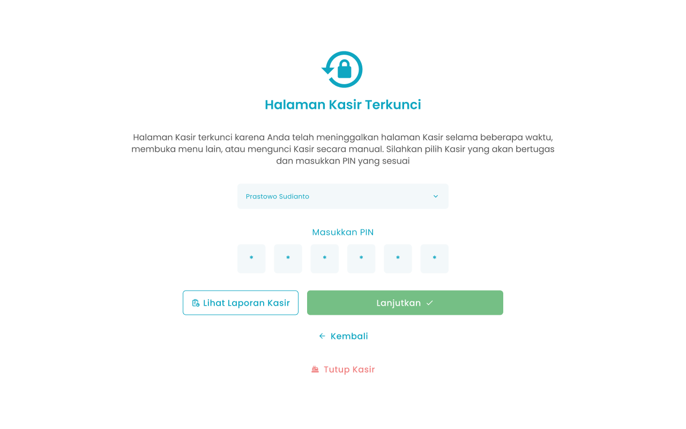

## **1.1. Cara Mengakses Kasir Ketika Terkunci**

Pada halaman awal setelah login dan mengakses menu Halaman Kasir, jika sudah membuka kasir atau kondisi kasir meninggalkan halaman selama beberapa menit maka akan menampilkan halaman kasir terkunci untuk masuk kembali ke halaman kasir

<Frame>
  
</Frame>

<table>
  <colgroup>
    <col width="50" />
    <col width="168" />
    <col width="445" />
  </colgroup>
  <thead>
    <tr>
      <th>No</th>
      <th>Simbol</th>
      <th>Keterangan</th>
    </tr>
  </thead>
  <tbody>
    <tr>
      <td>1</td>
      <td>Pilih Kasir</td>
      <td>Kolom untuk memilih kasir yang bertugas</td>
    </tr>
    <tr>
      <td>2</td>
      <td>PIN</td>
      <td>Kolom untuk input PIN Kasir</td>
    </tr>
    <tr>
      <td>3</td>
      <td>Lanjutkan</td>
      <td>Tombol untuk konfirmasi buka kunci kasir</td>
    </tr>
    <tr>
      <td>4</td>
      <td>Lihat Laporan Kasir</td>
      <td>Tombol untuk mengakses laporan kasir aktif</td>
    </tr>
    <tr>
      <td>5</td>
      <td>Kembali</td>
      <td>Tombol untuk kembali ke halaman dashboard</td>
    </tr>
    <tr>
      <td>6</td>
      <td>Tutup Kasir</td>
      <td>Tombol untuk tutup kasir</td>
    </tr>
  </tbody>
</table>

**Berikut cara mengakses menu kasir:**

1. Tekan ikon tiga garis di pojok kiri atas
   <Frame>
     
   </Frame>
2. Setelah menekan ikon, maka akan menampilkan sidebar list menu
   <Frame>
     
   </Frame>
3. Tekan menu Halaman Kasir pada list menu
4. Setelah menekan menu Halaman Kasir maka akan menampilkan halaman kasir terkunci
5. Pilih nama user kasir
   <Frame>
     
   </Frame>
6. Ketuk kolom PIN
   <Frame>
     
   </Frame>
7. Masukkan PIN menggunakan keyboard default.
8. Setelah mengisi nama user kasir dan PIN, kemudian tekan tombol “Lanjutkan”
   <Frame>
     
   </Frame>
9. Setelah selesai menekan tombol, maka akan menampilkan pesan sukses masuk halaman kasir dan diarahkan ke halaman kasir
