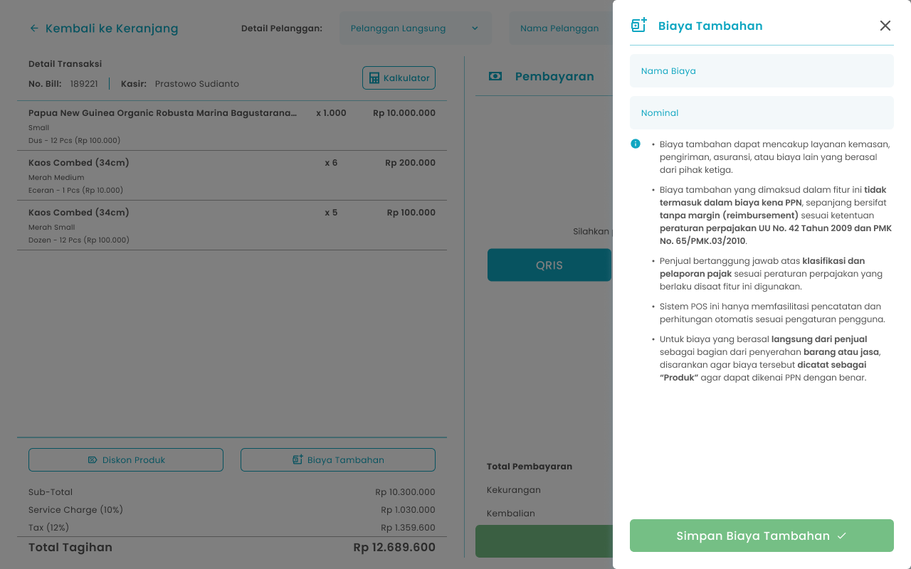
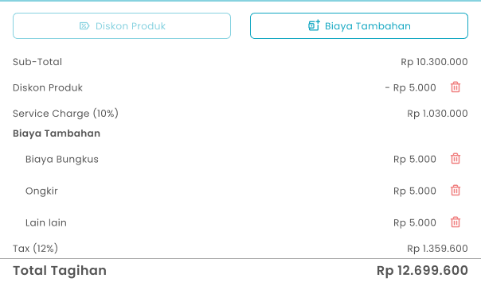

## **1.1. Cara Menambahkan Biaya Tambahan di Transaksi Pemesanan**

Kasir dapat menambahkan biaya tambahan pada pesanan pelanggan sebelum melakukan pembayaran

<table>
  <colgroup>
    <col width="50" />
    <col width="208" />
    <col width="419" />
  </colgroup>
  <thead>
    <tr>
      <th>No</th>
      <th>Simbol</th>
      <th>Keterangan</th>
    </tr>
  </thead>
  <tbody>
    <tr>
      <td>1</td>
      <td>Nama Biaya</td>
      <td>Kolom untuk input nama biaya tambahan</td>
    </tr>
    <tr>
      <td>2</td>
      <td>Nominal</td>
      <td>Kolom untuk input jumlah biaya tambahan</td>
    </tr>
    <tr>
      <td>3</td>
      <td>Simpan Biaya Tambahan</td>
      <td>Tombol untuk menyimpan biaya tambahan kedalam pesanan</td>
    </tr>
  </tbody>
</table>

**Cara Menambahkan Biaya Tambahan**

1. Input item pesanan yang perlu di masukkan pada keranjang
   <Frame>
     .png "Android Expanded 171 (1fgyt)")
   </Frame>
2. Setelah input pesanan, kemudian tekan tombol “Checkout”
   <Frame>
     .png "Frame 1366 (2frgh)")
   </Frame>
3. Setelah menekan tombol, maka akan menampilkan halaman checkout
4. Tekan tombol “Biaya Tambahan”
   <Frame>
     .png "Frame 959 (1ggdf)")
   </Frame>
5. Setelah menekan tombol, maka akan menampilkan halaman biaya tambahan
6. Masukkan nama biaya di kolom nama biaya
   <Frame>
     .png "Input Right Icon (37fdgtr)")
   </Frame>
7. Masukkan jumlah nominal biaya tambahan di kolom nominal
   <Frame>
     .png "Input Right Icon (38gvtrb)")
   </Frame>
8. Setelah selesai mengisi biaya tambahan, kemudian tekan tombol “Simpan Biaya Tambahan”
   <Frame>
     .png "Frame 1367 (2cdxbjy)")
   </Frame>
9. Setelah selesai menekan tombol, maka akan menampilkan pesan sukses menambahkan biaya tambahan dan menampilkan jumlah biaya tambahan di halaman checkout
10. **Cara Menghapus Biaya Tambahan**
11. Tekan tombol hapus di kolom biaya tambahan 
    <Frame>
      
    </Frame>
12. Setelah menekan tombol, maka akan menampilkan halaman konfirmasi hapus biaya tambahan
    <Frame>
      .png "Frame 1334 (1eretref)")
    </Frame>
13. Tekan tombol “Ya, Saya Yakin” di halaman konfirmasi untuk melanjutkan proses hapus biaya tambahan
    <Frame>
      .png "Button 45e(11)")
    </Frame>
14. Tekan tombol “Tidak” di halaman konfirmasi untuk membatalkan hapus biaya tambahan
    <Frame>
      
    </Frame>
15. Setelah menekan tombol “Ya, Saya Yakin”,  maka akan menampilkan sukses menghapus biaya tambahan
