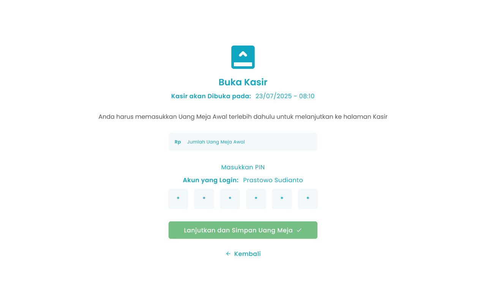

Pada halaman awal setelah login dan mengakses menu Halaman Kasir dan kondisi sudah tutup kasir atau pertama kali mengakses menu kasir maka anda wajib membuka kasir untuk menandai awal shift kasir dan input saldo awal sebagai kembalian

<Frame>
  
</Frame>

<table>
  <colgroup>
    <col width="50" />
    <col width="284" />
    <col width="325" />
  </colgroup>
  <thead>
    <tr>
      <th>No</th>
      <th>Simbol</th>
      <th>Keterangan</th>
    </tr>
  </thead>
  <tbody>
    <tr>
      <td>1</td>
      <td>Jumlah Uang Meja Awal</td>
      <td>Kolom untuk mengisi nominal uang meja awal</td>
    </tr>
    <tr>
      <td>2</td>
      <td>PIN</td>
      <td>Kolom untuk input PIN Kasir</td>
    </tr>
    <tr>
      <td>3</td>
      <td>Lanjutkan dan Simpan Uang Meja</td>
      <td>Tombol untuk konfirmasi buka kasir</td>
    </tr>
    <tr>
      <td>4</td>
      <td>Kembali</td>
      <td>Tombol untuk kembali ke halaman dashboard</td>
    </tr>
  </tbody>
</table>

## **1.1. Cara Mengakses Kasir Pertama Kali**

Pada halaman awal setelah login dan mengakses menu Halaman Kasir, jika belum membuka kasir atau sebelumnya sudah melakukan tutup kasir maka akan menampilkan halaman buka kasir untuk menambahkan uang meja kasir sebelum melakukan transaksi pemesanan.

**Berikut cara mengakses menu kasir:**

1. Tekan ikon tiga garis di pojok kiri atas

<Frame>
  
</Frame>

2. Setelah menekan ikon, maka akan menampilkan sidebar list menu

<Frame>
  
</Frame>

3. Tekan menu Halaman Kasir pada list menu 
4. Setelah menekan menu Halaman Kasir maka akan menampilkan halaman buka kasir
5. Ketuk kolom jumlah uang meja awal

<Frame>
  
</Frame>

6. Masukkan nominal uang meja awal di kolom numpad
7. Setelah selesai mengisi uang meja awal, kemudian tekan tombol “Submit”
8. Ketuk kolom PIN

<Frame>
  
</Frame>

9. Masukkan PIN menggunakan keyboard default.
10. Setelah mengisi uang meja awal dan PIN, kemudian tekan tombol “Lanjutkan dan Simpan Uang Meja”

<Frame>
  
</Frame>

12. Setelah selesai menekan tombol, maka akan menampilkan pesan sukses buka kasir dan diarahkan ke halaman kasir
