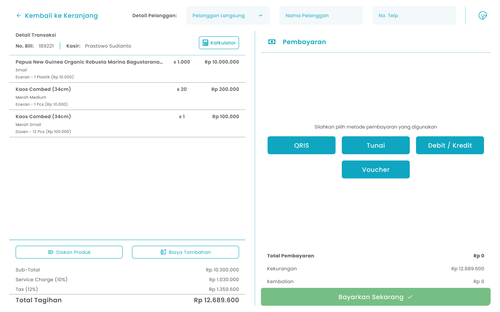
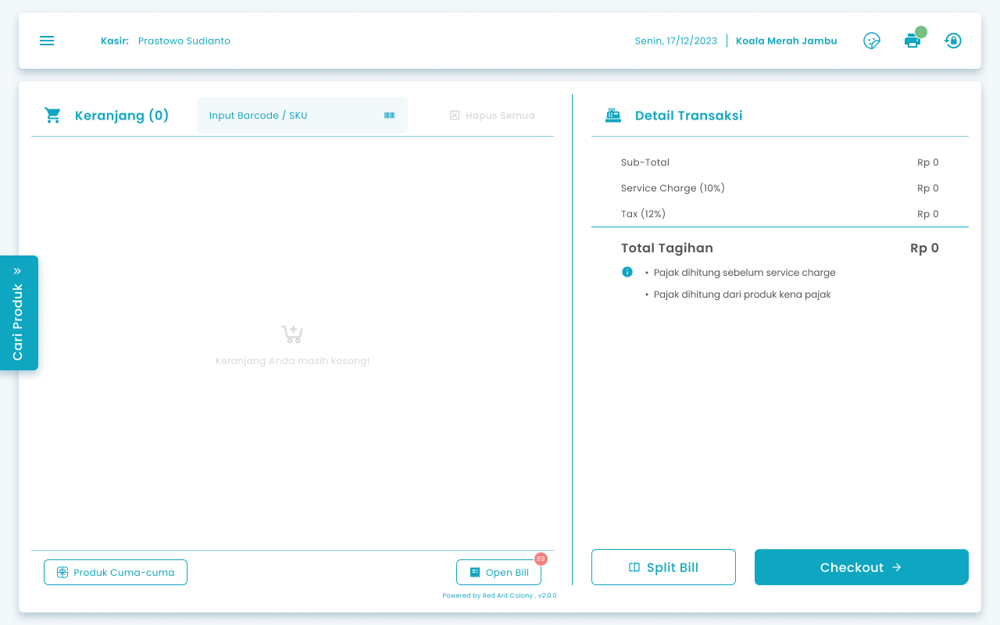
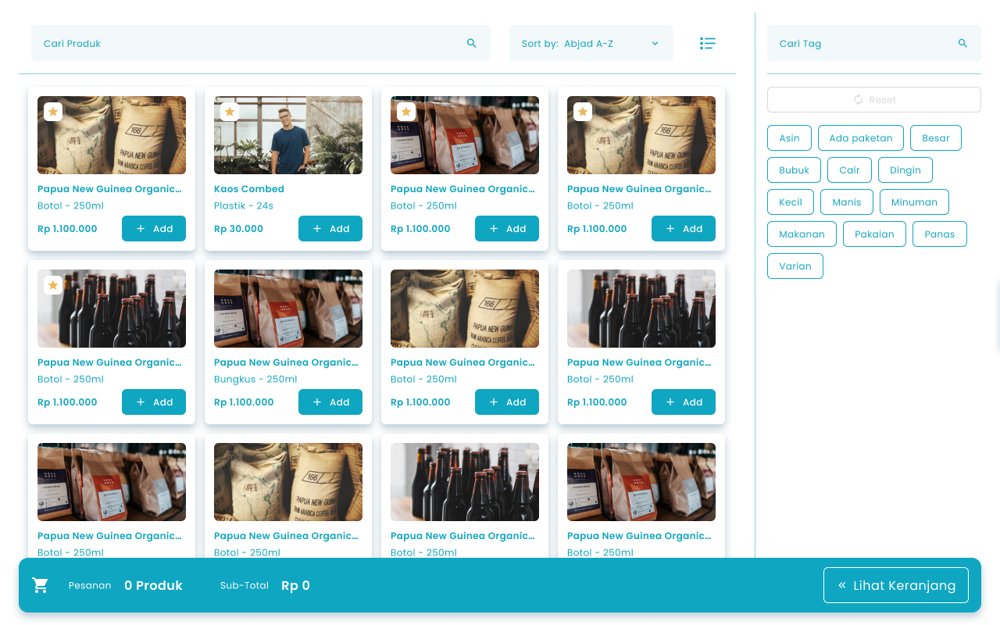
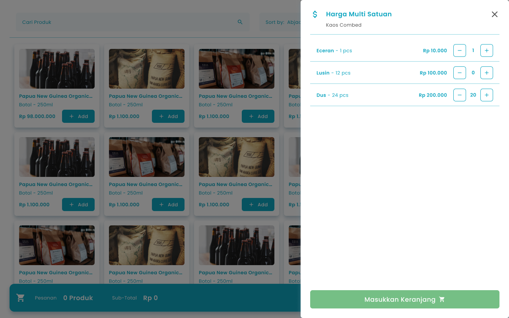
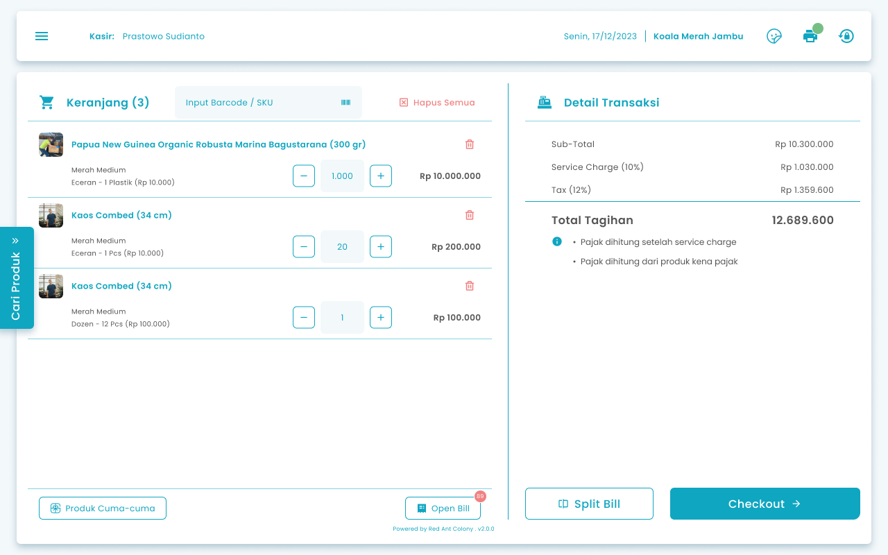
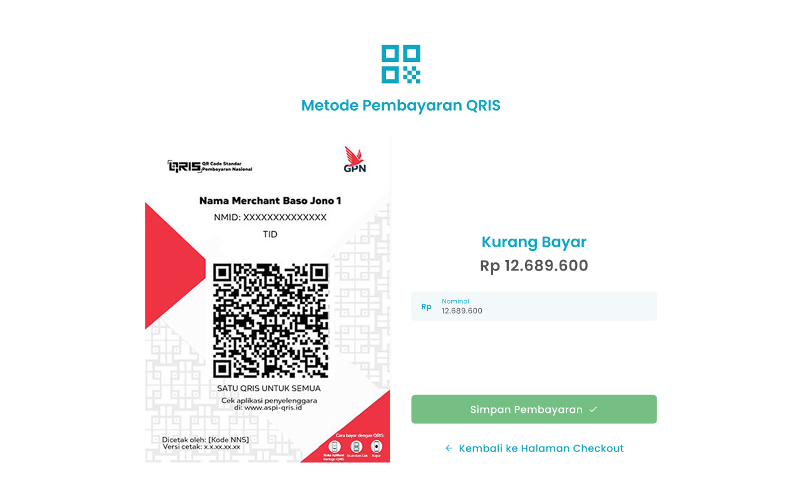
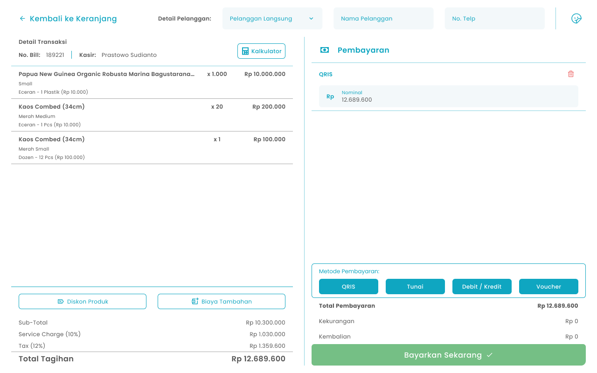
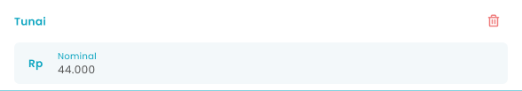
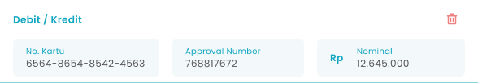
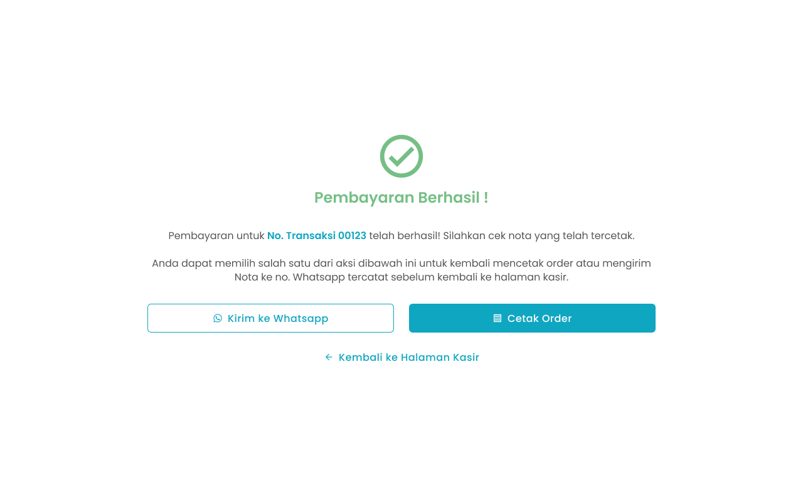

## **1.5. Cara Memproses Pembayaran di Transaksi Pemesanan**

Kasir dapat memproses transaksi pelanggan dari mulai input item pesanan hingga memproses pembayaran

<Frame>
  
</Frame>

<table>
  <colgroup>
    <col width="50" />
    <col width="208" />
    <col width="412" />
  </colgroup>
  <thead>
    <tr>
      <th>No</th>
      <th>Simbol</th>
      <th>Keterangan</th>
    </tr>
  </thead>
  <tbody>
    <tr>
      <td>1</td>
      <td>List Pesanan</td>
      <td>Tabel pesanan pelanggan</td>
    </tr>
    <tr>
      <td>2</td>
      <td>Kalkulator</td>
      <td>Tombol untuk menghitung pesanan pelanggan</td>
    </tr>
    <tr>
      <td>3</td>
      <td>QRIS</td>
      <td>Tombol untuk memilih metode pembayaran QRIS, muncul jika sudah diaktifkan di master data</td>
    </tr>
    <tr>
      <td>4</td>
      <td>Tunai</td>
      <td>Tombol untuk memilih metode pembayaran tunai, muncul jika sudah diaktifkan di master data</td>
    </tr>
    <tr>
      <td>5</td>
      <td>Debit/Kredit</td>
      <td>Tombol untuk memilih metode pembayaran debit/kredit, muncul jika sudah diaktifkan di master data</td>
    </tr>
    <tr>
      <td>6</td>
      <td>Voucher</td>
      <td>Tombol untuk menambahkan voucher di pesanan, muncul jika sudah diaktifkan di master data</td>
    </tr>
    <tr>
      <td>7</td>
      <td>Bayar Sekarang</td>
      <td>Tombol untuk memproses pembayaran pesanan</td>
    </tr>
    <tr>
      <td>8</td>
      <td>Pilih Pelanggan Member</td>
      <td>Tombol untuk memilih pelanggan member</td>
    </tr>
    <tr>
      <td>9</td>
      <td>Input Pelanggan Non Member</td>
      <td>Tombol untuk mengisi nama pelanggan</td>
    </tr>
    <tr>
      <td>10</td>
      <td>No Telp Pelanggan</td>
      <td>Tombol untuk mengisi no telp pelanggan</td>
    </tr>
    <tr>
      <td>11</td>
      <td>Diskon Produk</td>
      <td>Tombol untuk input diskon transaksi</td>
    </tr>
    <tr>
      <td>12</td>
      <td>Biaya Tambahan</td>
      <td>Tombol untuk mengisi biaya tambahan transaksi</td>
    </tr>
  </tbody>
</table>

**Berikut cara mengakses menu pembayaran transaksi:**

1. Tekan tombol “Cari Produk” di halaman Keranjang Kasir
   <Frame>
     
   </Frame>
2. Setelah menekan tombol, maka akan menampilkan halaman list produk
   <Frame>
     
   </Frame>

<table>
  <colgroup>
    <col width="50" />
    <col width="139" />
    <col width="478" />
  </colgroup>
  <thead>
    <tr>
      <th>No</th>
      <th>Simbol</th>
      <th>Keterangan</th>
    </tr>
  </thead>
  <tbody>
    <tr>
      <td>1</td>
      <td>Cari Produk</td>
      <td>Tombol untuk mencari produk</td>
    </tr>
    <tr>
      <td>2</td>
      <td>Urutkan Produk</td>
      <td>Tombol untuk mengurutkan produk</td>
    </tr>
    <tr>
      <td>3</td>
      <td>Grid/List</td>
      <td>Tombol untuk mengubah tampilan produk dengan card atau list</td>
    </tr>
    <tr>
      <td>4</td>
      <td>Cari Tag</td>
      <td>Tombol untuk mencari tag produk</td>
    </tr>
    <tr>
      <td>5</td>
      <td>Reset</td>
      <td>Tombol untuk unchecklist semua tag yang sudah dipilih</td>
    </tr>
    <tr>
      <td>6</td>
      <td>List Tag</td>
      <td>Tombol untuk filter produk berdasarkan tag</td>
    </tr>
    <tr>
      <td>7</td>
      <td>Card Produk</td>
      <td>Tombol untuk melihat detail produk dan menambahkan produk ke keranjang</td>
    </tr>
    <tr>
      <td>8</td>
      <td>Lihat Keranjang</td>
      <td>Tombol untuk melihat keranjang pesanan</td>
    </tr>
  </tbody>
</table>

3. Tekan tombol “Add” pada salah satu produk untuk menambahkan produk ke keranjang
   <Frame>
     
   </Frame>
4. **Jika Tipe Produk Biasa atau Produk Paduan**
5. Setelah menekan tombol, maka akan menambahkan produk ke keranjang
6. **Jika Tipe Produk Biasa dengan Multi Satuan atau Produk Varian**
7. Setelah menekan tombol, maka akan menampilkan halaman harga multi satuan dari produk tersebut
   <Frame>
     
   </Frame>
8. Masukkan jumlah pesanan yang akan ditambahkan ke keranjang pesanan atau tekan tombol +/- untuk menambahkan kuantiti
   <Frame>
     
   </Frame>
9. Setelah mengisi jumlah pesanan, kemudian tekan tombol “Masukkan Keranjang”
   <Frame>
     .png "Frame 1366 (dffr1)")
   </Frame>
10. Setelah menekan tombol, maka akan menambahkan produk ke keranjang
11. Setelah selesai input produk ke keranjang, kemudian tekan tombol “Lihat Keranjang”
    <Frame>
      
    </Frame>
12. Setelah menekan tombol, maka akan menampilkan halaman keranjang kasir dengan list item pesanan, pada halaman ini anda masih dapat mengubah kuantitas item pesanan
    <Frame>
      
    </Frame>
13. Setelah selesai input pesanan, kemudian tekan tombol “Checkout”
    <Frame>
      .png "Frame 1366 (2frgh)")
    </Frame>
14. Setelah menekan tombol, maka akan menampilkan halaman checkout pembayaran
15. **Input pelanggan member**
16. Pilih pelanggan langsung di kolom pelanggan langsung
    <Frame>
      .png "Input Right Icon (31sdr)")
    </Frame>
17. Setelah menekan tombol, maka akan menampilkan list member
18. Pilih salah satu member
19. **Input pelanggan bukan member**
20. Masukkan nama pelanggan di kolom nama pelanggan
    <Frame>
      .png "Input Right Icon (32wsqad)")
    </Frame>
21. Masukkan no telp pelanggan di kolom no telp
    <Frame>
      .png "Input Right Icon (3dsfth3)")
    </Frame>
22. **Jika Pembayaran Menggunakan Metode Pembayaran QRIS**
23. Tekan tombol “QRIS”
    <Frame>
      .png "Frame 1365 (1sdgjk)")
    </Frame>
24. Setelah menekan tombol, maka akan menampilkan halaman pembayaran QRIS
    <Frame>
      
    </Frame>
25. Masukkan jumlah nominal pembayaran pelanggan di kolom nominal
    <Frame>
      .png "Input Right Icon (34ertyhg)")
    </Frame>
26. Setelah selesai mengisi jumlah nominal pembayaran, kemudian tekan tombol “Simpan Pembayaran”
    <Frame>
      
    </Frame>
27. Setelah menekan tombol maka akan menampilkan nominal pembayaran di halaman checkout
    <Frame>
      
    </Frame>
28. **Jika Pembayaran Menggunakan Metode Pembayaran Tunai**
29. Tekan tombol “Tunai”
    <Frame>
      
    </Frame>
30. Setelah menekan tombol, maka akan menampilkan kolom input nominal tunai
    <Frame>
      
    </Frame>
31. Masukkan jumlah nominal pembayaran pelanggan di kolom nominal
32. **JIka Pembayaran Menggunakan Metode Pembayaran Debit/Kredit**
33. Tekan tombol “Debit/Kredit”
    <Frame>
      .png "Frame 1366 (3cvdcx)")
    </Frame>
34. Setelah menekan tombol, maka akan menampilkan kolom input nominal debit/kredit
    <Frame>
      
    </Frame>
35. Masukkan no kartu debit/kredit di kolom no kartu
36. Masukkan approval number di kolom approval number
37. Masukkan jumlah nominal pembayaran pelanggan di kolom nominal
38. **Proses Pembayaran**
39. Setelah selesai mengisi nominal pembayaran, kemudian tekan tombol “Bayarkan Sekarang”
    <Frame>
      
    </Frame>
40. Setelah selesai menekan tombol, maka akan menampilkan halaman konfirmasi pembayaran transaksi
    <Frame>
      .png "Frame 1336 (7sdvdse)")
    </Frame>
41. Tekan tombol “Ya, Saya Yakin” di halaman konfirmasi untuk melanjutkan proses pembayaran transaksi
    <Frame>
      
    </Frame>
42. Tekan tombol “Tidak” di halaman konfirmasi untuk membatalkan proses pembayaran transaksi
    <Frame>
      
    </Frame>
43. Setelah menekan tombol “Ya, Saya Yakin”,  maka akan menampilkan halaman pembayaran sukses
    <Frame>
      
    </Frame>
44. **Cara Mengirim nota ke No Whatsapp**
45. Tekan tombol “Kirim ke Whatsapp”
    <Frame>
      .png "Frame 1367 (1erfsfg)")
    </Frame>
46. **Jika pelanggan merupakan member maka nota akan dikirimkan sesuai nomor whatsapp pelanggan**
47. **Jika pelanggan bukan merupakan member maka akan menampilkan halaman input no whatsapp**
    <Frame>
      
    </Frame>
48. Masukkan no whatsapp pelanggan di kolom no whatsapp pelanggan
49. Tekan tombol “Kirim ke Whatsapp” di halaman input no whatsapp untuk melanjutkan proses kirim nota
50. Tekan tombol “Tidak” di halaman  input no whatsapp untuk membatalkan proses kirim nota
51. Setelah menekan tombol “Kirim ke Whatsapp”, maka akan menampilkan pesan sukses kirim nota ke whatsapp
52. **Cara mencetak Nota Pesanan**
53. Tekan tombol “Cetak Order”
    <Frame>
      .png "Frame 1366 (4ytuehbru)")
    </Frame>
54. Setelah menekan tombol maka akan menampilkan list printer kasir yang terhubung
    <Frame>
      .png "Android Expanded 486 (1rtge)")
    </Frame>
55. Tekan tombol refresh untuk memindai ulang perangkat printer kasir
    <Frame>
      
    </Frame>
56. Tekan tombol printer di salah satu list printer yang terhubung
    <Frame>
      .png "Material Symbols Print (dfdr1)")
    </Frame>
57. Setelah menekan tombol, maka akan menampilkan pesan sukses cetak nota dan mencetak nota di printer kasir

<table>
  <colgroup>
    <col width="101" />
    <col width="565" />
  </colgroup>
  <thead>
    <tr>
      <td style={{ textAlign: "center" }}>**🛈** **Information**</td>
      <td>Anda perlu menghubungkan printer kasir dengan perangkat android anda sebelum melakukan cetak order</td>
    </tr>
  </thead>
</table>
