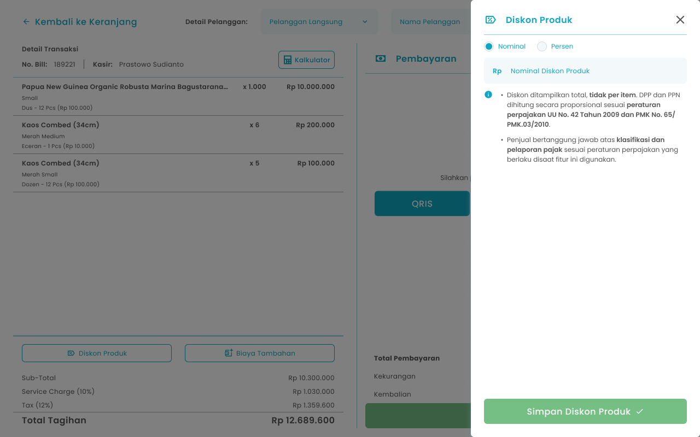
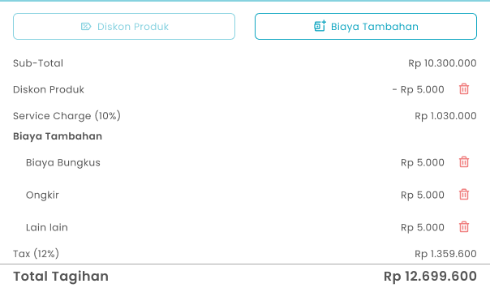

## **1.1. Cara Menambahkan Potongan di Transaksi Pemesanan**

Kasir dapat menambahkan potongan biaya pada pesanan pelanggan sebelum melakukan pembayaran

<Frame>
  
</Frame>

<table>
  <colgroup>
    <col width="54" />
    <col width="190" />
    <col width="430" />
  </colgroup>
  <thead>
    <tr>
      <th>No</th>
      <th>Simbol</th>
      <th>Keterangan</th>
    </tr>
  </thead>
  <tbody>
    <tr>
      <td>1</td>
      <td>Jenis diskon</td>
      <td>Kolom untuk memilih jenis diskon persen atau nominal</td>
    </tr>
    <tr>
      <td>2</td>
      <td>Input diskon</td>
      <td>Kolom untuk input jumlah diskon</td>
    </tr>
    <tr>
      <td>3</td>
      <td>Simpan Diskon Produk</td>
      <td>Tombol untuk menambahkan diskon produk</td>
    </tr>
  </tbody>
</table>

**Cara Menambahkan Potongan**

1. Input item pesanan yang perlu di masukkan pada keranjang
   <Frame>
     .png "Android Expanded 171 (1fgyt)")
   </Frame>
2. Setelah input pesanan, kemudian tekan tombol “Checkout”
   <Frame>
     
   </Frame>
3. Setelah menekan tombol, maka akan menampilkan halaman checkout
4. Setelah input pesanan, kemudian tekan tombol “Diskon Produk”
   <Frame>
     .png "Frame 960 (2fght)")
   </Frame>
5. Setelah menekan tombol, maka akan menampilkan halaman potongan biaya
6. Pilih tipe potongan nominal atau persen
   <Frame>
     
   </Frame>
7. **Jika memilih tipe nominal**
8. Masukkan jumlah nominal potongan di kolom nominal diskon produk
   <Frame>
     .png "Input Right Icon (35dfer)")
   </Frame>
9. **Jika memilih tipe persen**
10. Masukkan jumlah persen potongan pada kolom persen diskon produk. Untuk nilai desimal, gunakan tanda koma (,) sebagai pemisah.
    <Frame>
      .png "Input Right Icon (36xswaq)")
    </Frame>
11. Setelah selesai mengisi jumlah potongan, kemudian tekan tombol “Simpan Diskon Produk”
    <Frame>
      .png "Frame 1369 (ret6t)")
    </Frame>
12. Setelah selesai menekan tombol, maka akan menampilkan pesan sukses menambahkan potongan harga dan menampilkan jumlah potongan harga di halaman kasir
13. **Cara Menghapus Potongan Biaya**
14. Tekan tombol hapus di kolom Diskon halaman checkout
    <Frame>
      
    </Frame>
15. Setelah menekan tombol, maka akan menampilkan halaman konfirmasi hapus potongan
    <Frame>
      .png "Frame 1205 (5asxzd)")
    </Frame>
16. Tekan tombol “Ya, Saya Yakin” di halaman konfirmasi untuk melanjutkan proses hapus potongan
    <Frame>
      .png "Button 45e(11)")
    </Frame>
17. Tekan tombol “Tidak” di halaman konfirmasi untuk membatalkan hapus potongan
    <Frame>
      
    </Frame>
18. Setelah menekan tombol “Ya, Saya Yakin”,  maka akan menampilkan sukses menghapus potongan
