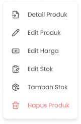

Perubahan harga produk dapat terjadi di salah satu toko maupun beberapa toko. Zycas memungkinkan anda untuk mengubah harga dengan cepat pada toko yang spesifik

<Frame>
  
</Frame>

<table>
  <colgroup>
    <col width="50" />
    <col width="159" />
    <col width="505" />
  </colgroup>
  <thead>
    <tr>
      <th>No</th>
      <th>Simbol</th>
      <th>Keterangan</th>
    </tr>
  </thead>
  <tbody>
    <tr>
      <td>1</td>
      <td>Tipe Harga Multi Satuan</td>
      <td>Kolom untuk memilih tipe harga grosir atau multi kemasan di masing masing toko</td>
    </tr>
    <tr>
      <td>2</td>
      <td>Nama Satuan</td>
      <td>Kolom untuk mengisi nama satuan di masing masing toko</td>
    </tr>
    <tr>
      <td>3</td>
      <td>Kuantiti</td>
      <td>Kolom untuk mengisi jumlah satuan yang dijual di masing masing toko</td>
    </tr>
    <tr>
      <td>4</td>
      <td>Nominal Harga</td>
      <td>Kolom untuk mengisi harga jual pada satuan tertentu di masing masing toko</td>
    </tr>
    <tr>
      <td>5</td>
      <td>Tambah Opsi Harga</td>
      <td>Tombol untuk menambahkan satuan harga di masing masing toko</td>
    </tr>
    <tr>
      <td>6</td>
      <td>Reset</td>
      <td>Tombol untuk mengembalikan perubahan harga sebelum diubah</td>
    </tr>
    <tr>
      <td>7</td>
      <td>Simpan Harga</td>
      <td>Tombol untuk menyimpan perubahan harga produk</td>
    </tr>
    <tr>
      <td>8</td>
      <td>Batal</td>
      <td>Tombol untuk membatalkan proses edit harga produk</td>
    </tr>
  </tbody>
</table>

## 1.1. Cara Mengubah Harga Produk

**Berikut Cara Mengubah Harga Produk:**

1. Tekan tombol titik tiga di salah satu produk/varian di list produk organisasi

<Frame>
  
</Frame>

2. Setelah menekan tombol, maka akan menampilkan opsi menu

<Frame>
  
</Frame>

3. Tekan tombol edit harga
4. Setelah menekan tombol maka akan menampilkan halaman edit harga produk
5. **Menambahkan Harga Multi Satuan**
6. Anda dapat menambahkan harga multi satuan produk dengan menekan tombol tambah opsi harga sebanyak opsi harga yang diperlukan di toko tertentu
   <Frame>
     .png "Button (33ssfss)")
   </Frame>
7. Setelah menekan tombol maka akan menambahkan kolom input satuan
8. Anda dapat mengubah pilihan harga multi satuan sebagai harga kemasan atau harga grosir di toko tertentu
   <Frame>
     
   </Frame>
9. Ubah atau masukkan nama satuan di kolom satuan
   <Frame>
     .png "Input (3dsdasda5)")
   </Frame>
10. Ubah atau masukkan kuantiti di kolom kuantiti di toko tertentu
    <Frame>
      .png "Input (34sqsasa)")
    </Frame>
11. Ubah atau masukkan nominal satuan di kolom nominal harga di toko tertentu
    <Frame>
      .png "Input (33sdeefs)")
    </Frame>
12. Tekan tombol "Reset" untuk mengembalikan data sebelum diubah di toko tertentu
    <Frame>
      
    </Frame>
13. Tekan tombol hapus untuk menghapus satuan harga di toko tertentu
    <Frame>
      .png "Button (32xdgg)")
    </Frame>
14. Setelah selesai mengubah data harga produk, kemudian tekan tombol “Simpan Harga”
    <Frame>
      .png "Button (31xdcf)")
    </Frame>
15. Setelah menekan tombol, maka akan menampilkan halaman konfirmasi perubahan harga
    <Frame>
      .png "Alter Dialog (22aaqa)")
    </Frame>
16. Tekan tombol “Ya, Saya Yakin” di halaman konfirmasi untuk melanjutkan proses simpan perubahan harga produk
    <Frame>
      .png "Button2q (1)")
    </Frame>
17. Tekan tombol “Tidak” di halaman konfirmasi untuk membatalkan simpan perubahan harga produk
    <Frame>
      .png "Button2sa (2)")
    </Frame>
18. Setelah menekan tombol “Ya, Saya Yakin”,  maka akan menampilkan pesan sukses edit harga produk
