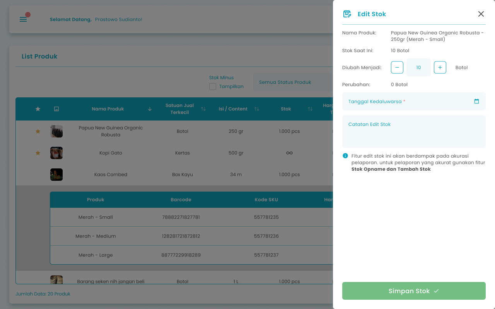

## 1.1. Cara Mengubah Stok Produk

Menu Edit Stok Produk adalah menu yang dapat digunakan untuk mengubah stok produk. Untuk mengakses halaman ini adalah dengan klik tombol “Edit Stok” di halaman list produk.

<Frame>
  
</Frame>

<table>
  <colgroup>
    <col width="51" />
    <col width="172" />
    <col width="448" />
  </colgroup>
  <thead>
    <tr>
      <th>No</th>
      <th>Simbol</th>
      <th>Keterangan</th>
    </tr>
  </thead>
  <tbody>
    <tr>
      <td>1</td>
      <td>Diubah Menjadi</td>
      <td>Tombol untuk mengisi jumlah perubahan stok produk</td>
    </tr>
    <tr>
      <td>2</td>
      <td>Tanggal Kadaluarsa</td>
      <td>Tombol untuk mengisi tanggal kadaluarsa</td>
    </tr>
    <tr>
      <td>3</td>
      <td>Catatan Edit Stok</td>
      <td>Tombol untuk mengisi catatan perubahan stok</td>
    </tr>
    <tr>
      <td>4</td>
      <td>Simpan Stok</td>
      <td>Tombol menyimpan data perubahan stok</td>
    </tr>
  </tbody>
</table>

**Berikut Cara Mengubah Stok Produk**

1. Tekan tombol edit stok pada salah satu produk/varian di halaman list produk
   <Frame>
     
   </Frame>
2. Setelah menekan tombol maka akan menampilkan halaman edit stok produk
3. Masukkan tanggal kadaluarsa jika ada
   <Frame>
     .png "Input Right Icon (18tftf)")
   </Frame>
4. Masukkan jumlah perubahan stok di kolom diubah menjadi
   <Frame>
     
   </Frame>
5. **Jika jumlah perubahan stok melebihi stok saat ini, maka masukkan harga modal**
   <Frame>
     .png "Input Right Icon (2sdedws9)")
   </Frame>
6. Masukkan catatan perubahan stok di kolom catatan edit stok
   <Frame>
     .png "Input Right Icon (30sefgtt)")
   </Frame>
7. Setelah selesai mengubah data stok produk, kemudian tekan tombol “Simpan Stok”
   <Frame>
     .png "Frame 1411 (6retertg)")
   </Frame>
8. Setelah menekan tombol, maka akan menampilkan halaman sukses edit stok dan kembali ke halaman list produk
