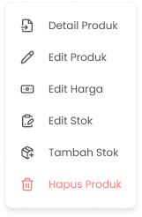

## 1.1. Cara Mengubah Stok Produk

Menu Edit Stok Produk adalah menu yang dapat digunakan untuk mengubah stok produk. Untuk mengakses halaman ini adalah dengan klik tombol “Edit Stok” di halaman list produk

<Frame>
  .png "Alter Dialog (21ssdwsx)")
</Frame>

<table>
  <colgroup>
    <col width="55" />
    <col width="180" />
    <col width="473" />
  </colgroup>
  <thead>
    <tr>
      <th>No</th>
      <th>Simbol</th>
      <th>Keterangan</th>
    </tr>
  </thead>
  <tbody>
    <tr>
      <td>1</td>
      <td>Diubah Menjadi</td>
      <td>Tombol untuk mengisi jumlah perubahan stok produk</td>
    </tr>
    <tr>
      <td>2</td>
      <td>Tanggal Kadaluarsa</td>
      <td>Tombol untuk mengisi tanggal kadaluarsa produk</td>
    </tr>
    <tr>
      <td>3</td>
      <td>Catatan Edit Stok</td>
      <td>Tombol untuk mengisi catatan perubahan stok</td>
    </tr>
    <tr>
      <td>4</td>
      <td>Simpan Stok</td>
      <td>Tombol menyimpan data perubahan stok</td>
    </tr>
  </tbody>
</table>

**Berikut Cara Mengubah Stok Produk**

1. Tekan tombol titik tiga di salah satu produk/varian di list produk organisasi

<Frame>
  
</Frame>

2. Setelah menekan tombol, maka akan menampilkan opsi menu

<Frame>
  
</Frame>

3. Tekan tombol edit stok
4. Setelah menekan tombol maka akan menampilkan halaman edit stok produk
5. Masukkan jumlah perubahan stok di kolom diubah menjadi
   <Frame>
     .png "Input (29dwsax)")
   </Frame>
6. Jika jumlah perubahan stok melebihi stok saat ini, maka perlu input harga modal dari produk
   <Frame>
     .png "Input (30dsxw)")
   </Frame>
7. Masukkan tanggal kadaluarsa produk jika produk terdapat masa kadaluarsanya
   <Frame>
     .png "Input (31ssax)")
   </Frame>
8. Masukkan catatan perubahan stok di kolom catatan edit stok
   <Frame>
     .png "Input (3sdwc2)")
   </Frame>
9. Setelah selesai mengubah data stok produk, kemudian tekan tombol “Simpan Stok”
   <Frame>
     .png "Button (30saxs)")
   </Frame>
10. Setelah menekan tombol, maka akan menampilkan halaman sukses edit stok dan kembali ke halaman list produk
