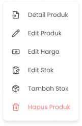

## 1.1. Cara Menghapus Produk

Menu Hapus Produk adalah menu yang dapat digunakan untuk menghapus data produk dari list. Untuk mengakses halaman ini adalah dengan klik tombol “Hapus Produk” di halaman list produk

**Berikut Cara Menghapus Produk:**

1. Tekan tombol titik tiga di salah satu produk/varian di list produk kelola organisasi

<Frame>
  
</Frame>

2. Setelah menekan tombol, maka akan menampilkan opsi menu

<Frame>
  
</Frame>

3. Tekan tombol "Hapus Produk"
4. Setelah menekan tombol, maka akan menampilkan pop up konfirmasi hapus produk

<Frame>
  .png "Alter Dialog (20erwerwdd)")
</Frame>

5. Tekan tombol “Ya, Saya Yakin” di halaman konfirmasi untuk melanjutkan proses hapus produk/varian

<Frame>
  .png "Button 45e(11)")
</Frame>

6. Tekan tombol “Tidak” di halaman konfirmasi untuk membatalkan hapus produk/varian

<Frame>
  .png "Button2sa (2)")
</Frame>

7. Setelah menekan tombol “Ya, Saya Yakin”,  maka akan mengarahkan ke halaman halaman list produk dan produk akan terhapus dari list produk

<table>
  <colgroup>
    <col width="121" />
    <col width="595" />
  </colgroup>
  <thead>
    <tr>
      <th style={{ textAlign: "center" }}>**🛈** **Information**</th>
      <th>Jika produk/varian merupakan komponen produk paduan maka produk/varian tersebut tidak dapat dihapus dan menampilkan pop up list produk paduan yang menggunakan produk tersebut</th>
    </tr>
  </thead>
</table>
