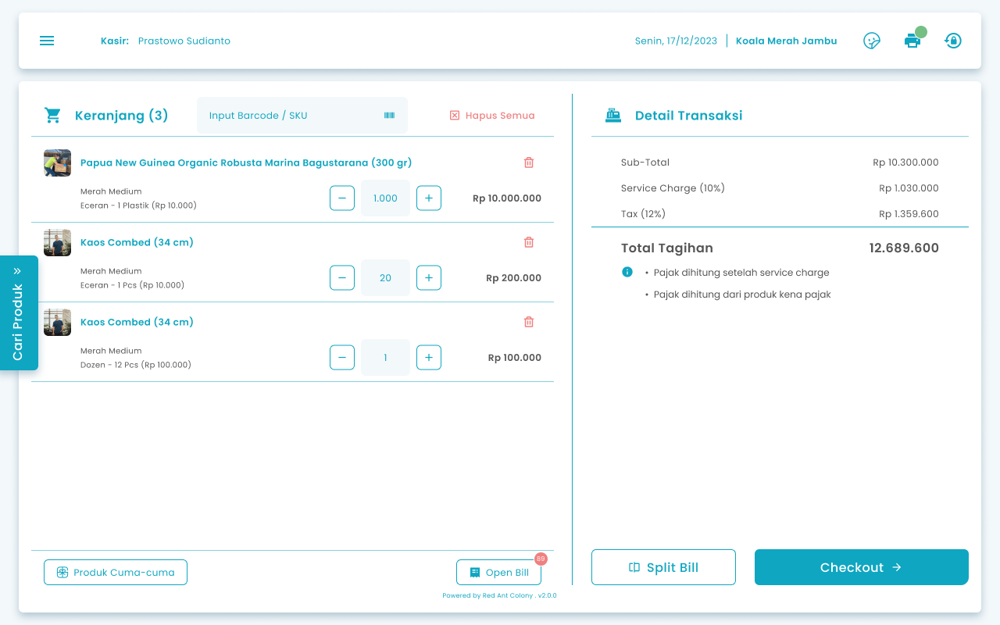
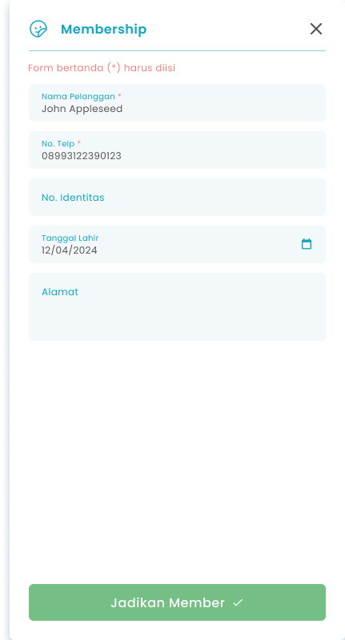
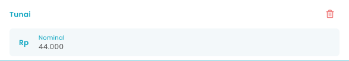

## **1.1. Cara Melakukan Transaksi Hutang**

Pada halaman awal setelah login jika kondisi kasir berada di halaman kasir untuk memproses pesanan hutang pelanggan member.

**Berikut cara mengakses menu Hutang:**

1. Input item pesanan ke keranjang
   <Frame>
     
   </Frame>
2. Setelah input pesanan, kemudian tekan tombol “Checkout”
   <Frame>
     .png "Frame 1366 (2frgh)")
   </Frame>
3. Setelah menekan tombol, sistem akan menampilkan halaman checkout
4. **Jika pelanggan sebelumnya bukan member maka perlu ditambahkan sebagai member**
5. Tekan tombol "Tambah Member"
   <Frame>
     
   </Frame>
6. Setelah menekan tombol maka akan menampilkan kolom input member
   <Frame>
     
   </Frame>
7. Masukkan nama pelanggan di kolom nama pelanggan
8. Masukkan no telp di kolom no telp
9. Masukkan no identitas di kolom no identitas
10. Masukkan tanggal lahir di kolom tanggal lahir
11. Masukkan alamat di kolom alamat
12. Setelah selesai mengisi data member, tekan tombol "Jadikan Member"
    <Frame>
      .png "Frame 1367 (7dsdded)")
    </Frame>
13. **Jika pelanggan sudah menjadi member**
14. Tekan tombol “Pelanggan Langsung”
    <Frame>
      .png "Input Right Icon (31sdr)")
    </Frame>
15. Setelah menekan tombol, maka akan menampilkan list member
16. Pilih salah satu pelanggan
17. **Jika pembayaran pesanan menggunakan tunai**
18. Tekan tombol "Tunai"
    <Frame>
      
    </Frame>
19. Setelah memilih memilih metode pembayaran maka akan menampilkan kolom untuk input nominal pembayaran
    <Frame>
      
    </Frame>
20. Anda dapat memasukkan **nominal pembayaran kurang dari total semua biaya pesanan** di kolom nominal
21. Setelah selesai mengisi nominal pembayaran, kemudian tekan tombol “Bayarkan Sekarang”
    <Frame>
      
    </Frame>
22. Setelah menekan tombol, maka akan menampilkan halaman konfirmasi pembayaran hutang
    <Frame>
      .png "Frame 1334 (2dfdfdf)")
    </Frame>
23. Masukkan tanggal estimasi pembayaran hutang
    <Frame>
      .png "Input Right Icon (46sdsdedf)")
    </Frame>
24. Tekan tombol “Ya, Saya Yakin” di halaman konfirmasi untuk melanjutkan proses transaksi
    <Frame>
      .png "Button 45e(11)")
    </Frame>
25. Tekan tombol “Tidak” di halaman konfirmasi untuk membatalkan transaksi
    <Frame>
      
    </Frame>
26. Setelah menekan tombol “Ya, Saya Yakin”,  maka akan menampilkan halaman pembayaran sukses

<table>
  <colgroup>
    <col width="122" />
    <col width="594" />
  </colgroup>
  <thead>
    <tr>
      <th style={{ textAlign: "center" }}>**🛈** **Information**</th>
      <th><ul><li>Transaksi hutang hanya dapat dilakukan untuk pelanggan member dan pengaturan fitur hutang aktif</li><li>Melihat riwayat transaksi hutang di menu Transaksi Hutang</li></ul></th>
    </tr>
  </thead>
</table>
