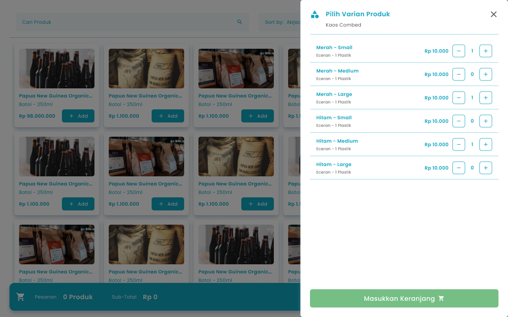
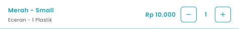

Pada halaman kasir, pengguna dapat melakukan input pesanan langsung melalui halaman keranjang menggunakan Barcode Scanner.

**Berikut langkah-langkah melakukan input pesanan di halaman keranjang:**

1. Akses halaman kasir
   <Frame>
     .png "Android Expanded 4 (1sdsvdx)")
   </Frame>
2. Ketuk kolom “Input Barcode/SKU”, kemudian input barcode manual atau menggunakan barcode scanner
   <Frame>
     .png "Input Right Icon (45dfdeds)")
   </Frame>

<table>
  <colgroup>
    <col width="118" />
    <col width="564" />
  </colgroup>
  <thead>
    <tr>
      <th style={{ textAlign: "center" }}>**🛈** **Information**</th>
      <th style={{ textAlign: "center" }}>Baca artikel berikut untuk menghubungkan barcode scanner ke perangkat android anda [https://kdslabel.co.id/id/berita/detail/bagaimana-cara-menghubungkan-barcode-scanner-dengan-komputer-atau-hp](https://kdslabel.co.id/id/berita/detail/bagaimana-cara-menghubungkan-barcode-scanner-dengan-komputer-atau-hp)</th>
    </tr>
  </thead>
</table>

3. **Jika kode barcode digunakan lebih dari 1 produk atau produk memiliki harga multi satuan**, maka akan menampilkan drawer list produk yang dapat dipilih item tertentu yang di input dalam keranjang pesanan

<Frame>
  
</Frame>

4. Masukkan jumlah pesanan yang akan ditambahkan ke keranjang pesanan dengan menginput jumlah secara manual atau menggunakan tombol tambah (+) dan kurang (−).

<Frame>
  
</Frame>

5. Setelah mengisi kuantiti item, tekan tombol “Masukkan Keranjang”

<Frame>
  .png "Frame 1366 (dffr1)")
</Frame>

6. Item akan ditambahkan di keranjang
7. **Jika kode barcode digunakan hanya 1 produk dengan 1 harga satuan,** maka item akan langsung ditambahkan di keranjang

<table>
  <colgroup>
    <col width="116" />
    <col width="562" />
  </colgroup>
  <thead>
    <tr>
      <th style={{ textAlign: "center" }}>**🛈** **Information**</th>
      <th>Jika kode barcode digunakan hanya 1 produk yang memiliki harga multi satuan, maka ketika input barcode menggunakan scanner akan ditambahkan dari satuan terkecilnya</th>
    </tr>
  </thead>
</table>
