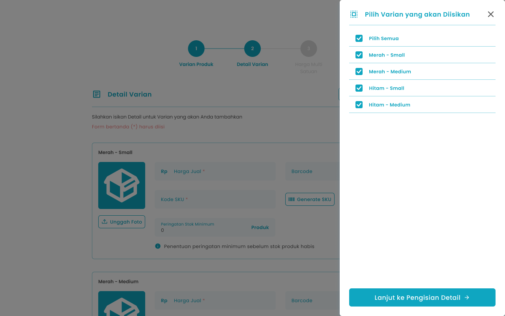
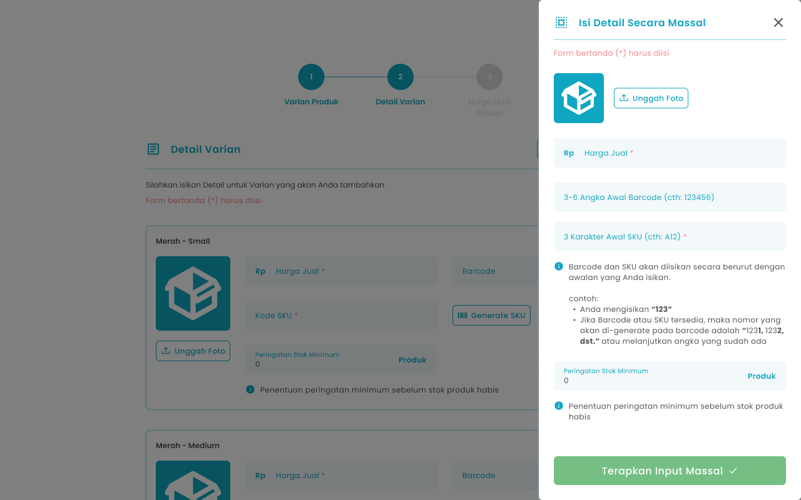
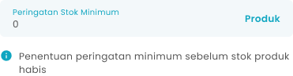
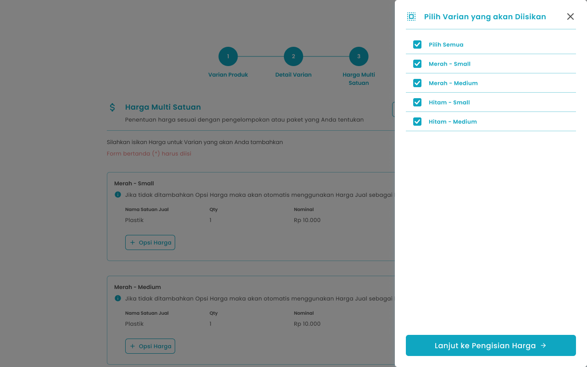
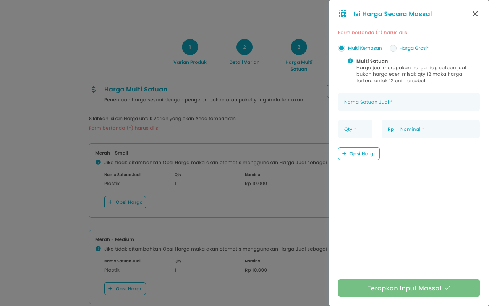

Fitur **input massal detail varian** dan **input massal harga multi satuan** memungkinkan pengguna untuk mengelola data produk dalam skala besar secara efisien tanpa harus melakukan input satu per satu. Melalui fitur ini, pengguna dapat sekaligus menambahkan atau memperbarui berbagai varian produk (seperti ukuran, warna, atau kemasan) dalam satu aksi, sekaligus menetapkan harga untuk masing-masing varian berdasarkan beberapa satuan penjualan (misalnya per pcs, pack, atau dus). Sistem akan memproses data secara terstruktur dengan validasi otomatis untuk memastikan konsistensi antar varian dan satuan, sehingga mempercepat proses administrasi produk, meminimalkan kesalahan input, dan mendukung fleksibilitas strategi penetapan harga di berbagai skenario penjualan.

## **1.1. Cara Input Detail Varian Massal Produk Varian**

**Berikut cara input detail varian secara massal:**

1. Tekan tombol “Isi Detail Secara Massal” di halaman form detail varian (step 2) tambah produk varian
   <Frame>
     .png "Frame 960 (5sdsdf)")
   </Frame>
2. Setelah menekan tombol maka akan menampilkan list varian yang bisa dipilih untuk diisi secara massal
   <Frame>
     
   </Frame>
3. Pilih beberapa atau semua varian
4. setelah selesai memilih, kemudian tekan tombol “Lanjut ke Pengisian Detail”
5. Setelah menekan tombol maka akan menampilkan halaman isi detail varian secara massal
   <Frame>
     
   </Frame>
6. Unggah foto varian dengan tekan tombol “Unggah Foto”
   <Frame>
     
   </Frame>
7. Masukkan harga jual dari varian
   <Frame>
     .png "Input Right Icon (6dfdfggg3)")
   </Frame>
8. Masukkan 3 digit awal barcode di kolom barcode
   <Frame>
     .png "Input Right Icon (62ssfggh)")
   </Frame>
9. Masukkan 3 digit awal SKU di kolom SKU
   <Frame>
     .png "Input Right Icon (61sdeff)")
   </Frame>
10. Masukkan jumlah stok minimum peringatan stok habis di kolom peringatan stok minimum
    <Frame>
      
    </Frame>
11. Setelah selesai mengisi detail varian secara massal, kemudian tekan tombol “Terapkan Input Massal”
    <Frame>
      .png "Frame 1411 (9dsfg)")
    </Frame>
12. Setelah menekan tombol,  maka akan menampilkan halaman sukses mengisi detail secara massal dan kembali ke halaman input detail varian

## **1.2. Cara Input Harga Multi Satuan Massal Produk Varian**

**Berikut cara input harga multi satuan secara massal**

1. Tekan tombol “Isi Harga Secara Massal”  di halaman form harga multi satuan (step 3) tambah produk varian
   <Frame>
     .png "Frame 960 (6sdfsdf)")
   </Frame>
2. Setelah menekan tombol maka akan menampilkan list varian yang bisa dipilih untuk diisi secara massal
   <Frame>
     
   </Frame>
3. Pilih beberapa atau semua varian
4. setelah selesai memilih, kemudian tekan tombol “Lanjut ke Pengisian Harga”
5. Setelah menekan tombol maka akan menampilkan halaman isi harga varian secara massal
   <Frame>
     
   </Frame>
6. Anda dapat memilih harga multi satuan sebagai harga kemasan atau harga grosir
   <Frame>
     .png "Frame 1202 (2sdfsdf)")
   </Frame>
7. Masukkan nama satuan di kolom satuan
   <Frame>
     .png "Input Right Icon (64sdfsf)")
   </Frame>
8. Masukkan quantity di kolom qty
   <Frame>
     .png "Input Right Icon (65bfbgbgb)")
   </Frame>
9. Masukkan nominal satuan di kolom nominal
   <Frame>
     .png "Input Right Icon (66wewerrdee)")
   </Frame>
10. Anda dapat menambahkan satuan produk dengan menekan tombol "\+ opsi harga"
    <Frame>
      .png "Frame 960 (7sdfsdff)")
    </Frame>
11. Setelah selesai mengisi harga secara massal, kemudian tekan tombol “Terapkan Input Massal”
    <Frame>
      .png "Frame 1411 (9dsfg)")
    </Frame>
12. Setelah menekan tombol, maka akan menampilkan halaman sukses mengisi harga secara massal dan kembali ke halaman input harga multi satuan
