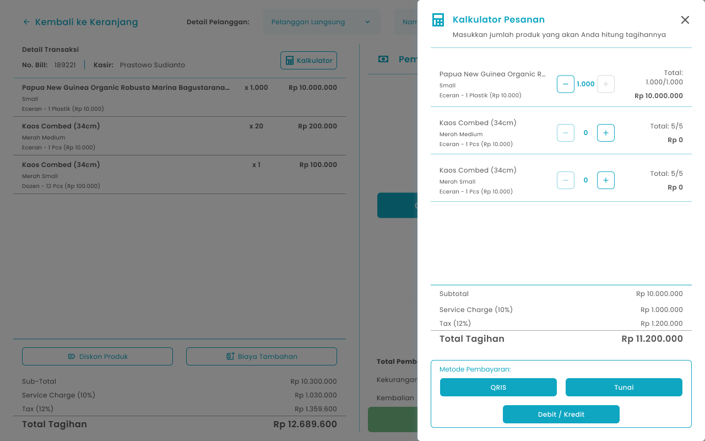
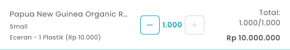
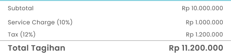

## **1.1. Cara menghitung Pesanan Sebelum Proses Pembayaran**

Kasir dapat melakukan perhitungan pesanan pelanggan dengan jumlah tertentu sebelum melakukan pembayaran

<Frame>
  
</Frame>

<table>
  <colgroup>
    <col width="53" />
    <col width="278" />
    <col width="346" />
  </colgroup>
  <thead>
    <tr>
      <th>No</th>
      <th>Simbol</th>
      <th>Keterangan</th>
    </tr>
  </thead>
  <tbody>
    <tr>
      <td>1</td>
      <td>Input quantity item produk cuma cuma</td>
      <td>Kolom untuk input kuantiti item produk cuma cuma</td>
    </tr>
    <tr>
      <td>2</td>
      <td>Metode Pembayaran</td>
      <td>Tombol untuk set metode pembayaran pada item yang diinput</td>
    </tr>
  </tbody>
</table>

**Berikut cara mengakses menu kalkulator:**

1. Input item pesanan yang perlu di masukkan pada keranjang pesanan
   <Frame>
     .png "Android Expanded 171 (1fgyt)")
   </Frame>
2. Setelah input pesanan, kemudian tekan tombol “Checkout”
   <Frame>
     
   </Frame>
3. Setelah menekan tombol, maka akan menampilkan halaman checkout
4. Tekan tombol “Kalkulator”
   <Frame>
     .png "Frame 960 (xzawet3)")
   </Frame>
5. Setelah menekan tombol, maka akan menampilkan halaman kalkulator pesanan
6. Anda dapat menginput jumlah pesanan secara manual atau dengan menekan tombol tambah (+) dan kurang (−) untuk ditambahkan ke keranjang pesanan.
   <Frame>
     
   </Frame>
7. Setelah selesai mengisi pesanan yang perlu dihitung, maka akan menampilkan total tagihan pesanan
   <Frame>
     
   </Frame>
8. Tekan tombol pada salah satu metode pembayaran untuk dilakukan pembayaran
   <Frame>
     
   </Frame>
9. Setelah memilih memilih metode pembayaran maka akan menampilkan kolom untuk input nominal pembayaran dengan autofill dari total tagihan kalkulator di halaman checkout
