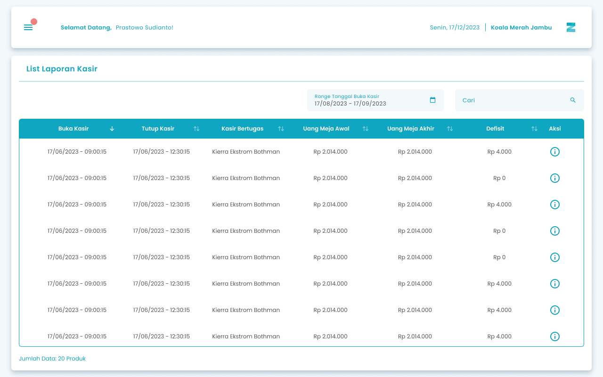
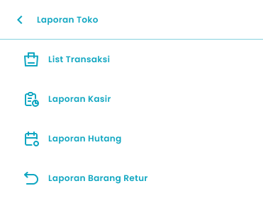
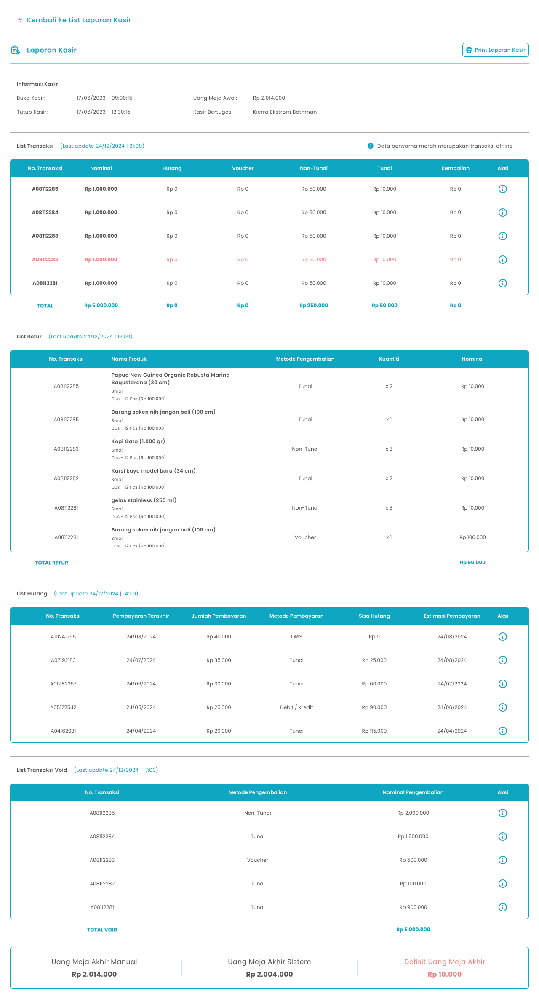

Pada aplikasi Zycas terdapat fitur Laporan Kasir untuk memberikan gambaran rinci tentang setiap sesi kasir, mulai dari waktu buka hingga tutup kasir. Ini membantu Anda memantau kinerja kasir, mengontrol perputaran uang, dan memastikan tidak ada selisih

<Frame>
  
</Frame>

<table>
  <colgroup>
    <col width="52" />
    <col width="223" />
    <col width="441" />
  </colgroup>
  <thead>
    <tr>
      <th>No.</th>
      <th>Simbol</th>
      <th>Keterangan</th>
    </tr>
  </thead>
  <tbody>
    <tr>
      <td>1</td>
      <td>Range Tanggal Buka Kasir</td>
      <td>Tombol untuk filter range tanggal buka kasir</td>
    </tr>
    <tr>
      <td>2</td>
      <td>Cari</td>
      <td>Kolom untuk mencari list laporan kasir dari kasir yang bertugas</td>
    </tr>
    <tr>
      <td>3</td>
      <td>Aksi Detail</td>
      <td>Icon untuk informasi detail pada setiap list laporan kasir</td>
    </tr>
  </tbody>
</table>

## **1.1. Cara Akses Laporan Kasir**

**Berikut cara mengakses halaman list laporan kasir:**

1. Tekan ikon tiga garis di pojok kiri atas

<Frame>
  
</Frame>

2. Setelah menekan ikon hamburger, maka akan menampilkan sidebar list menu

<Frame>
  
</Frame>

3. Tekan menu Laporan Toko pada list menu

<Frame>
  
</Frame>

4. Setelah tekan menu Laporan Toko, maka akan menampilkan list sub menu Laporan Toko

<Frame>
  
</Frame>

5. Lalu tekan menu Laporan Kasir pada list sub menu Laporan Toko

<Frame>
  
</Frame>

6. Setelah menekan menu Laporan Kasir maka akan menampilkan halaman List Laporan Kasir 

## **1.2. Cara Melihat Detail Laporan Kasir**

Fitur Detail Laporan Kasir memberikan rincian lengkap dari setiap sesi kasir yang telah selesai. Berikut cara melihat detail dari setiap laporan kasir yang sudah ada  

**Berikut cara melihat detail laporan kasir:**

1. Tekan Aksi Detail pada salah satu list laporan kasir di kolom aksi yang terletak paling kanan
   <Frame>
     
   </Frame>
2. Setelah menekan bagian aksi detail, akan muncul halaman detail laporan kasir
3. Tekan Aksi Detail pada salah satu list transaksi di kolom aksi pada tabel list transaksi, list hutang, atau transaksi void untuk melihat detail transaksi tersebut
   <Frame>
     
   </Frame>

<table>
  <colgroup>
    <col width="58" />
    <col width="257" />
    <col width="396" />
  </colgroup>
  <thead>
    <tr>
      <th>No.</th>
      <th>Simbol</th>
      <th>Keterangan</th>
    </tr>
  </thead>
  <tbody>
    <tr>
      <td>1</td>
      <td>Kembali ke List Laporan Kasir</td>
      <td>Tombol untuk kembali ke halaman list laporan kasir</td>
    </tr>
    <tr>
      <td>2</td>
      <td>Print Laporan Kasir</td>
      <td>Tombol untuk download laporan kasir</td>
    </tr>
  </tbody>
</table>

## **1.3. Cara Unduh Laporan Kasir**

Dari detail laporan kasir, bisa juga lakukan unduh laporan kasirnya. 

**Berikut cara unduh laporan kasir :**

1. Tekan “Print Laporan Kasir” di pojok kanan atas halaman detail laporan kasir
   <Frame>
     .png "Frame 6 (aqwedc1)")
   </Frame>
2. Tunggu beberapa saat untuk proses pengunduhan, setelah itu laporan kasir akan tersimpan di device anda

<table>
  <colgroup>
    <col width="118" />
    <col width="605" />
  </colgroup>
  <thead>
    <tr>
      <th style={{ textAlign: "center" }}>**🛈** **Information**</th>
      <th>Untuk mengunduh laporan kasir maka perlu menyalakan izin penyimpanan pada device anda</th>
    </tr>
  </thead>
</table>

## **Glosarium**

<table>
  <colgroup>
    <col width="195" />
    <col width="526" />
  </colgroup>
  <thead>
    <tr>
      <th>**Istilah**</th>
      <th>**Deskripsi (Penjelasan dalam Bahasa Indonesia)**</th>
    </tr>
  </thead>
  <tbody>
    <tr>
      <td>Zycas Mobile</td>
      <td>Aplikasi mobile untuk pengelolaan operasional bisnis ritel, termasuk transaksi, kasir, dan pelaporan.</td>
    </tr>
    <tr>
      <td>Pengguna (User)</td>
      <td>Individu yang menggunakan aplikasi Zycas dengan hak akses tertentu.</td>
    </tr>
    <tr>
      <td>Owner</td>
      <td>Pengguna dengan hak akses penuh untuk memantau, mengelola, dan mengevaluasi seluruh aktivitas kasir.</td>
    </tr>
    <tr>
      <td>Karyawan</td>
      <td>Pengguna yang menjalankan operasional kasir sesuai hak akses yang diberikan oleh owner.</td>
    </tr>
    <tr>
      <td>Hak Akses</td>
      <td>Izin yang menentukan fitur dan menu yang dapat digunakan oleh pengguna dalam aplikasi.</td>
    </tr>
    <tr>
      <td>Laporan Kasir</td>
      <td>Modul pelaporan yang menyajikan ringkasan dan detail aktivitas kasir dari buka hingga tutup kasir.</td>
    </tr>
    <tr>
      <td>Modul Laporan Kasir</td>
      <td>Sistem monitoring dan dokumentasi sesi kasir yang digunakan untuk kontrol keuangan dan evaluasi performa.</td>
    </tr>
    <tr>
      <td>Shift Kasir</td>
      <td>Periode kerja kasir yang dimulai saat buka kasir dan berakhir saat tutup kasir.</td>
    </tr>
    <tr>
      <td>Buka Kasir (Opening)</td>
      <td>Proses awal memulai shift kasir sebelum transaksi dilakukan.</td>
    </tr>
    <tr>
      <td>Tutup Kasir (Closing)</td>
      <td>Proses akhir shift kasir untuk menyelesaikan transaksi dan rekonsiliasi uang kas.</td>
    </tr>
    <tr>
      <td>Monitoring Kasir</td>
      <td>Aktivitas pemantauan kinerja dan aktivitas kasir selama satu sesi kerja.</td>
    </tr>
    <tr>
      <td>Rekonsiliasi Kas</td>
      <td>Proses pencocokan antara uang fisik dengan data transaksi sistem.</td>
    </tr>
    <tr>
      <td>Selisih Kas</td>
      <td>Perbedaan antara jumlah uang fisik dengan saldo yang tercatat di sistem.</td>
    </tr>
    <tr>
      <td>Akuntabilitas</td>
      <td>Tanggung jawab kasir dalam mengelola dan mempertanggungjawabkan uang tunai.</td>
    </tr>
    <tr>
      <td>Point of Sale (POS)</td>
      <td>Sistem kasir tempat transaksi penjualan dilakukan dan dicatat.</td>
    </tr>
    <tr>
      <td>Range Tanggal Buka Kasir</td>
      <td>Filter untuk menampilkan laporan kasir berdasarkan rentang tanggal buka kasir.</td>
    </tr>
    <tr>
      <td>Filter</td>
      <td>Fitur untuk menyaring data laporan kasir berdasarkan kriteria tertentu.</td>
    </tr>
    <tr>
      <td>Cari</td>
      <td>Kolom pencarian untuk menemukan laporan kasir berdasarkan nama kasir atau data terkait.</td>
    </tr>
    <tr>
      <td>List Laporan Kasir</td>
      <td>Daftar seluruh laporan kasir yang tersedia dalam sistem.</td>
    </tr>
    <tr>
      <td>Aksi Detail</td>
      <td>Ikon atau tombol untuk melihat rincian lengkap laporan kasir tertentu.</td>
    </tr>
    <tr>
      <td>Detail Laporan Kasir</td>
      <td>Tampilan yang menampilkan informasi lengkap satu sesi kasir.</td>
    </tr>
    <tr>
      <td>Sidebar Menu</td>
      <td>Panel navigasi utama yang menampilkan daftar menu aplikasi.</td>
    </tr>
    <tr>
      <td>Ikon Hamburger</td>
      <td>Ikon tiga garis yang digunakan untuk membuka sidebar menu.</td>
    </tr>
    <tr>
      <td>Menu Transaksi</td>
      <td>Menu utama yang berisi fitur-fitur terkait transaksi dan laporan kasir.</td>
    </tr>
    <tr>
      <td>Simpan PDF</td>
      <td>Fitur untuk mengunduh laporan kasir dalam format PDF.</td>
    </tr>
    <tr>
      <td>Unduh Laporan Kasir</td>
      <td>Proses menyimpan file laporan kasir ke perangkat pengguna.</td>
    </tr>
    <tr>
      <td>File PDF</td>
      <td>Format dokumen digital yang digunakan untuk menyimpan laporan kasir.</td>
    </tr>
    <tr>
      <td>Izin Penyimpanan</td>
      <td>Hak akses perangkat yang diperlukan agar aplikasi dapat menyimpan file laporan.</td>
    </tr>
    <tr>
      <td>Notifikasi</td>
      <td>Pesan sistem yang memberikan informasi terkait status proses yang dilakukan pengguna.</td>
    </tr>
  </tbody>
</table>
