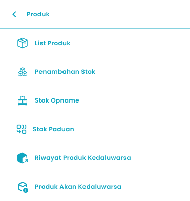

Modul Produk menyediakan sistem manajemen inventaris yang komprehensif dengan dukungan untuk tiga jenis produk berbeda: produk biasa, produk paduan (rakitan), dan produk varian. Setiap jenis produk memiliki fitur khusus yang disesuaikan dengan kebutuhan bisnis ritel Anda.

<Frame>
  .png "Android Expanded 809 (1dferf)")
</Frame>

<table>
  <colgroup>
    <col width="100" />
    <col width="140" />
    <col width="424" />
  </colgroup>
  <thead>
    <tr>
      <th>No</th>
      <th>Simbol</th>
      <th>Keterangan</th>
    </tr>
  </thead>
  <tbody>
    <tr>
      <td>1</td>
      <td>Tambah Produk</td>
      <td>Tombol untuk menambah produk baru</td>
    </tr>
    <tr>
      <td>2</td>
      <td>Detail Produk</td>
      <td>Tombol untuk melihat detail produk tertentu</td>
    </tr>
    <tr>
      <td>3</td>
      <td>Edit Produk</td>
      <td>Tombol untuk mengubah produk tertentu</td>
    </tr>
    <tr>
      <td>4</td>
      <td>Edit Stok</td>
      <td>Tombol untuk mengubah stok produk</td>
    </tr>
    <tr>
      <td>5</td>
      <td>Tambah Stok</td>
      <td>Tombol untuk menambah stok produk</td>
    </tr>
    <tr>
      <td>6</td>
      <td>Hapus Produk</td>
      <td>Tombol untuk menghapus produk</td>
    </tr>
    <tr>
      <td>7</td>
      <td>Edit Stok Varian</td>
      <td>Tombol untuk mengubah stok varian</td>
    </tr>
  </tbody>
</table>

## 1.1. Cara Mengakses List Produk

**Berikut cara mengakses menu list produk:**

1. Tekan ikon tiga garis di pojok kiri atas

<Frame>
  
</Frame>

2. Setelah menekan ikon, maka akan menampilkan sidebar list menu

3. Tekan menu Produk pada list menu
4. Setelah menekan menu, maka akan menampilkan list sub menu produk

<Frame>
  
</Frame>

5. Tekan menu List Produk pada list sub menu produk
6. Setelah menekan menu List produk maka akan menampilkan halaman List Produk
