Modul Riwayat Transaksi adalah pusat dokumentasi dan manajemen pasca-penjualan yang menyediakan catatan lengkap dan terstruktur dari seluruh aktivitas transaksi yang telah dilakukan dalam sistem. Modul ini berfungsi sebagai database komprehensif untuk pelacakan, audit, layanan pelanggan, dan pengelolaan after-sales activities seperti retur barang, pembayaran hutang, dan pembatalan transaksi.

<Frame>
  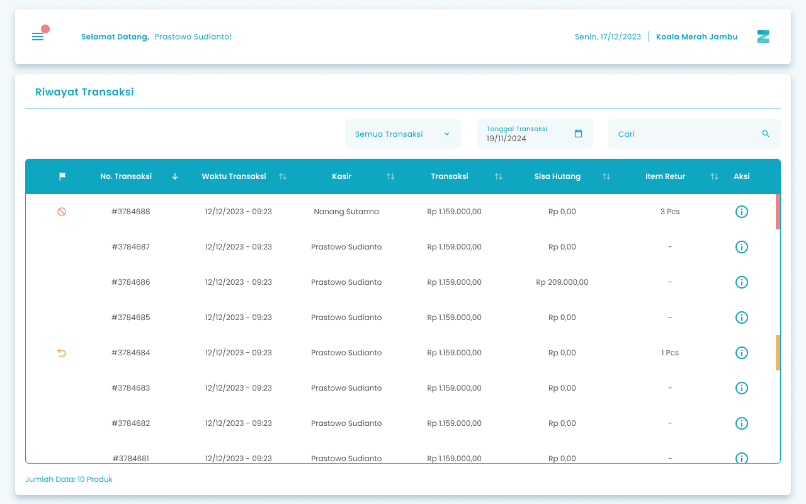
</Frame>

<table>
  <colgroup>
    <col width="50" />
    <col width="202" />
    <col width="465" />
  </colgroup>
  <thead>
    <tr>
      <th>No</th>
      <th>Simbol</th>
      <th>Keterangan</th>
    </tr>
  </thead>
  <tbody>
    <tr>
      <td>1</td>
      <td>Status Transaksi</td>
      <td>Tombol untuk filter status transaksi yang aktif, retur atau dibatalkan</td>
    </tr>
    <tr>
      <td>2</td>
      <td>Tanggal transaksi</td>
      <td>Tombol untuk filter tanggal transaksi</td>
    </tr>
    <tr>
      <td>3</td>
      <td>Cari Transaksi</td>
      <td>Kolom untuk mencari riwayat transaksi</td>
    </tr>
    <tr>
      <td>4</td>
      <td>Detail Riwayat Transaksi</td>
      <td>Tombol untuk detail riwayat transaksi</td>
    </tr>
    <tr>
      <td>5</td>
      <td>Kolom Status Transaksi</td>
      <td>Kolom untuk melihat transaksi retur/void</td>
    </tr>
  </tbody>
</table>

## **1.1. Cara Akses Riwayat Transaksi**

**Berikut cara mengakses menu Riwayat Transaksi:**

1. Tekan ikon tiga garis di pojok kiri atas

<Frame>
  
</Frame>

2. Setelah menekan ikon hamburger, maka akan menampilkan sidebar list menu

<Frame>
  
</Frame>

3. Tekan menu Laporan Toko pada list menu

<Frame>
  
</Frame>

4. Setelah tekan menu Laporan Toko, maka akan menampilkan list sub menu Laporan Toko

<Frame>
  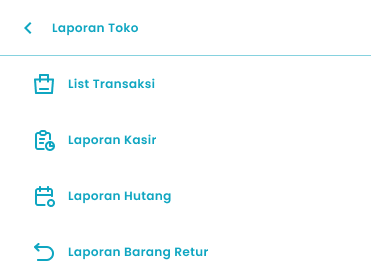
</Frame>

5. Lalu tekan menu List Transaksi pada list sub menu Laporan Toko

<Frame>
  
</Frame>

6. Setelah menekan menu List Transaksi maka akan menampilkan halaman List Transaksi
7. Tekan tombol detail di salah satu transaksi pada halaman list transaksi
   <Frame>
     
   </Frame>
8. Setelah menekan tombol, maka akan menampilkan halaman detail transaksi 

<Frame>
  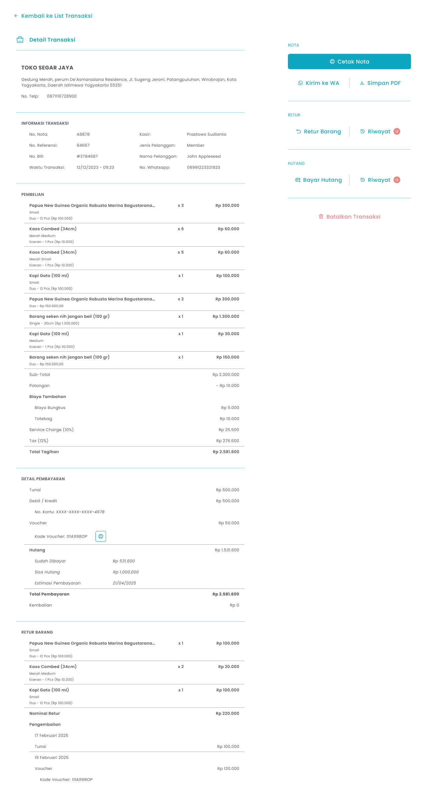
</Frame>

<table>
  <colgroup>
    <col width="50" />
    <col width="165" />
    <col width="497" />
  </colgroup>
  <thead>
    <tr>
      <th>No</th>
      <th>Simbol</th>
      <th>Keterangan</th>
    </tr>
  </thead>
  <tbody>
    <tr>
      <td>1</td>
      <td>Cetak Nota</td>
      <td>Tombol untuk cetak nota transaksi</td>
    </tr>
    <tr>
      <td>2</td>
      <td>Kirim Ke WA</td>
      <td>Tombol untuk kirim transaksi ke no whatsapp</td>
    </tr>
    <tr>
      <td>3</td>
      <td>Simpan PDF</td>
      <td>Tombol untuk simpan transaksi dalam format PDF</td>
    </tr>
    <tr>
      <td>4</td>
      <td>Retur Barang</td>
      <td>Tombol untuk retur produk</td>
    </tr>
    <tr>
      <td>5</td>
      <td>Riwayat Retur</td>
      <td>Tombol untuk melihat riwayat retur</td>
    </tr>
    <tr>
      <td>6</td>
      <td>Bayar Hutang</td>
      <td>Tombol untuk pembayaran hutang</td>
    </tr>
    <tr>
      <td>7</td>
      <td>Riwayat Bayar Hutang</td>
      <td>Tombol untuk melihat riwayat pembayaran hutang</td>
    </tr>
    <tr>
      <td>8</td>
      <td>Batalkan Transaksi</td>
      <td>Tombol untuk pembatalan transaksi</td>
    </tr>
  </tbody>
</table>

## **1.2. Cara Mencetak Nota Transaksi**

**Berikut cara mengakses menu Cetak Nota Transaksi:**

1. Tekan tombol “Cetak Nota” di halaman detail transaksi

<Frame>
  
</Frame>

2. Setelah menekan tombol, maka akan menampilkan list printer yang terhubung ke pertangkat untuk mencetak nota transaksi di printer
   <Frame>
     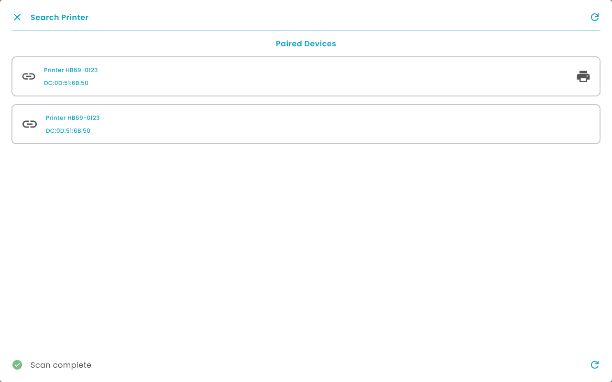
   </Frame>
3. Tekan icon "Printer" di salah satu printer yang terhubung untuk mencetak nota

<Frame>
  
</Frame>

## **1.3. Cara Retur Produk**

**Berikut cara mengakses menu Retur Produk:**

1. Tekan tombol “Retur Barang” di halaman detail transaksi

<Frame>
  
</Frame>

2. Sistem akan melakukan pengecekan status shift kasir:

- **_Jika shift sudah ditutup (Closed Shift)_** → sistem akan mengarahkan Anda ke halaman **Open Cashier** untuk membuka shift baru terlebih dahulu.

3. Masukkan tanggal retur di kolom tanggal retur
4. **Retur barang menggunakan metode pengembalian tunai**
   <Frame>
     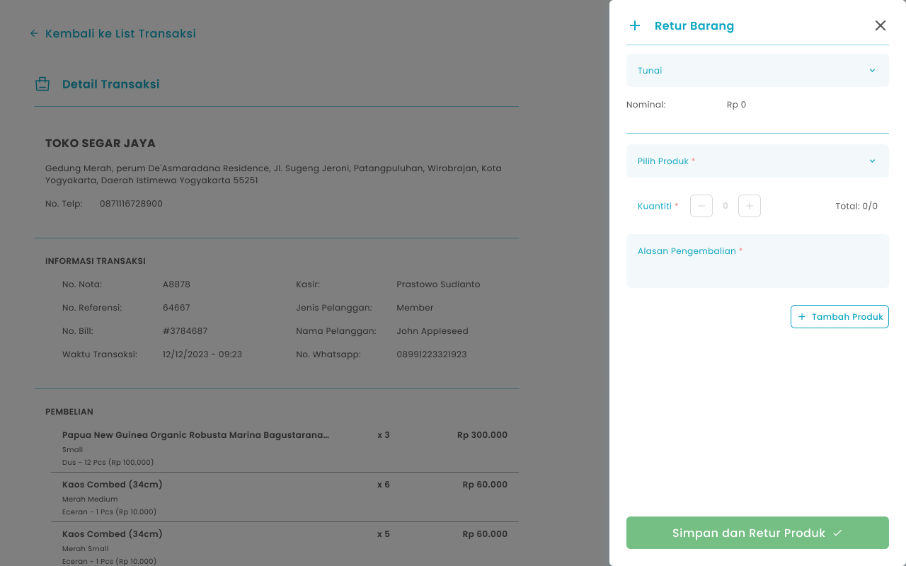
   </Frame>
5. Pilih metode pengembalian dengan tunai
   <Frame>
     
   </Frame>
6. **Retur barang menggunakan metode pengembalian non tunai**
7. Pilih metode pengembalian dengan non tunai
   <Frame>
     
   </Frame>
8. Setelah memilih metode pengembalian non tunai, maka akan menampilkan kolom input no referensi
9. Masukkan no referensi di kolom no. referensi
   <Frame>
     .png "Input Right Icon (3qwqww)")
   </Frame>
10. Tekan tombol “Pilih Produk” untuk memilih produk yang perlu di retur
    <Frame>
      swaw.png "Input Right Icon (1)swaw")
    </Frame>
11. Setelah menekan tombol, maka akan menampilkan list produk
    <Frame>
      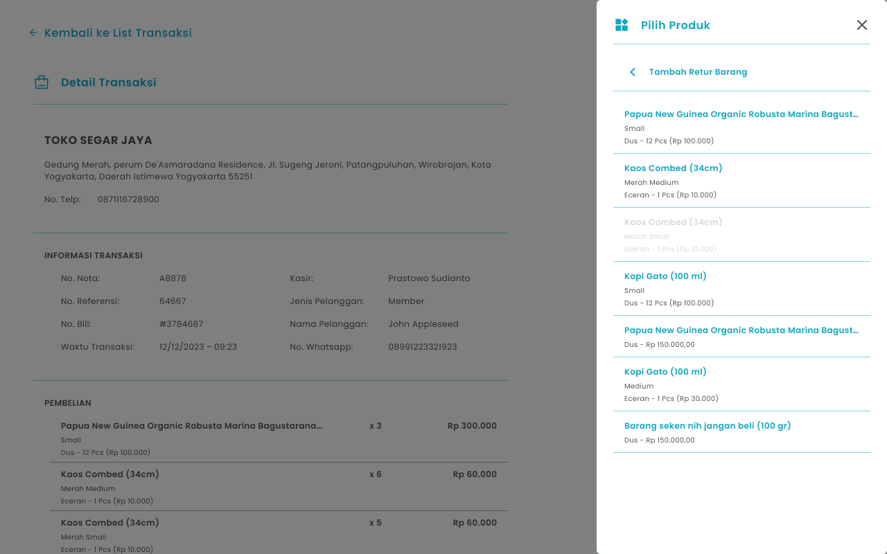
    </Frame>
12. Pilih salah satu produk yang perlu diretur
13. Setelah memilih produk maka akan ditampilkan di kolom pilih produk
14. Masukkan jumlah produk yang diretur di kolom kuantiti atau tekan tombol +/- untuk input jumlah produk yang di retur
    <Frame>
      
    </Frame>
15. Masukkan alasan pengembalian di kolom alasan pengembalian
    <Frame>
      .png "Input Right Icon (2aqas)")
    </Frame>
16. Tekan tombol “Tambah Produk” untuk menambah produk lain yang perlu di retur
    <Frame>
      
    </Frame>
17. Setelah menekan tombol, maka akan menampilkan kolom input produk lain
18. Setelah selesai mengisi data retur, kemudian tekan tombol “Simpan dan Retur Produk”
    <Frame>
      
    </Frame>
19. Setelah menekan tombol, maka akan menampilkan halaman konfirmasi retur produk
    <Frame>
      .png "Frame 1336 (1aqaqa)")
    </Frame>
20. Tekan tombol “Ya, Saya Yakin” di halaman konfirmasi untuk melanjutkan retur
    <Frame>
      
    </Frame>
21. Tekan tombol “Tidak” di halaman konfirmasi untuk membatalkan retur
    <Frame>
      
    </Frame>
22. Setelah menekan tombol “Ya, Saya Yakin”,  maka akan menampilkan halaman list transaksi serta notifikasi “Produk berhasil di retur”

## **1.4. Cara Melihat Riwayat Retur Produk**

**Berikut cara mengakses menu Riwayat Retur Produk:**

1. Tekan tombol “Riwayat” di halaman detail transaksi (section retur)

<Frame>
  
</Frame>

2. Setelah menekan tombol, maka akan menampilkan halaman riwayat retur produk
   <Frame>
     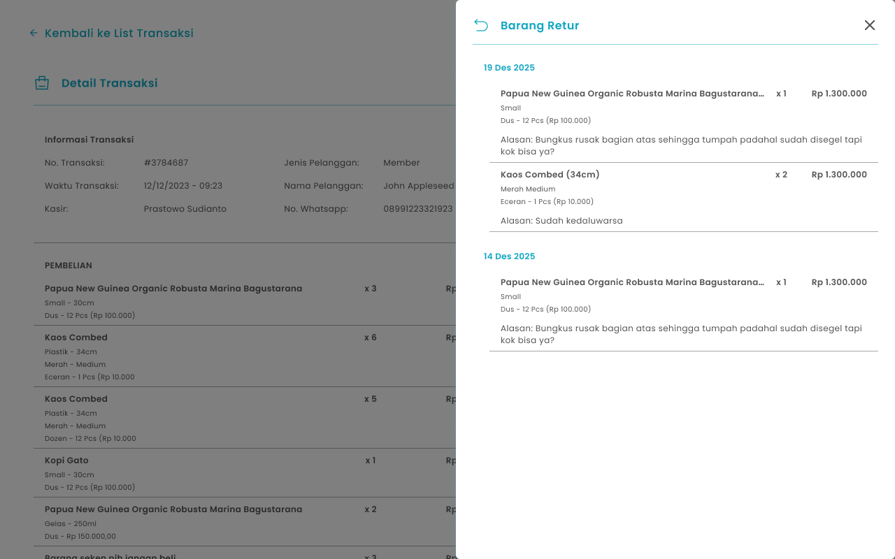
   </Frame>

## **1.5. Cara Pembayaran Hutang**

**Berikut cara mengakses menu Pembayaran Hutang:**

1. Tekan tombol “Bayar Hutang” di halaman detail transaksi

<Frame>
  dwsax.png "Frame 1610 (1)dwsax")
</Frame>

<table>
  <colgroup>
    <col width="125" />
    <col width="589" />
  </colgroup>
  <thead>
    <tr>
      <th style={{ textAlign: "center" }}>**🛈** **Information**</th>
      <th>Anda dapat melakukan pembayaran hutang jika masih terdapat sisa hutang yang belum terbayarkan</th>
    </tr>
  </thead>
</table>

2. Sistem akan melakukan pengecekan status shift kasir:

- **_Jika shift sudah ditutup (Closed Shift)_** → sistem akan mengarahkan Anda ke halaman **Open Cashier** untuk membuka shift baru terlebih dahulu.

3. Menampilkan halaman Pilih metode Pembayaran
   <Frame>
     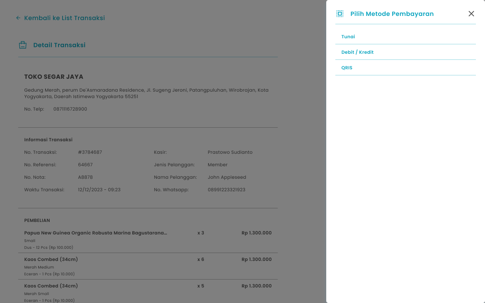
   </Frame>
4. **Cara Pembayaran Hutang dengan Tunai**
5. Pilih Tunai di halaman halaman Pilih metode Pembayaran
6. Setelah memilih tunai, maka menampilkan halaman input nominal pembayaran
   <Frame>
     .png "Input Right Icon (4swaq)")
   </Frame>
7. Masukkan nominal pembayaran di kolom nominal pembayaran
8. **Cara Pembayaran Hutang dengan Debit/Kredit**
9. Pilih **Debit/Kredit** di halaman Pilih metode Pembayaran
10. Setelah memilih debit/kredit, maka menampilkan halaman input nominal pembayaran
    <Frame>
      .png "Input Right Icon (4swaq)")
    </Frame>
11. Masukkan nominal pembayaran di kolom nominal pembayaran
12. Masukkan no kartu di kolom no kartu
    <Frame>
      .png "Input Right Icon (5123e)")
    </Frame>
13. Masukkan approver number di kolom approver number
    <Frame>
      .png "Input Right Icon (6sqwed)")
    </Frame>
14. **Cara Pembayaran Hutang dengan QRIS**
15. Pilih QRIS di halaman Pilih metode Pembayaran
16. Setelah memilih qris, maka menampilkan halaman input nominal pembayaran
    <Frame>
      .png "Input Right Icon (4swaq)")
    </Frame>
17. Masukkan nominal pembayaran di kolom nominal pembayaran
18. Tekan tombol “Lihat QRIS” untuk menampilkan kode QRIS
    <Frame>
      .png "Frame 1609 (1qftyg)")
    </Frame>
19. Setelah menekan tombol, maka akan menampilkan halaman kode QRIS
    <Frame>
      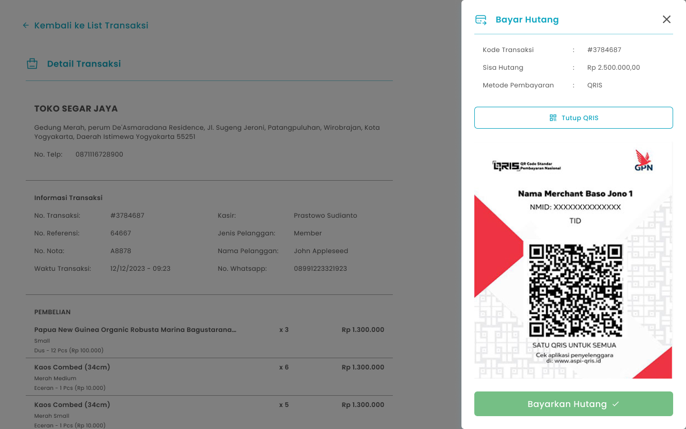
    </Frame>
20. Tekan tombol “Tutup QRIS” untuk menutup halaman kode QRIS
    <Frame>
      .png "Frame 1609 (2wdedv)")
    </Frame>
21. Setelah selesai mengisi data, kemudian tekan tombol “Bayarkan Hutang”
    <Frame>
      .png "Frame 1411 (2sdxgb)")
    </Frame>
22. **Jika lunas maka akan menampilkan halaman konfirmasi bayar hutang**
    <Frame>
      .png "Frame 1336 (2qrtg)")
    </Frame>
23. Tekan tombol “Ya, Saya Yakin” di halaman konfirmasi untuk melanjutkan pembayaran hutang
    <Frame>
      
    </Frame>
24. Tekan tombol “Tidak” di halaman konfirmasi untuk membatalkan pembayaran hutang
    <Frame>
      
    </Frame>
25. Setelah menekan tombol “Ya, Saya Yakin”,  maka akan menampilkan halaman list hutang serta notifikasi “Hutang berhasil dibayar”
26. **Jika belum lunas maka akan menampilkan halaman konfirmasi bayar hutang belum lunas**
27. Masukkan tanggal estimasi pembayaran hutang
    <Frame>
      srtyg.png "Frame 1205 (1)srtyg")
    </Frame>
28. Tekan tombol “Ya, Saya Yakin” di halaman konfirmasi untuk melanjutkan proses transaksi
    <Frame>
      .png "Button 45e(11)")
    </Frame>
29. Tekan tombol “Tidak” di halaman konfirmasi untuk membatalkan transaksi
    <Frame>
      
    </Frame>
30. Setelah menekan tombol “Ya, Saya Yakin”,  maka akan menampilkan halaman pembayaran sukses

## **1.6. Cara Melihat Riwayat Pembayaran Hutang**

**Berikut cara mengakses menu Riwayat Pembayaran Hutang:**

1. Tekan tombol “Riwayat” di halaman detail transaksi (section hutang)

<Frame>
  
</Frame>

2. Setelah menekan tombol, maka akan menampilkan halaman riwayat pembayaran hutang
   <Frame>
     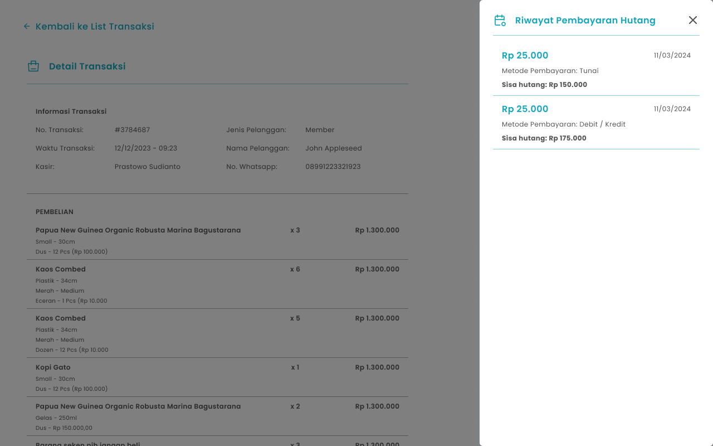
   </Frame>

## **1.7. Cara Membatalkan Transaksi**

**Berikut cara mengakses menu Retur Produk:**

1. Tekan tombol “Batalkan Transaksi” di halaman detail transaksi

<Frame>
  
</Frame>

2. Sistem akan melakukan pengecekan status shift kasir:

- **_Jika shift sudah ditutup (Closed Shift) atau shift kasir yang berbeda dari kasir yang mencatat transaksi_** → proses pembatalan transaksi tidak dapat dilakukan dan sistem akan menampilkan pop up sesi kasir sudah tidak aktif

3. Masukkan tanggal pembatalan di kolom tanggal pembatalan

<Frame>
  
</Frame>

4. **Pembatalan transaksi menggunakan metode pengembalian tunai**
5. Pilih metode pengembalian dengan tunai
   <Frame>
     
   </Frame>
6. **Pembatalan transaksi menggunakan metode pengembalian non tunai**
7. Pilih metode pengembalian dengan non tunai
   <Frame>
     
   </Frame>
8. Setelah memilih metode pengembalian non tunai, maka akan menampilkan kolom no referensi
9. Masukkan no referensi di kolom no. referensi
   <Frame>
     .png "Input Right Icon (3qwqww)")
   </Frame>
10. Setelah selesai mengisi data pembatalan, kemudian tekan tombol “Batalkan Transaksi”
    <Frame>
      .png "Frame 1411 (1qwert)")
    </Frame>
11. Setelah menekan tombol, maka akan menampilkan halaman konfirmasi pembatalan transaksi
    <Frame>
      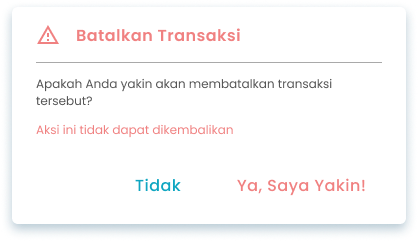
    </Frame>
12. Tekan tombol “Ya, Saya Yakin” di halaman konfirmasi untuk melanjutkan pembatalan
    <Frame>
      .png "Button 45e(11)")
    </Frame>
13. Tekan tombol “Tidak” di halaman konfirmasi untuk membatalkan pembatalan transaksi
    <Frame>
      
    </Frame>
14. Setelah menekan tombol “Ya, Saya Yakin”,  maka akan menampilkan halaman list transaksi serta notifikasi “Transaksi berhasil dibatalkan”

## **Glosarium**

<table>
  <colgroup>
    <col width="238" />
    <col width="487" />
  </colgroup>
  <thead>
    <tr>
      <th>**Istilah**</th>
      <th>**Deskripsi (Penjelasan dalam Bahasa Indonesia)**</th>
    </tr>
  </thead>
  <tbody>
    <tr>
      <td>Zycas Mobile</td>
      <td>Aplikasi mobile untuk mengelola transaksi penjualan, stok, dan operasional bisnis ritel.</td>
    </tr>
    <tr>
      <td>Pengguna (User)</td>
      <td>Orang yang menggunakan aplikasi Zycas Mobile dengan hak akses tertentu.</td>
    </tr>
    <tr>
      <td>Owner</td>
      <td>Pengguna dengan hak akses penuh terhadap seluruh menu dan fitur aplikasi.</td>
    </tr>
    <tr>
      <td>Karyawan</td>
      <td>Pengguna dengan hak akses terbatas sesuai izin yang diberikan oleh owner.</td>
    </tr>
    <tr>
      <td>Hak Akses</td>
      <td>Pengaturan izin yang menentukan fitur dan menu yang dapat diakses pengguna.</td>
    </tr>
    <tr>
      <td>Riwayat Transaksi</td>
      <td>Modul yang menampilkan catatan lengkap seluruh transaksi yang telah dilakukan dalam sistem.</td>
    </tr>
    <tr>
      <td>Modul Riwayat Transaksi</td>
      <td>Modul yang berfungsi sebagai pusat dokumentasi, pelacakan, dan audit transaksi pasca-penjualan.</td>
    </tr>
    <tr>
      <td>After-Sales Activities</td>
      <td>Aktivitas lanjutan setelah transaksi seperti retur produk, pembayaran hutang, dan pembatalan transaksi.</td>
    </tr>
    <tr>
      <td>List Transaksi</td>
      <td>Halaman yang menampilkan daftar seluruh transaksi berdasarkan filter tertentu.</td>
    </tr>
    <tr>
      <td>Status Transaksi</td>
      <td>Informasi kondisi transaksi, seperti normal, retur, atau dibatalkan.</td>
    </tr>
    <tr>
      <td>Tanggal Transaksi</td>
      <td>Waktu terjadinya transaksi yang dapat digunakan sebagai filter pencarian.</td>
    </tr>
    <tr>
      <td>Cari Transaksi</td>
      <td>Fitur pencarian untuk menemukan transaksi tertentu dengan cepat.</td>
    </tr>
    <tr>
      <td>Detail Riwayat Transaksi</td>
      <td>Halaman yang menampilkan informasi lengkap dari satu transaksi.</td>
    </tr>
    <tr>
      <td>Cetak Nota</td>
      <td>Fitur untuk mencetak bukti transaksi melalui printer.</td>
    </tr>
    <tr>
      <td>Nota Transaksi</td>
      <td>Dokumen bukti transaksi penjualan yang berisi detail pembelian.</td>
    </tr>
    <tr>
      <td>Kirim ke WhatsApp</td>
      <td>Fitur untuk mengirim detail transaksi ke nomor WhatsApp pelanggan.</td>
    </tr>
    <tr>
      <td>Simpan PDF</td>
      <td>Fitur untuk menyimpan detail transaksi dalam format PDF.</td>
    </tr>
    <tr>
      <td>Retur Barang</td>
      <td>Proses pengembalian produk dari pelanggan ke toko.</td>
    </tr>
    <tr>
      <td>Riwayat Retur</td>
      <td>Halaman yang menampilkan daftar riwayat pengembalian produk.</td>
    </tr>
    <tr>
      <td>Metode Pengembalian</td>
      <td>Cara pengembalian dana pada proses retur atau pembatalan transaksi (tunai atau non tunai).</td>
    </tr>
    <tr>
      <td>Tunai</td>
      <td>Metode pembayaran atau pengembalian dana menggunakan uang tunai.</td>
    </tr>
    <tr>
      <td>Non Tunai</td>
      <td>Metode pembayaran atau pengembalian dana tanpa uang tunai, seperti transfer atau kartu.</td>
    </tr>
    <tr>
      <td>No. Referensi</td>
      <td>Nomor bukti transaksi non tunai yang digunakan sebagai referensi pembayaran.</td>
    </tr>
    <tr>
      <td>Shift Kasir</td>
      <td>Periode kerja kasir yang aktif dalam sistem.</td>
    </tr>
    <tr>
      <td>Closed Shift</td>
      <td>Kondisi di mana shift kasir telah ditutup dan tidak dapat melakukan transaksi tertentu.</td>
    </tr>
    <tr>
      <td>Open Cashier</td>
      <td>Halaman untuk membuka shift kasir baru sebelum melakukan transaksi.</td>
    </tr>
    <tr>
      <td>Bayar Hutang</td>
      <td>Fitur untuk melakukan pembayaran sisa hutang dari transaksi penjualan.</td>
    </tr>
    <tr>
      <td>Hutang</td>
      <td>Sisa pembayaran transaksi yang belum dilunasi oleh pelanggan.</td>
    </tr>
    <tr>
      <td>Riwayat Pembayaran Hutang</td>
      <td>Halaman yang menampilkan catatan pembayaran hutang yang telah dilakukan.</td>
    </tr>
    <tr>
      <td>Metode Pembayaran</td>
      <td>Cara yang digunakan untuk melakukan pembayaran, seperti tunai, debit/kredit, atau QRIS.</td>
    </tr>
    <tr>
      <td>Debit/Kredit</td>
      <td>Metode pembayaran menggunakan kartu debit atau kartu kredit.</td>
    </tr>
    <tr>
      <td>No Kartu</td>
      <td>Nomor kartu debit atau kredit yang digunakan dalam transaksi.</td>
    </tr>
    <tr>
      <td>Approver Number</td>
      <td>Nomor persetujuan dari sistem pembayaran kartu.</td>
    </tr>
    <tr>
      <td>QRIS</td>
      <td>Metode pembayaran non tunai menggunakan kode QR standar nasional Indonesia.</td>
    </tr>
    <tr>
      <td>Kode QRIS</td>
      <td>Kode QR yang digunakan pelanggan untuk melakukan pembayaran melalui QRIS.</td>
    </tr>
    <tr>
      <td>Pembatalan Transaksi</td>
      <td>Proses membatalkan transaksi yang telah tercatat dalam sistem.</td>
    </tr>
    <tr>
      <td>Batalkan Transaksi</td>
      <td>Tombol untuk memulai proses pembatalan transaksi.</td>
    </tr>
    <tr>
      <td>Tanggal Pembatalan</td>
      <td>Tanggal saat transaksi dibatalkan.</td>
    </tr>
    <tr>
      <td>Estimasi Pembayaran Hutang</td>
      <td>Perkiraan tanggal pelunasan hutang jika pembayaran belum lunas.</td>
    </tr>
    <tr>
      <td>Konfirmasi Transaksi</td>
      <td>Halaman persetujuan akhir sebelum proses transaksi disimpan atau dijalankan.</td>
    </tr>
    <tr>
      <td>Notifikasi Berhasil</td>
      <td>Pesan sistem yang menandakan proses transaksi berhasil dilakukan.</td>
    </tr>
    <tr>
      <td>Sidebar Menu</td>
      <td>Panel navigasi samping yang berisi daftar menu aplikasi.</td>
    </tr>
    <tr>
      <td>Ikon Hamburger</td>
      <td>Ikon tiga garis yang digunakan untuk membuka sidebar menu.</td>
    </tr>
  </tbody>
</table>
