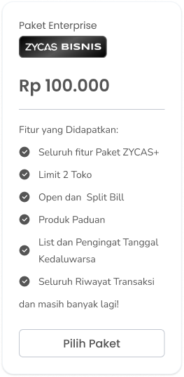
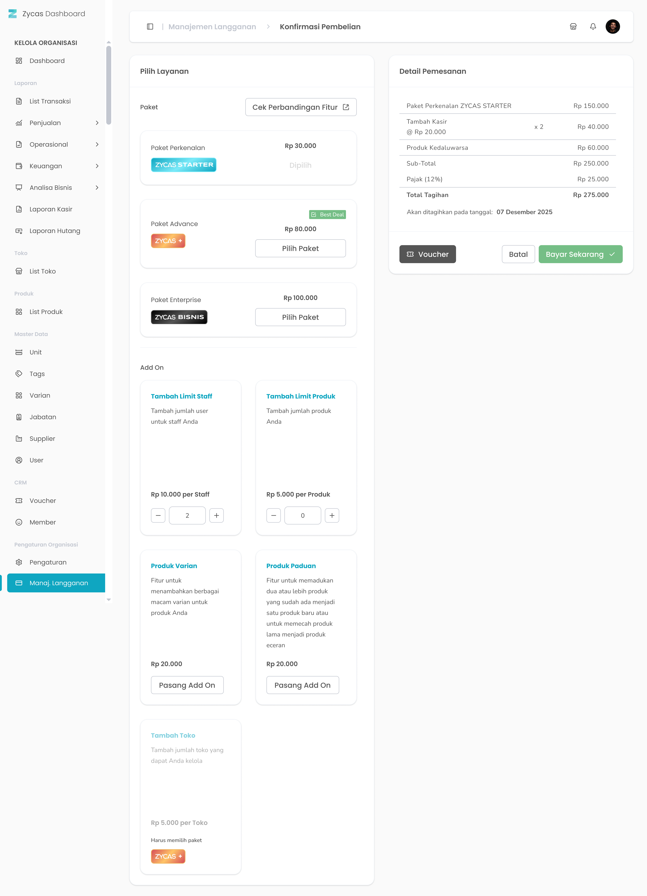
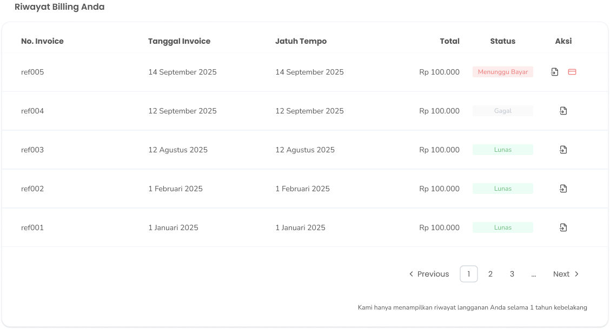

Kelola data langganan Zycas anda mulai dari perpanjang masa langganan dan pembelian add on.

<Frame>
  
</Frame>

<table>
  <colgroup>
    <col width="100" />
    <col width="197" />
    <col width="423" />
  </colgroup>
  <thead>
    <tr>
      <th>No</th>
      <th>Simbol</th>
      <th>Keterangan</th>
    </tr>
  </thead>
  <tbody>
    <tr>
      <td>1</td>
      <td>Perpanjang Langganan</td>
      <td>Tombol untuk perpanjang langganan</td>
    </tr>
    <tr>
      <td>2</td>
      <td>Batalkan Langganan</td>
      <td>Tombol untuk batalkan langganan</td>
    </tr>
    <tr>
      <td>3</td>
      <td>Cek Perbandingan Fitur</td>
      <td>Tombol untuk cek perbandingan fitur</td>
    </tr>
    <tr>
      <td>4</td>
      <td>Upgrade Paket</td>
      <td>Tombol untuk upgrade paket</td>
    </tr>
    <tr>
      <td>5</td>
      <td>Pasang Add On</td>
      <td>Tombol untuk pasang add on</td>
    </tr>
    <tr>
      <td>6</td>
      <td>Batalkan Add On</td>
      <td>Tombol untuk berhenti menggunakan add on</td>
    </tr>
    <tr>
      <td>7</td>
      <td>Detail Invoice</td>
      <td>Tombol untuk melihat detail tagihan</td>
    </tr>
    <tr>
      <td>8</td>
      <td>Bayar Tagihan</td>
      <td>Tombol untuk membayar tagihan</td>
    </tr>
  </tbody>
</table>

## **1.1. Cara Mengakses Menu Manajemen Langganan**

**Berikut cara mengakses menu manajemen langganan:**

1. Tekan menu manajemen langganan pada list menu di sidebar kelola organisasi
   <Frame>
     .png "ONLY ORGANISASI (22ccccccc)")
   </Frame>
2. Setelah menekan tombol, maka akan menampilkan halaman manajemen langganan organisasi

## **1.2. Cara Berhenti Langganan**

**Berikut merupakan langkah-langkah untuk berhenti langganan:** 

1. Tekan tombol “Batalkan Langganan” di halaman manajemen langganan
   <Frame>
     .png "Button (48sdsddsd)")
   </Frame>
2. Setelah menekan tombol maka akan menampilkan pop up konfirmasi membatalkan langganan
   <Frame>
     .png "Alter Dialog (29sddsvcccx)")
   </Frame>
3. Pilih salah satu alasan berhenti langganan dari beberapa opsi yang tersedia
4. Tekan tombol “Ya, Saya Yakin” di halaman konfirmasi untuk melanjutkan berhenti langganan
   <Frame>
     .png "Button 45e(11)")
   </Frame>
5. Tekan tombol “Tidak” di halaman konfirmasi untuk membatalkan berhenti langganan
   <Frame>
     .png "Button2sa (2)")
   </Frame>
6. Setelah menekan tombol “Ya, Saya Yakin”,  maka akan menampilkan halaman manajemen langganan serta notifikasi “Langganan Paket Anda akan kembali ke versi Gratis saat masa berlaku Paket ini habis”

<table>
  <colgroup>
    <col width="118" />
    <col width="596" />
  </colgroup>
  <thead>
    <tr>
      <th style={{ textAlign: "center" }}>**🛈** **Information**</th>
      <th>Langganan akan dikembalikan ke paket gratis setelah tanggal masa aktif berlangganan berakhir</th>
    </tr>
  </thead>
</table>

## **1.3. Cara Berhenti Langganan Add On**

**Berikut merupakan langkah-langkah untuk berhenti langganan add on:** 

1. Tekan tombol “Batalkan Add On” pada salah satu list add on di halaman manajemen langganan
   <Frame>
     .png "Section (5ererere)")
   </Frame>
2. Setelah menekan tombol maka akan menampilkan pop up konfirmasi membatalkan langganan add on
   <Frame>
     .png "Alter Dialog (30fsdfsdff)")
   </Frame>
3. Pilih salah satu alasan berhenti langganan add on dari beberapa opsi yang tersedia
4. Tekan tombol “Ya, Saya Yakin” di halaman konfirmasi untuk melanjutkan berhenti langganan add on
   <Frame>
     .png "Button 45e(11)")
   </Frame>
5. Tekan tombol “Tidak” di halaman konfirmasi untuk membatalkan berhenti langganan add on
   <Frame>
     .png "Button2sa (2)")
   </Frame>
6. Setelah menekan tombol “Ya, Saya Yakin”,  maka akan menampilkan halaman manajemen langganan serta notifikasi “Langganan Add On Anda akan dihentikan sesuai dengan masa aktif Add On”

## **1.4. Cara Pembelian Paket Langganan**

**Berikut merupakan langkah-langkah untuk pembelian paket langganan:**

1. Tekan tombol “Pilih Paket” di halaman manajemen langganan
   <Frame>
     
   </Frame>
2. Setelah menekan tombol, maka akan menampilkan halaman konfirmasi pembayaran
   <Frame>
     
   </Frame>
3. Anda dapat menambahkan add on pada pembelian paket langganan
   <Frame>
     .png "Section (6sdfgggg)")
   </Frame>
4. **Ubah Pilihan Paket**
5. Tekan tombol "Pilih Paket" untuk berganti pilihan paket
   <Frame>
     
   </Frame>
6. **Input Voucher**
7. Tekan tombol “Voucher” untuk input voucher paket berlangganan jika memiliki voucher pembelian paket langganan
   <Frame>
     .png "Button (49ffffff)")
   </Frame>
8. Setelah menekan tombol maka akan menampilkan kolom input kode voucher
   <Frame>
     .png "Alter Dialog (31fsdff)")
   </Frame>
9. Masukkan kode voucher di kolom kode voucher
10. Setelah mengisi kode voucher, tekan tombol “Cek Voucher”
11. Setelah selesai menekan tombol, maka jika kode voucher valid maka akan menambahkan diskon pembayaran langganan di detail transaksi
12. Setelah selesai menambah add on atau voucher, tekan tombol “Bayar Sekarang”
    <Frame>
      .png "Button (50zzzzz)")
    </Frame>
13. Setelah menekan tombol, maka akan menampilkan halaman konfirmasi pembayaran paket langganan
    <Frame>
      .png "Alter Dialog (32qwqwqw)")
    </Frame>
14. Tekan tombol “Ya, Saya Yakin” di halaman konfirmasi untuk melanjutkan pembayaran paket langganan
    <Frame>
      .png "Button2q (1)")
    </Frame>
15. Tekan tombol “Tidak” di halaman konfirmasi untuk membatalkan pembayaran paket langganan
    <Frame>
      .png "Button2sa (2)")
    </Frame>
16. Setelah menekan tombol “Ya, Saya Yakin”,  maka akan menampilkan halaman pembayaran xendit yang sudah men generate kode bayar
17. Lakukan pembayaran paket langganan dan setelah pembayaran sukses maka paket langganan diaktifkan

## **1.5. Cara Perpanjangan Paket Langganan**

**Berikut merupakan langkah-langkah untuk perpanjang paket langganan:**

1. Gulirkan layar kebawah hingga menemukan tabel riwayat billing anda
   <Frame>
     
   </Frame>
2. Tekan tombol “Bayar Tagihan” di tabel riwayat billing anda
   <Frame>
     .png "Button (51dddseee)")
   </Frame>
3. Setelah menekan tombol, maka akan menampilkan halaman pembayaran xendit yang sudah men generate kode bayar
4. Lakukan pembayaran paket langganan dan setelah pembayaran sukses maka paket langganan diaktifkan
