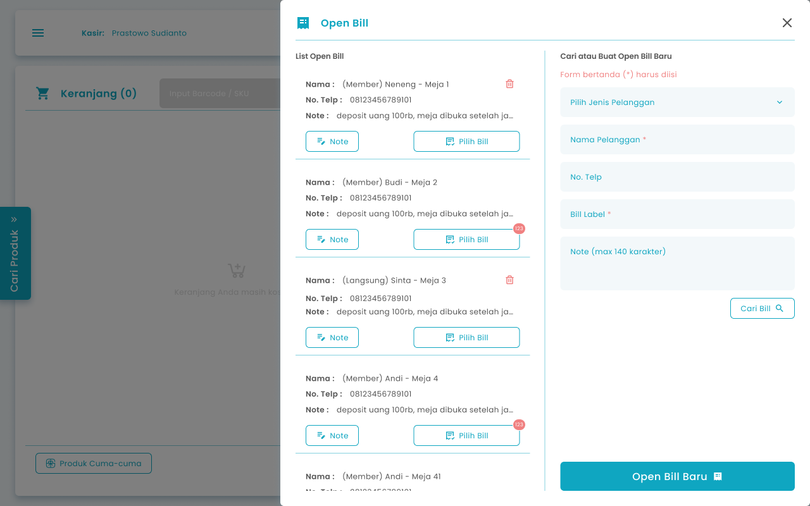
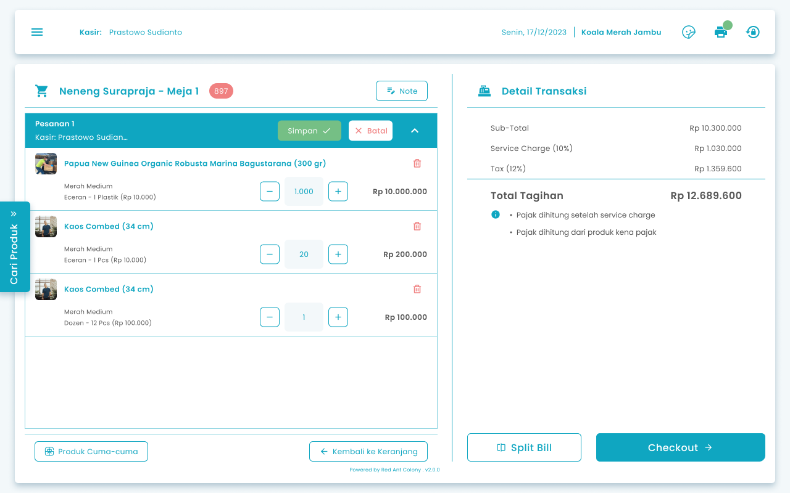
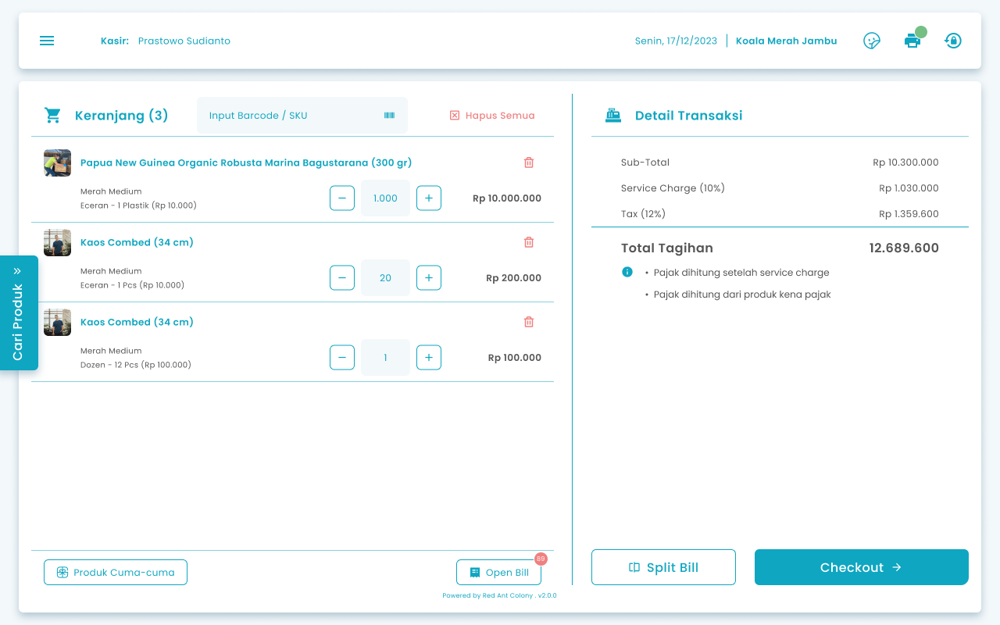
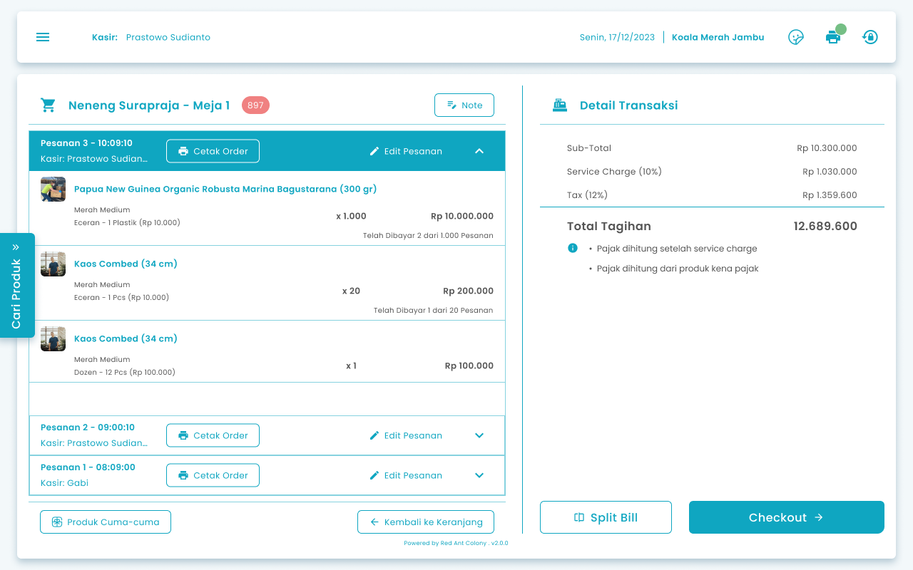

## **1.1. Cara Membuat Open Order Pelanggan Baru**

Kasir dapat simpan pesanan pelanggan baru jika menerapkan mekanisme pesan dulu bayar belakangan

**Berikut cara mengakses menu order order:**

 1. Input item pesanan pada keranjang

    <Frame>
      .png "Android Expanded 171 (1fgyt)")
    </Frame>
 2. Tekan tombol “Open Bill”

    <Frame>
      
    </Frame>
 3. Setelah menekan tombol, maka akan menampilkan halaman list pesanan tersimpan per pelanggan

    <Frame>
      
    </Frame>
 4. **Input data pelanggan baru**
 5. Pilih jenis pelanggan untuk member atau non member

    <Frame>
      .png "Input Right Icon (40qsdg)")
    </Frame>
 5. Masukkan nama pelanggan di kolom nama pelanggan

    <Frame>
      .png "Input Right Icon (41zasca)")
    </Frame>
 6. Masukkan no telp pelanggan di kolom no telp

    <Frame>
      .png "Input Right Icon Sdes(42)")
    </Frame>
 7. Masukkan bill label di kolom bill label

    <Frame>
      .png "Input Right Icon (43sdwe)")
    </Frame>
 8. Masukkan catatan di kolom note

    <Frame>
      .png "Input Right Icon (44sdss)")
    </Frame>
 9. Tekan tombol “Open Bill Baru”

    <Frame>
      .png "Frame 1367 (6dcswefsdf)")
    </Frame>
10. Setelah **Jika terdapat item pesanan pada keranjang**, maka akan menampilkan konfirmasi membawa item pesanan kedalam bill

    <Frame>
      .png "Frame 1205 (sdswwef6)")
    </Frame>
11. Tekan tombol “Ya, Saya Yakin” di halaman konfirmasi untuk menambahkan transaksi berjalan kedalam bill

    <Frame>
      
    </Frame>
12. Tekan tombol “Tidak” di halaman konfirmasi untuk membatalkan proses membawa transaksi berjalan kedalam bill

    <Frame>
      
    </Frame>
13. Setelah menekan tombol “Ya, Saya Yakin”,  maka akan diarahkan ke halaman list transaksi tersimpan dari pelanggan tersebut

    <Frame>
      
    </Frame>
14. Tekan tombol “Simpan”

    <Frame>
      
    </Frame>
15. Setelah menekan tombol, maka akan menampilkan halaman konfirmasi simpan perubahan pesanan

    <Frame>
      .png "Frame 1336 (8dfghjggg)")
    </Frame>
16. Tekan tombol “Ya, Saya Yakin” di halaman konfirmasi untuk melanjutkan proses perubahan pesanan

    <Frame>
      
    </Frame>
17. Tekan tombol “Tidak” di halaman konfirmasi untuk membatalkan proses perubahan pesanan

    <Frame>
      
    </Frame>
18. Setelah menekan tombol, maka akan menampilkan pesan sukses simpan order

## **1.2. Cara Menambah Order Pelanggan dari Open Bill**

Kasir dapat menambahkan order pelanggan dari open bill jika pelanggan melakukan repeat order

**Berikut cara mengakses menu open bill:**

 1. Input item pesanan pada keranjang

    <Frame>
      
    </Frame>
 2. Tekan tombol “Open Bill”

    <Frame>
      
    </Frame>
 3. Setelah menekan tombol, maka akan menampilkan halaman list pesanan tersimpan per pelanggan. Langkah pencarian bill di nomor **4–6 dapat dilewati**, dan Anda dapat **langsung memilih pelanggan dari daftar pesanan tersimpan** yang ditampilkan pada halaman tersebut.

    <Frame>
      
    </Frame>
 4. Masukkan nama pelanggan di kolom nama pelanggan

    <Frame>
      .png "Input Right Icon (41zasca)")
    </Frame>
 5. Masukkan no telp pelanggan di kolom no telp

    <Frame>
      .png "Input Right Icon Sdes(42)")
    </Frame>
 6. Tekan tombol “Cari Bill”

    <Frame>
      dfdds.png "Frame 962 (1)dfdds")
    </Frame>
 7. Setelah menekan tombol, maka akan menampilkan list open bill yang dicari
 8. Tekan tombol “Pilih Bill” dari transaksi tersimpan salah satu pelanggan

    <Frame>
      .png "Frame 970 (3sdfsdfrgsd)")
    </Frame>
 9. Setelah **Jika terdapat item pesanan di keranjang**, maka akan menampilkan konfirmasi membawa item pesanan kedalam bill

    <Frame>
      .png "Frame 1205 (7asder)")
    </Frame>
10. Tekan tombol “Ya, Saya Yakin” di halaman konfirmasi untuk menambahkan transaksi berjalan kedalam bill

    <Frame>
      
    </Frame>
11. Tekan tombol “Tidak” di halaman konfirmasi untuk membatalkan proses membawa transaksi berjalan kedalam bill

    <Frame>
      
    </Frame>
12. Setelah menekan tombol “Ya, Saya Yakin”,  maka akan diarahkan ke halaman list transaksi tersimpan dari pelanggan tersebut 

    <Frame>
      
    </Frame>
13. Tekan tombol “Simpan”

    <Frame>
      
    </Frame>
14. Setelah menekan tombol, maka akan menampilkan halaman konfirmasi simpan perubahan pesanan

    <Frame>
      .png "Frame 1336 (8dfghjggg)")
    </Frame>
15. Tekan tombol “Ya, Saya Yakin” di halaman konfirmasi untuk melanjutkan proses perubahan pesanan

    <Frame>
      
    </Frame>
16. Tekan tombol “Tidak” di halaman konfirmasi untuk membatalkan proses perubahan pesanan

    <Frame>
      
    </Frame>
17. Setelah menekan tombol, maka akan menampilkan pesan sukses simpan order

## **1.3. Cara Mengubah Order Pelanggan dari Open Bill**

Kasir dapat mengubah pesanan yang terdapat pada open bill

**Berikut cara mengakses menu open bill:**

 1. Tekan Tekan tombol “Open Bill” di halaman keranjang pesanan

    <Frame>
      
    </Frame>
 2. Setelah menekan tombol, maka akan menampilkan halaman list pesanan tersimpan per pelanggan
 3. Tekan tombol “Pilih Bill” dari transaksi tersimpan salah satu pelanggan

    <Frame>
      .png "Frame 970 (3sdfsdfrgsd)")
    </Frame>
 4. Setelah memilih transaksi tersimpan maka akan menampilkan list transaksi tersimpan dari pelanggan tersebut di halaman kasir

    <Frame>
      
    </Frame>
 5. Tekan tombol “Edit Pesanan” pada salah satu pesanan yang dipilih

    <Frame>
      .png "Frame 962 (3ddsfs)")
    </Frame>
 6. Setelah menekan tombol, maka akan diarahkan ke halaman kasir untuk menambah, mengubah atau menghapus pesanan

    <Frame>
      
    </Frame>
 7. **Jika anda ingin simpan perubahan pesanan**
 8. Tekan tombol “Simpan”

    <Frame>
      
    </Frame>
 9. Setelah menekan tombol, maka akan menampilkan halaman konfirmasi simpan perubahan pesanan

    <Frame>
      .png "Frame 1336 (8dfghjggg)")
    </Frame>
10. Tekan tombol “Ya, Saya Yakin” di halaman konfirmasi untuk melanjutkan proses perubahan pesanan

    <Frame>
      
    </Frame>
11. Tekan tombol “Tidak” di halaman konfirmasi untuk membatalkan proses perubahan pesanan

    <Frame>
      
    </Frame>
12. Setelah menekan tombol “Ya, Saya Yakin”,  maka akan menampilkan pesan sukses mengubah pesanan tersimpan
13. **Jika anda ingin membatalkan perubahan pesanan**
14. Tekan tombol “Batal”

    <Frame>
      .png "Frame 6 (4dfdrg)")
    </Frame>
15. Setelah menekan tombol, maka akan menampilkan halaman konfirmasi batalkan perubahan pesanan

    <Frame>
      .png "Frame 1336 (fdfg9)")
    </Frame>
16. Tekan tombol “Ya, Saya Yakin” di halaman konfirmasi untuk melanjutkan proses pembatalan perubahan pesanan

    <Frame>
      .png "Button 45e(11)")
    </Frame>
17. Tekan tombol “Tidak” di halaman konfirmasi untuk membatalkan proses pembatalan perubahan pesanan

    <Frame>
      
    </Frame>
18. Setelah menekan tombol “Ya, Saya Yakin”,  maka akan mengembalikan pesanan tersimpan ke pesanan tersimpan sebelum diubah

## **1.4. Cara Mencetak Order di Open Bill**

Kasir dapat mencetak pesanan pelanggan di open bill

**Berikut cara mengakses menu simpan order:**

1. Tekan Tekan tombol “Open Bill” di halaman keranjang pesanan

   <Frame>
     
   </Frame>
2. Setelah menekan tombol, maka akan menampilkan halaman list pesanan tersimpan per pelanggan
3. Tekan tombol “Pilih Bill” dari transaksi tersimpan salah satu pelanggan

   <Frame>
     .png "Frame 970 (3sdfsdfrgsd)")
   </Frame>
4. Setelah memilih transaksi tersimpan maka akan menampilkan list transaksi tersimpan dari pelanggan tersebut di halaman kasir

   <Frame>
     
   </Frame>
5. Tekan tombol “Cetak Order” pada salah satu pesanan yang dipilih

   <Frame>
     
   </Frame>
6. Setelah menekan tombol maka akan menampilkan list printer kasir yang terhubung

   <Frame>
     .png "Android Expanded 486 (1rtge)")
   </Frame>
7. Tekan tombol refresh untuk memindai ulang perangkat printer kasir

   <Frame>
     
   </Frame>
8. Tekan tombol printer di salah satu list printer yang terhubung

   <Frame>
     .png "Material Symbols Print (dfdr1)")
   </Frame>
9. Setelah menekan tombol, maka akan menampilkan pesan sukses cetak order dan mencetak nota di printer kasir
