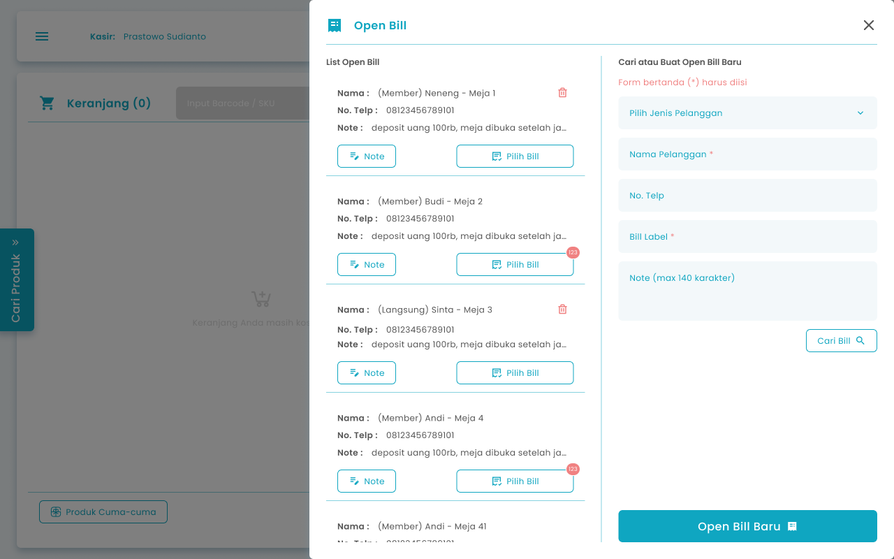
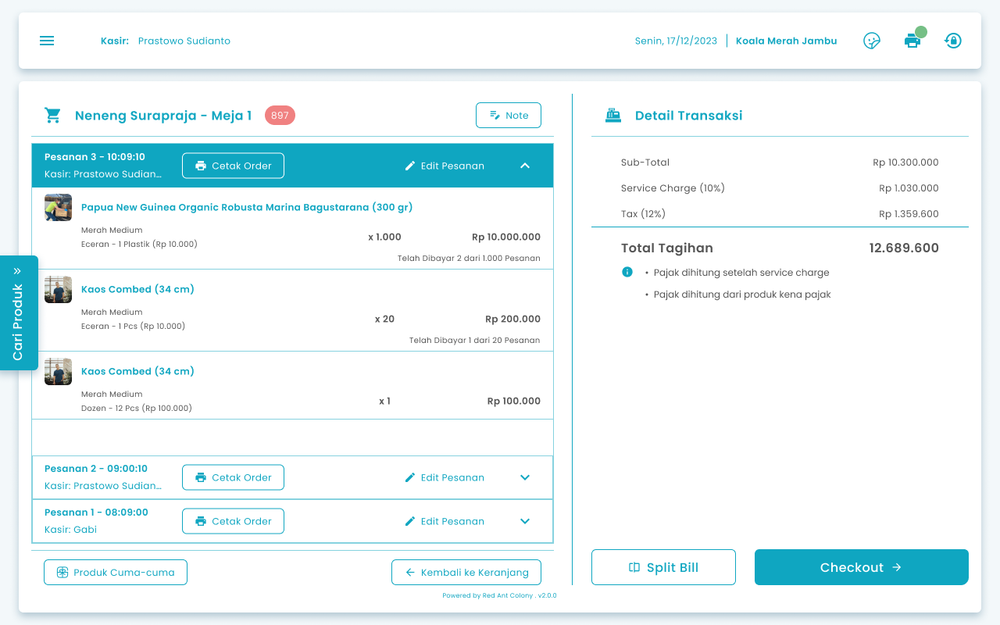
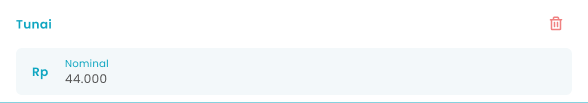

## **1.1. Cara Memproses Pembayaran di Order Open Bill**

Kasir dapat memproses pembayaran order pelanggan yang tercatat di list open bill

**Berikut cara mengakses menu pembayaran transaksi:**

 1. Tekan tombol “Open Bill” di halaman keranjang pesanan

    <Frame>
      
    </Frame>
 2. Setelah menekan tombol, maka akan menampilkan halaman list pesanan tersimpan per pelanggan. Pada halaman ini, **langkah 3–6 dapat dilewati** dan pengguna dapat langsung memilih bill dari daftar yang ditampilkan.

    <Frame>
      
    </Frame>
 3. Masukkan nama pelanggan di kolom nama pelanggan

    <Frame>
      .png "Input Right Icon (41zasca)")
    </Frame>
 4. Masukkan no telp pelanggan di kolom no telp

    <Frame>
      .png "Input Right Icon Sdes(42)")
    </Frame>
 5. Tekan tombol “Cari Bill”

    <Frame>
      dfdds.png "Frame 962 (1)dfdds")
    </Frame>
 6. Setelah menekan tombol, maka akan menampilkan list pesanan tersimpan yang dicari
 7. Tekan tombol “Pilih Bill” dari transaksi tersimpan salah satu pelanggan

    <Frame>
      .png "Frame 970 (3sdfsdfrgsd)")
    </Frame>
 8. Setelah memilih transaksi tersimpan maka akan menampilkan list transaksi tersimpan dari pelanggan tersebut di halaman kasir

    <Frame>
      
    </Frame>
 9. Tekan tombol “Checkout”

    <Frame>
      
    </Frame>
10. Setelah menekan tombol, maka akan menampilkan halaman checkout pembayaran
11. **Jika pelanggan merupakan member**
12. Pilih member di kolom Pelanggan Langsung

    <Frame>
      .png "Input Right Icon (31sdr)")
    </Frame>
13. Setelah menekan tombol, maka akan menampilkan list member
14. Pilih salah satu member
15. **Jika pelanggan bukan merupakan member**
15. Masukkan nama pelanggan di kolom nama pelanggan untuk pelanggan non member

    <Frame>
      .png "Input Right Icon (32wsqad)")
    </Frame>
16. Masukkan no telp pelanggan di kolom no telp

    <Frame>
      .png "Input Right Icon (3dsfth3)")
    </Frame>
17. **Jika Pembayaran Menggunakan Metode Pembayaran Tunai**
18. Tekan tombol “Tunai”

    <Frame>
      
    </Frame>
19. Setelah menekan tombol, maka akan menampilkan kolom input nominal tunai

    <Frame>
      
    </Frame>
20. Masukkan jumlah nominal pembayaran pelanggan di kolom nominal
21. Setelah selesai mengisi nominal pembayaran, kemudian tekan tombol “Bayarkan Sekarang”

    <Frame>
      
    </Frame>
22. Setelah selesai menekan tombol, maka akan menampilkan halaman konfirmasi pembayaran transaksi

    <Frame>
      .png "Frame 1336 (7sdvdse)")
    </Frame>
23. Tekan tombol “Ya, Saya Yakin” di halaman konfirmasi untuk melanjutkan proses pembayaran transaksi

    <Frame>
      
    </Frame>
24. Tekan tombol “Tidak” di halaman konfirmasi untuk membatalkan proses pembayaran transaksi

    <Frame>
      
    </Frame>
25. Setelah menekan tombol “Ya, Saya Yakin”,  maka akan menampilkan halaman pembayaran sukses
