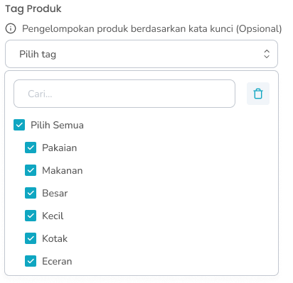
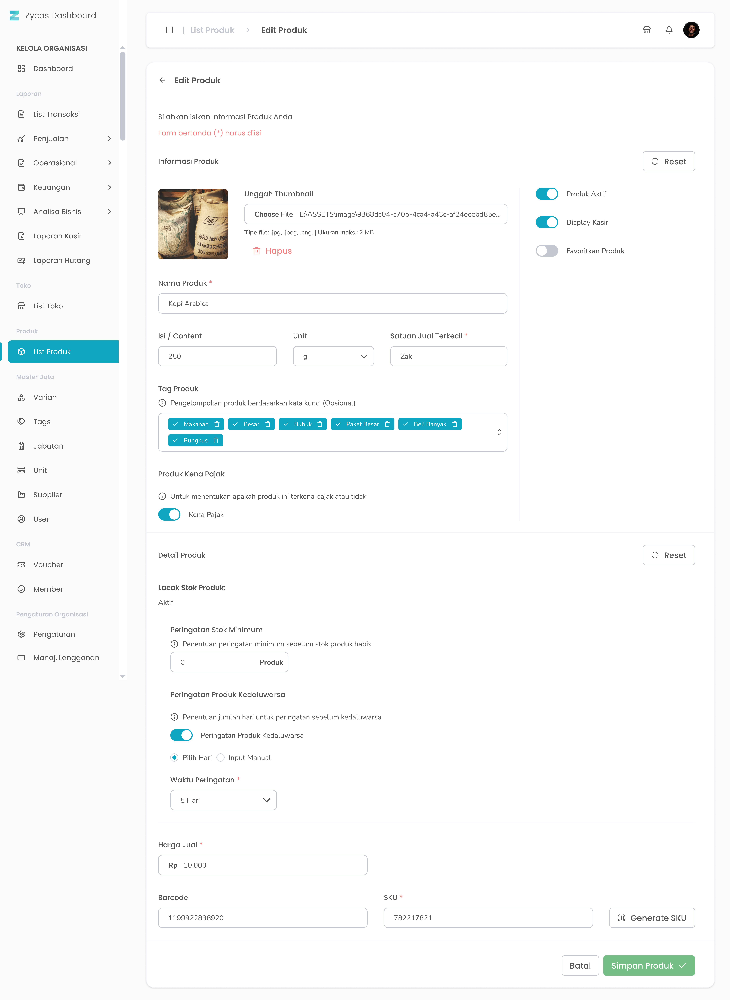

## 1.1. Cara Menambah Produk Biasa

Menu Tambah Produk adalah menu yang dapat digunakan untuk menambahkan produk biasa. Untuk mengakses halaman ini adalah dengan klik tombol “Tambah Produk” di halaman list produk

<Frame>
  .jpg "Tambah Produk (asdxdadf2)")
</Frame>

<table>
  <colgroup>
    <col width="50" />
    <col width="218" />
    <col width="445" />
  </colgroup>
  <thead>
    <tr>
      <th>No</th>
      <th>Simbol</th>
      <th>Keterangan</th>
    </tr>
  </thead>
  <tbody>
    <tr>
      <td>1</td>
      <td>Unggah Foto</td>
      <td>Tombol untuk mengunggah foto produk</td>
    </tr>
    <tr>
      <td>2</td>
      <td>Produk Aktif</td>
      <td>Tombol untuk mengaktifkan produk</td>
    </tr>
    <tr>
      <td>3</td>
      <td>Display Kasir</td>
      <td>Tombol untuk menampilkan produk di Halaman Kasir</td>
    </tr>
    <tr>
      <td>4</td>
      <td>Favoritkan Produk</td>
      <td>Tombol untuk favoritkan produk</td>
    </tr>
    <tr>
      <td>5</td>
      <td>Nama Produk</td>
      <td>Tombol untuk mengisi nama produk</td>
    </tr>
    <tr>
      <td>6</td>
      <td>Isi/Content</td>
      <td>Tombol untuk mengisi total berat atau jumlah isi dari satu produk (250,1)</td>
    </tr>
    <tr>
      <td>7</td>
      <td>Unit</td>
      <td>Tombol untuk memilih unit yang sudah dibuat dari master data (gram, pcs)</td>
    </tr>
    <tr>
      <td>8</td>
      <td>Satuan Jual Terkecil</td>
      <td>Tombol untuk mengisi jenis kemasan dari produk (plastik, karton)</td>
    </tr>
    <tr>
      <td>9</td>
      <td>Produk Kena Pajak</td>
      <td>Tombol untuk mengaktifkan produk kena pajak</td>
    </tr>
    <tr>
      <td>10</td>
      <td>Tag Produk</td>
      <td>Tombol untuk memilih beberapa tag produk yang sudah dibuat dari master data</td>
    </tr>
    <tr>
      <td>11</td>
      <td>Atur Produk Paduan</td>
      <td>Tombol untuk mengatur produk paduan</td>
    </tr>
    <tr>
      <td>12</td>
      <td>Atur Varian</td>
      <td>Tombol untuk mengatur produk varian</td>
    </tr>
    <tr>
      <td>13</td>
      <td>Lacak stok produk</td>
      <td>Tombol untuk mengaktifkan peringatan stok minimum produk sebelum habis</td>
    </tr>
    <tr>
      <td>14</td>
      <td>Peringatan stok minimum</td>
      <td>Tombol untuk mengisi jumlah stok sebagai penentuan peringatan sebelum habis</td>
    </tr>
    <tr>
      <td>15</td>
      <td>Peringatan Produk Kadaluarsa</td>
      <td>Tombol untuk mengaktifkan peringatan produk sebelum kadaluarsa</td>
    </tr>
    <tr>
      <td>16</td>
      <td>Pilih Hari/Input Manual</td>
      <td>Tombol untuk memilih jenis input hari peringatan kadaluarsa yang terdiri dari pilih hari atau input manual</td>
    </tr>
    <tr>
      <td>17</td>
      <td>Jumlah Hari</td>
      <td>Tombol untuk mengisi jumlah hari peringatan sebelum kadaluarsa</td>
    </tr>
    <tr>
      <td>18</td>
      <td>Harga Jual</td>
      <td>Tombol untuk mengisi harga jual produk</td>
    </tr>
    <tr>
      <td>19</td>
      <td>Barcode</td>
      <td>Tombol untuk mengisi barcode dari produk</td>
    </tr>
    <tr>
      <td>20</td>
      <td>Kode SKU</td>
      <td>Tombol untuk mengisi kode SKU dari produk</td>
    </tr>
    <tr>
      <td>21</td>
      <td>Generate SKU</td>
      <td>Tombol untuk membuat kode SKU secara otomatis</td>
    </tr>
    <tr>
      <td>22</td>
      <td>Multi Kemasan/Grosir</td>
      <td>Tombol untuk memilih harga multi satuan yang terdiri dari harga multi kemasan atau harga grosir</td>
    </tr>
    <tr>
      <td>23</td>
      <td>Nama satuan</td>
      <td>Tombol untuk mengisi nama satuan (single, lusin, box)</td>
    </tr>
    <tr>
      <td>24</td>
      <td>Quantity</td>
      <td>Tombol untuk mengisi quantity satuan dari produk</td>
    </tr>
    <tr>
      <td>25</td>
      <td>Nominal</td>
      <td>Tombol untuk mengisi nominal satuan</td>
    </tr>
    <tr>
      <td>26</td>
      <td>Opsi harga</td>
      <td>Tombol untuk menambahkan kolom input harga satuan</td>
    </tr>
    <tr>
      <td>27</td>
      <td>Simpan dan Input Stok Awal</td>
      <td>Tombol untuk menyimpan data produk dan melanjutkan proses input stok</td>
    </tr>
  </tbody>
</table>

**Berikut Cara Menambahkan Data Produk**

1. Tekan tombol "Tambah Produk" di halaman list produk
   <Frame>
     .png "Button (40asddasd)")
   </Frame>
2. Setelah menekan tombol, maka akan menampilkan halaman form tambah produk
3. Unggah foto produk dengan tekan tombol “Unggah Foto”
   <Frame>
     
   </Frame>
4. Anda dapat mengaktifkan atau menonaktifkan produk
   <Frame>
     .png "Switch (2dsfrd)")
   </Frame>
5. Anda dapat menampilkan produk atau menyembunyikan produk di halaman kasir
   <Frame>
     .png "Switch (3asdesas)")
   </Frame>
6. Anda dapat menjadikan produk sebagai produk favorit
   <Frame>
     .png "Switch (4sdsdws)")
   </Frame>
7. Masukkan nama produk di kolom nama produk
   <Frame>
     .png "Input (52asdawd)")
   </Frame>
8. Masukkan isi / content di kolom isi/content
   <Frame>
     .png "Input (53sdswd)")
   </Frame>
9. Tekan tombol “Unit” di kolom unit produk
   <Frame>
     .png "Input (54ssass)")
   </Frame>
10. Setelah menekan tombol maka akan menampilkan daftar unit produk yang sudah anda tambahkan dari master data unit produk
11. Setelah selesai memilih unit produk, maka akan menampilkan unit produk di halaman tambah produk
12. Masukkan satuan jual terkecil di kolom Satuan Jual Terkecil
    <Frame>
      .png "Input (55asasa)")
    </Frame>
13. Anda dapat mengaktifkan pajak pada produk
    <Frame>
      .png "Switch (5zxczx)")
    </Frame>
14. Tekan tombol “Pilih Tags” di kolom tag produk
    <Frame>
      
    </Frame>
15. Setelah menekan tombol maka akan menampilkan daftar tag produk yang sudah anda tambahkan dari master data tags produk
16. Pilih beberapa tag produk
17. Setelah selesai memilih tag produk, maka akan menampilkan list tag di halaman tambah produk
18. **Anda dapat mengaktifkan atau menonaktifkan peringatan lacak stok produk**
    <Frame>
      .png "Switch (6dsddd)")
    </Frame>
19. **Jika mengaktifkan peringatan stok produk maka anda perlu memasukkan jumlah stok minimum sebagai pengingat stok habis di kolom peringatan stok minimum**
    <Frame>
      
    </Frame>
20. **Anda dapat mengaktifkan peringatan produk kadaluarsa**
    <Frame>
      .png "Switch (7ddrdss)")
    </Frame>
21. Jika mengaktifkan peringatan produk kadaluarsa maka anda perlu memilih jumlah hari munculnya peringatan sebelum tanggal kadaluarsa produk tersebut
    <Frame>
      .png "Input (56xszad)")
    </Frame>
22. **Jika menonaktifkan peringatan stok produk maka tidak dapat input stok awal produk dan tidak dapat mengaktifkan peringatan produk kadaluarsa**
23. Masukkan harga jual di kolom harga jual
    <Frame>
      .png "Input (57asdsd)")
    </Frame>
24. **Masukkan harga modal jika anda menonaktifkan peringatan stok produk sebelumnya**
    <Frame>
      .png "Input (58asdfed)")
    </Frame>
25. Masukkan barcode di kolom barcode
    <Frame>
      .png "Input (59asdefdd)")
    </Frame>
26. Masukkan kode sku di kolom kode sku
    <Frame>
      .png "Input (60qwedsxe)")
    </Frame>
27. Tekan tombol “Generate SKU” untuk membuat kode sku secara otomatis
    <Frame>
      .png "Button (41ddsfrfdsfse)")
    </Frame>
28. **Menambahkan Harga Multi Satuan**
29. Anda dapat memilih harga multi satuan sebagai harga kemasan atau harga grosir pada harga multi satuan
    <Frame>
      .png "Radio Group (1ddd)")
    </Frame>
30. Anda dapat menambahkan harga multi satuan produk dengan menekan tombol tambah opsi harga sebanyak opsi harga yang diperlukan
    <Frame>
      .png "Button (42sdsd)")
    </Frame>
31. Setelah menekan tombol maka akan menambahkan kolom input satuan
    <Frame>
      
    </Frame>
32. Masukkan nama satuan di kolom satuan
33. Masukkan kuantiti di kolom kuantiti
34. Masukkan nominal satuan di kolom nominal
35. Setelah selesai mengisi data produk, kemudian tekan tombol “Simpan dan Input Stok Awal” maka akan menampilkan halaman pengaturan stok awal
    <Frame>
      .png "Button (43asdewd)")
    </Frame>

<table>
  <colgroup>
    <col width="123" />
    <col width="603" />
  </colgroup>
  <thead>
    <tr>
      <th style={{ textAlign: "center" }}>**🛈** **Information**</th>
      <th><ul><li>Menonaktifkan Lacak Stok Produk menandakan anda menambahkan produk yang tidak memiliki acuan stok yang tidak dapat ditentukan stoknya sebagai contoh produk jasa yaitu potong rambut, cabut gigi, dll</li><li>**Contoh harga multi kemasan** Satu botol air mineral Rp5.000, tetapi paket isi 6 botol dijual Rp28.000 (lebih murah per botol)</li><li>**Contoh harga grosir** Karton mie instan isi 40 bungkus dijual Rp95.000, sehingga per bungkus hanya Rp2.375 (lebih murah dibanding harga eceran Rp3.000).</li></ul></th>
    </tr>
  </thead>
</table>

36. Cara Menambahkan Stok Awal Menu Atur Stok Awal adalah menu yang berisi form untuk menambahkan stok awal produk yang sedang dibuat. Untuk mengakses halaman ini adalah dengan tekan tombol “Simpan dan Input Stok Awal”  di halaman Tambah Produk

<Frame>
  .jpg "Atur Stok (1sdfsdfe)")
</Frame>

<table>
  <colgroup>
    <col width="54" />
    <col width="184" />
    <col width="468" />
  </colgroup>
  <thead>
    <tr>
      <th>No</th>
      <th>Simbol</th>
      <th>Keterangan</th>
    </tr>
  </thead>
  <tbody>
    <tr>
      <td>1</td>
      <td>Tanggal stok awal</td>
      <td>Kolom untuk mengisi tanggal stok awal produk baru</td>
    </tr>
    <tr>
      <td>2</td>
      <td>Pilih Toko</td>
      <td>Kolom untuk mengisi stok di toko tertentu</td>
    </tr>
    <tr>
      <td>3</td>
      <td>Stok awal</td>
      <td>Kolom untuk mengisi jumlah stok awal produk baru</td>
    </tr>
    <tr>
      <td>4</td>
      <td>Harga beli</td>
      <td>Kolom untuk mengisi harga beli produk baru</td>
    </tr>
    <tr>
      <td>5</td>
      <td>Tanggal kadaluarsa</td>
      <td>Kolom untuk mengisi tanggal kadaluarsa produk</td>
    </tr>
    <tr>
      <td>6</td>
      <td>Simpan Produk</td>
      <td>Tombol untuk melanjutkan proses menyimpan produk</td>
    </tr>
    <tr>
      <td>7</td>
      <td>Lewati Pengisian Stok</td>
      <td>Tombol untuk melewati proses pengisian stok awal</td>
    </tr>
    <tr>
      <td>8</td>
      <td>Stok Toko Lain</td>
      <td>Tombol untuk mengisi stok di toko lain</td>
    </tr>
  </tbody>
</table>

37. Pilih toko tertentu untuk input stok awal di kolom toko

<Frame>
  .png "Input (6sdfsdff5)")
</Frame>

38. Masukkan tanggal input stok awal di kolom tanggal stok awal

<Frame>
  .png "Input (61asdeds)")
</Frame>

39. Masukkan jumlah stok awal di kolom stok awal

<Frame>
  .png "Input (62ddsf)")
</Frame>

40. Masukkan harga beli di kolom harga beli

<Frame>
  .png "Input (63dfdfx)")
</Frame>

41. Masukkan tanggal kadaluarsa produk di kolom tanggal kadaluarsa jika anda mengaktifkan peringatan produk kadaluarsa sebelumnya

<Frame>
  .png "Input (64dfdfrf)")
</Frame>

42. Tekan tombol "Tambah Stok Toko Lain" untuk input stok di toko lainnya

<Frame>
  .png "Button (45sdefdsff)")
</Frame>

43. Setelah menekan tombol, maka akan menampilkan kolom input stok di toko lain
44. Setelah selesai mengisi data stok, kemudian tekan tombol “Simpan Produk"

<Frame>
  .png "Button (44sddfed)")
</Frame>

45. Setelah menekan tombol, maka akan menampilkan halaman konfirmasi simpan produk

<Frame>
  .png "Alter Dialog (27asdddc)")
</Frame>

46. Tekan tombol “Ya, Saya Yakin” di halaman konfirmasi untuk melanjutkan proses simpan produk

<Frame>
  .png "Button2q (1)")
</Frame>

47. Tekan tombol “Tidak” di halaman konfirmasi untuk membatalkan simpan produk

<Frame>
  .png "Button2sa (2)")
</Frame>

48. Setelah menekan tombol “Ya, Saya Yakin”,  maka akan menampilkan halaman sukses tambah produk

## 1.2. Cara Mengubah Produk Biasa

Menu Ubah Produk adalah menu yang dapat digunakan untuk mengubah produk biasa. Untuk mengakses halaman ini adalah dengan klik tombol “Edit Produk” di halaman list produk

<Frame>
  
</Frame>

<table>
  <colgroup>
    <col width="53" />
    <col width="214" />
    <col width="444" />
  </colgroup>
  <thead>
    <tr>
      <th>No</th>
      <th>Simbol</th>
      <th>Keterangan</th>
    </tr>
  </thead>
  <tbody>
    <tr>
      <td>1</td>
      <td>Reset Informasi Produk</td>
      <td>Tombol mengembalikan data informasi produk ke semula sebelum diubah</td>
    </tr>
    <tr>
      <td>2</td>
      <td>Unggah Foto</td>
      <td>Tombol untuk mengunggah foto produk</td>
    </tr>
    <tr>
      <td>3</td>
      <td>Produk Aktif</td>
      <td>Tombol untuk mengaktifkan produk</td>
    </tr>
    <tr>
      <td>4</td>
      <td>Display Kasir</td>
      <td>Tombol untuk menampilkan produk di Halaman Kasir</td>
    </tr>
    <tr>
      <td>5</td>
      <td>Favoritkan Produk</td>
      <td>Tombol untuk favoritkan produk</td>
    </tr>
    <tr>
      <td>6</td>
      <td>Nama Produk</td>
      <td>Tombol untuk mengisi nama produk</td>
    </tr>
    <tr>
      <td>7</td>
      <td>Isi/Content</td>
      <td>Tombol untuk mengisi total berat atau jumlah isi dari satu produk (250,1)</td>
    </tr>
    <tr>
      <td>8</td>
      <td>Unit</td>
      <td>Tombol untuk memilih unit yang sudah dibuat dari master data (gram, pcs)</td>
    </tr>
    <tr>
      <td>9</td>
      <td>Satuan Jual Terkecil</td>
      <td>Tombol untuk mengisi jenis kemasan dari produk (plastik, karton)</td>
    </tr>
    <tr>
      <td>10</td>
      <td>Produk Kena Pajak</td>
      <td>Tombol untuk mengaktifkan produk kena pajak</td>
    </tr>
    <tr>
      <td>11</td>
      <td>Tag Produk</td>
      <td>Tombol untuk memilih beberapa tag produk yang sudah dibuat dari master data</td>
    </tr>
    <tr>
      <td>12</td>
      <td>Reset Detail Produk</td>
      <td>Tombol mengembalikan data detail produk ke semula sebelum diubah</td>
    </tr>
    <tr>
      <td>13</td>
      <td>Peringatan stok minimum</td>
      <td>Tombol untuk mengisi jumlah stok sebagai penentuan peringatan sebelum habis</td>
    </tr>
    <tr>
      <td>14</td>
      <td>Peringatan Produk Kadaluarsa</td>
      <td>Tombol untuk mengaktifkan peringatan produk sebelum kadaluarsa</td>
    </tr>
    <tr>
      <td>15</td>
      <td>Pilih Hari/Input Manual</td>
      <td>Tombol untuk memilih jenis input hari peringatan kadaluarsa yang terdiri dari pilih hari atau input manual</td>
    </tr>
    <tr>
      <td>16</td>
      <td>Jumlah Hari</td>
      <td>Tombol untuk mengisi jumlah hari peringatan sebelum kadaluarsa</td>
    </tr>
    <tr>
      <td>17</td>
      <td>Harga Jual</td>
      <td>Tombol untuk mengisi harga jual produk</td>
    </tr>
    <tr>
      <td>18</td>
      <td>Barcode</td>
      <td>Tombol untuk mengisi barcode dari produk</td>
    </tr>
    <tr>
      <td>19</td>
      <td>Kode SKU</td>
      <td>Tombol untuk mengisi kode SKU dari produk</td>
    </tr>
    <tr>
      <td>20</td>
      <td>Generate SKU</td>
      <td>Tombol untuk membuat kode SKU secara otomatis</td>
    </tr>
    <tr>
      <td>21</td>
      <td>Simpan Produk</td>
      <td>Tombol untuk menyimpan perubahan data produk biasa</td>
    </tr>
  </tbody>
</table>

**Berikut merupakan tahapan mengubah produk biasa:**

1. Tekan tombol "Edit Produk" pada salah satu produk biasa di halaman list produk
   <Frame>
     
   </Frame>
2. Setelah menekan tombol, maka akan menampilkan halaman form edit produk
3. Anda dapat mengubah foto produk dengan tekan tombol “Unggah Foto”
   <Frame>
     
   </Frame>
4. Anda dapat mengaktifkan atau menonaktifkan produk
   <Frame>
     .png "Switch (2dsfrd)")
   </Frame>
5. Anda dapat menampilkan produk atau menyembunyikan produk di halaman kasir
   <Frame>
     .png "Switch (3asdesas)")
   </Frame>
6. Anda dapat menjadikan produk sebagai produk favorit
   <Frame>
     .png "Switch (4sdsdws)")
   </Frame>
7. Anda dapat mengubah nama produk di kolom nama produk
   <Frame>
     .png "Input (52asdawd)")
   </Frame>
8. Anda dapat mengubah isi / content di kolom isi/content
   <Frame>
     .png "Input (53sdswd)")
   </Frame>
9. Anda dapat mengubah dengan tekan tombol “Unit” di kolom unit produk
   <Frame>
     .png "Input (54ssass)")
   </Frame>
10. Setelah menekan tombol maka akan menampilkan list unit yang sudah anda tambahkan dari master data unit produk
11. Setelah selesai memilih unit produk maka akan menampilkan unit di halaman tambah produk
12. Anda dapat mengubah satuan jual terkecil di kolom Satuan Jual Terkecil
    <Frame>
      .png "Input (55asasa)")
    </Frame>
13. Anda dapat mengaktifkan pajak pada produk
    <Frame>
      .png "Switch (5zxczx)")
    </Frame>
14. Anda dapat menambahkan tag produk dengan tekan tombol “Pilih Tags” di kolom tag produk
    <Frame>
      
    </Frame>
15. Setelah menekan tombol maka akan menampilkan daftar tag produk yang sudah anda tambahkan di master data tags produk
16. Pilih beberapa tag produk
17. Setelah memilih beberapa tag, maka akan menampilkan list tag di halaman tambah produk
18. Tekan tombol “hapus” dengan ikon keranjang sampah untuk menghapus tag yang tidak diperlukan
    <Frame>
      
    </Frame>
19. Anda dapat mengembalikan perubahan informasi produk ke awal sebelum diubah dengan menekan tombol “Reset”
    <Frame>
      
    </Frame>
20. **Jika peringatan stok produk aktif maka anda dapat mengubah jumlah stok minimum sebagai pengingat stok habis di kolom peringatan stok minimum**
    <Frame>
      
    </Frame>
21. **Jika peringatan stok produk aktif maka anda dapat mengaktifkan peringatan produk kadaluarsa**
    <Frame>
      .png "Switch (7ddrdss)")
    </Frame>
22. Jika mengaktifkan peringatan produk kadaluarsa maka anda perlu memilih jumlah hari sebelum tanggal kadaluarsa produk tersebut
    <Frame>
      .png "Input (56xszad)")
    </Frame>
23. Anda dapat mengubah harga jual di kolom harga jual
    <Frame>
      .png "Input (57asdsd)")
    </Frame>
24. **Anda dapat mengubah harga modal jika anda menonaktifkan peringatan stok produk sebelumnya**
    <Frame>
      .png "Input (58asdfed)")
    </Frame>
25. Anda dapat mengubah barcode di kolom barcode
    <Frame>
      .png "Input (59asdefdd)")
    </Frame>
26. Anda dapat mengubah kode sku di kolom kode sku
    <Frame>
      .png "Input (60qwedsxe)")
    </Frame>
27. Tekan tombol “Generate SKU” untuk membuat kode sku secara otomatis
    <Frame>
      .png "Button (41ddsfrfdsfse)")
    </Frame>
28. Anda dapat mengembalikan perubahan detail produk ke awal sebelum diubah dengan menekan tombol “Reset”
    <Frame>
      
    </Frame>
29. **Menambahkan atau mengubah Harga Multi Satuan**
30. Anda dapat memilih harga multi satuan sebagai harga kemasan atau harga grosir
    <Frame>
      .png "Radio Group (1ddd)")
    </Frame>
31. Anda dapat menambahkan satuan produk dengan menekan tombol tambah opsi harga
    <Frame>
      .png "Button (42sdsd)")
    </Frame>
32. Setelah menekan tombol maka akan menambahkan kolom input satuan
    <Frame>
      
    </Frame>
33. Anda dapat mengubah atau menambahkan data baru untuk nama satuan di kolom satuan
34. Anda dapat mengubah atau menambahkan data baru untuk kuantiti di kolom kuantiti
35. Anda dapat mengubah atau menambahkan data baru untuk nominal satuan di kolom nominal
36. Tekan tombol “Hapus” untuk menghapus satuan produk
37. Anda dapat mengembalikan perubahan harga produk ke awal sebelum diubah dengan menekan tombol “Reset”
    <Frame>
      
    </Frame>
38. Setelah selesai mengubah data produk, kemudian tekan tombol “Simpan Produk” maka akan menampilkan pesan sukses mengubah produk dan kembali ke halaman list produk
    <Frame>
      .png "Button (44sddfed)")
    </Frame>
