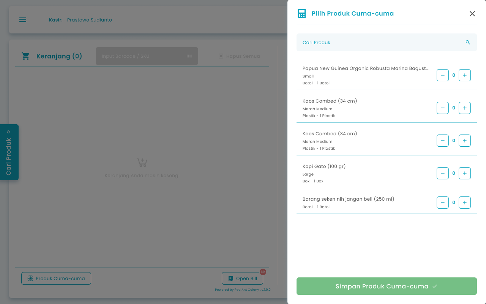

## **1.1. Cara Menambahkan Produk Cuma Cuma di Transaksi Pemesanan**

Pada halaman awal setelah login jika kondisi kasir berada di halaman kasir untuk menambahkan produk cuma cuma pada pesanan pelanggan. Dengan menambahkan produk cuma-cuma yang berarti pelanggan mendapatkan produk gratis tanpa menambah tagihan pesanan pelanggan.

<Frame>
  
</Frame>

<table>
  <colgroup>
    <col width="50" />
    <col width="306" />
    <col width="325" />
  </colgroup>
  <thead>
    <tr>
      <th>No</th>
      <th>Simbol</th>
      <th>Keterangan</th>
    </tr>
  </thead>
  <tbody>
    <tr>
      <td>1</td>
      <td>Cari Produk</td>
      <td>Kolom untuk mencari produk cuma cuma dengan cepat</td>
    </tr>
    <tr>
      <td>2</td>
      <td>Input quantity item produk cuma cuma</td>
      <td>Kolom untuk input kuantiti item produk cuma cuma</td>
    </tr>
    <tr>
      <td>3</td>
      <td>Simpan Produk Cuma-cuma</td>
      <td>Tombol untuk menambahkan item produk cuma cuma ke keranjang</td>
    </tr>
  </tbody>
</table>

**Berikut cara mengakses menu Produk Cuma Cuma:**

1. Tekan tombol “Produk Cuma-cuma” di keranjang kasir
   <Frame>
     .png "Android Expanded 171 (1fgyt)")
   </Frame>
2. Setelah menekan tombol, maka akan menampilkan halaman produk cuma-cuma
3. Masukkan jumlah pesanan yang akan ditambahkan ke keranjang pesanan dengan menginput jumlah secara manual atau menggunakan tombol tambah (+) dan kurang (−).
   <Frame>
     .png "Frame 970 (1swsaer)")
   </Frame>
4. Setelah selesai mengisi jumlah pesanan, kemudian tekan tombol “Simpan Produk Cuma-cuma”
   <Frame>
     .png "Frame 1367 (4xssfrr)")
   </Frame>
5. Setelah menekan tombol, maka akan menampilkan pesan sukses menambahkan produk cuma-cuma dan diarahkan ke halaman kasir dengan terdapat produk cuma-cuma di list keranjang
