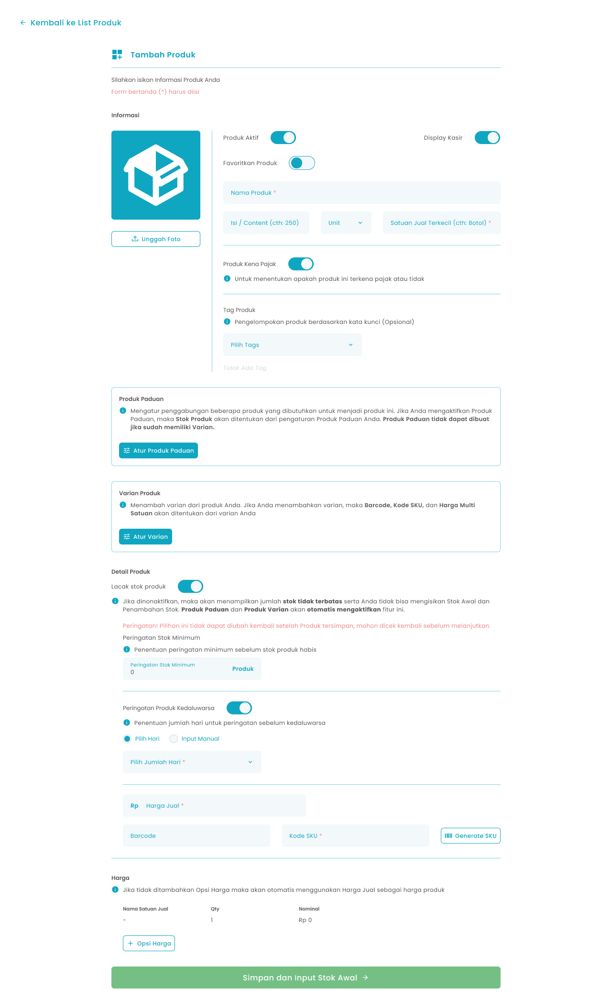
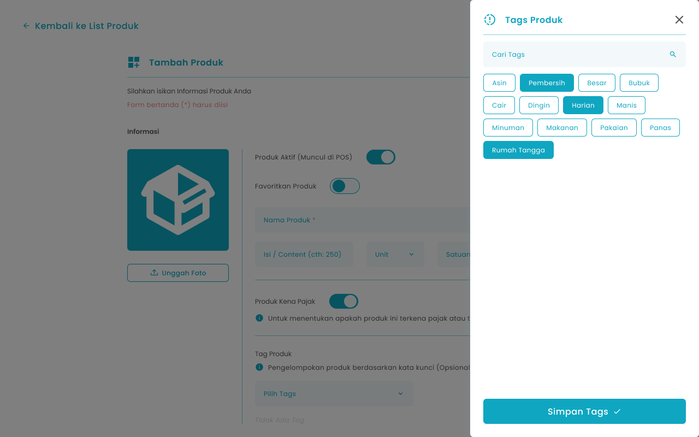
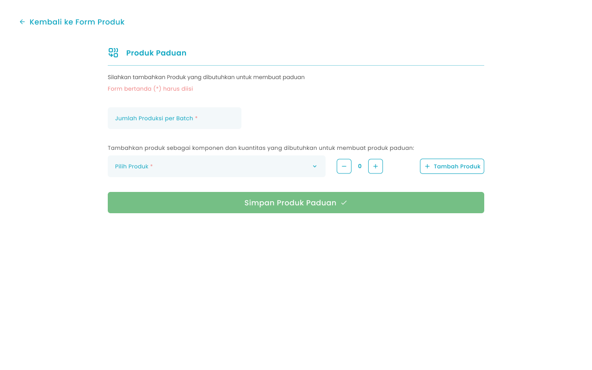
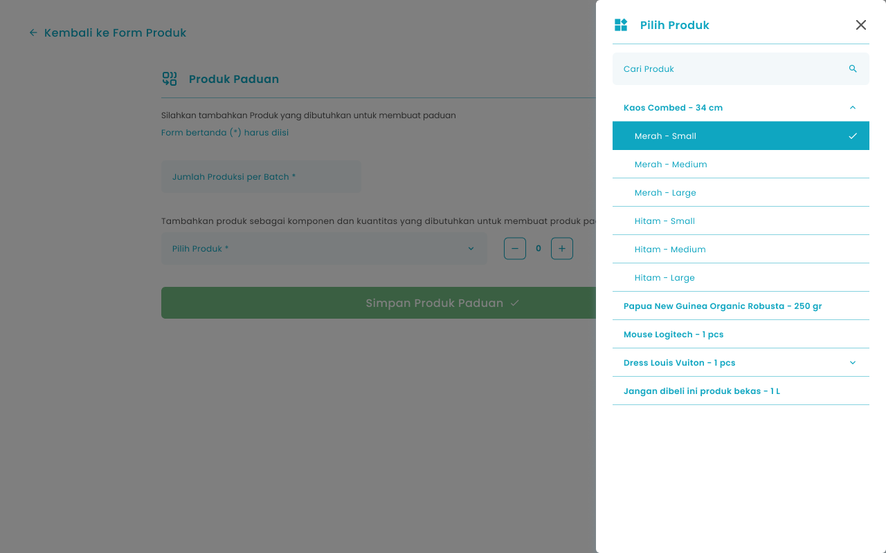
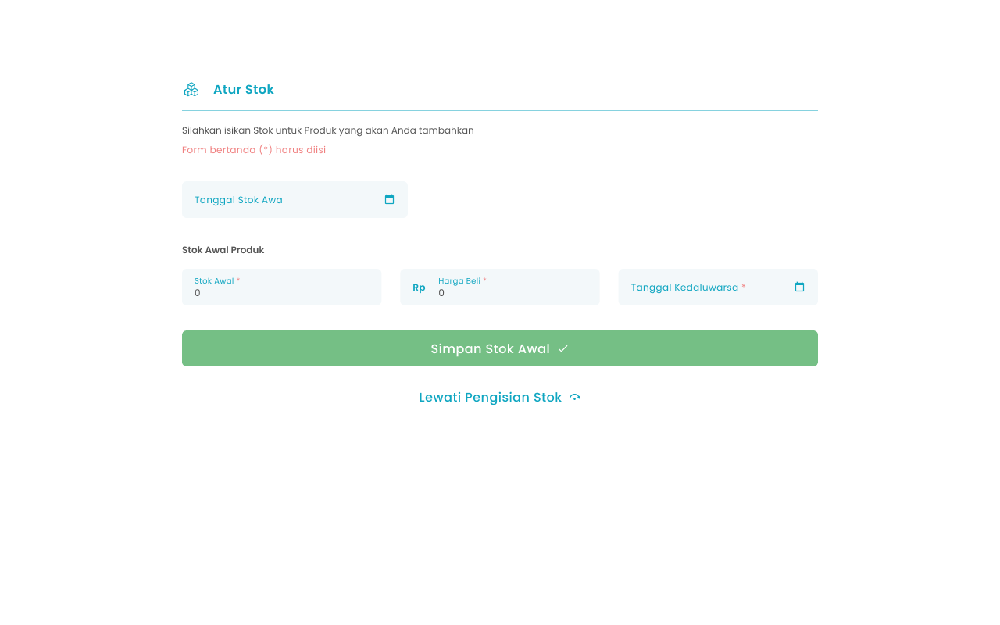
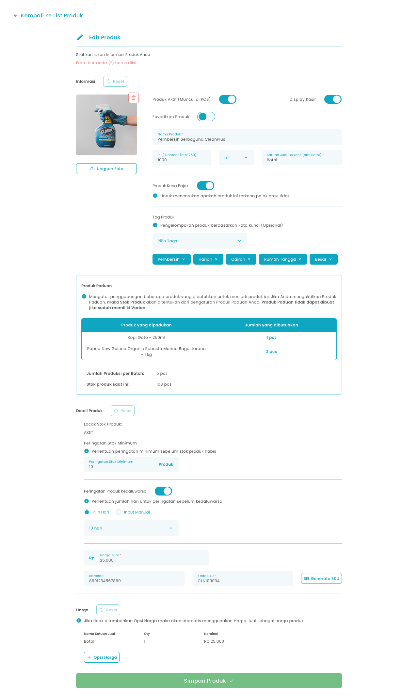

## 1.1. Cara Menambah Produk Paduan

Menu Tambah Produk adalah menu yang dapat digunakan untuk menambahkan produk paduan. Produk Paduan merupakan produk yang dijual dalam bentuk gabungan atau paket. Contohnya Minuman + snack dijual sebagai “paket hemat”. Untuk mengakses halaman ini adalah dengan klik tombol “Tambah Produk” di halaman list produk

<Frame>
  
</Frame>

<table>
  <colgroup>
    <col width="50" />
    <col width="187" />
    <col width="477" />
  </colgroup>
  <thead>
    <tr>
      <th>No</th>
      <th>Simbol</th>
      <th>Keterangan</th>
    </tr>
  </thead>
  <tbody>
    <tr>
      <td>1</td>
      <td>Unggah Foto</td>
      <td>Tombol untuk mengunggah foto produk</td>
    </tr>
    <tr>
      <td>2</td>
      <td>Produk Aktif</td>
      <td>Tombol untuk mengaktifkan produk</td>
    </tr>
    <tr>
      <td>3</td>
      <td>Display Kasir</td>
      <td>Tombol untuk menampilkan produk di Halaman Kasir</td>
    </tr>
    <tr>
      <td>4</td>
      <td>Favoritkan Produk</td>
      <td>Tombol untuk favoritkan produk</td>
    </tr>
    <tr>
      <td>5</td>
      <td>Nama Produk</td>
      <td>Tombol untuk mengisi nama produk</td>
    </tr>
    <tr>
      <td>6</td>
      <td>Isi/Content</td>
      <td>Tombol untuk mengisi total berat atau jumlah isi dari satu produk (250,1)</td>
    </tr>
    <tr>
      <td>7</td>
      <td>Unit</td>
      <td>Tombol untuk memilih unit yang sudah dibuat dari master data (gram, pcs)</td>
    </tr>
    <tr>
      <td>8</td>
      <td>Satuan Jual Terkecil</td>
      <td>Tombol untuk mengisi jenis kemasan dari produk (plastik, karton)</td>
    </tr>
    <tr>
      <td>9</td>
      <td>Produk Kena Pajak</td>
      <td>Tombol untuk mengaktifkan produk kena pajak</td>
    </tr>
    <tr>
      <td>10</td>
      <td>Tag Produk</td>
      <td>Tombol untuk memilih beberapa tag produk yang sudah dibuat dari master data</td>
    </tr>
    <tr>
      <td>11</td>
      <td>Atur Produk Paduan</td>
      <td>Tombol untuk mengatur produk paduan</td>
    </tr>
    <tr>
      <td>12</td>
      <td>Atur Varian</td>
      <td>Tombol untuk mengatur produk varian</td>
    </tr>
    <tr>
      <td>13</td>
      <td>Lacak stok produk</td>
      <td>Tombol untuk mengaktifkan peringatan stok minimum produk sebelum habis</td>
    </tr>
    <tr>
      <td>14</td>
      <td>Peringatan stok minimum</td>
      <td>Tombol untuk mengisi jumlah stok sebagai penentuan peringatan sebelum habis</td>
    </tr>
    <tr>
      <td>15</td>
      <td>Peringatan Produk Kadaluarsa</td>
      <td>Tombol untuk mengaktifkan peringatan produk sebelum kadaluarsa</td>
    </tr>
    <tr>
      <td>16</td>
      <td>Pilih Hari/Input Manual</td>
      <td>Tombol untuk memilih jenis input hari peringatan kadaluarsa yang terdiri dari pilih hari atau input manual</td>
    </tr>
    <tr>
      <td>17</td>
      <td>Jumlah Hari</td>
      <td>Tombol untuk mengisi jumlah hari peringatan sebelum kadaluarsa</td>
    </tr>
    <tr>
      <td>18</td>
      <td>Harga Jual</td>
      <td>Tombol untuk mengisi harga jual produk</td>
    </tr>
    <tr>
      <td>19</td>
      <td>Barcode</td>
      <td>Tombol untuk mengisi barcode dari produk</td>
    </tr>
    <tr>
      <td>20</td>
      <td>Kode SKU</td>
      <td>Tombol untuk mengisi kode SKU dari produk</td>
    </tr>
    <tr>
      <td>21</td>
      <td>Generate SKU</td>
      <td>Tombol untuk membuat kode SKU secara otomatis</td>
    </tr>
    <tr>
      <td>22</td>
      <td>Multi Kemasan/Grosir</td>
      <td>Tombol untuk memilih harga multi satuan yang terdiri dari harga multi kemasan atau harga grosir</td>
    </tr>
    <tr>
      <td>23</td>
      <td>Nama satuan</td>
      <td>Tombol untuk mengisi nama satuan (single, lusin, box)</td>
    </tr>
    <tr>
      <td>24</td>
      <td>Quantity</td>
      <td>Tombol untuk mengisi quantity satuan dari produk</td>
    </tr>
    <tr>
      <td>25</td>
      <td>Nominal</td>
      <td>Tombol untuk mengisi nominal satuan</td>
    </tr>
    <tr>
      <td>26</td>
      <td>Opsi harga</td>
      <td>Tombol untuk menambahkan kolom input harga satuan</td>
    </tr>
    <tr>
      <td>27</td>
      <td>Simpan dan Input Stok Awal</td>
      <td>Tombol untuk menyimpan data produk dan melanjutkan proses input stok</td>
    </tr>
  </tbody>
</table>

**Cara Menambahkan Data Produk**

1. Tekan tombol "Tambah Produk" di halaman list produk
   <Frame>
     
   </Frame>
2. Setelah menekan tombol, maka akan menampilkan halaman tambah produk
3. Unggah foto produk dengan tekan tombol “Unggah Foto”
   <Frame>
     
   </Frame>
4. Anda dapat mengaktifkan atau menonaktifkan produk
   <Frame>
     
   </Frame>
5. Anda dapat menampilkan produk atau menyembunyikan produk di halaman kasir
   <Frame>
     
   </Frame>
6. Anda dapat menjadikan produk sebagai produk favorit
   <Frame>
     
   </Frame>
7. Masukkan nama produk di kolom nama produk
   <Frame>
     .png "Input Right Icon (47dsffr)")
   </Frame>
8. Masukkan besaran isi produk di kolom isi/content
   <Frame>
     .png "Input Right Icon (48dfdf)")
   </Frame>
9. Tekan tombol “Unit” di kolom unit produk untuk menambahkan ukuran besaran isi
   <Frame>
     .png "Input Right Icon (49dfdfr)")
   </Frame>
10. Setelah menekan tombol maka akan menampilkan list unit yang sudah anda tambahkan dari master data unit produk
11. Pilih salah satu unit
12. Setelah selesai memilih unit produk maka akan menampilkan unit di halaman tambah produk
13. Masukkan satuan jual terkecil di kolom Satuan Jual Terkecil
    <Frame>
      .png "Input Right Icon (50vhfe)")
    </Frame>
14. Anda dapat mengaktifkan pajak pada produk
    <Frame>
      
    </Frame>
15. Tekan tombol “Pilih Tags” di kolom tag produk untuk menambahkan tag produk
    <Frame>
      
    </Frame>
16. Setelah menekan tombol maka akan menampilkan daftar tag produk yang sudah anda tambahkan dari master data tags produk
    <Frame>
      
    </Frame>
17. Pilih beberapa tag produk
18. Setelah selesai memilih tag produk tekan tombol “Simpan Tags”
19. Setelah menekan tombol, maka akan menampilkan list tag di halaman tambah produk
20. Tekan tombol “Atur Produk Paduan”
    <Frame>
      .png "Frame 6 (5zadas)")
    </Frame>
21. Setelah menekan tombol, maka akan menampilkan halaman input produk paduan
    <Frame>
      
    </Frame>

<table>
  <colgroup>
    <col width="52" />
    <col width="221" />
    <col width="431" />
  </colgroup>
  <thead>
    <tr>
      <th>No</th>
      <th>Simbol</th>
      <th>Keterangan</th>
    </tr>
  </thead>
  <tbody>
    <tr>
      <td>1</td>
      <td>Jumlah Produksi per Batch</td>
      <td>Tombol untuk mengisi jumlah produksi tiap produk paduan</td>
    </tr>
    <tr>
      <td>2</td>
      <td>Pilih Produk</td>
      <td>Tombol untuk memilih produk yang dipadukan</td>
    </tr>
    <tr>
      <td>3</td>
      <td>Quantity Produk</td>
      <td>Tombol untuk mengisi jumlah produk yang dipadukan</td>
    </tr>
    <tr>
      <td>4</td>
      <td>Tambah Produk</td>
      <td>Tombol untuk menambahkan kolom input produk lain yang perlu dipadukan</td>
    </tr>
    <tr>
      <td>5</td>
      <td>Simpan Produk Paduan</td>
      <td>Tombol untuk memproses simpan produk paduan</td>
    </tr>
  </tbody>
</table>

21. Masukkan jumlah produksi per batch di kolom jumlah produksi per batch
    <Frame>
      .png "Input Right Icon (67dsfe)")
    </Frame>
22. Tekan tombol “Pilih Produk” di kolom pilih produk untuk memilih produk yang perlu dipadukan
    <Frame>
      .png "Input Right Icon (68dasfrf)")
    </Frame>
23. Setelah menekan tombol, maka akan menampilkan list produk satuan dan varian yang dapat dipilih untuk dipadukan
    <Frame>
      
    </Frame>
24. Pilih salah satu produk/varian
25. Setelah selesai memilih produk/varian maka akan menampilkan produk di halaman form produk paduan
26. Masukkan jumlah quantity produk di kolom quantity
    <Frame>
      
    </Frame>
27. Anda dapat menambahkan produk lain yang perlu dipadukan dengan menekan tombol tambah produk
    <Frame>
      .png "Frame 960 (8rtrtrt)")
    </Frame>
28. Setelah menekan tombol maka akan menambahkan kolom input produk lain
29. Setelah selesai mengisi data produk paduan, kemudian tekan tombol Simpan produk Paduan
    <Frame>
      .png "Frame 1411 (10drfdfg)")
    </Frame>
30. Setelah menekan tombol, maka akan menampilkan halaman konfirmasi simpan produk paduan
    <Frame>
      .png "Frame 1336 (12sdfsfr)")
    </Frame>
31. Tekan tombol “Ya, Saya Yakin” di halaman konfirmasi untuk melanjutkan proses simpan produk paduan
    <Frame>
      
    </Frame>
32. Tekan tombol “Tidak” di halaman konfirmasi untuk membatalkan simpan produk paduan
    <Frame>
      
    </Frame>
33. Setelah menekan tombol “Ya, Saya Yakin”,  maka akan menampilkan halaman sukses tambah produk paduan dan kembali ke halaman tambah produk dengan menampilkan list produk yang dipadukan
34. Produk paduan wajib memiliki stok maka anda tidak dapat menonaktifkan fitur lacak stok produk
35. Anda perlu memasukkan jumlah stok minimum sebagai pengingat stok habis di kolom peringatan stok minimum
    <Frame>
      .png "Input Right Icon (51frsf)")
    </Frame>
36. **Anda dapat mengaktifkan peringatan produk kadaluarsa**
    <Frame>
      
    </Frame>
37. Jika mengaktifkan peringatan produk kadaluarsa maka anda perlu memilih jumlah hari munculnya peringatan sebelum tanggal kadaluarsa produk tersebut
    <Frame>
      .png "Input Right Icon (52dfder)")
    </Frame>
38. **Jika menonaktifkan peringatan stok produk maka tidak dapat input stok awal produk dan tidak dapat mengaktifkan peringatan produk kadaluarsa**
39. Masukkan harga jual di kolom harga jual
    <Frame>
      .png "Input Right Icon (53asdee)")
    </Frame>
40. **Masukkan harga modal jika anda menonaktifkan peringatan stok produk sebelumnya**
    <Frame>
      .png "Input Right Icon (54sdeff)")
    </Frame>
41. Masukkan barcode di kolom barcode
    <Frame>
      sdsded.png "Input Right Icon (55)sdsded")
    </Frame>
42. Masukkan kode sku di kolom kode sku
    <Frame>
      .png "Input Right Icon (56sdferr)")
    </Frame>
43. Tekan tombol “Generate SKU” untuk membuat kode sku secara otomatis
    <Frame>
      
    </Frame>
44. **Menambahkan Harga Multi Satuan**
45. Anda dapat memilih harga multi satuan sebagai harga kemasan atau harga grosir pada harga multi satuan

<Frame>
  .png "Frame 1202 (1sdsrf)")
</Frame>

32. Anda dapat menambahkan harga multi satuan produk dengan menekan tombol tambah opsi harga sebanyak opsi harga yang diperlukan

<Frame>
  .png "Frame 960 (4sderef)")
</Frame>

33. Setelah menekan tombol maka akan menambahkan kolom input satuan

<Frame>
  
</Frame>

34. Masukkan nama satuan di kolom satuan
35. Masukkan quantity di kolom qty
36. Masukkan nominal satuan di kolom nominal
37. Setelah selesai mengisi data produk, kemudian tekan tombol “Simpan dan Input Stok Awal” maka akan menampilkan halaman pengaturan stok awal
    <Frame>
      .png "Frame 1380 (1ssdf)")
    </Frame>

<table>
  <colgroup>
    <col width="115" />
    <col width="601" />
  </colgroup>
  <thead>
    <tr>
      <th style={{ textAlign: "center" }}>**🛈** **Information**</th>
      <th><ul><li>**Contoh harga multi kemasan** Satu botol air mineral dijual seharga Rp5.000. Namun, jika membeli 6 botol sekaligus, harganya hanya Rp28.000. Jadi, harga per botol menjadi lebih murah dibandingkan membeli satuan.</li><li>**Contoh harga grosir** Satu bungkus mi instan dijual seharga Rp3.000. Namun, jika membeli satu karton berisi 40 bungkus, harganya hanya Rp95.000. Jadi, harga per bungkus menjadi Rp2.375, lebih murah dibandingkan membeli satuan.</li></ul></th>
    </tr>
  </thead>
</table>

37. Cara Menambahkan Stok Awal Menu Atur Stok Awal adalah menu yang berisi form untuk menambahkan stok awal produk yang sedang dibuat. Untuk mengakses halaman ini adalah dengan tekan tombol “Simpan dan Input Stok Awal”  di halaman Tambah Produk

<Frame>
  
</Frame>

<table>
  <colgroup>
    <col width="50" />
    <col width="178" />
    <col width="478" />
  </colgroup>
  <thead>
    <tr>
      <th>No</th>
      <th>Simbol</th>
      <th>Keterangan</th>
    </tr>
  </thead>
  <tbody>
    <tr>
      <td>1</td>
      <td>Tanggal stok awal</td>
      <td>Tombol untuk mengisi tanggal stok awal produk baru</td>
    </tr>
    <tr>
      <td>2</td>
      <td>Stok awal</td>
      <td>Tombol untuk mengisi jumlah stok awal produk baru</td>
    </tr>
    <tr>
      <td>3</td>
      <td>Harga beli</td>
      <td>Tombol untuk mengisi harga beli produk baru</td>
    </tr>
    <tr>
      <td>4</td>
      <td>Tanggal kadaluarsa</td>
      <td>Tombol untuk mengisi tanggal kadaluarsa produk</td>
    </tr>
    <tr>
      <td>5</td>
      <td>Simpan Produk</td>
      <td>Tombol untuk melanjutkan proses menyimpan produk</td>
    </tr>
    <tr>
      <td>6</td>
      <td>Lewati Pengisian Stok</td>
      <td>Tombol untuk melewati proses pengisian stok awal</td>
    </tr>
  </tbody>
</table>

38. Masukkan tanggal input stok awal di kolom tanggal stok awal
    <Frame>
      .png "Input Right Icon (57asder)")
    </Frame>
39. Masukkan jumlah stok awal di kolom stok awal
    <Frame>
      .png "Input Right Icon (58sdfsdr)")
    </Frame>
40. Masukkan harga beli di kolom harga beli
    <Frame>
      .png "Input Right Icon (59sdfred)")
    </Frame>
41. Masukkan tanggal kadaluarsa produk di kolom tanggal kadaluarsa jika anda mengaktifkan peringatan produk kadaluarsa sebelumnya
    <Frame>
      .png "Input Right Icon (6sdfee0)")
    </Frame>
42. Setelah selesai mengisi data stok, kemudian tekan tombol “Simpan Stok Awal”
    <Frame>
      .png "Frame 1411 (7weer4e)")
    </Frame>
43. Setelah menekan tombol, maka akan menampilkan halaman konfirmasi simpan produk
    <Frame>
      .png "Frame 1336 (11sddfeff)")
    </Frame>
44. Tekan tombol “Ya, Saya Yakin” di halaman konfirmasi untuk melanjutkan proses simpan produk
    <Frame>
      
    </Frame>
45. Tekan tombol “Tidak” di halaman konfirmasi untuk membatalkan simpan produk
    <Frame>
      
    </Frame>
46. Setelah menekan tombol “Ya, Saya Yakin”,  maka akan menampilkan halaman sukses tambah produk

## 1.2. Cara Mengubah Produk Paduan

Menu Ubah Produk adalah menu yang dapat digunakan untuk mengubah produk paduan. Untuk mengakses halaman ini adalah dengan klik tombol “Edit Produk” di halaman list produk

<Frame>
  
</Frame>

<table>
  <colgroup>
    <col width="50" />
    <col width="245" />
    <col width="419" />
  </colgroup>
  <thead>
    <tr>
      <th>No</th>
      <th>Simbol</th>
      <th>Keterangan</th>
    </tr>
  </thead>
  <tbody>
    <tr>
      <td>1</td>
      <td>Reset Informasi Produk</td>
      <td>Tombol mengembalikan data informasi produk ke semula sebelum diubah</td>
    </tr>
    <tr>
      <td>2</td>
      <td>Unggah Foto</td>
      <td>Tombol untuk mengunggah foto produk</td>
    </tr>
    <tr>
      <td>3</td>
      <td>Produk Aktif</td>
      <td>Tombol untuk mengaktifkan produk</td>
    </tr>
    <tr>
      <td>4</td>
      <td>Display Kasir</td>
      <td>Tombol untuk menampilkan produk di Halaman Kasir</td>
    </tr>
    <tr>
      <td>5</td>
      <td>Favoritkan Produk</td>
      <td>Tombol untuk favoritkan produk</td>
    </tr>
    <tr>
      <td>6</td>
      <td>Nama Produk</td>
      <td>Tombol untuk mengisi nama produk</td>
    </tr>
    <tr>
      <td>7</td>
      <td>Isi/Content</td>
      <td>Tombol untuk mengisi total berat atau jumlah isi dari satu produk (250,1)</td>
    </tr>
    <tr>
      <td>8</td>
      <td>Unit</td>
      <td>Tombol untuk memilih unit yang sudah dibuat dari master data (gram, pcs)</td>
    </tr>
    <tr>
      <td>9</td>
      <td>Satuan Jual Terkecil</td>
      <td>Tombol untuk mengisi jenis kemasan dari produk (plastik, karton)</td>
    </tr>
    <tr>
      <td>10</td>
      <td>Produk Kena Pajak</td>
      <td>Tombol untuk mengaktifkan produk kena pajak</td>
    </tr>
    <tr>
      <td>11</td>
      <td>Tag Produk</td>
      <td>Tombol untuk memilih beberapa tag produk yang sudah dibuat dari master data</td>
    </tr>
    <tr>
      <td>12</td>
      <td>List Produk Paduan</td>
      <td>Tabel yang berisi daftar produk biasa yang dipadukan</td>
    </tr>
    <tr>
      <td>13</td>
      <td>Reset Detail Produk</td>
      <td>Tombol mengembalikan data detail produk ke semula sebelum diubah</td>
    </tr>
    <tr>
      <td>14</td>
      <td>Peringatan stok minimum</td>
      <td>Tombol untuk mengisi jumlah stok sebagai penentuan peringatan sebelum habis</td>
    </tr>
    <tr>
      <td>15</td>
      <td>Peringatan Produk Kadaluarsa</td>
      <td>Tombol untuk mengaktifkan peringatan produk sebelum kadaluarsa</td>
    </tr>
    <tr>
      <td>16</td>
      <td>Pilih Hari/Input Manual</td>
      <td>Tombol untuk memilih jenis input hari peringatan kadaluarsa yang terdiri dari pilih hari atau input manual</td>
    </tr>
    <tr>
      <td>17</td>
      <td>Jumlah Hari</td>
      <td>Tombol untuk mengisi jumlah hari peringatan sebelum kadaluarsa</td>
    </tr>
    <tr>
      <td>18</td>
      <td>Harga Jual</td>
      <td>Tombol untuk mengisi harga jual produk</td>
    </tr>
    <tr>
      <td>19</td>
      <td>Barcode</td>
      <td>Tombol untuk mengisi barcode dari produk</td>
    </tr>
    <tr>
      <td>20</td>
      <td>Kode SKU</td>
      <td>Tombol untuk mengisi kode SKU dari produk</td>
    </tr>
    <tr>
      <td>21</td>
      <td>Generate SKU</td>
      <td>Tombol untuk membuat kode SKU secara otomatis</td>
    </tr>
    <tr>
      <td>22</td>
      <td>Reset Harga Multi Satuan</td>
      <td>Tombol mengembalikan data harga multi satuan produk ke semula sebelum diubah</td>
    </tr>
    <tr>
      <td>23</td>
      <td>Multi Kemasan/Grosir</td>
      <td>Tombol untuk memilih harga multi satuan yang terdiri dari harga multi kemasan atau harga grosir</td>
    </tr>
    <tr>
      <td>24</td>
      <td>Nama satuan</td>
      <td>Tombol untuk mengisi nama satuan (single, lusin, box)</td>
    </tr>
    <tr>
      <td>25</td>
      <td>Quantity</td>
      <td>Tombol untuk mengisi quantity satuan dari produk</td>
    </tr>
    <tr>
      <td>26</td>
      <td>Nominal</td>
      <td>Tombol untuk mengisi nominal satuan</td>
    </tr>
    <tr>
      <td>27</td>
      <td>Opsi harga</td>
      <td>Tombol untuk menambahkan kolom input harga satuan</td>
    </tr>
    <tr>
      <td>28</td>
      <td>Simpan Produk</td>
      <td>Tombol untuk menyimpan perubahan data produk biasa</td>
    </tr>
  </tbody>
</table>

**Berikut merupakan tahapan mengubah produk paduan:**

1. Tekan tombol "Edit Produk" pada salah satu produk biasa di halaman list produk
   <Frame>
     .png "Frame 1369 (3dsfsdfr)")
   </Frame>
2. Setelah menekan tombol, maka akan menampilkan halaman edit produk
3. Anda dapat mengubah foto produk dengan tekan tombol “Unggah Foto”
   <Frame>
     .png "Frame 1456 (1sdsded)")
   </Frame>
4. Anda dapat mengaktifkan atau menonaktifkan produk
   <Frame>
     
   </Frame>
5. Anda dapat menampilkan produk atau menyembunyikan produk di halaman kasir
   <Frame>
     
   </Frame>
6. Anda dapat menjadikan produk sebagai produk favorit
   <Frame>
     
   </Frame>
7. Anda dapat mengubah nama produk di kolom nama produk
   <Frame>
     .png "Input Right Icon (47dsffr)")
   </Frame>
8. Anda dapat mengubah isi / content di kolom isi/content
   <Frame>
     .png "Input Right Icon (48dfdf)")
   </Frame>
9. Anda dapat mengubah dengan tekan tombol “Unit” di kolom unit produk
   <Frame>
     .png "Input Right Icon (49dfdfr)")
   </Frame>
10. Setelah menekan tombol maka akan menampilkan list unit yang sudah anda tambahkan dari master data unit produk
11. Pilih salah satu unit
12. Setelah selesai memilih unit produk maka akan menampilkan unit di halaman tambah produk
13. Anda dapat mengubah satuan jual terkecil di kolom Satuan Jual Terkecil
    <Frame>
      .png "Input Right Icon (50vhfe)")
    </Frame>
14. Anda dapat mengaktifkan pajak pada produk
    <Frame>
      
    </Frame>
15. Anda dapat menambahkan tag produk dengan tekan tombol “Pilih Tags” di kolom tag produk
    <Frame>
      
    </Frame>
16. Setelah menekan tombol maka akan menampilkan daftar tag produk yang sudah anda tambahkan di master data tags produk

<Frame>
  
</Frame>

17. Pilih beberapa tag produk
18. Setelah selesai memilih tag produk tekan tombol “Simpan Tags”
19. Setelah menekan tombol, maka akan menampilkan list tag di halaman tambah produk
20. Tekan tombol “x” untuk menghapus tag yang tidak diperlukan

<Frame>
  .png "Frame 238108 (1sdfsdff)")
</Frame>

21. Anda dapat mengembalikan perubahan informasi produk ke awal sebelum diubah dengan menekan tombol “Reset”

<Frame>
  
</Frame>

22. Anda dapat mengubah jumlah stok minimum sebagai pengingat stok habis di kolom peringatan stok minimum

<Frame>
  .png "Input Right Icon (51frsf)")
</Frame>

23. **Jika peringatan lacak stok produk aktif maka anda dapat mengaktifkan peringatan produk kadaluarsa**

<Frame>
  
</Frame>

24. Jika mengaktifkan peringatan produk kadaluarsa maka anda perlu memilih jumlah hari sebelum tanggal kadaluarsa produk tersebut

<Frame>
  .png "Input Right Icon (52dfder)")
</Frame>

25. Anda dapat mengubah harga jual di kolom harga jual

<Frame>
  .png "Input Right Icon (53asdee)")
</Frame>

26. **Anda dapat mengubah harga modal jika anda menonaktifkan peringatan stok produk sebelumnya**

<Frame>
  .png "Input Right Icon (54sdeff)")
</Frame>

27. Anda dapat mengubah barcode di kolom barcode

<Frame>
  sdsded.png "Input Right Icon (55)sdsded")
</Frame>

28. Anda dapat mengubah kode sku di kolom kode sku

<Frame>
  .png "Input Right Icon (56sdferr)")
</Frame>

29. Tekan tombol “Generate SKU” untuk membuat kode sku secara otomatis

<Frame>
  
</Frame>

30. Anda dapat mengembalikan perubahan detail produk ke awal sebelum diubah dengan menekan tombol “Reset”

<Frame>
  
</Frame>

31. **Menambahkan atau mengubah Harga Multi Satuan**
32. Anda dapat mengubah pilihan harga multi satuan sebagai harga kemasan atau harga grosir

<Frame>
  .png "Frame 1202 (1sdsrf)")
</Frame>

33. Anda dapat menambahkan satuan produk dengan menekan tombol tambah opsi harga

<Frame>
  .png "Frame 960 (4sderef)")
</Frame>

34. Setelah menekan tombol maka akan menambahkan kolom input satuan

<Frame>
  
</Frame>

35. Anda dapat mengubah atau menambahkan data baru untuk nama satuan di kolom satuan
36. Anda dapat mengubah atau menambahkan data baru untuk quantity di kolom qty
37. Anda dapat mengubah atau menambahkan data baru untuk nominal satuan di kolom nominal
38. Tekan tombol “Hapus” untuk menghapus satuan produk

<Frame>
  
</Frame>

39. Anda dapat mengembalikan perubahan harga produk ke awal sebelum diubah dengan menekan tombol “Reset”

<Frame>
  
</Frame>

40. Setelah selesai mengubah data produk, kemudian tekan tombol “Simpan Produk” maka akan menampilkan pesan sukses mengubah produk dan kembali ke halaman list produk

<Frame>
  .png "Frame 1411 (8ererr)")
</Frame>
