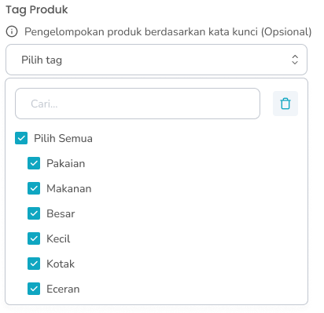

## 1.1. Cara Mengubah Produk Varian

Menu Ubah Produk adalah menu yang dapat digunakan untuk mengubah produk varian. Untuk mengakses halaman ini adalah dengan klik tombol “Edit Produk” di halaman list produk

<Frame>
  .jpg "Edit Produk (3zxczxczxv)")
</Frame>

<table>
  <colgroup>
    <col width="50" />
    <col width="197" />
    <col width="457" />
  </colgroup>
  <thead>
    <tr>
      <th>No</th>
      <th>Simbol</th>
      <th>Keterangan</th>
    </tr>
  </thead>
  <tbody>
    <tr>
      <td>1</td>
      <td>Reset Informasi Produk</td>
      <td>Tombol mengembalikan data informasi produk ke semula sebelum diubah</td>
    </tr>
    <tr>
      <td>2</td>
      <td>Produk Aktif</td>
      <td>Tombol untuk menampilkan produk di Halaman Kasir</td>
    </tr>
    <tr>
      <td>3</td>
      <td>Display Kasir</td>
      <td>Tombol untuk menampilkan produk di Halaman Kasir</td>
    </tr>
    <tr>
      <td>4</td>
      <td>Favoritkan Produk</td>
      <td>Tombol untuk favoritkan produk</td>
    </tr>
    <tr>
      <td>5</td>
      <td>Nama Produk</td>
      <td>Tombol untuk mengisi nama produk</td>
    </tr>
    <tr>
      <td>6</td>
      <td>Isi/Content</td>
      <td>Tombol untuk mengisi total berat atau jumlah isi dari satu produk (250,1)</td>
    </tr>
    <tr>
      <td>7</td>
      <td>Unit</td>
      <td>Tombol untuk memilih unit yang sudah dibuat dari master data (gram, pcs)</td>
    </tr>
    <tr>
      <td>8</td>
      <td>Satuan Jual Terkecil</td>
      <td>Tombol untuk mengisi jenis kemasan dari produk (plastik, karton)</td>
    </tr>
    <tr>
      <td>9</td>
      <td>Produk Kena Pajak</td>
      <td>Tombol untuk mengaktifkan produk kena pajak</td>
    </tr>
    <tr>
      <td>10</td>
      <td>Tag Produk</td>
      <td>Tombol untuk memilih beberapa tag produk yang sudah dibuat dari master data</td>
    </tr>
    <tr>
      <td>11</td>
      <td>Tambah Opsi Varian</td>
      <td>Tombol untuk menambahkan opsi varian pada produk varian</td>
    </tr>
    <tr>
      <td>12</td>
      <td>Edit Opsi Varian</td>
      <td>Tombol untuk mengubah opsi varian pada produk varian</td>
    </tr>
    <tr>
      <td>13</td>
      <td>Varian Aktif</td>
      <td>Tombol untuk mengaktifkan opsi varian produk</td>
    </tr>
    <tr>
      <td>14</td>
      <td>Display Kasir Varian</td>
      <td>Tombol untuk menampilkan varian di Halaman Kasir</td>
    </tr>
    <tr>
      <td>15</td>
      <td>Reset Detail Produk</td>
      <td>Tombol mengembalikan data detail produk ke semula sebelum diubah</td>
    </tr>
    <tr>
      <td>16</td>
      <td>Peringatan Produk Kadaluarsa</td>
      <td>Tombol untuk mengaktifkan peringatan produk sebelum kadaluarsa</td>
    </tr>
    <tr>
      <td>17</td>
      <td>Pilih Hari/Input Manual</td>
      <td>Tombol untuk memilih jenis input hari peringatan kadaluarsa yang terdiri dari pilih hari atau input manual</td>
    </tr>
    <tr>
      <td>18</td>
      <td>Jumlah Hari</td>
      <td>Tombol untuk mengisi jumlah hari peringatan sebelum kadaluarsa</td>
    </tr>
    <tr>
      <td>19</td>
      <td>Simpan Produk</td>
      <td>Tombol untuk menyimpan perubahan data produk varian</td>
    </tr>
  </tbody>
</table>

**Berikut cara Mengubah Data Produk Varian**

1. Tekan tombol "Edit Produk" di salah satu produk varian di halaman list produk
   <Frame>
     .png "Frame 9 (2azazzaz)")
   </Frame>
2. Setelah menekan tombol, maka akan menampilkan halaman form edit produk
3. Anda dapat mengaktifkan atau menonaktifkan produk
   <Frame>
     .png "Switch (8sdsddd)")
   </Frame>
4. Anda dapat menampilkan produk atau menyembunyikan produk di halaman kasir
   <Frame>
     .png "Switch (9sdfsdfsd)")
   </Frame>
5. Anda dapat menjadikan produk sebagai produk favorit
   <Frame>
     .png "Switch (10erterttrr)")
   </Frame>
6. Anda dapat mengubah nama produk di kolom nama produk
   <Frame>
     .png "Input (7sdfsdf0)")
   </Frame>
7. Anda dapat mengubah isi /content di kolom isi/content
   <Frame>
     .png "Input (71ddddsss)")
   </Frame>
8. Anda dapat mengubah unit produk dengan menekan tombol “Unit” di kolom unit produk
   <Frame>
     .png "Input (72ddvvvv)")
   </Frame>
9. Pilih salah satu unit
10. Setelah selesai memilih unit produk maka akan menampilkan unit di halaman tambah produk
11. Anda dapat mengubah satuan jual terkecil di kolom Satuan Jual Terkecil
    <Frame>
      .png "Input (73asddd)")
    </Frame>
12. Anda dapat mengaktifkan pajak pada produk
    <Frame>
      .png "Switch (11asdasdd)")
    </Frame>
13. Anda dapat menambahkan tag produk dengan menekan tombol “Pilih Tags” di kolom tag produk
    <Frame>
      .png "Frame 238351 (1fffffdddd)")
    </Frame>
14. Setelah menekan tombol maka akan menampilkan daftar tag produk yang sudah ditambahkan di master data tags produk
15. Pilih beberapa tag produk
16. Setelah menekan tombol, maka akan menampilkan list tag di halaman tambah produk
17. Tekan tombol “hapus” dengan ikon keranjang sampah untuk menghapus tag
    <Frame>
      .png "Input (75xxcccc)")
    </Frame>
18. Anda dapat mengembalikan perubahan informasi produk ke awal sebelum diubah dengan menekan tombol “Reset”
    <Frame>
      
    </Frame>
19. Anda dapat mengaktifkan varian produk atau menonaktifkan salah satu atau beberapa varian produk
    <Frame>
      .png "Switch (12bjdhs)")
    </Frame>
20. Anda dapat menampilkan varian produk atau menyembunyikan salah satu atau beberapa varian produk di halaman kasir
    <Frame>
      .png "Switch (13ssaazzz)")
    </Frame>
21. Anda dapat mengaktifkan peringatan produk kadaluarsa
    <Frame>
      .png "Switch (14ddsdseff)")
    </Frame>
22. Jika mengaktifkan peringatan produk kadaluarsa maka anda perlu memilih jumlah hari sebelum tanggal kadaluarsa produk tersebut
    <Frame>
      .png "Input (76eerrr)")
    </Frame>
23. Anda dapat mengembalikan perubahan detail produk ke awal sebelum diubah dengan menekan tombol “Reset”
    <Frame>
      
    </Frame>
24. Setelah selesai mengubah data produk, kemudian tekan tombol “Simpan Produk” maka akan menampilkan pesan sukses mengubah produk dan kembali ke halaman list produk
    <Frame>
      .png "Button (5d2fffdf)")
    </Frame>

## 1.2. Cara Mengubah Opsi Varian Produk

Menu Ubah Opsi Varian adalah menu yang berisi form untuk mengubah opsi varian dari produk varian. Untuk mengakses halaman ini adalah dengan tekan tombol “Edit  Opsi Varian”  di halaman Ubah Produk

<Frame>
  .jpg "Edit Opsi Varian (1sdddffdggth)")
</Frame>

<table>
  <colgroup>
    <col width="50" />
    <col width="212" />
    <col width="453" />
  </colgroup>
  <thead>
    <tr>
      <th>No</th>
      <th>Simbol</th>
      <th>Keterangan</th>
    </tr>
  </thead>
  <tbody>
    <tr>
      <td>1</td>
      <td>Reset Detail Opsi Varian</td>
      <td>Tombol mengembalikan data detail opsi varian ke semula sebelum diubah</td>
    </tr>
    <tr>
      <td>2</td>
      <td>Unggah Foto</td>
      <td>Tombol untuk mengunggah foto produk</td>
    </tr>
    <tr>
      <td>3</td>
      <td>Harga Jual</td>
      <td>Tombol untuk mengisi harga jual produk</td>
    </tr>
    <tr>
      <td>4</td>
      <td>Barcode</td>
      <td>Tombol untuk mengisi barcode dari produk</td>
    </tr>
    <tr>
      <td>5</td>
      <td>Kode SKU</td>
      <td>Tombol untuk mengisi kode SKU dari produk</td>
    </tr>
    <tr>
      <td>6</td>
      <td>Generate SKU</td>
      <td>Tombol untuk membuat kode SKU secara otomatis</td>
    </tr>
    <tr>
      <td>7</td>
      <td>Peringatan Stok Minimum</td>
      <td>Tombol untuk mengisi jumlah produk peringatan sebelum stok habis</td>
    </tr>
    <tr>
      <td>8</td>
      <td>Reset Harga Multi Satuan</td>
      <td>Tombol mengembalikan data harga multi satuan produk ke semula sebelum diubah</td>
    </tr>
    <tr>
      <td>9</td>
      <td>Multi Kemasan/Grosir</td>
      <td>Tombol untuk memilih harga multi satuan yang terdiri dari harga multi kemasan atau harga grosir</td>
    </tr>
    <tr>
      <td>10</td>
      <td>Nama satuan</td>
      <td>Tombol untuk mengisi nama satuan (single, lusin, box)</td>
    </tr>
    <tr>
      <td>11</td>
      <td>Quantity</td>
      <td>Tombol untuk mengisi quantity satuan dari produk</td>
    </tr>
    <tr>
      <td>12</td>
      <td>Nominal</td>
      <td>Tombol untuk mengisi nominal satuan</td>
    </tr>
    <tr>
      <td>13</td>
      <td>Opsi harga</td>
      <td>Tombol untuk menambahkan kolom input harga satuan</td>
    </tr>
    <tr>
      <td>14</td>
      <td>Simpan Opsi Varian</td>
      <td>Tombol untuk menyimpan perubahan data opsi varian</td>
    </tr>
  </tbody>
</table>

**Cara Mengubah Opsi Varian**

1. Tekan tombol "Edit Opsi Varian" di salah satu opsi varian di halaman edit produk
   <Frame>
     
   </Frame>
2. Setelah menekan tombol, maka akan menampilkan halaman form edit opsi varian
3. Anda dapat mengubah foto opsi varian produk dengan tekan tombol “Unggah Foto”
   <Frame>
     .png "Frame 237861 (1sssssss)")
   </Frame>
4. Anda dapat mengubah harga jual di kolom harga jual
   <Frame>
     .png "Input (77ddfg)")
   </Frame>
5. Anda dapat mengubah barcode di kolom barcode
   <Frame>
     .png "Input (78nnnmmnm)")
   </Frame>
6. Anda dapat mengubah kode sku di kolom kode sku
   <Frame>
     .png "Input (79dsdfsdfg)")
   </Frame>
7. Tekan tombol “Generate SKU” untuk membuat kode sku secara otomatis
   <Frame>
     .png "Button (53hjhjhj)")
   </Frame>
8. Anda dapat mengubah jumlah stok minimum sebagai pengingat stok habis di kolom peringatan stok minimum
   <Frame>
     .png "Input (80bbbgbg)")
   </Frame>
9. Anda dapat mengembalikan perubahan detail opsi varian ke awal sebelum diubah dengan menekan tombol “Reset”
   <Frame>
     
   </Frame>
10. **Menambahkan atau Mengubah Harga Multi Satuan**
11. Anda dapat menambahkan harga multi satuan produk dengan menekan tombol tambah opsi harga sebanyak opsi harga yang diperlukan
    <Frame>
      .png "Button (42sdsd)")
    </Frame>
12. Setelah menekan tombol maka akan menambahkan kolom input satuan
    <Frame>
      
    </Frame>
13. Anda dapat memilih harga multi satuan sebagai harga kemasan atau harga grosir pada harga multi satuan
    <Frame>
      .png "Radio Group (1ddd)")
    </Frame>
14. Masukkan nama satuan di kolom satuan
15. Masukkan kuantiti di kolom kuantiti
16. Masukkan nominal satuan di kolom nominal
17. Setelah selesai mengubah data opsi varian, kemudian tekan tombol “Simpan Perubahan”
    <Frame>
      .png "Button (54ssdfg)")
    </Frame>
18. Setelah menekan tombol, maka akan menampilkan halaman konfirmasi simpan perubahan opsi varian
    <Frame>
      .png "Alter Dialog (33fdfgdf)")
    </Frame>
19. Tekan tombol “Ya, Saya Yakin” di halaman konfirmasi untuk melanjutkan proses simpan perubahan opsi varian
    <Frame>
      .png "Button2q (1)")
    </Frame>
20. Tekan tombol “Tidak” di halaman konfirmasi untuk membatalkan simpan perubahan opsi varian
    <Frame>
      .png "Button2sa (2)")
    </Frame>
21. Setelah menekan tombol “Ya, Saya Yakin”,  maka akan menampilkan halaman sukses edit opsi varian dan kembali ke halaman edit produk

## 1.3. Cara Menambah Opsi Varian Produk

Menu Tambah Opsi Varian adalah menu yang berisi form untuk menambahkan opsi varian dari produk varian. Untuk mengakses halaman ini adalah dengan tekan tombol “Tambah Opsi Varian”  di halaman Ubah Produk

<Frame>
  .jpg "Tambah Opsi Varian (1nmbcnbxc)")
</Frame>

<table>
  <colgroup>
    <col width="50" />
    <col width="199" />
    <col width="464" />
  </colgroup>
  <thead>
    <tr>
      <th>No</th>
      <th>Simbol</th>
      <th>Keterangan</th>
    </tr>
  </thead>
  <tbody>
    <tr>
      <td>1</td>
      <td>Unggah Foto</td>
      <td>Tombol untuk mengunggah foto produk</td>
    </tr>
    <tr>
      <td>2</td>
      <td>List Varian 1</td>
      <td>Tombol untuk memilih opsi varian 1</td>
    </tr>
    <tr>
      <td>3</td>
      <td>List Varian 2</td>
      <td>Tombol untuk memilih opsi varian 2</td>
    </tr>
    <tr>
      <td>4</td>
      <td>Harga Jual</td>
      <td>Tombol untuk mengisi harga jual produk</td>
    </tr>
    <tr>
      <td>5</td>
      <td>Barcode</td>
      <td>Tombol untuk mengisi barcode dari produk</td>
    </tr>
    <tr>
      <td>6</td>
      <td>Kode SKU</td>
      <td>Tombol untuk mengisi kode SKU dari produk</td>
    </tr>
    <tr>
      <td>7</td>
      <td>Generate SKU</td>
      <td>Tombol untuk membuat kode SKU secara otomatis</td>
    </tr>
    <tr>
      <td>8</td>
      <td>Peringatan Stok Minimum</td>
      <td>Tombol untuk mengisi jumlah produk peringatan sebelum stok habis</td>
    </tr>
    <tr>
      <td>9</td>
      <td>Multi Kemasan/Grosir</td>
      <td>Tombol untuk memilih harga multi satuan yang terdiri dari harga multi kemasan atau harga grosir</td>
    </tr>
    <tr>
      <td>10</td>
      <td>Nama satuan</td>
      <td>Tombol untuk mengisi nama satuan (single, lusin, box)</td>
    </tr>
    <tr>
      <td>11</td>
      <td>Quantity</td>
      <td>Tombol untuk mengisi quantity satuan dari produk</td>
    </tr>
    <tr>
      <td>12</td>
      <td>Nominal</td>
      <td>Tombol untuk mengisi nominal satuan</td>
    </tr>
    <tr>
      <td>13</td>
      <td>Opsi harga</td>
      <td>Tombol untuk menambahkan kolom input harga satuan</td>
    </tr>
    <tr>
      <td>14</td>
      <td>Simpan dan Input Stok Awal</td>
      <td>Tombol untuk menyimpan data produk dan melanjutkan proses input stok</td>
    </tr>
  </tbody>
</table>

**Berikut cara Menambah Opsi Varian**

1. Tekan tombol "Tambah Opsi Varian" di halaman edit produk
   <Frame>
     .png "Button (55cdcdcd)")
   </Frame>
2. Setelah menekan tombol, maka akan menampilkan halaman form tambah opsi varian
3. Unggah foto opsi varian produk dengan tekan tombol “Unggah Foto”
   <Frame>
     .png "Frame 237860 (1sssxzs)")
   </Frame>
4. **Pilih Kombinasi opsi varian**
   - Terdapat 3 kemungkinan kombinasi untuk 2 varian sebagai berikut:
     - Varian 1 yang sudah tersedia dan Opsi Baru Varian 2 contoh kombinasi warna hitam dan ukuran xs
     - Opsi Baru Varian 1 dan Varian 2 yang sudah tersedia contoh kombinasi warna biru dan ukuran medium
     - Opsi Baru Varian 1 dan Opsi Baru Varian 2 contoh kombinasi warna biru dan ukuran xs
5. Anda dapat memilih varian yang sudah ada atau masukkan opsi baru di kolom varian 1
   <Frame>
     
   </Frame>
6. Anda dapat memilih varian yang sudah ada atau masukkan opsi baru di kolom varian 2
   <Frame>
     
   </Frame>
7. Masukkan harga jual di kolom harga jual
   <Frame>
     .png "Input (57asdsd)")
   </Frame>
8. Masukkan barcode di kolom barcode
   <Frame>
     .png "Input (59asdefdd)")
   </Frame>
9. Masukkan kode sku di kolom kode sku
   <Frame>
     .png "Input (60qwedsxe)")
   </Frame>
10. Tekan tombol “Generate SKU” untuk membuat kode sku secara otomatis
    <Frame>
      .png "Button (41ddsfrfdsfse)")
    </Frame>
11. **Menambahkan Harga Multi Satuan**
12. Anda dapat menambahkan harga multi satuan produk dengan menekan tombol tambah opsi harga sebanyak opsi harga yang diperlukan
    <Frame>
      .png "Button (42sdsd)")
    </Frame>
13. Setelah menekan tombol maka akan menambahkan kolom input satuan
    <Frame>
      
    </Frame>
14. Anda dapat memilih harga multi satuan sebagai harga kemasan atau harga grosir pada harga multi satuan
    <Frame>
      .png "Radio Group (1ddd)")
    </Frame>
15. Masukkan nama satuan di kolom satuan
16. Masukkan kuantiti di kolom kuantiti
17. Masukkan nominal satuan di kolom nominal
18. Setelah selesai mengisi data produk, kemudian tekan tombol “Simpan dan Input Stok Awal” maka akan menampilkan halaman pengaturan stok awal
    <Frame>
      .png "Button (43asdewd)")
    </Frame>

<table>
  <colgroup>
    <col width="123" />
    <col width="603" />
  </colgroup>
  <thead>
    <tr>
      <th style={{ textAlign: "center" }}>**🛈** **Information**</th>
      <th><ul><li>**Contoh harga multi kemasan** Satu botol air mineral Rp5.000, tetapi paket isi 6 botol dijual Rp28.000 (lebih murah per botol)</li><li>**Contoh harga grosir** Karton mie instan isi 40 bungkus dijual Rp95.000, sehingga per bungkus hanya Rp2.375 (lebih murah dibanding harga eceran Rp3.000).</li></ul></th>
    </tr>
  </thead>
</table>

19. Cara Menambahkan Stok Awal Menu Atur Stok Awal adalah menu yang berisi form untuk menambahkan stok awal produk yang sedang dibuat. Untuk mengakses halaman ini adalah dengan tekan tombol “Simpan dan Input Stok Awal”  di halaman Tambah Produk

<Frame>
  .jpg "Atur Stok (3dsfdsfgfgfgg)")
</Frame>

<table>
  <colgroup>
    <col width="54" />
    <col width="184" />
    <col width="468" />
  </colgroup>
  <thead>
    <tr>
      <th>No</th>
      <th>Simbol</th>
      <th>Keterangan</th>
    </tr>
  </thead>
  <tbody>
    <tr>
      <td>1</td>
      <td>Tanggal stok awal</td>
      <td>Kolom untuk mengisi tanggal stok awal produk baru</td>
    </tr>
    <tr>
      <td>2</td>
      <td>Stok awal</td>
      <td>Kolom untuk mengisi jumlah stok awal produk baru</td>
    </tr>
    <tr>
      <td>3</td>
      <td>Harga beli</td>
      <td>Kolom untuk mengisi harga beli produk baru</td>
    </tr>
    <tr>
      <td>4</td>
      <td>Tanggal kadaluarsa</td>
      <td>Kolom untuk mengisi tanggal kadaluarsa produk</td>
    </tr>
    <tr>
      <td>5</td>
      <td>Simpan Produk</td>
      <td>Tombol untuk melanjutkan proses menyimpan produk</td>
    </tr>
    <tr>
      <td>6</td>
      <td>Lewati Pengisian Stok</td>
      <td>Tombol untuk melewati proses pengisian stok awal</td>
    </tr>
  </tbody>
</table>

20. Masukkan tanggal input stok awal di kolom tanggal stok awal

<Frame>
  .png "Input (61asdeds)")
</Frame>

22. Masukkan jumlah stok awal di kolom stok awal

<Frame>
  .png "Input (62ddsf)")
</Frame>

23. Masukkan harga beli di kolom harga beli

<Frame>
  .png "Input (63dfdfx)")
</Frame>

24. Masukkan tanggal kadaluarsa produk di kolom tanggal kadaluarsa jika anda mengaktifkan peringatan produk kadaluarsa sebelumnya

<Frame>
  .png "Input (64dfdfrf)")
</Frame>

25. Setelah selesai mengisi data stok, kemudian tekan tombol “Simpan Produk"

<Frame>
  .png "Button (44sddfed)")
</Frame>

28. Setelah menekan tombol, maka akan menampilkan halaman konfirmasi simpan produk

<Frame>
  .png "Alter Dialog (27asdddc)")
</Frame>

29. Tekan tombol “Ya, Saya Yakin” di halaman konfirmasi untuk melanjutkan proses simpan produk

<Frame>
  .png "Button2q (1)")
</Frame>

30. Tekan tombol “Tidak” di halaman konfirmasi untuk membatalkan simpan produk

<Frame>
  .png "Button2sa (2)")
</Frame>

31. Setelah menekan tombol “Ya, Saya Yakin”,  maka akan menampilkan pesan sukses menambah opsi varian produk dan mengarahkan ke halaman halaman edit produk

## 1.4. Cara Menambah Produk Varian

Menu Tambah Produk adalah menu yang dapat digunakan untuk menambahkan produk varian. Untuk mengakses halaman ini adalah dengan klik tombol “Tambah Produk” di halaman list produk

**Berikut cara menambahkan produk varian**

1. Tekan tombol "Tambah Produk" di halaman list produk
   <Frame>
     .png "Button (40asddasd)")
   </Frame>
2. Setelah menekan tombol, maka akan menampilkan halaman form tambah produk
3. Unggah foto produk dengan tekan tombol “Unggah Foto”
   <Frame>
     
   </Frame>
4. Anda dapat mengaktifkan atau menonaktifkan produk
   <Frame>
     .png "Switch (2dsfrd)")
   </Frame>
5. Anda dapat menampilkan produk atau menyembunyikan produk di halaman kasir
   <Frame>
     .png "Switch (3asdesas)")
   </Frame>
6. Anda dapat menjadikan produk sebagai produk favorit
   <Frame>
     .png "Switch (4sdsdws)")
   </Frame>
7. Masukkan nama produk di kolom nama produk
   <Frame>
     .png "Input (52asdawd)")
   </Frame>
8. Masukkan isi / content di kolom isi/content
   <Frame>
     .png "Input (53sdswd)")
   </Frame>
9. Tekan tombol “Unit” di kolom unit produk
   <Frame>
     .png "Input (54ssass)")
   </Frame>
10. Setelah menekan tombol maka akan menampilkan daftar unit produk yang sudah anda tambahkan dari master data unit produk
11. Setelah selesai memilih unit produk, maka akan menampilkan unit produk di halaman tambah produk
12. Masukkan satuan jual terkecil di kolom Satuan Jual Terkecil
    <Frame>
      .png "Input (55asasa)")
    </Frame>
13. Anda dapat mengaktifkan pajak pada produk
    <Frame>
      .png "Switch (5zxczx)")
    </Frame>
14. Tekan tombol “Pilih Tags” di kolom tag produk
    <Frame>
      
    </Frame>
15. Setelah menekan tombol maka akan menampilkan daftar tag produk yang sudah anda tambahkan dari master data tags produk
16. Pilih beberapa tag produk
17. Setelah selesai memilih tag produk, maka akan menampilkan list tag di halaman tambah produk
18. Tekan tombol “Atur Varian”
    <Frame>
      .png "Button (56dddsff)")
    </Frame>
19. **Setelah menekan tombol, maka akan menampilkan halaman input varian produk (step 1)**
    <Frame>
      .jpg "Buat Produk Varian (1sdfsdff)")
    </Frame>

<table>
  <colgroup>
    <col width="50" />
    <col width="229" />
    <col width="432" />
  </colgroup>
  <thead>
    <tr>
      <th>No</th>
      <th>Simbol</th>
      <th>Keterangan</th>
    </tr>
  </thead>
  <tbody>
    <tr>
      <td>1</td>
      <td>Tambah Varian</td>
      <td>Tombol untuk menambah kolom input varian lain</td>
    </tr>
    <tr>
      <td>2</td>
      <td>Nama Varian</td>
      <td>Tombol untuk mengisi nama varian produk yang sudah dibuat dari master data (warna, ukuran)</td>
    </tr>
    <tr>
      <td>3</td>
      <td>Nama Opsi</td>
      <td>Tombol untuk mengisi nama opsi varian produk (merah, xl)</td>
    </tr>
    <tr>
      <td>4</td>
      <td>Tambah Opsi</td>
      <td>Tombol untuk menambah kolom input opsi varian</td>
    </tr>
    <tr>
      <td>5</td>
      <td>Simpan dan Isi Detail Varian</td>
      <td>Tombol untuk melanjutkan proses simpan list varian</td>
    </tr>
  </tbody>
</table>

20. Tekan tombol “Nama Varian” di kolom nama varian

<Frame>
  .png "Frame 34 (5fvghgg)")
</Frame>

21. Pilih salah satu varian
22. Masukkan nama opsi variasi di kolom nama opsi
    <Frame>
      .png "Input (81zaqzas)")
    </Frame>
23. Anda dapat menambahkan opsi variasi dengan menekan tombol “Tambah Opsi”
    <Frame>
      .png "Frame 237870 (2asxsda)")
    </Frame>
24. Setelah menekan tombol maka akan menambahkan kolom input opsi variasi
25. Anda dapat menambahkan varian lain dengan menekan tombol “Tambah Varian 2”
    <Frame>
      .png "Frame 237870 (3zzazz)")
    </Frame>
26. Setelah menekan tombol maka akan menambahkan kolom input varian lain untuk dikombinasikan dengan varian sebelumnya
27. Setelah selesai mengisi data varian, kemudian tekan tombol Simpan dan Isi Detail Varian
    <Frame>
      .png "Button (57qwewer)")
    </Frame>
28. **Setelah menekan tombol, maka akan menampilkan halaman input detail varian (step 2)**
29. **Input manual detail varian**
30. Anda dapat mengabaikan beberapa varian untuk tidak disimpan dengan menyalakan toggle tidak disimpan
    <Frame>
      .png "Switch (15nnhnhh)")
    </Frame>
31. Unggah foto varian dengan tekan tombol “Unggah Foto”
    <Frame>
      
    </Frame>
32. Masukkan harga jual di kolom harga jual
    <Frame>
      .png "Input (57asdsd)")
    </Frame>
33. Masukkan barcode di kolom barcode
    <Frame>
      .png "Input (59asdefdd)")
    </Frame>
34. Masukkan kode sku di kolom kode sku
    <Frame>
      .png "Input (60qwedsxe)")
    </Frame>
35. Masukkan jumlah stok minimum untuk peringatan sebelum stok habis di kolom peringatan stok minimum
    <Frame>
      .png "Input (82saddfrr)")
    </Frame>
36. Setelah selesai mengisi detail varian, kemudian tekan tombol “Simpan dan Atur Harga Multi Satuan”
    <Frame>
      .png "Frame 237856 (5dsdff)")
    </Frame>
37. **Setelah menekan tombol maka akan menampilkan halaman input harga multi satuan (step 3)**
38. **Input manual harga multi satuan**
39. Anda dapat menambahkan satuan produk dengan menekan tombol tambah opsi harga di salah satu varian produk
    <Frame>
      .png "Section (7dsfsdfrf)")
    </Frame>
40. Setelah menekan tombol maka akan menambahkan kolom input satuan
41. Anda dapat memilih harga multi satuan sebagai harga kemasan atau harga grosir
    <Frame>
      .png "Radio Group (2cdfff)")
    </Frame>
42. Masukkan nama satuan di kolom satuan
    <Frame>
      .png "Input (88ccxssddd)")
    </Frame>
43. Masukkan kuantiti satuan di kolom kuantiti
    <Frame>
      .png "Input (89zxczxc)")
    </Frame>
44. Masukkan nominal satuan di kolom nominal
    <Frame>
      .png "Input (90dfdfdf)")
    </Frame>
45. Setelah selesai mengisi data produk varian, kemudian tekan tombol Simpan Varian Produk
    <Frame>
      .png "Button (59sdff)")
    </Frame>
46. Setelah menekan tombol, maka akan menampilkan halaman konfirmasi simpan varian produk
    <Frame>
      .png "Alter Dialog (35rtertet)")
    </Frame>
47. Tekan tombol “Ya, Saya Yakin” di halaman konfirmasi untuk melanjutkan proses simpan varian produk
    <Frame>
      .png "Button2q (1)")
    </Frame>
48. Tekan tombol “Tidak” di halaman konfirmasi untuk membatalkan simpan varian produk
    <Frame>
      .png "Button2sa (2)")
    </Frame>
49. Setelah menekan tombol “Ya, Saya Yakin”,  maka akan kembali ke halaman tambah produk dengan menampilkan list varian produk yang sudah ditambahkan sebelumnya
50. Anda dapat mengaktifkan atau menonaktifkan varian tertentu
    <Frame>
      .png "Switch (17fdffffdf)")
    </Frame>
51. Produk varian wajib memiliki stok maka anda tidak dapat menonaktifkan fitur lacak stok produk
52. Anda dapat mengaktifkan peringatan produk kadaluarsa
    <Frame>
      .png "Switch (16dffdfdf)")
    </Frame>
53. Jika mengaktifkan peringatan produk kadaluarsa maka anda perlu memilih jumlah hari sebelum tanggal kadaluarsa produk tersebut
    <Frame>
      .png "Input (91bgffcf)")
    </Frame>
54. Setelah selesai mengisi data produk, kemudian tekan tombol “Simpan dan Input Stok Awal” maka akan menampilkan halaman pengaturan stok awal
    <Frame>
      .png "Button (60zxczxcvvc)")
    </Frame>
55. Cara Menambahkan Stok Awal Menu Atur Stok Awal adalah menu yang berisi form untuk menambahkan stok awal produk yang sedang dibuat. Untuk mengakses halaman ini adalah dengan tekan tombol “Simpan dan Input Stok Awal”  di halaman Tambah Produk
    <Frame>
      .jpg "Atur Stok (4sdfsgrghhjjjj)")
    </Frame>

<table>
  <colgroup>
    <col width="50" />
    <col width="186" />
    <col width="477" />
  </colgroup>
  <thead>
    <tr>
      <th>No</th>
      <th>Simbol</th>
      <th>Keterangan</th>
    </tr>
  </thead>
  <tbody>
    <tr>
      <td>1</td>
      <td>Tanggal stok awal</td>
      <td>Tombol untuk mengisi tanggal stok awal</td>
    </tr>
    <tr>
      <td>2</td>
      <td>Stok awal</td>
      <td>Tombol untuk mengisi jumlah stok awal</td>
    </tr>
    <tr>
      <td>3</td>
      <td>Harga beli</td>
      <td>Tombol untuk mengisi harga beli produk</td>
    </tr>
    <tr>
      <td>4</td>
      <td>Tanggal kadaluarsa</td>
      <td>Tombol untuk mengisi tanggal kadaluarsa produk</td>
    </tr>
    <tr>
      <td>5</td>
      <td>Simpan Produk</td>
      <td>Tombol untuk menyimpan produk</td>
    </tr>
    <tr>
      <td>6</td>
      <td>Lewati Pengisian Stok</td>
      <td>Tombol untuk melewati proses pengisian stok awal</td>
    </tr>
  </tbody>
</table>

56. Masukkan tanggal input stok awal di kolom tanggal stok awal

<Frame>
  .png "Input (86xxxsddds)")
</Frame>

57. Masukkan jumlah stok awal di kolom stok awal di semua varian produk

<Frame>
  .png "Input (85ccdccdc)")
</Frame>

58. Masukkan harga beli di kolom harga beli di semua varian produk

<Frame>
  .png "Input (84rredded)")
</Frame>

59. Masukkan tanggal kadaluarsa produk di kolom tanggal kadaluarsa jika anda mengaktifkan peringatan produk kadaluarsa sebelumnya

<Frame>
  .png "Input (83azfas)")
</Frame>

60. Setelah selesai mengisi data stok, kemudian tekan tombol “Simpan Produk”
    <Frame>
      .png "Button (58vvvffvv)")
    </Frame>
61. Setelah menekan tombol, maka akan menampilkan halaman konfirmasi simpan produk
    <Frame>
      .png "Alter Dialog (34qqaaqaa)")
    </Frame>
62. Tekan tombol “Ya, Saya Yakin” di halaman konfirmasi untuk melanjutkan proses simpan produk
    <Frame>
      .png "Button2q (1)")
    </Frame>
63. Tekan tombol “Tidak” di halaman konfirmasi untuk membatalkan simpan produk
    <Frame>
      .png "Button2sa (2)")
    </Frame>
64. Setelah menekan tombol “Ya, Saya Yakin”,  maka akan menampilkan halaman sukses tambah produk
