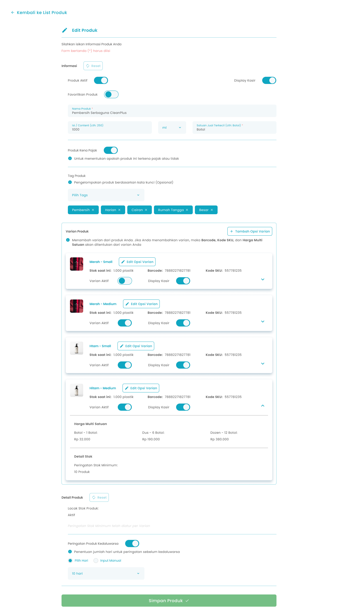
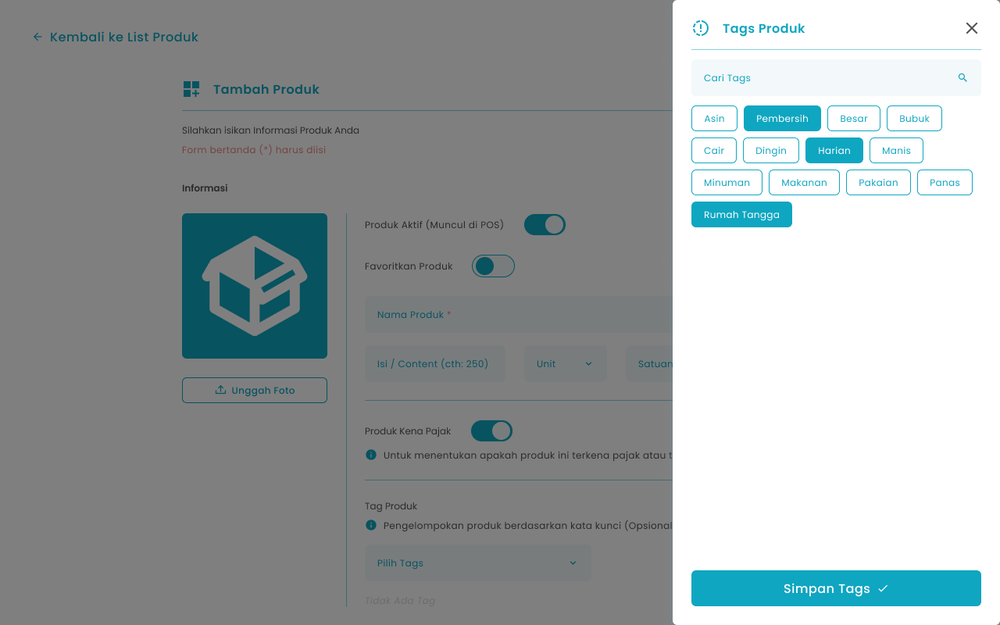
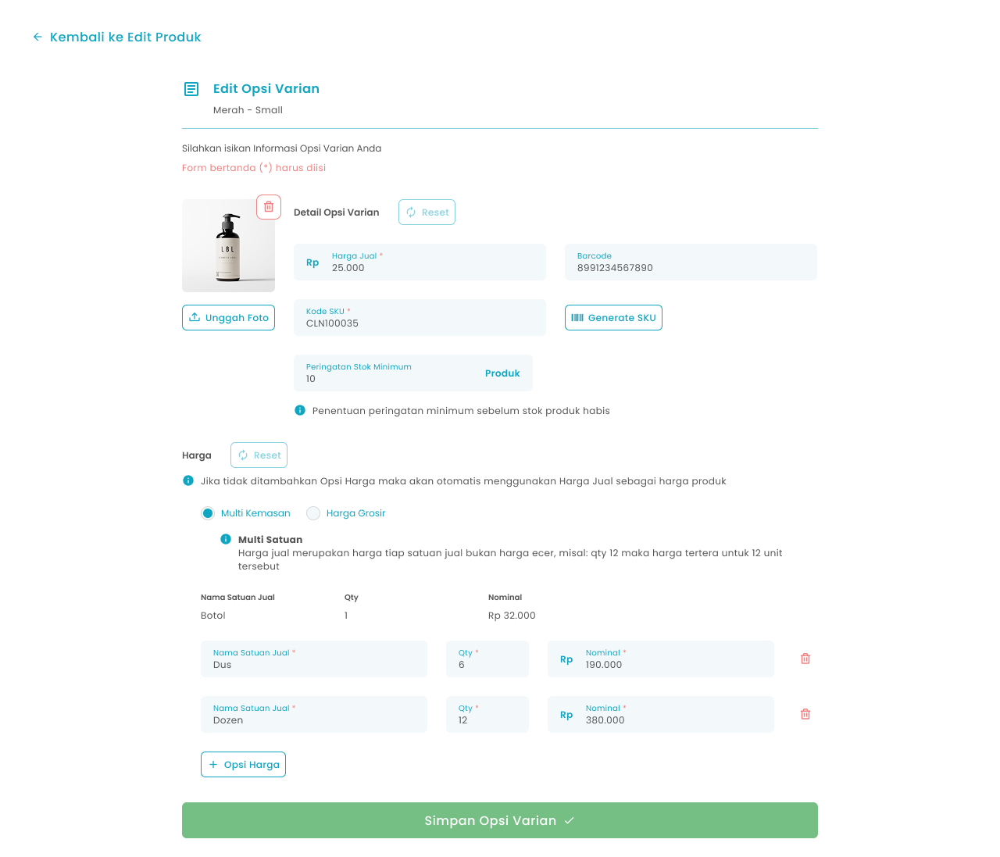
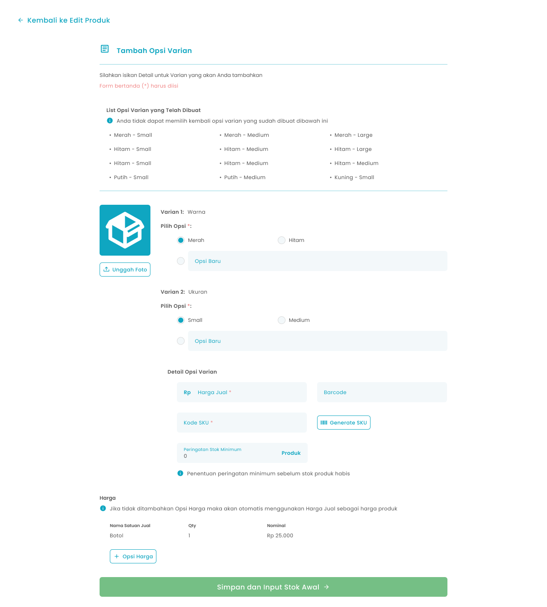
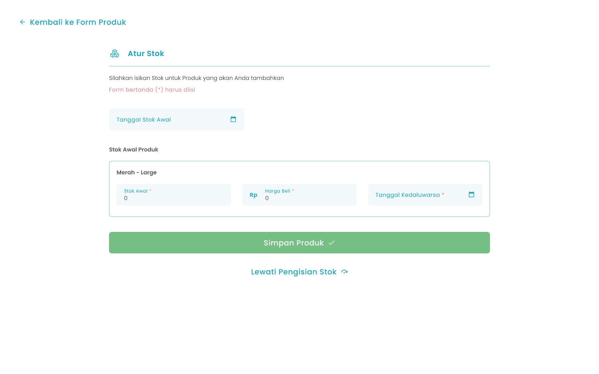
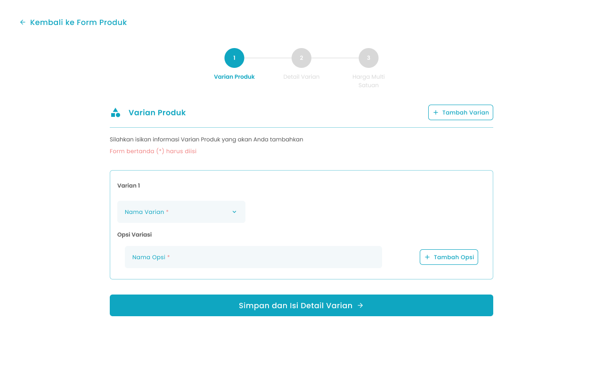
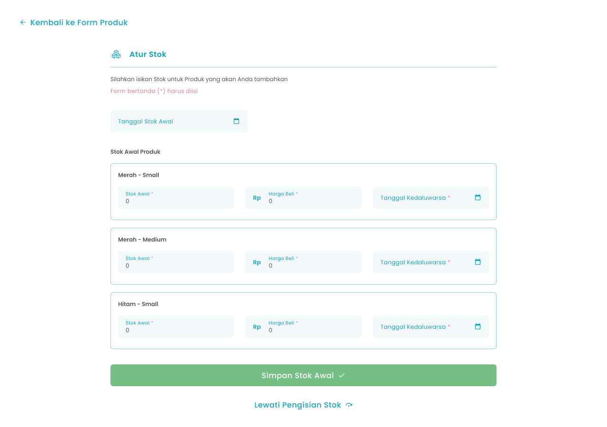

## 1.1. Cara Mengubah Produk Varian

Menu Ubah Produk adalah menu yang dapat digunakan untuk mengubah produk varian. Untuk mengakses halaman ini adalah dengan klik tombol “Edit Produk” di halaman list produk

<Frame>
  
</Frame>

<table>
  <colgroup>
    <col width="50" />
    <col width="189" />
    <col width="473" />
  </colgroup>
  <thead>
    <tr>
      <th>No</th>
      <th>Simbol</th>
      <th>Keterangan</th>
    </tr>
  </thead>
  <tbody>
    <tr>
      <td>1</td>
      <td>Reset Informasi Produk</td>
      <td>Tombol mengembalikan data informasi produk ke semula sebelum diubah</td>
    </tr>
    <tr>
      <td>2</td>
      <td>Produk Aktif</td>
      <td>Tombol untuk menampilkan produk di Halaman Kasir</td>
    </tr>
    <tr>
      <td>3</td>
      <td>Display Kasir</td>
      <td>Tombol untuk menampilkan produk di Halaman Kasir</td>
    </tr>
    <tr>
      <td>4</td>
      <td>Favoritkan Produk</td>
      <td>Tombol untuk favoritkan produk</td>
    </tr>
    <tr>
      <td>5</td>
      <td>Nama Produk</td>
      <td>Tombol untuk mengisi nama produk</td>
    </tr>
    <tr>
      <td>6</td>
      <td>Isi/Content</td>
      <td>Tombol untuk mengisi total berat atau jumlah isi dari satu produk (250,1)</td>
    </tr>
    <tr>
      <td>7</td>
      <td>Unit</td>
      <td>Tombol untuk memilih unit yang sudah dibuat dari master data (gram, pcs)</td>
    </tr>
    <tr>
      <td>8</td>
      <td>Satuan Jual Terkecil</td>
      <td>Tombol untuk mengisi jenis kemasan dari produk (plastik, karton)</td>
    </tr>
    <tr>
      <td>9</td>
      <td>Produk Kena Pajak</td>
      <td>Tombol untuk mengaktifkan produk kena pajak</td>
    </tr>
    <tr>
      <td>10</td>
      <td>Tag Produk</td>
      <td>Tombol untuk memilih beberapa tag produk yang sudah dibuat dari master data</td>
    </tr>
    <tr>
      <td>11</td>
      <td>Tambah Opsi Varian</td>
      <td>Tombol untuk menambahkan opsi varian pada produk varian</td>
    </tr>
    <tr>
      <td>12</td>
      <td>Edit Opsi Varian</td>
      <td>Tombol untuk mengubah opsi varian pada produk varian</td>
    </tr>
    <tr>
      <td>13</td>
      <td>Varian Aktif</td>
      <td>Tombol untuk mengaktifkan opsi varian produk</td>
    </tr>
    <tr>
      <td>14</td>
      <td>Display Kasir Varian</td>
      <td>Tombol untuk menampilkan varian di Halaman Kasir</td>
    </tr>
    <tr>
      <td>15</td>
      <td>Reset Detail Produk</td>
      <td>Tombol mengembalikan data detail produk ke semula sebelum diubah</td>
    </tr>
    <tr>
      <td>16</td>
      <td>Peringatan Produk Kadaluarsa</td>
      <td>Tombol untuk mengaktifkan peringatan produk sebelum kadaluarsa</td>
    </tr>
    <tr>
      <td>17</td>
      <td>Pilih Hari/Input Manual</td>
      <td>Tombol untuk memilih jenis input hari peringatan kadaluarsa yang terdiri dari pilih hari atau input manual</td>
    </tr>
    <tr>
      <td>18</td>
      <td>Jumlah Hari</td>
      <td>Tombol untuk mengisi jumlah hari peringatan sebelum kadaluarsa</td>
    </tr>
    <tr>
      <td>19</td>
      <td>Simpan Produk</td>
      <td>Tombol untuk menyimpan perubahan data produk varian</td>
    </tr>
  </tbody>
</table>

**Cara Mengubah Data Produk Varian**

1. Tekan tombol "Edit Produk" pada salah satu produk biasa di halaman list produk
   <Frame>
     .png "Frame 1369 (3dsfsdfr)")
   </Frame>
2. Setelah menekan tombol, maka akan menampilkan halaman edit produk
3. Anda dapat mengubah foto produk dengan tekan tombol “Unggah Foto”
   <Frame>
     .png "Frame 1456 (1sdsded)")
   </Frame>
4. Anda dapat mengaktifkan atau menonaktifkan produk
   <Frame>
     
   </Frame>
5. Anda dapat menampilkan produk atau menyembunyikan produk di halaman kasir
   <Frame>
     
   </Frame>
6. Anda dapat menjadikan produk sebagai produk favorit
   <Frame>
     
   </Frame>
7. Anda dapat mengubah nama produk di kolom nama produk
   <Frame>
     .png "Input Right Icon (47dsffr)")
   </Frame>
8. Anda dapat mengubah isi / content di kolom isi/content
   <Frame>
     .png "Input Right Icon (48dfdf)")
   </Frame>
9. Anda dapat mengubah dengan tekan tombol “Unit” di kolom unit produk
   <Frame>
     .png "Input Right Icon (49dfdfr)")
   </Frame>
10. Setelah menekan tombol maka akan menampilkan list unit yang sudah anda tambahkan dari master data unit produk
11. Pilih salah satu unit
12. Setelah selesai memilih unit produk maka akan menampilkan unit di halaman tambah produk
13. Anda dapat mengubah satuan jual terkecil di kolom Satuan Jual Terkecil
    <Frame>
      .png "Input Right Icon (50vhfe)")
    </Frame>
14. Anda dapat mengaktifkan pajak pada produk
    <Frame>
      
    </Frame>
15. Anda dapat menambahkan tag produk dengan tekan tombol “Pilih Tags” di kolom tag produk
    <Frame>
      
    </Frame>
16. Setelah menekan tombol maka akan menampilkan daftar tag produk yang sudah anda tambahkan di master data tags produk

<Frame>
  
</Frame>

17. Pilih beberapa tag produk
18. Setelah selesai memilih tag produk tekan tombol “Simpan Tags”
19. Setelah menekan tombol, maka akan menampilkan list tag di halaman tambah produk
20. Tekan tombol “x” untuk menghapus tag yang tidak diperlukan

<Frame>
  .png "Frame 238108 (1sdfsdff)")
</Frame>

21. Anda dapat mengembalikan perubahan informasi produk ke awal sebelum diubah dengan menekan tombol “Reset”

<Frame>
  
</Frame>

20. Anda dapat mengaktifkan varian produk atau menonaktifkan salah satu atau beberapa varian produk
    <Frame>
      
    </Frame>
21. Anda dapat menampilkan varian produk atau menyembunyikan salah satu atau beberapa varian produk di halaman kasir
    <Frame>
      .png "Frame 238110 (1sdfsdf)")
    </Frame>
22. Anda dapat mengaktifkan peringatan produk kadaluarsa
    <Frame>
      ffffff.png "Frame 1498 (1)ffffff")
    </Frame>
23. Jika mengaktifkan peringatan produk kadaluarsa maka anda perlu memilih jumlah hari sebelum tanggal kadaluarsa produk tersebut
    <Frame>
      .png "Input Right Icon (69sssss)")
    </Frame>
24. Anda dapat mengembalikan perubahan detail produk ke awal sebelum diubah dengan menekan tombol “Reset”
    <Frame>
      
    </Frame>
25. Setelah selesai mengubah data produk, kemudian tekan tombol “Simpan Produk” maka akan menampilkan pesan sukses mengubah produk dan kembali ke halaman list produk
    <Frame>
      .png "Frame 1411 (11xcvxcv)")
    </Frame>

## 1.2. Cara Mengubah Opsi Varian Produk

Menu Ubah Opsi Varian adalah menu yang berisi form untuk mengubah opsi varian dari produk varian. Untuk mengakses halaman ini adalah dengan tekan tombol “Edit  Opsi Varian”  di halaman Ubah Produk

<Frame>
  
</Frame>

<table>
  <colgroup>
    <col width="56" />
    <col width="212" />
    <col width="451" />
  </colgroup>
  <thead>
    <tr>
      <th>No</th>
      <th>Simbol</th>
      <th>Keterangan</th>
    </tr>
  </thead>
  <tbody>
    <tr>
      <td>1</td>
      <td>Reset Detail Opsi Varian</td>
      <td>Tombol mengembalikan data detail opsi varian ke semula sebelum diubah</td>
    </tr>
    <tr>
      <td>2</td>
      <td>Unggah Foto</td>
      <td>Tombol untuk mengunggah foto produk</td>
    </tr>
    <tr>
      <td>3</td>
      <td>Harga Jual</td>
      <td>Tombol untuk mengisi harga jual produk</td>
    </tr>
    <tr>
      <td>4</td>
      <td>Barcode</td>
      <td>Tombol untuk mengisi barcode dari produk</td>
    </tr>
    <tr>
      <td>5</td>
      <td>Kode SKU</td>
      <td>Tombol untuk mengisi kode SKU dari produk</td>
    </tr>
    <tr>
      <td>6</td>
      <td>Generate SKU</td>
      <td>Tombol untuk membuat kode SKU secara otomatis</td>
    </tr>
    <tr>
      <td>7</td>
      <td>Peringatan Stok Minimum</td>
      <td>Tombol untuk mengisi jumlah produk peringatan sebelum stok habis</td>
    </tr>
    <tr>
      <td>8</td>
      <td>Reset Harga Multi Satuan</td>
      <td>Tombol mengembalikan data harga multi satuan produk ke semula sebelum diubah</td>
    </tr>
    <tr>
      <td>9</td>
      <td>Multi Kemasan/Grosir</td>
      <td>Tombol untuk memilih harga multi satuan yang terdiri dari harga multi kemasan atau harga grosir</td>
    </tr>
    <tr>
      <td>10</td>
      <td>Nama satuan</td>
      <td>Tombol untuk mengisi nama satuan (single, lusin, box)</td>
    </tr>
    <tr>
      <td>11</td>
      <td>Quantity</td>
      <td>Tombol untuk mengisi quantity satuan dari produk</td>
    </tr>
    <tr>
      <td>12</td>
      <td>Nominal</td>
      <td>Tombol untuk mengisi nominal satuan</td>
    </tr>
    <tr>
      <td>13</td>
      <td>Opsi harga</td>
      <td>Tombol untuk menambahkan kolom input harga satuan</td>
    </tr>
    <tr>
      <td>14</td>
      <td>Simpan Opsi Varian</td>
      <td>Tombol untuk menyimpan perubahan data opsi varian</td>
    </tr>
  </tbody>
</table>

**Cara Mengubah Opsi Varian**

1. Tekan tombol "Edit Opsi Varian" di salah satu opsi varian di halaman edit produk
   <Frame>
     
   </Frame>
2. Anda dapat mengubah foto opsi varian produk dengan tekan tombol “Unggah Foto”
   <Frame>
     
   </Frame>
3. Anda dapat mengubah harga jual di kolom harga jual
   <Frame>
     .png "Input Right Icon (70sdsddf)")
   </Frame>
4. Anda dapat mengubah barcode di kolom barcode
   <Frame>
     .png "Input Right Icon (71sdsdsff)")
   </Frame>
5. Anda dapat mengubah kode sku di kolom kode sku
   <Frame>
     .png "Input Right Iconsdsds (7dds2)")
   </Frame>
6. Tekan tombol “Generate SKU” untuk membuat kode sku secara otomatis
   <Frame>
     .png "Frame 960 (9dfdfgggg)")
   </Frame>
7. Anda dapat mengubah jumlah stok minimum sebagai pengingat stok habis di kolom peringatan stok minimum
   <Frame>
     .png "Input Right Icon (73xxxxsss)")
   </Frame>
8. Anda dapat mengembalikan perubahan detail opsi varian ke awal sebelum diubah dengan menekan tombol “Reset”
   <Frame>
     dfdffgg.png "Frame 6 (6)dfdffgg")
   </Frame>
9. **Menambahkan atau mengubah harga multi satuan**
10. Anda dapat menambahkan satuan produk dengan menekan tombol tambah opsi harga
    <Frame>
      .png "Frame 960 (10sdfsdfgg)")
    </Frame>
11. Setelah menekan tombol maka akan menambahkan kolom input satuan
12. Anda dapat memilih harga multi satuan sebagai harga kemasan atau harga grosir
    <Frame>
      .png "Frame 1202 (3fgfg)")
    </Frame>
13. Anda dapat mengubah atau menambah data baru untuk nama satuan di kolom nama satuan jual
    <Frame>
      .png "Input Right Icon (74ddfdfff)")
    </Frame>
14. Anda dapat mengubah atau menambah data baru untuk quantity satuan di kolom qty
    <Frame>
      .png "Input Right Icon (75dfdf)")
    </Frame>
15. Anda dapat mengubah atau menambah data baru untuk nominal satuan di kolom nominal
    <Frame>
      .png "Input Right Icon (76dfdfdffff)")
    </Frame>
16. Tekan tombol “Hapus” untuk menghapus satuan produk
    <Frame>
      
    </Frame>
17. Anda dapat mengembalikan perubahan harga pada opsi varian ke awal sebelum diubah dengan menekan tombol “Reset”
    <Frame>
      dfdffgg.png "Frame 6 (6)dfdffgg")
    </Frame>
18. Setelah selesai mengubah data opsi varian, kemudian tekan tombol “Simpan Opsi Varian”
    <Frame>
      .png "Frame 1411 (12dfdfdf)")
    </Frame>
19. Setelah menekan tombol, maka akan menampilkan halaman konfirmasi simpan perubahan opsi varian
    <Frame>
      .png "Frame 1336 (13sdfsdf)")
    </Frame>
20. Tekan tombol “Ya, Saya Yakin” di halaman konfirmasi untuk melanjutkan proses simpan perubahan opsi varian
    <Frame>
      
    </Frame>
21. Tekan tombol “Tidak” di halaman konfirmasi untuk membatalkan simpan perubahan opsi varian
    <Frame>
      
    </Frame>
22. Setelah menekan tombol “Ya, Saya Yakin”,  maka akan menampilkan halaman sukses edit opsi varian dan kembali ke halaman edit produk

## 1.3. Cara Menambah Opsi Varian Produk

Menu Tambah Opsi Varian adalah menu yang berisi form untuk menambahkan opsi varian dari produk varian. Untuk mengakses halaman ini adalah dengan tekan tombol “Tambah Opsi Varian”  di halaman Ubah Produk

<Frame>
  
</Frame>

<table>
  <colgroup>
    <col width="50" />
    <col width="228" />
    <col width="434" />
  </colgroup>
  <thead>
    <tr>
      <th>No</th>
      <th>Simbol</th>
      <th>Keterangan</th>
    </tr>
  </thead>
  <tbody>
    <tr>
      <td>1</td>
      <td>Unggah Foto</td>
      <td>Tombol untuk mengunggah foto produk</td>
    </tr>
    <tr>
      <td>2</td>
      <td>List Varian 1</td>
      <td>Tombol untuk memilih opsi varian 1</td>
    </tr>
    <tr>
      <td>3</td>
      <td>List Varian 2</td>
      <td>Tombol untuk memilih opsi varian 2</td>
    </tr>
    <tr>
      <td>4</td>
      <td>Harga Jual</td>
      <td>Tombol untuk mengisi harga jual produk</td>
    </tr>
    <tr>
      <td>5</td>
      <td>Barcode</td>
      <td>Tombol untuk mengisi barcode dari produk</td>
    </tr>
    <tr>
      <td>6</td>
      <td>Kode SKU</td>
      <td>Tombol untuk mengisi kode SKU dari produk</td>
    </tr>
    <tr>
      <td>7</td>
      <td>Generate SKU</td>
      <td>Tombol untuk membuat kode SKU secara otomatis</td>
    </tr>
    <tr>
      <td>8</td>
      <td>Peringatan Stok Minimum</td>
      <td>Tombol untuk mengisi jumlah produk peringatan sebelum stok habis</td>
    </tr>
    <tr>
      <td>9</td>
      <td>Multi Kemasan/Grosir</td>
      <td>Tombol untuk memilih harga multi satuan yang terdiri dari harga multi kemasan atau harga grosir</td>
    </tr>
    <tr>
      <td>10</td>
      <td>Nama satuan</td>
      <td>Tombol untuk mengisi nama satuan (single, lusin, box)</td>
    </tr>
    <tr>
      <td>11</td>
      <td>Quantity</td>
      <td>Tombol untuk mengisi quantity satuan dari produk</td>
    </tr>
    <tr>
      <td>12</td>
      <td>Nominal</td>
      <td>Tombol untuk mengisi nominal satuan</td>
    </tr>
    <tr>
      <td>13</td>
      <td>Opsi harga</td>
      <td>Tombol untuk menambahkan kolom input harga satuan</td>
    </tr>
    <tr>
      <td>14</td>
      <td>Simpan dan Input Stok Awal</td>
      <td>Tombol untuk menyimpan data produk dan melanjutkan proses input stok</td>
    </tr>
  </tbody>
</table>

**Cara Menambah Opsi Varian**

1. Tekan tombol "Tambah Opsi Varian" di halaman edit produk
   <Frame>
     
   </Frame>
2. Unggah foto opsi varian produk dengan tekan tombol “Unggah Foto”
   <Frame>
     
   </Frame>
3. **Pilih Kombinasi opsi varian**
   - Terdapat 3 kemungkinan kombinasi untuk 2 varian sebagai berikut:
     - Varian 1 yang sudah tersedia dan Opsi Baru Varian 2 contoh kombinasi warna hitam dan ukuran xs
     - Opsi Baru Varian 1 dan Varian 2 yang sudah tersedia contoh kombinasi warna biru dan ukuran medium
     - Opsi Baru Varian 1 dan Opsi Baru Varian 2 contoh kombinasi warna biru dan ukuran xs
4. Anda dapat memilih varian yang sudah ada atau masukkan opsi baru di kolom varian 1
   <Frame>
     
   </Frame>
5. Anda dapat memilih varian yang sudah ada atau masukkan opsi baru di kolom varian 2
   <Frame>
     
   </Frame>
6. Masukkan harga jual di kolom harga jual
   <Frame>
     .png "Input Right Icon (77asdasd)")
   </Frame>
7. Masukkan barcode di kolom barcode
   <Frame>
     .png "Input Right Icon (78dddddd)")
   </Frame>
8. Masukkan kode sku di kolom kode sku
   <Frame>
     .png "Input Right Icon (79dfdfdff)")
   </Frame>
9. Tekan tombol “Generate SKU” untuk membuat kode sku secara otomatis
   <Frame>
     .png "Frame 960 (11sssddsdddd)")
   </Frame>
10. Masukkan jumlah stok minimum sebagai pengingat stok habis di kolom peringatan stok minimum
    <Frame>
      .png "Input Right Icon (80dsffg)")
    </Frame>
11. **Menambahkan harga multi satuan**
12. Anda dapat menambahkan satuan produk dengan menekan tombol tambah opsi harga
    <Frame>
      .png "Frame 960 (12dssffff)")
    </Frame>
13. Setelah menekan tombol maka akan menambahkan kolom input satuan
    <Frame>
      .png "Frame 1506 (1fdfgdggttt)")
    </Frame>
14. Anda dapat memilih harga multi satuan sebagai harga kemasan atau harga grosir
    <Frame>
      .png "Frame 1202sdsd (4)")
    </Frame>
15. Masukkan nama satuan di kolom nama satuan jual
16. Masukkan quantity satuan di kolom qty
17. Masukkan nominal satuan di kolom nominal
18. Setelah selesai mengisi data opsi varian, kemudian tekan tombol “Simpan dan Input Stok Awal” maka akan menampilkan halaman pengaturan stok awal
    <Frame>
      .png "Frame 1380 (2sdfsfff)")
    </Frame>
19. Setelah menekan tombol, maka akan menampilkan halaman konfirmasi simpan opsi varian
    <Frame>
      .png "Frame 1336 (14dfdffff)")
    </Frame>
20. Tekan tombol “Ya, Saya Yakin” di halaman konfirmasi untuk melanjutkan proses simpan opsi varian
    <Frame>
      
    </Frame>
21. Tekan tombol “Tidak” di halaman konfirmasi untuk membatalkan simpan opsi varian
    <Frame>
      
    </Frame>
22. Setelah menekan tombol “Ya, Saya Yakin”,  maka akan mengarahkan ke halaman halaman atur stok awal
23. **Cara Menambahkan Stok Awal** Menu Atur Stok Awal adalah menu yang berisi form untuk menambahkan stok awal opsi varian produk dari produk varian. Untuk mengakses halaman ini adalah dengan tekan tombol “Simpan dan Input Stok Awal”  di halaman Tambah Opsi Varian
    <Frame>
      
    </Frame>

<table>
  <colgroup>
    <col width="50" />
    <col width="191" />
    <col width="473" />
  </colgroup>
  <thead>
    <tr>
      <th>No</th>
      <th>Simbol</th>
      <th>Keterangan</th>
    </tr>
  </thead>
  <tbody>
    <tr>
      <td>1</td>
      <td>Tanggal stok awal</td>
      <td>Tombol untuk mengisi tanggal input stok awal</td>
    </tr>
    <tr>
      <td>2</td>
      <td>Stok awal</td>
      <td>Tombol untuk mengisi jumlah stok awal</td>
    </tr>
    <tr>
      <td>3</td>
      <td>Harga beli</td>
      <td>Tombol untuk mengisi harga beli produk</td>
    </tr>
    <tr>
      <td>4</td>
      <td>Tanggal kadaluarsa</td>
      <td>Tombol untuk mengisi tanggal kadaluarsa produk</td>
    </tr>
    <tr>
      <td>5</td>
      <td>Simpan Produk</td>
      <td>Tombol untuk menyimpan produk</td>
    </tr>
    <tr>
      <td>6</td>
      <td>Lewati Pengisian Stok</td>
      <td>Tombol untuk melewati proses pengisian stok awal</td>
    </tr>
  </tbody>
</table>

24. Masukkan tanggal input stok awal di kolom tanggal stok awal

<Frame>
  .png "Input Right Icon (81dfdfff)")
</Frame>

25. Masukkan jumlah stok awal di kolom stok awal

<Frame>
  .png "Input Right Icon (82ccccvvv)")
</Frame>

26. Masukkan harga beli di kolom harga beli

<Frame>
  .png "Input Right Icon (83sgsggsg)")
</Frame>

27. Jika anda mengaktifkan peringatan produk kadaluarsa anda dapat memasukkan tanggal kadaluarsa produk di kolom tanggal kadaluarsa

<Frame>
  .png "Input Right Icon (84fffggggh)")
</Frame>

28. Setelah selesai mengisi data stok, kemudian tekan tombol “Simpan produk”

<Frame>
  .png "Frame 1411 (13dfdffgg)")
</Frame>

29. Setelah menekan tombol, maka akan menampilkan halaman konfirmasi simpan stok awal opsi varian

<Frame>
  
</Frame>

30. Tekan tombol “Ya, Saya Yakin” di halaman konfirmasi untuk melanjutkan proses simpan stok awal opsi varian

<Frame>
  
</Frame>

31. Tekan tombol “Tidak” di halaman konfirmasi untuk membatalkan simpan stok awal  opsi varian

<Frame>
  
</Frame>

32. Setelah menekan tombol “Ya, Saya Yakin”,  maka akan menampilkan pesan sukses menambah opsi varian produk dan mengarahkan ke halaman halaman edit produk

## 1.4. Cara Menambah Produk Varian

Menu Tambah Produk adalah menu yang dapat digunakan untuk menambahkan produk varian. Untuk mengakses halaman ini adalah dengan klik tombol “Tambah Produk” di halaman list produk

**Berikut cara menambahkan produk varian:**

1. Tekan tombol "Tambah Produk" di halaman list produk
   <Frame>
     
   </Frame>
2. Setelah menekan tombol, maka akan menampilkan halaman tambah produk
3. Unggah foto produk dengan tekan tombol “Unggah Foto”
   <Frame>
     
   </Frame>
4. Anda dapat mengaktifkan atau menonaktifkan produk
   <Frame>
     
   </Frame>
5. Anda dapat menampilkan produk atau menyembunyikan produk di halaman kasir
   <Frame>
     
   </Frame>
6. Anda dapat menjadikan produk sebagai produk favorit
   <Frame>
     
   </Frame>
7. Masukkan nama produk di kolom nama produk
   <Frame>
     .png "Input Right Icon (47dsffr)")
   </Frame>
8. Masukkan besaran isi produk di kolom isi/content
   <Frame>
     .png "Input Right Icon (48dfdf)")
   </Frame>
9. Tekan tombol “Unit” di kolom unit produk untuk menambahkan ukuran besaran isi
   <Frame>
     .png "Input Right Icon (49dfdfr)")
   </Frame>
10. Setelah menekan tombol maka akan menampilkan list unit yang sudah anda tambahkan dari master data unit produk
11. Pilih salah satu unit
12. Setelah selesai memilih unit produk maka akan menampilkan unit di halaman tambah produk
13. Masukkan satuan jual terkecil di kolom Satuan Jual Terkecil
    <Frame>
      .png "Input Right Icon (50vhfe)")
    </Frame>
14. Anda dapat mengaktifkan pajak pada produk
    <Frame>
      
    </Frame>
15. Tekan tombol “Pilih Tags” di kolom tag produk untuk menambahkan tag produk
    <Frame>
      
    </Frame>
16. Setelah menekan tombol maka akan menampilkan daftar tag produk yang sudah anda tambahkan dari master data tags produk
    <Frame>
      
    </Frame>
17. Pilih beberapa tag produk
18. Setelah selesai memilih tag produk tekan tombol “Simpan Tags”
19. Setelah menekan tombol, maka akan menampilkan list tag di halaman tambah produk
20. Tekan tombol “Atur Varian”
    <Frame>
      .png "Frame 6 (7asdddggh)")
    </Frame>
21. **Setelah menekan tombol, maka akan menampilkan halaman input varian produk (step 1)**
    <Frame>
      
    </Frame>

<table>
  <colgroup>
    <col width="50" />
    <col width="233" />
    <col width="433" />
  </colgroup>
  <thead>
    <tr>
      <th>No</th>
      <th>Simbol</th>
      <th>Keterangan</th>
    </tr>
  </thead>
  <tbody>
    <tr>
      <td>1</td>
      <td>Tambah Varian</td>
      <td>Tombol untuk menambah kolom input varian lain</td>
    </tr>
    <tr>
      <td>2</td>
      <td>Nama Varian</td>
      <td>Tombol untuk mengisi nama varian produk yang sudah dibuat dari master data (warna, ukuran)</td>
    </tr>
    <tr>
      <td>3</td>
      <td>Nama Opsi</td>
      <td>Tombol untuk mengisi nama opsi varian produk (merah, xl)</td>
    </tr>
    <tr>
      <td>4</td>
      <td>Tambah Opsi</td>
      <td>Tombol untuk menambah kolom input opsi varian</td>
    </tr>
    <tr>
      <td>5</td>
      <td>Simpan dan Isi Detail Varian</td>
      <td>Tombol untuk melanjutkan proses simpan list varian</td>
    </tr>
  </tbody>
</table>

21. Tekan tombol “Nama Varian” di kolom nama varian
    <Frame>
      .png "Input Right Icon (85aaazzz)")
    </Frame>
22. Setelah menekan tombol maka akan menampilkan list varian yang sudah ditambahkan di master data varian produk
23. Pilih salah satu varian
24. Setelah selesai memilih varian maka akan menampilkan varian di halaman input produk varian
25. Masukkan nama opsi variasi di kolom nama opsi
    <Frame>
      .png "Input Right Icon (86zxczxcv)")
    </Frame>
26. Anda dapat menambahkan opsi variasi dengan menekan tombol “Tambah Opsi”
    <Frame>
      .png "Frame 960 (13qqqqq)")
    </Frame>
27. Setelah menekan tombol maka akan menambahkan kolom input opsi variasi
28. Anda dapat menambahkan varian lain dengan menekan tombol “Tambah Varian”
    <Frame>
      .png "Frame 960 (14eeeerrr)")
    </Frame>
29. Setelah menekan tombol maka akan menambahkan kolom input varian lain untuk dikombinasikan dengan varian sebelumnya
30. Setelah selesai mengisi data varian, kemudian tekan tombol Simpan dan Isi Detail Varian
    <Frame>
      .png "Frame 1380 (3xawqwqww)")
    </Frame>
31. **Setelah menekan tombol, maka akan menampilkan halaman input detail varian (step 2)**
32. **Input manual detail varian**
33. Anda dapat mengabaikan beberapa varian untuk tidak disimpan dengan menyalakan toggle tidak disimpan
    <Frame>
      .png "Frame 238110 (2qweqweee)")
    </Frame>
34. Unggah foto varian dengan tekan tombol “Unggah Foto”
    <Frame>
      
    </Frame>
35. Masukkan harga jual di kolom harga jual
    <Frame>
      .png "Input Right Icon (87zxczxcc)")
    </Frame>
36. Masukkan barcode di kolom barcode
    <Frame>
      .png "Input Right Icon (88cccdccccc)")
    </Frame>
37. Masukkan kode sku di kolom kode sku
    <Frame>
      .png "Input Right Icon (89qq1qq2q)")
    </Frame>
38. Masukkan jumlah stok minimum untuk peringatan sebelum stok habis di kolom peringatan stok minimum
    <Frame>
      .png "Input Right Icon (901werr)")
    </Frame>
39. Setelah selesai mengisi detail varian, kemudian tekan tombol “Simpan dan Atur Harga Multi Satuan”
    <Frame>
      
    </Frame>
40. **Setelah menekan tombol maka akan menampilkan halaman input harga multi satuan (step 3)**
41. **Input manual harga multi satuan**
42. Anda dapat menambahkan satuan produk dengan menekan tombol tambah opsi harga di salah satu varian produk
    <Frame>
      .png "Frame 960 (15nnnccnnc)")
    </Frame>
43. Setelah menekan tombol maka akan menambahkan kolom input satuan
    <Frame>
      .png "Frame 1506 (2xxxccvv)")
    </Frame>
44. Anda dapat memilih harga multi satuan sebagai harga kemasan atau harga grosir
    <Frame>
      .png "Frame 1202 (5dffdfdd)")
    </Frame>
45. Masukkan nama satuan di kolom satuan
46. Masukkan quantity satuan di kolom qty
47. Masukkan nominal satuan di kolom nominal
48. Setelah selesai mengisi data produk varian, kemudian tekan tombol Simpan Varian Produk
    <Frame>
      .png "Frame 1411 (14sddssdss)")
    </Frame>
49. Setelah menekan tombol, maka akan menampilkan halaman konfirmasi simpan varian produk
    <Frame>
      .png "Frame 1336 (15ssddffvvf)")
    </Frame>
50. Tekan tombol “Ya, Saya Yakin” di halaman konfirmasi untuk melanjutkan proses simpan varian produk
    <Frame>
      
    </Frame>
51. Tekan tombol “Tidak” di halaman konfirmasi untuk membatalkan simpan varian produk
    <Frame>
      
    </Frame>
52. Setelah menekan tombol “Ya, Saya Yakin”,  maka akan kembali ke halaman tambah produk dengan menampilkan list varian produk yang sudah ditambahkan sebelumnya
53. Anda dapat mengaktifkan atau menonaktifkan varian tertentu
    <Frame>
      .png "Frame 1035 (dfdff1)")
    </Frame>
54. Anda dapat menampilkan atau menyembunyikan varian tertentu pada halaman kasir
    <Frame>
      .png "Frame 238110 (3qweqweee)")
    </Frame>
55. Produk varian wajib memiliki stok maka anda tidak dapat menonaktifkan fitur lacak stok produk
56. Anda dapat mengaktifkan peringatan produk kadaluarsa
    <Frame>
      .png "Frame 1498 (2xaasxcxc)")
    </Frame>
57. Jika mengaktifkan peringatan produk kadaluarsa maka anda perlu memilih jumlah hari sebelum tanggal kadaluarsa produk tersebut
    <Frame>
      .png "Input Right Icon (91afgggg)")
    </Frame>
58. Setelah selesai mengisi data produk, kemudian tekan tombol “Simpan dan Input Stok Awal” maka akan menampilkan halaman pengaturan stok awal
    <Frame>
      .png "Frame 1380 (4qweqwerr)")
    </Frame>
59. Cara Menambahkan Stok Awal Menu Atur Stok Awal adalah menu yang berisi form untuk menambahkan stok awal produk yang sedang dibuat. Untuk mengakses halaman ini adalah dengan tekan tombol “Simpan dan Input Stok Awal”  di halaman Tambah Produk
    <Frame>
      
    </Frame>

<table>
  <colgroup>
    <col width="50" />
    <col width="186" />
    <col width="474" />
  </colgroup>
  <thead>
    <tr>
      <th>No</th>
      <th>Simbol</th>
      <th>Keterangan</th>
    </tr>
  </thead>
  <tbody>
    <tr>
      <td>1</td>
      <td>Tanggal stok awal</td>
      <td>Tombol untuk mengisi tanggal stok awal</td>
    </tr>
    <tr>
      <td>2</td>
      <td>Stok awal</td>
      <td>Tombol untuk mengisi jumlah stok awal</td>
    </tr>
    <tr>
      <td>3</td>
      <td>Harga beli</td>
      <td>Tombol untuk mengisi harga beli produk</td>
    </tr>
    <tr>
      <td>4</td>
      <td>Tanggal kadaluarsa</td>
      <td>Tombol untuk mengisi tanggal kadaluarsa produk</td>
    </tr>
    <tr>
      <td>5</td>
      <td>Simpan Produk</td>
      <td>Tombol untuk menyimpan produk</td>
    </tr>
    <tr>
      <td>6</td>
      <td>Lewati Pengisian Stok</td>
      <td>Tombol untuk melewati proses pengisian stok awal</td>
    </tr>
  </tbody>
</table>

60. Masukkan tanggal input stok awal di kolom tanggal stok awal
    <Frame>
      .png "Input Right Icon (92qweqewee)")
    </Frame>
61. Masukkan jumlah stok awal di kolom stok awal di semua varian produk
    <Frame>
      .png "Input Right Icon (93sdfsffsfsf)")
    </Frame>
62. Masukkan harga beli di kolom harga beli di semua varian produk
    <Frame>
      .png "Input Right Icon (94errttttt)")
    </Frame>
63. Masukkan tanggal kadaluarsa produk di kolom tanggal kadaluarsa jika anda mengaktifkan peringatan produk kadaluarsa sebelumnya
    <Frame>
      .png "Input Right Icon (95dfdffggg)")
    </Frame>
64. Setelah selesai mengisi data stok, kemudian tekan tombol “Simpan Stok Awal”
    <Frame>
      .png "Frame 1411 (15sdfsdfff)")
    </Frame>
65. Setelah menekan tombol, maka akan menampilkan halaman konfirmasi simpan produk
    <Frame>
      .png "Frame 1336 (16dfggghhj)")
    </Frame>
66. Tekan tombol “Ya, Saya Yakin” di halaman konfirmasi untuk melanjutkan proses simpan produk
    <Frame>
      
    </Frame>
67. Tekan tombol “Tidak” di halaman konfirmasi untuk membatalkan simpan produk
    <Frame>
      
    </Frame>
68. Setelah menekan tombol “Ya, Saya Yakin”,  maka akan menampilkan halaman sukses tambah produk
