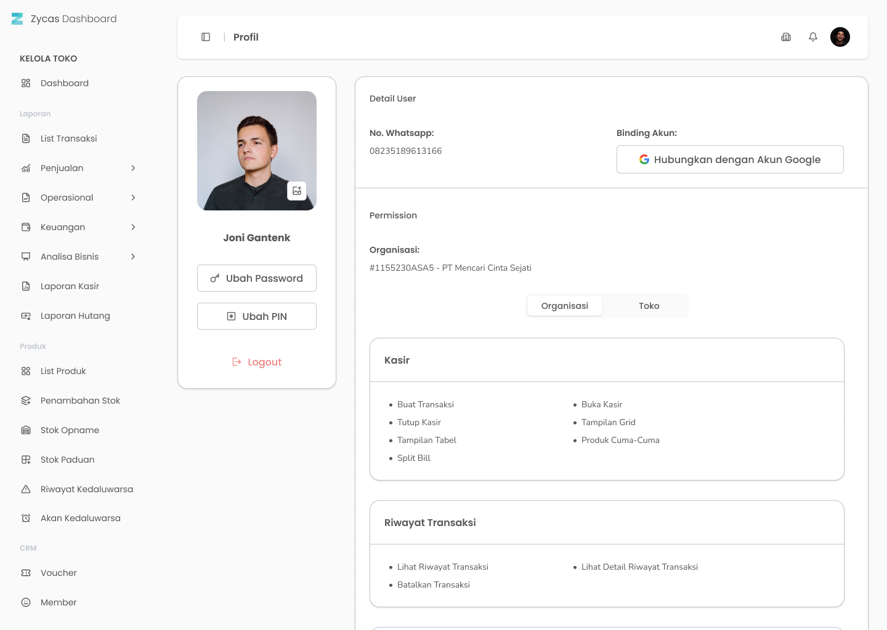
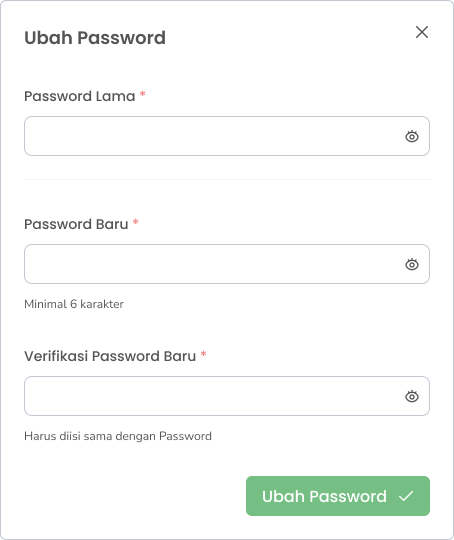
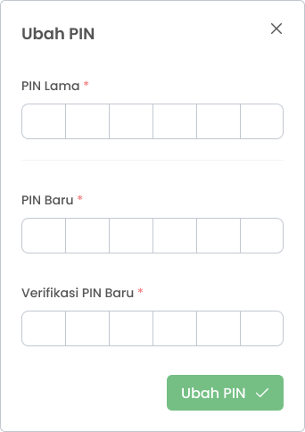
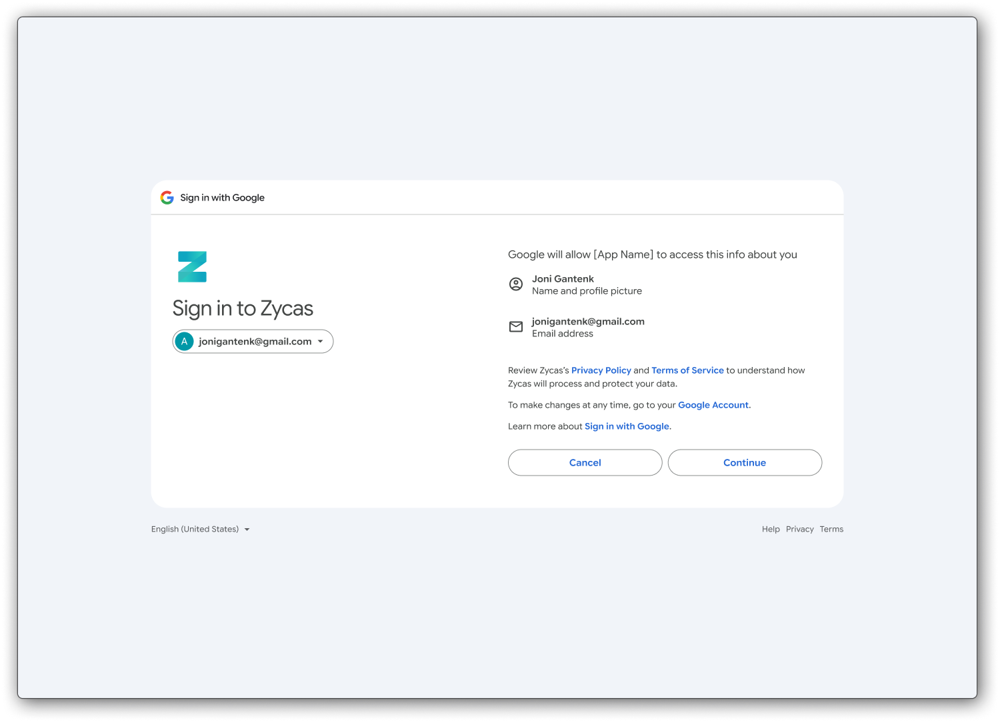
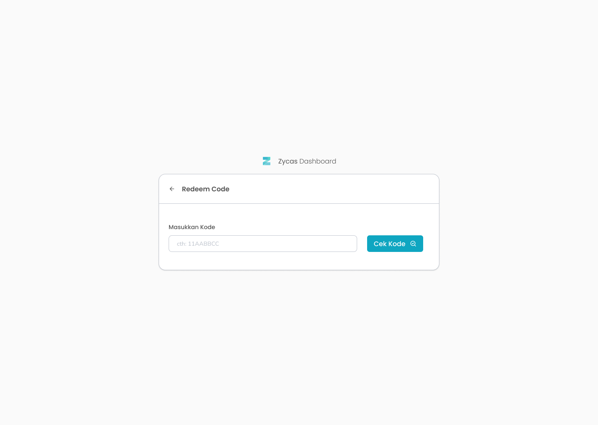
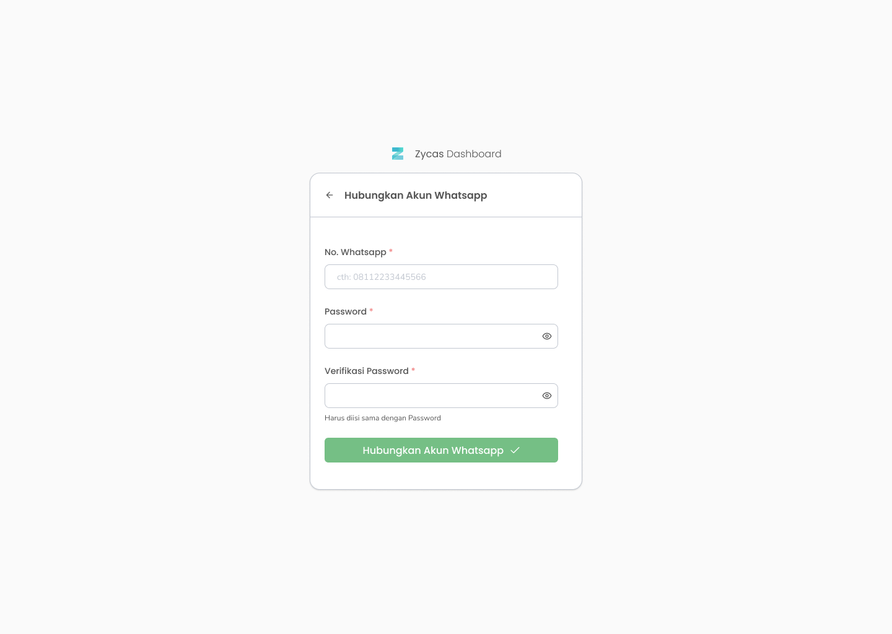

Fitur profil pada aplikasi Zycas berguna untuk mengelola informasi akun. Pada halaman ini, pengguna dapat melihat informasi user, informasi permission, mengubah password, ubah pin, dan logout.

<Frame>
  
</Frame>

<table>
  <colgroup>
    <col width="59" />
    <col width="272" />
    <col width="388" />
  </colgroup>
  <thead>
    <tr>
      <th>No</th>
      <th>Simbol</th>
      <th>Keterangan</th>
    </tr>
  </thead>
  <tbody>
    <tr>
      <td>1</td>
      <td>Ubah password</td>
      <td>Tombol untuk mengubah password</td>
    </tr>
    <tr>
      <td>2</td>
      <td>Ubah pin</td>
      <td>Tombol untuk mengubah pin</td>
    </tr>
    <tr>
      <td>3</td>
      <td>Logout</td>
      <td>Tombol untuk keluar dari akun zycas</td>
    </tr>
    <tr>
      <td>4</td>
      <td>List Permission</td>
      <td>Daftar permission organisasi atau toko</td>
    </tr>
    <tr>
      <td>5</td>
      <td>Hubungkan dengan Akun Google</td>
      <td>Tombol untuk dapat login dengan akun google</td>
    </tr>
  </tbody>
</table>

## **1.1. Cara Mengakses Menu Profile**

**Berikut cara mengakses menu profil:**

1. Tekan foto profil anda di menu header yang terletak di pojok kanan atas
   <Frame>
     
   </Frame>
2. Setelah menekan profil picture, maka akan menampilkan sub list menu
   <Frame>
     .png "Frame 237853s (1)")
   </Frame>
3. Tekan icon avatar di sub list menu
   <Frame>
     
   </Frame>
4. Setelah menekan tombol, maka akan menampilkan halaman profil
5. Tekan tab organisasi/toko untuk melihat permission di kelola toko dan kelola organisasi
   <Frame>
     .png "Bottom34d (1)")
   </Frame>

## **1.2. Cara Mengubah Password**

Menu **Ubah Password** adalah menu yang berisi form untuk mengubah password lama ke password baru. Untuk mengakses halaman ini adalah dengan klik Menu **ubah password** di halaman profil

<Frame>
  
</Frame>

<table>
  <colgroup>
    <col width="53" />
    <col width="215" />
    <col width="444" />
  </colgroup>
  <thead>
    <tr>
      <th>No</th>
      <th>Simbol</th>
      <th>Keterangan</th>
    </tr>
  </thead>
  <tbody>
    <tr>
      <td>1</td>
      <td>Password Lama</td>
      <td>Kolom untuk mengisi password lama</td>
    </tr>
    <tr>
      <td>2</td>
      <td>Password Baru</td>
      <td>Kolom untuk mengisi password baru</td>
    </tr>
    <tr>
      <td>3</td>
      <td>Verifikasi Password Baru</td>
      <td>Kolom untuk mengisi verifikasi password baru</td>
    </tr>
    <tr>
      <td>4</td>
      <td>Ubah Password</td>
      <td>Tombol untuk memproses ubah password</td>
    </tr>
    <tr>
      <td>5</td>
      <td>Close (X)</td>
      <td>Tombol untuk membatalkan atau keluar ke halaman sebelumnya</td>
    </tr>
  </tbody>
</table>

**Berikut merupakan langkah-langkah untuk mengubah password :** 

1. Tekan tombol "Ubah Password" di halaman Profil
   <Frame>
     .png "Butto12n (7)")
   </Frame>
2. Masukkan password lama ke dalam kolom password lama 
   <Frame>
     .png "Input (12342)")
   </Frame>
3. Masukkan password baru anda ke dalam kolom password baru 
   <Frame>
     .png "Input S3q(2)")
   </Frame>
4. Masukkan ulang password anda di kolom verifikasi password baru
   <Frame>
     .png "Input (2s3)")
   </Frame>
5. Setelah selesai mengisi data ubah password, kemudian tekan tombol “Ubah Password”
   <Frame>
     .png "Button (85rd)")
   </Frame>
6. Setelah menekan tombol, maka akan menampilkan halaman konfirmasi ubah password
   <Frame>
     .png "Alter D2q1ialog (3)")
   </Frame>
7. Tekan tombol “Ya, Saya Yakin” di halaman konfirmasi untuk melanjutkan ubah password
   <Frame>
     .png "Button2q (1)")
   </Frame>
8. Tekan tombol “Tidak” di halaman konfirmasi untuk membatalkan ubah password
   <Frame>
     .png "Button2sa (2)")
   </Frame>
9. Setelah menekan tombol “Ya, Saya Yakin”,  maka akan menampilkan halaman login serta notifikasi “Perubahan Password Berhasil Disimpan”

## **1.3. Cara Mengubah PIN**

Menu **Ubah PIN** adalah menu yang berisi form untuk mengubah PIN lama ke PIN baru. Untuk mengakses halaman ini adalah dengan klik Menu **Ubah PIN** di halaman profil

<Frame>
  
</Frame>

<table>
  <colgroup>
    <col width="53" />
    <col width="159" />
    <col width="364" />
  </colgroup>
  <thead>
    <tr>
      <th>No</th>
      <th>Simbol</th>
      <th>Keterangan</th>
    </tr>
  </thead>
  <tbody>
    <tr>
      <td>1</td>
      <td>PIN Lama</td>
      <td>Kolom untuk mengisi PIN lama</td>
    </tr>
    <tr>
      <td>2</td>
      <td>PIN Baru</td>
      <td>Kolom untuk mengisi PIN baru</td>
    </tr>
    <tr>
      <td>3</td>
      <td>Verifikasi PIN Baru</td>
      <td>Kolom untuk mengisi verifikasi PIN baru</td>
    </tr>
    <tr>
      <td>4</td>
      <td>Ubah PIN</td>
      <td>Tombol untuk memproses ubah pin</td>
    </tr>
    <tr>
      <td>5</td>
      <td>Close (X)</td>
      <td>Tombol untuk membatalkan atau kembali ke halaman sebelumnya</td>
    </tr>
  </tbody>
</table>

**Berikut merupakan langkah-langkah untuk mengubah PIN :** 

1. Tekan tombol "Ubah PIN" di halaman Profil
   <Frame>
     .png "Butto2q4n (9)")
   </Frame>
2. Setelah menekan tombol maka akan menampilkan halaman ubah pin
3. Masukkan PIN lama ke dalam kolom PIN lama 
   <Frame>
     .png "Input (q344)")
   </Frame>
4. Masukkan PIN baru anda ke dalam kolom PIN baru 
   <Frame>
     .png "Input E3(5)")
   </Frame>
5. Masukkan ulang PIN anda di kolom verifikasi PIN baru
   <Frame>
     .png "Input (q16)")
   </Frame>
6. Setelah selesai mengisi data ubah password, kemudian tekan tombol “Ubah PIN”
   <Frame>
     .png "Button12q (10)")
   </Frame>
7. Setelah menekan tombol, maka akan menampilkan halaman konfirmasi ubah PIN 
   <Frame>
     .png "Alter D2qialog (5)")
   </Frame>
8. Tekan tombol “Ya, Saya Yakin” di halaman konfirmasi untuk melanjutkan ubah PIN
   <Frame>
     .png "Button2q (1)")
   </Frame>
9. Tekan tombol “Tidak” di halaman konfirmasi untuk membatalkan ubah PIN
   <Frame>
     .png "Button2sa (2)")
   </Frame>
10. Setelah menekan tombol “Ya, Saya Yakin”,  maka akan menampilkan halaman profil serta notifikasi “Perubahan PIN Berhasil Disimpan”

## **1.4. Logout**

Menu **logout**  adalah menu yang berisi konfirmasi untuk keluar akun Zycas. Untuk mengakses halaman ini adalah dengan klik Menu **Logout** di halaman profil

**Berikut cara logout aplikasi:**

1. Tekan tombol "Logout" di halaman Profil
   <Frame>
     .png "Frame 237870 (5ccwwww)")
   </Frame>
2. Setelah menekan tombol, maka akan menampilkan halaman konfirmasi logout
   <Frame>
     .png "Alter Di21qalog (6)")
   </Frame>
3. Tekan tombol “Ya, Saya Yakin” di halaman konfirmasi untuk melanjutkan logout
   <Frame>
     .png "Button 45e(11)")
   </Frame>
4. Tekan tombol “Tidak” di halaman konfirmasi untuk membatalkan logout
   <Frame>
     .png "Button2sa (2)")
   </Frame>
5. Setelah menekan tombol “Ya, Saya Yakin”,  maka akan menampilkan halaman login Zycas serta notifikasi “Berhasil keluar dari Zycas! Silahkan Masuk kembali”

## **1.5. Hubungkan dengan Akun Google**

Menu "Hubungkan dengan Akun Google" adalah menu yang digunakan untuk menambahkan akun google sebagai metode login aplikasi Zycas ketika sebelumnya sudah registrasi menggunakan no whatsapp

**Berikut cara menghubungkan dengan akun google:**

1. Tekan tombol Hubungkan dengan Google pada halaman profil

<Frame>
  
</Frame>

2. Setelah menekan tombol, maka akan diarahkan ke halaman pilih akun google

.png "Sign In32a (1)")

3. Pilih salah satu akun google dan konfirmasi login 

4. Setelah melakukan konfirmasi login maka berhasil menghubungkan akun google untuk login di aplikasi Zycas

## **1.6. Redeem Code Subscription**

Menu "Redeem Code Subscription" adalah menu yang digunakan untuk mengaktifkan langganan aplikasi Zycas dengan memasukkan kode redeem yang telah diberikan. Setelah kode berhasil diverifikasi, masa aktif langganan akan ditambahkan sesuai dengan ketentuan kode yang digunakan.

**Berikut cara mengaktifkan langganan menggunakan redeem code:**

1. Tekan tombol Redeem Code di halaman profil.

<Frame>
  .png "Button (61sdcddddd)")
</Frame>

2. Setelah menekan tombol maka akan menampilkan halaman redeem code

<Frame>
  
</Frame>

3. Masukkan kode redeem pada kolom yang tersedia.

<Frame>
  .png "Masukkan Kode (1ffgddde)")
</Frame>

4. Tekan tombol **Cek Kode** untuk memproses kode.

<Frame>
  .png "Button (65ffdfgg)")
</Frame>

5. Jika kode valid maka akan menampilkan paket langganan Zycas yang akan diaktifkan

<Frame>
  .png "Redeem Code (1sdsdggg)")
</Frame>

6. Tekan tombol Lanjutkan

<Frame>
  .png "Button (67fdfdfrr)")
</Frame>

7. Setelah menekan tombol, maka akan menampilkan pop up konfirmasi redeem code

<Frame>
  .png "Alter Dialog (37ffffccc)")
</Frame>

8. Tekan tombol "Tidak" untuk membatalkan redeem code

<Frame>
  .png "Button2sa (2)")
</Frame>

9. Checklist teks "Saya telah membaca dan memahami aturan dan konsekuensi redeem code dan ingin melanjutkan \*"

<Frame>
  .png "Checkbox (2dddsss)")
</Frame>

10. Tekan tombol "Ya, Saya Yakin" untuk konfirmasi redeem code

<Frame>
  .png "Button2q (1)")
</Frame>

11. Tunggu hingga sistem selesai memverifikasi kode redeem.
12. Jika kode berhasil diverifikasi, langganan akan otomatis diaktifkan sesuai dengan masa berlaku kode.
13. Periksa informasi langganan pada halaman Manajemen Langganan untuk memastikan status dan masa aktif langganan telah diperbarui.

## **1.7. Hubungkan dengan Akun WhatsApp**

Menu "Hubungkan dengan Akun WhatsApp" adalah menu yang digunakan untuk menghubungkan nomor WhatsApp sebagai metode login aplikasi Zycas. Dengan menghubungkan akun WhatsApp, pengguna dapat login ke aplikasi menggunakan nomor WhatsApp yang telah terdaftar. Fitur ini juga dapat digunakan untuk menambahkan user staff agar masing-masing staff dapat memiliki akses login ke aplikasi Zycas.

**Berikut cara menghubungkan dengan akun WhatsApp:**

1. Tekan tombol **Set Akun WA** pada halaman Profil.

<Frame>
  .png "Button (68dfgdfggt)")
</Frame>

2. Setelah menekan tombol maka akan menampilkan form input no whatsapp

<Frame>
  
</Frame>

3. Masukkan nomor WhatsApp yang ingin dihubungkan.

<Frame>
  
</Frame>

4. Masukkan password di kolom password

<Frame>
  .png "Password (2dfdfdgbnh)")
</Frame>

5. Masukkan ulang password anda di kolom verifikasi password

<Frame>
  xxsxx.png "Verifikasi Password (2)xxsxx")
</Frame>

6. Tekan tombol "Hubungkan Akun Whatsapp" untuk melanjutkan proses penghubungan.

<Frame>
  .png "Button (69ffghhfr)")
</Frame>

7. Sistem akan mengirimkan kode verifikasi (OTP) ke nomor WhatsApp yang dimasukkan.
8. Masukkan kode OTP pada kolom verifikasi.

<Frame>
  .png "OTP (1fgbbbb)")
</Frame>

9. Tekan tombol "Konfirmasi OTP"

<Frame>
  .png "Button (70dfggghh)")
</Frame>

10. Setelah kode berhasil diverifikasi, nomor WhatsApp akan terhubung dengan akun Zycas.
11. Pengguna dapat menggunakan nomor WhatsApp tersebut sebagai metode login ke aplikasi Zycas.
