Fitur profil pada aplikasi Zycas berguna untuk mengelola informasi akun. Pada halaman ini, pengguna dapat melihat informasi user, informasi permission, mengubah password, ubah pin, request hapus akun dan redeem code.

<Frame>
  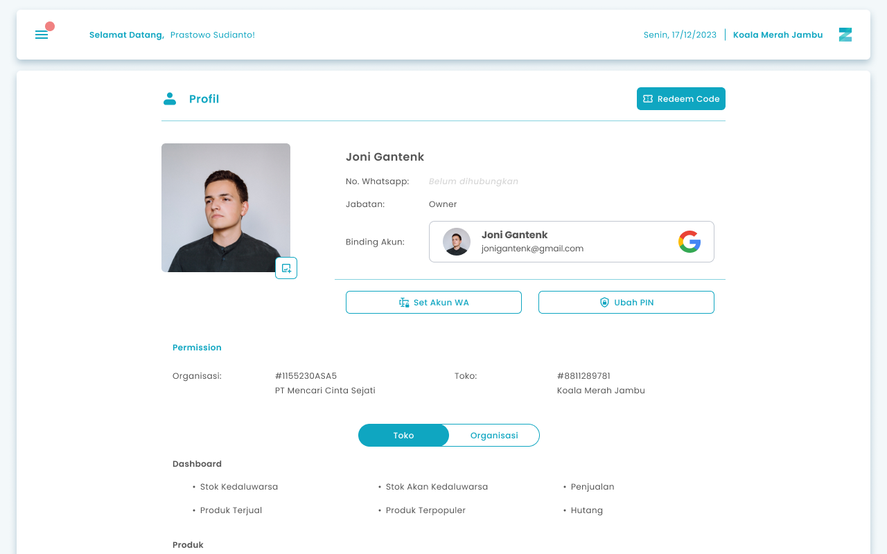
</Frame>

<table>
  <colgroup>
    <col width="50" />
    <col width="148" />
    <col width="507" />
  </colgroup>
  <thead>
    <tr>
      <th>No</th>
      <th>Simbol</th>
      <th>Keterangan</th>
    </tr>
  </thead>
  <tbody>
    <tr>
      <td>1</td>
      <td>Ubah password</td>
      <td>Tombol untuk mengubah password</td>
    </tr>
    <tr>
      <td>2</td>
      <td>Ubah pin</td>
      <td>Tombol untuk mengubah pin</td>
    </tr>
    <tr>
      <td>3</td>
      <td>Hubungkan dengan Google</td>
      <td>Tombol untuk menambahkan metode login dengan akun google jika sebelumnya registrasi dengan no whatsapp</td>
    </tr>
    <tr>
      <td>4</td>
      <td>Redeem Code</td>
      <td>Tombol untuk mengaktifkan paket langganan dengan kode voucher berlangganan</td>
    </tr>
    <tr>
      <td>5</td>
      <td>Set Akun WA</td>
      <td>Tombol untuk menambahkan metode login dengan nomor whatsapp jika sebelumnya registrasi dengan akun google</td>
    </tr>
  </tbody>
</table>

## **1.1. Cara Mengakses Menu Profile**

**Berikut cara mengakses menu profil:**

1. Tekan ikon tiga garis di pojok kiri atas

<Frame>
  
</Frame>

2. Setelah menekan ikon, maka akan menampilkan sidebar list menu

<Frame>
  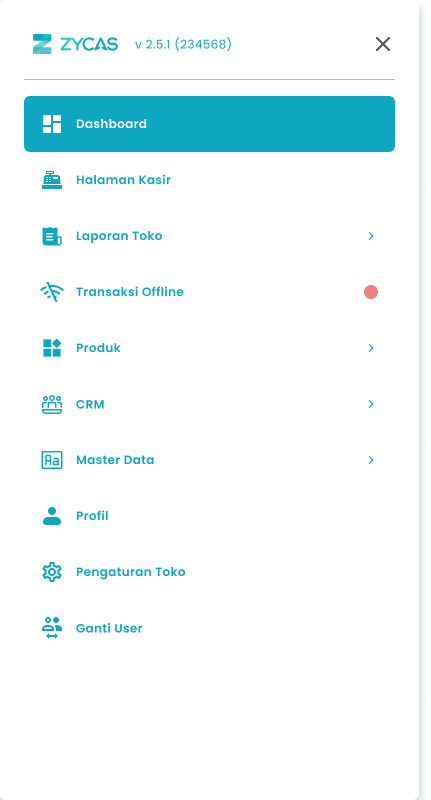
</Frame>

3. Tekan menu Profil pada list menu 

<Frame>
  .png "Frame 1183 (1)")
</Frame>

4. Setelah menekan menu profil maka akan menampilkan halaman profil

## **1.2. Cara Mengubah Password**

Menu "Ubah Password" adalah menu yang berisi form untuk mengubah password lama ke password baru. Untuk mengakses halaman ini adalah dengan klik Menu **ubah password** di halaman profil

<Frame>
  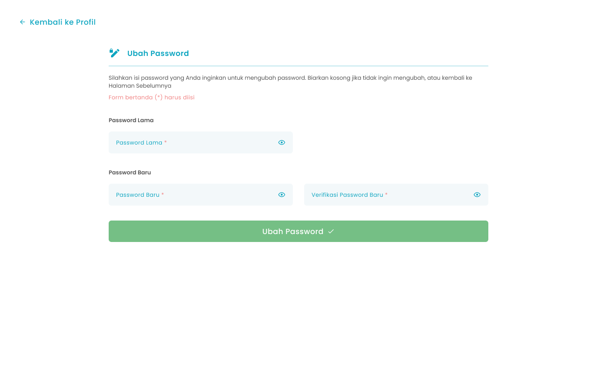
</Frame>

| No | Simbol | Keterangan |
| :-- | :-- | :-- |
| 1 | Password Lama | Kolom untuk mengisi password lama |
| 2 | Password Baru | Kolom untuk mengisi password baru |
| 3 | Verifikasi Password Baru | Kolom untuk mengisi verifikasi password baru |
| 4 | Ubah Password | Tombol untuk simpan perubahan password |

**Berikut merupakan langkah-langkah untuk mengubah password :**

1. Masukkan password lama ke dalam kolom password lama 

<Frame>
  
</Frame>

2. Masukkan password baru anda ke dalam kolom password baru 

<Frame>
  .png "Input Right Icaon (1)")
</Frame>

3. Masukkan ulang password anda di kolom verifikasi password baru

<Frame>
  .png "Input Right Icoqn (2)")
</Frame>

4. Setelah selesai mengisi data ubah password, kemudian tekan tombol “Ubah Password”

<Frame>
  
</Frame>

5. Setelah menekan tombol, maka akan menampilkan halaman konfirmasi ubah password

<Frame>
  .png "Frame 13s36 (1)")
</Frame>

6. Tekan tombol “Ya, Saya Yakin” di halaman konfirmasi untuk melanjutkan ubah password

<Frame>
  
</Frame>

7. Tekan tombol “Tidak” di halaman konfirmasi untuk membatalkan ubah password

<Frame>
  
</Frame>

8. Setelah menekan tombol “Ya, Saya Yakin”,  maka akan menampilkan halaman profil serta notifikasi “Perubahan Password Berhasil Disimpan”

## **1.3. Cara Mengubah PIN**

Menu "Ubah PIN" adalah menu yang berisi form untuk mengubah PIN lama ke PIN baru. Untuk mengakses halaman ini adalah dengan klik Menu "Ubah PIN" di halaman profil

<Frame>
  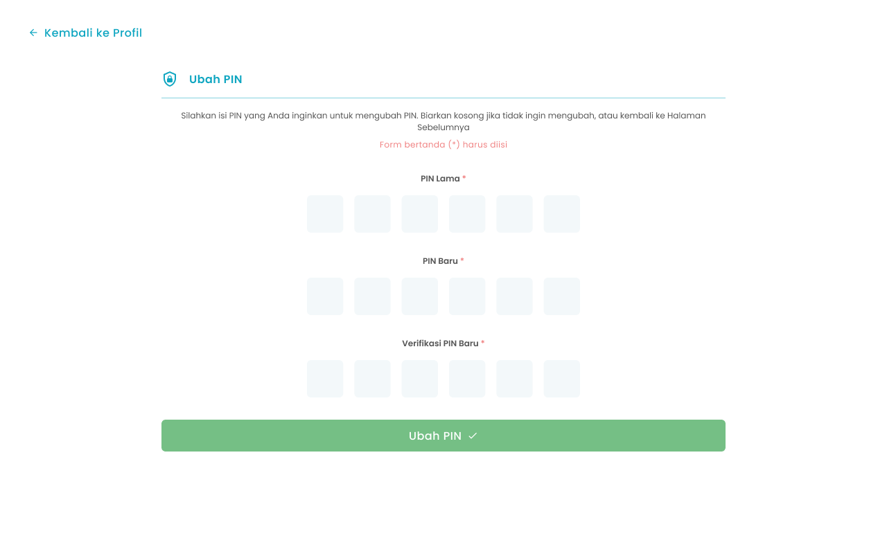
</Frame>

| No | Simbol | Keterangan |
| :-- | :-- | :-- |
| 1 | PIN Lama | Kolom untuk mengisi PIN lama |
| 2 | PIN Baru | Kolom untuk mengisi PIN baru |
| 3 | Verifikasi PIN Baru | Kolom untuk mengisi verifikasi PIN baru |
| 4 | Ubah PIN | Tombol untuk simpan perubahan pin |

**Berikut merupakan langkah-langkah untuk mengubah PIN :**

1. Masukkan PIN lama ke dalam kolom PIN lama 

<Frame>
  
</Frame>

2. Masukkan PIN baru anda ke dalam kolom PIN baru 

<Frame>
  
</Frame>

3. Masukkan ulang PIN anda di kolom verifikasi PIN baru

<Frame>
  
</Frame>

4. Setelah selesai mengisi data ubah password, kemudian tekan tombol “Ubah PIN”

<Frame>
  .png "Frame 13g69 (1)")
</Frame>

5. Setelah menekan tombol, maka akan menampilkan halaman konfirmasi ubah PIN 

<Frame>
  .png "Frame 1336www (2)")
</Frame>

6. Tekan tombol “Ya, Saya Yakin” di halaman konfirmasi untuk melanjutkan ubah PIN

<Frame>
  
</Frame>

7. Tekan tombol “Tidak” di halaman konfirmasi untuk membatalkan ubah PIN

<Frame>
  
</Frame>

8. Setelah menekan tombol “Ya, Saya Yakin”,  maka akan menampilkan halaman profil serta notifikasi “Perubahan PIN Berhasil Disimpan”

## **1.4. Cara Request Hapus Akun**

Menu "Request Hapus Akun" adalah menu yang berisi konfirmasi untuk mengajukan hapus akun kepada admin. Untuk mengakses halaman ini adalah dengan klik tombol "Request Hapus Akun" di halaman profil

**Berikut merupakan langkah-langkah untuk request hapus akun :**

1. Tekan tombol Request Hapus Akun pada halaman profil

<Frame>
  .png "Framesq 6 (2)")
</Frame>

2. Setelah menekan menu profil maka akan menampilkan pop up konfirmasi request hapus akun

<Frame>
  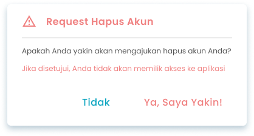
</Frame>

3. Tekan tombol “Ya, Saya Yakin” di halaman konfirmasi untuk melanjutkan request hapus akun

<Frame>
  
</Frame>

4. Tekan tombol “Tidak” di halaman konfirmasi untuk membatalkan request hapus akun

<Frame>
  
</Frame>

5. Setelah menekan tombol “Ya, Saya Yakin”,  maka akan menampilkan pesan notifikasi “Penghapusan akun berhasil diajukan! Silahkan tunggu persetujuan dari Admin”
6. Anda akan diarahkan ke halaman halaman privacy policy untuk penghapusan akun
7. Tekan tulisan “data subject access request” untuk diarahkan ke halaman form request hapus akun
8. Isi data-data pada form request hapus akun dengan lengkap
9. Setelah selesai mengisi form, tekan tombol “Submit”

<table>
  <colgroup>
    <col width="123" />
    <col width="527" />
  </colgroup>
  <thead>
    <tr>
      <th style={{ textAlign: "center" }}>**🛈** **Information**</th>
      <th>Fitur Request Hapus Akun hanya dapat dilakukan oleh user owner</th>
    </tr>
  </thead>
</table>

## **1.5. Hubungkan dengan Akun Google**

Menu "Hubungkan dengan Akun Google" adalah menu yang digunakan untuk menambahkan akun google sebagai metode login aplikasi Zycas ketika sebelumnya sudah registrasi menggunakan no whatsapp

**Berikut cara menghubungkan dengan akun google:**

1. Tekan tombol Hubungkan dengan Google pada halaman profil

<Frame>
  
</Frame>

2. Setelah menekan tombol, maka akan diarahkan ke halaman pilih akun google

<Frame>
  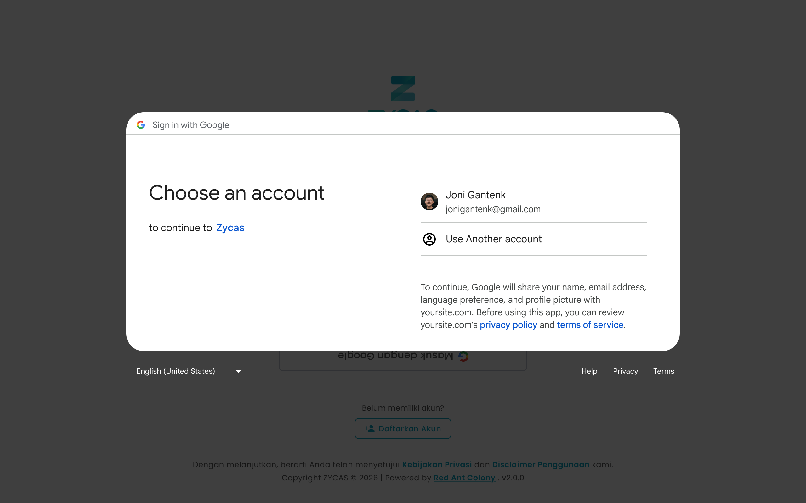
</Frame>

3. Pilih salah satu akun google dan konfirmasi login 

<Frame>
  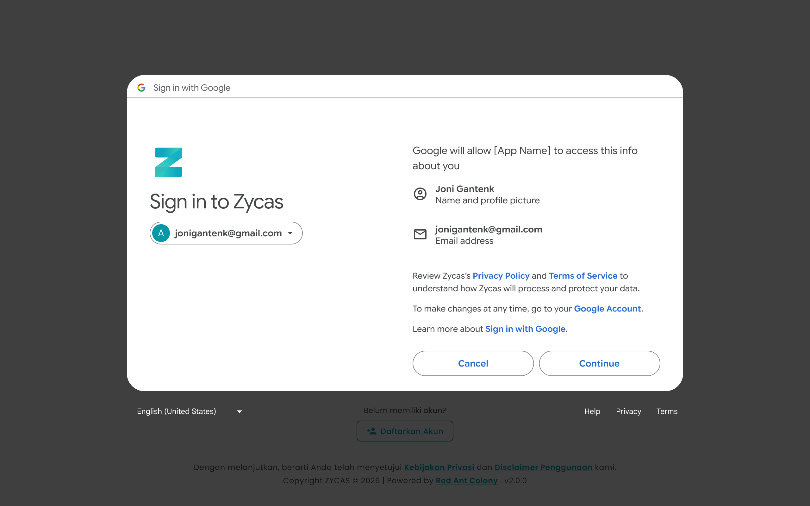
</Frame>

4. Setelah melakukan konfirmasi login maka berhasil menghubungkan akun google untuk login di aplikasi Zycas

## **1.6. Redeem Code Subscription**

Menu "Redeem Code Subscription" adalah menu yang digunakan untuk mengaktifkan langganan aplikasi Zycas dengan memasukkan kode redeem yang telah diberikan. Setelah kode berhasil diverifikasi, masa aktif langganan akan ditambahkan sesuai dengan ketentuan kode yang digunakan.

**Berikut cara mengaktifkan langganan menggunakan redeem code:**

1. Tekan tombol Redeem Code di halaman profil.

<Frame>
  .png "Button (61sdcddddd)")
</Frame>

2. Setelah menekan tombol maka akan menampilkan halaman redeem code

<Frame>
  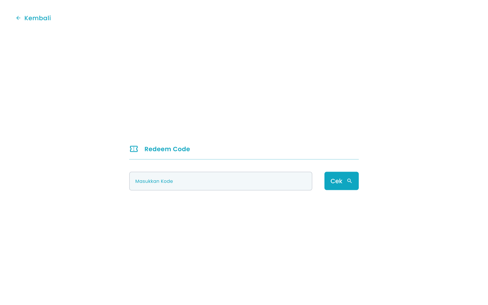
</Frame>

3. Masukkan kode redeem pada kolom yang tersedia.

<Frame>
  
</Frame>

4. Tekan tombol **Cek** untuk memproses kode.

<Frame>
  .png "Button (62ssddsdd)")
</Frame>

5. Jika kode valid maka akan menampilkan paket langganan Zycas yang akan diaktifkan

<Frame>
  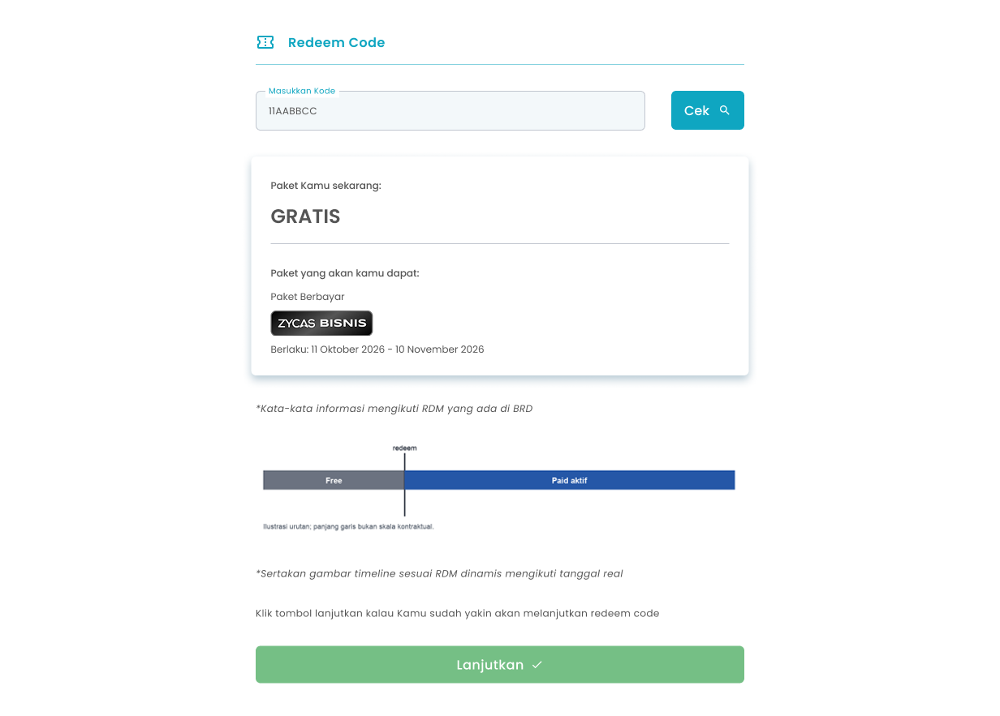
</Frame>

6. Tekan tombol Lanjutkan

<Frame>
  .png "Button (64ddd)")
</Frame>

7. Setelah menekan tombol, maka akan menampilkan pop up konfirmasi redeem code

<Frame>
  .png "Frame 1336 (17ffffgg)")
</Frame>

8. Tekan tombol "Tidak" untuk membatalkan redeem code

<Frame>
  
</Frame>

9. Checklist teks "Saya telah membaca dan memahami aturan dan konsekuensi redeem code dan ingin melanjutkan \*"

<Frame>
  .png "Checkbox (2dddsss)")
</Frame>

10. Tekan tombol "Ya, Saya Yakin" untuk konfirmasi redeem code

<Frame>
  
</Frame>

11. Tunggu hingga sistem selesai memverifikasi kode redeem.
12. Jika kode berhasil diverifikasi, langganan akan otomatis diaktifkan sesuai dengan masa berlaku kode.
13. Periksa informasi langganan pada halaman Manajemen Langganan untuk memastikan status dan masa aktif langganan telah diperbarui.

## **1.7. Hubungkan dengan Akun WhatsApp**

Menu "Hubungkan dengan Akun WhatsApp" adalah menu yang digunakan untuk menghubungkan nomor WhatsApp sebagai metode login aplikasi Zycas. Dengan menghubungkan akun WhatsApp, pengguna dapat login ke aplikasi menggunakan nomor WhatsApp yang telah terdaftar. Fitur ini juga dapat digunakan untuk menambahkan user staff agar masing-masing staff dapat memiliki akses login ke aplikasi Zycas.

**Berikut cara menghubungkan dengan akun WhatsApp:**

1. Tekan tombol **Set Akun WA** pada halaman Profil.

<Frame>
  .png "Frame 6 (8ddffde)")
</Frame>

2. Setelah menekan tombol maka akan menampilkan form input no whatsapp

<Frame>
  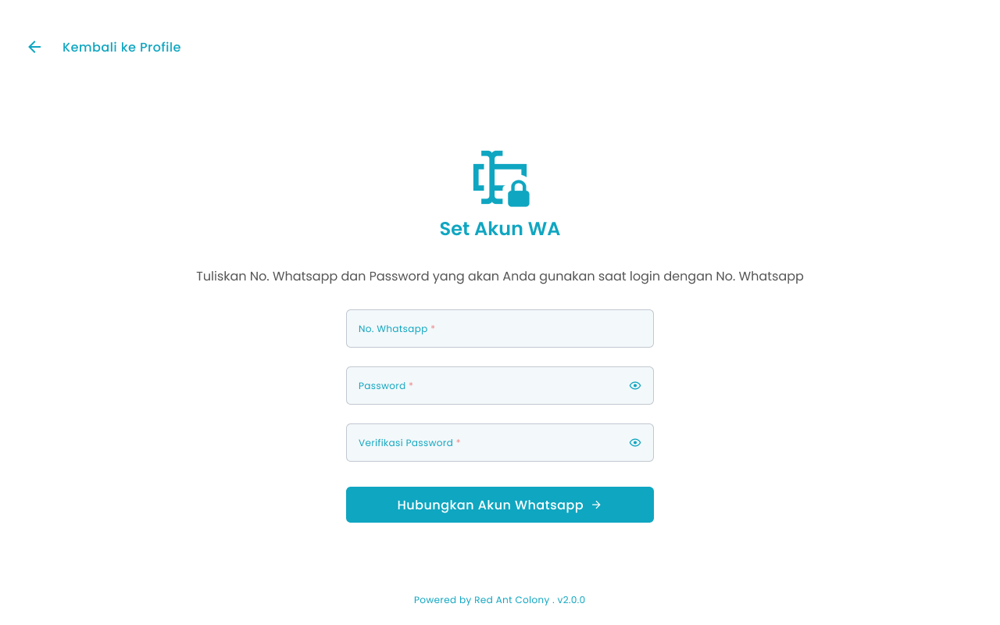
</Frame>

3. Masukkan nomor WhatsApp yang ingin dihubungkan.

<Frame>
  
</Frame>

4. Masukkan password di kolom password

<Frame>
  .png "Password (1ffdddr)")
</Frame>

5. Masukkan ulang password anda di kolom verifikasi password

<Frame>
  .png "Verifikasi Password (1bbvgvv)")
</Frame>

6. Tekan tombol "Hubungkan Akun Whatsapp" untuk melanjutkan proses penghubungan.

<Frame>
  
</Frame>

7. Sistem akan mengirimkan kode verifikasi (OTP) ke nomor WhatsApp yang dimasukkan.
8. Masukkan kode OTP pada kolom verifikasi.

<Frame>
  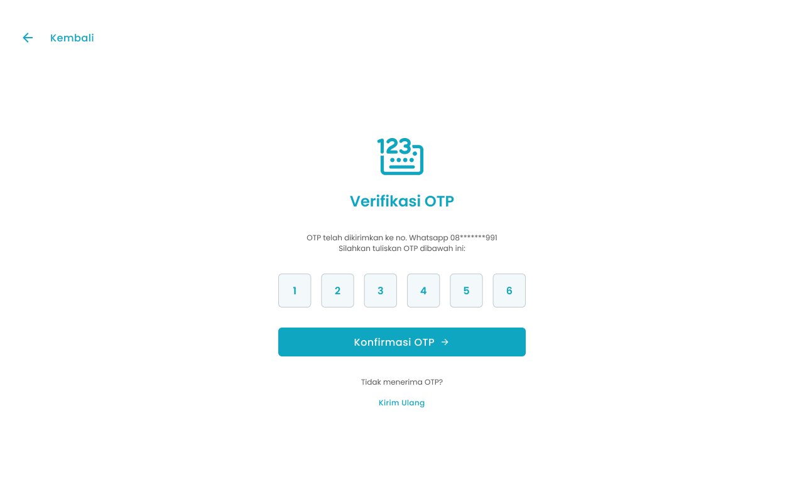
</Frame>

9. Setelah kode berhasil diverifikasi, nomor WhatsApp akan terhubung dengan akun Zycas.
10. Pengguna dapat menggunakan nomor WhatsApp tersebut sebagai metode login ke aplikasi Zycas.

## **Glosarium**

<table>
  <colgroup>
    <col width="240" />
    <col width="481" />
  </colgroup>
  <thead>
    <tr>
      <th>**Istilah**</th>
      <th>**Deskripsi (Penjelasan dalam Bahasa Indonesia)**</th>
    </tr>
  </thead>
  <tbody>
    <tr>
      <td>Zycas Mobile</td>
      <td>Aplikasi mobile untuk mengelola transaksi, stok, dan operasional bisnis ritel.</td>
    </tr>
    <tr>
      <td>Pengguna (User)</td>
      <td>Individu yang menggunakan aplikasi Zycas dengan hak akses tertentu.</td>
    </tr>
    <tr>
      <td>Owner</td>
      <td>Pengguna dengan hak akses penuh terhadap seluruh menu dan fitur aplikasi Zycas.</td>
    </tr>
    <tr>
      <td>Karyawan</td>
      <td>Pengguna dengan hak akses terbatas sesuai izin yang diberikan oleh owner.</td>
    </tr>
    <tr>
      <td>Hak Akses</td>
      <td>Pengaturan izin yang menentukan fitur dan menu yang dapat diakses oleh pengguna.</td>
    </tr>
    <tr>
      <td>Profile</td>
      <td>Menu pada Zycas Mobile yang digunakan untuk mengelola informasi akun dan keamanan pengguna.</td>
    </tr>
    <tr>
      <td>Modul Profile</td>
      <td>Pusat manajemen akun personal untuk mengatur identitas, keamanan, dan sesi login pengguna.</td>
    </tr>
    <tr>
      <td>Informasi User</td>
      <td>Data identitas pengguna yang ditampilkan pada halaman profil.</td>
    </tr>
    <tr>
      <td>Informasi Permission</td>
      <td>Informasi mengenai hak akses atau izin yang dimiliki oleh pengguna.</td>
    </tr>
    <tr>
      <td>Ubah Password</td>
      <td>Fitur untuk mengganti password lama dengan password baru.</td>
    </tr>
    <tr>
      <td>Password Lama</td>
      <td>Password yang sedang digunakan dan harus diisi sebagai verifikasi sebelum perubahan.</td>
    </tr>
    <tr>
      <td>Password Baru</td>
      <td>Password baru yang akan digunakan setelah proses perubahan berhasil.</td>
    </tr>
    <tr>
      <td>Verifikasi Password Baru</td>
      <td>Kolom konfirmasi untuk memastikan password baru diinput dengan benar.</td>
    </tr>
    <tr>
      <td>Ubah PIN</td>
      <td>Fitur untuk mengganti PIN lama dengan PIN baru pada akun pengguna.</td>
    </tr>
    <tr>
      <td>PIN Lama</td>
      <td>PIN yang sedang aktif dan digunakan sebagai verifikasi perubahan PIN.</td>
    </tr>
    <tr>
      <td>PIN Baru</td>
      <td>PIN baru yang akan digunakan setelah perubahan disimpan.</td>
    </tr>
    <tr>
      <td>Verifikasi PIN Baru</td>
      <td>Kolom konfirmasi untuk memastikan PIN baru diinput dengan benar.</td>
    </tr>
    <tr>
      <td>Request Hapus Akun</td>
      <td>Fitur untuk mengajukan permintaan penghapusan akun kepada admin.</td>
    </tr>
    <tr>
      <td>Pop Up Konfirmasi</td>
      <td>Jendela dialog yang meminta persetujuan pengguna sebelum melanjutkan suatu aksi.</td>
    </tr>
    <tr>
      <td>Admin</td>
      <td>Pihak yang memiliki wewenang untuk menyetujui atau memproses permintaan penghapusan akun.</td>
    </tr>
    <tr>
      <td>Privacy Policy</td>
      <td>Halaman kebijakan privasi yang menjelaskan pengelolaan data pengguna.</td>
    </tr>
    <tr>
      <td>Data Subject Access Request</td>
      <td>Tautan atau fitur untuk mengajukan permintaan terkait pengelolaan atau penghapusan data akun.</td>
    </tr>
    <tr>
      <td>Form Request Hapus Akun</td>
      <td>Formulir yang harus diisi pengguna untuk mengajukan penghapusan akun secara resmi.</td>
    </tr>
    <tr>
      <td>Halaman Login</td>
      <td>Halaman awal aplikasi Zycas yang digunakan untuk masuk ke akun pengguna.</td>
    </tr>
    <tr>
      <td>Ikon Hamburger</td>
      <td>Ikon tiga garis yang digunakan untuk membuka sidebar menu.</td>
    </tr>
    <tr>
      <td>Sidebar Menu</td>
      <td>Panel navigasi samping yang menampilkan daftar menu aplikasi.</td>
    </tr>
    <tr>
      <td>Notifikasi</td>
      <td>Pesan sistem yang menampilkan status keberhasilan atau pembatalan suatu aksi.</td>
    </tr>
    <tr>
      <td>Konfirmasi Aksi</td>
      <td>Proses persetujuan pengguna sebelum sistem menjalankan perintah tertentu.</td>
    </tr>
  </tbody>
</table>
