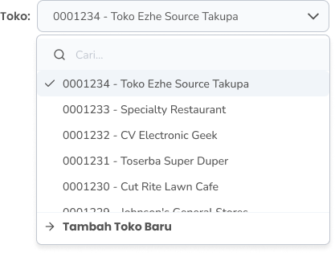

Fitur **Riwayat Produk Akan Kadaluarsa** pada aplikasi Zycas ini menyediakan catatan lengkap tentang semua produk yang akan melewati tanggal kadaluarsanya. Halaman ini berfungsi menampilkan produk yang tampil pada list ini adalah produk yang mendekati dari tanggal kadaluarsa, berdasarkan masukan peringatan stok kadaluarsa yang dilakukan saat membuat produk

<Frame>
  .jpg "Stok Paduan (1dsdscv)")
</Frame>

<table>
  <colgroup>
    <col width="57" />
    <col width="175" />
    <col width="441" />
  </colgroup>
  <thead>
    <tr>
      <th>No.</th>
      <th>Simbol</th>
      <th>Keterangan</th>
    </tr>
  </thead>
  <tbody>
    <tr>
      <td>1</td>
      <td>Tanggal Kadaluarsa</td>
      <td>Tombol untuk filter range tanggal kadaluarsa produk</td>
    </tr>
    <tr>
      <td>2</td>
      <td>Cari</td>
      <td>Kolom untuk mencari produk kadaluarsa</td>
    </tr>
  </tbody>
</table>

## **1.1. Cara Akses List Riwayat Akan Kadaluarsa** 

**Berikut cara mengakses halaman list riwayat akan kadaluarsa :** 

1. Tekan menu Akan Kadaluarsa di sidebar menu kelola toko
   <Frame>
     .png "FULL (6mnmnm)")
   </Frame>
2. Setelah menekan menu Riwayat Produk Akan Kadaluarsa maka akan menampilkan halaman list riwayat akan kadaluarsa
3. Cari produk tertentu yang akan kadaluarsa dengan kata kunci tertentu di kolom cari
   <Frame>
     .png "Input (28qaqa)")
   </Frame>
4. Filter produk akan kadaluarsa di tanggal kadaluarsa tertentu
   <Frame>
     .png "Input (36dcxzxs)")
   </Frame>
5. **Ganti konteks toko**
6. Tekan tombol "Toko" di pojok kanan atas halaman
   <Frame>
     
   </Frame>
7. Setelah menekan tombol, maka akan menampilkan list toko
   <Frame>
     
   </Frame>
8. Pilih salah satu toko
9. Setelah memilih salah satu toko maka akan menampilkan list riwayat produk akan kadaluarsa di toko tersebut
