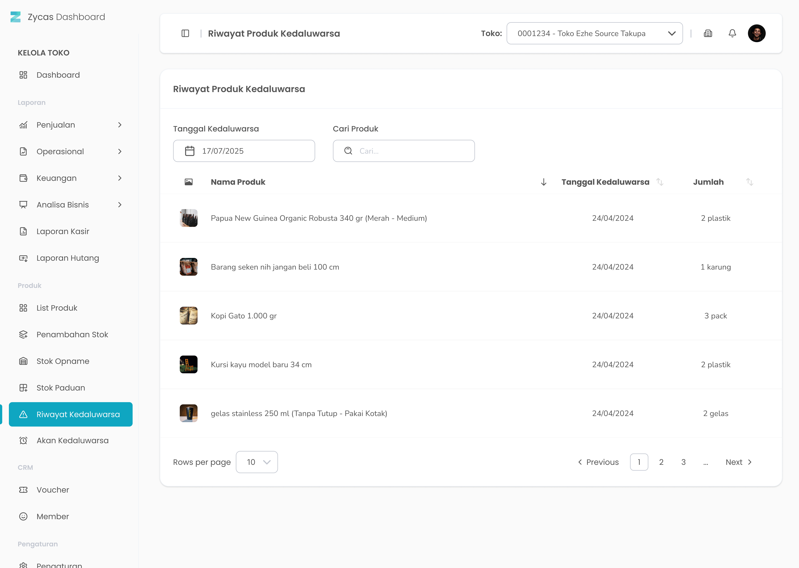
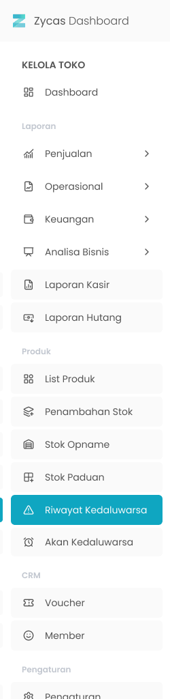

Fitur **Riwayat Produk Kadaluarsa** pada aplikasi Zycas ini menyediakan catatan lengkap tentang semua produk yang telah melewati tanggal kadaluarsanya. Halaman ini berfungsi sebagai arsip penting untuk membantu Anda menganalisis produk-produk yang tidak laku dan mengevaluasi manajemen stok.

<Frame>
  
</Frame>

<table>
  <colgroup>
    <col width="54" />
    <col width="181" />
    <col width="442" />
  </colgroup>
  <thead>
    <tr>
      <th>No.</th>
      <th>Simbol</th>
      <th>Keterangan</th>
    </tr>
  </thead>
  <tbody>
    <tr>
      <td>1</td>
      <td>Tanggal Kadaluarsa</td>
      <td>Tombol untuk filter range tanggal kadaluarsa produk</td>
    </tr>
    <tr>
      <td>2</td>
      <td>Cari</td>
      <td>Kolom untuk mencari produk kadaluarsa</td>
    </tr>
  </tbody>
</table>

## **1.1. Cara Akses List Riwayat Kadaluarsa** 

**Berikut cara mengakses halaman list riwayat kadaluarsa :** 

1. Tekan menu Riwayat Produk Kadaluarsa di sidebar menu kelola toko
   <Frame>
     
   </Frame>
2. Setelah menekan menu Riwayat Produk Kadaluarsa maka akan menampilkan halaman list riwayat kadaluarsa
3. Cari produk kadaluarsa tertentu dengan kata kunci tertentu di kolom cari
   <Frame>
     .png "Input (28qaqa)")
   </Frame>
4. Filter produk kadaluarsa di tanggal kadaluarsa terntentu
   <Frame>
     .png "Input (36dcxzxs)")
   </Frame>
5. **Ganti konteks toko**
6. Tekan tombol "Toko" di pojok kanan atas halaman
   <Frame>
     
   </Frame>
7. Setelah menekan tombol, maka akan menampilkan list toko
   <Frame>
     
   </Frame>
8. Pilih salah satu toko
9. Setelah memilih salah satu toko maka akan menampilkan list riwayat produk kadaluarsa di toko tersebut
