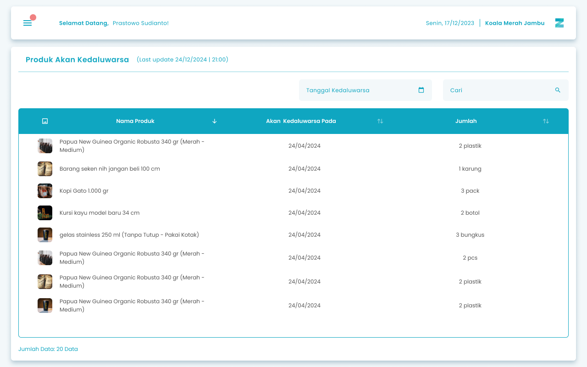
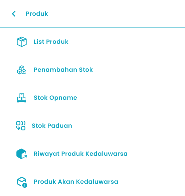

Fitur Riwayat Produk Akan Kadaluarsa pada aplikasi Zycas ini menyediakan catatan lengkap tentang semua produk yang akan melewati tanggal kadaluarsanya. Halaman ini berfungsi menampilkan produk yang tampil pada list ini adalah produk yang mendekati dari tanggal kadaluarsa, berdasarkan masukan peringatan stok kadaluarsa yang dilakukan saat membuat produk

<Frame>
  
</Frame>

<table>
  <colgroup>
    <col width="55" />
    <col width="182" />
    <col width="424" />
  </colgroup>
  <thead>
    <tr>
      <th>No.</th>
      <th>Simbol</th>
      <th>Keterangan</th>
    </tr>
  </thead>
  <tbody>
    <tr>
      <td>1</td>
      <td>Tanggal Kadaluarsa</td>
      <td>Tombol untuk filter range tanggal kadaluarsa produk</td>
    </tr>
    <tr>
      <td>2</td>
      <td>Cari</td>
      <td>Kolom untuk mencari produk kadaluarsa</td>
    </tr>
  </tbody>
</table>

## 1.1. Cara Akses List Riwayat Akan Kadaluarsa

**Berikut cara mengakses halaman list riwayat akan kadaluarsa :**

1. Tekan ikon tiga garis di pojok kiri atas

<Frame>
  
</Frame>

2. Setelah menekan ikon hamburger, maka akan menampilkan sidebar list menu

<Frame>
  
</Frame>

3. Tekan menu Produk pada list menu
4. Setelah tekan menu Produk, maka akan menampilkan list sub menu Produk

<Frame>
  
</Frame>

5. Lalu tekan menu Riwayat Produk Akan Kadaluarsa pada list sub menu Produk
6. Setelah menekan menu Riwayat Produk Akan Kadaluarsa maka akan menampilkan halaman list riwayat akan kadaluarsa. 

## **Glosarium**

<table>
  <colgroup>
    <col width="259" />
    <col width="417" />
  </colgroup>
  <thead>
    <tr>
      <th>**Istilah**</th>
      <th>**Deskripsi (Penjelasan dalam Bahasa Indonesia)**</th>
    </tr>
  </thead>
  <tbody>
    <tr>
      <td>Zycas Mobile</td>
      <td>Aplikasi mobile yang digunakan untuk mengelola transaksi, stok, dan operasional bisnis ritel.</td>
    </tr>
    <tr>
      <td>Pengguna</td>
      <td>Orang yang menggunakan aplikasi Zycas Mobile dengan hak akses tertentu.</td>
    </tr>
    <tr>
      <td>Owner</td>
      <td>Pengguna dengan hak akses penuh untuk mengelola seluruh menu dan fitur dalam aplikasi.</td>
    </tr>
    <tr>
      <td>Karyawan</td>
      <td>Pengguna dengan hak akses terbatas sesuai izin yang diberikan oleh owner.</td>
    </tr>
    <tr>
      <td>Hak Akses</td>
      <td>Pengaturan izin yang menentukan fitur dan menu yang dapat digunakan oleh setiap pengguna.</td>
    </tr>
    <tr>
      <td>Riwayat Akan Kedaluwarsa</td>
      <td>Modul yang menampilkan daftar produk yang akan segera melewati tanggal kedaluwarsa.</td>
    </tr>
    <tr>
      <td>Modul Riwayat Akan Kadaluarsa</td>
      <td>Fitur dalam aplikasi Zycas yang digunakan untuk memantau produk yang mendekati tanggal kedaluwarsa agar dapat ditindaklanjuti lebih awal.</td>
    </tr>
    <tr>
      <td>Produk Akan Kadaluarsa</td>
      <td>Produk yang masih layak jual namun sudah mendekati tanggal kedaluwarsanya.</td>
    </tr>
    <tr>
      <td>Tanggal Kedaluwarsa</td>
      <td>Batas tanggal aman penggunaan atau penjualan suatu produk.</td>
    </tr>
    <tr>
      <td>Peringatan Stok Kadaluarsa</td>
      <td>Pengaturan peringatan yang ditentukan saat pembuatan produk untuk menandai produk yang mendekati tanggal kedaluwarsa.</td>
    </tr>
    <tr>
      <td>Filter Tanggal Kadaluarsa</td>
      <td>Fitur untuk menyaring daftar produk berdasarkan rentang tanggal kedaluwarsa tertentu.</td>
    </tr>
    <tr>
      <td>Cari Produk</td>
      <td>Kolom pencarian untuk menemukan produk tertentu pada daftar riwayat akan kadaluarsa.</td>
    </tr>
    <tr>
      <td>List Riwayat Akan Kadaluarsa</td>
      <td>Halaman yang menampilkan daftar lengkap produk yang mendekati tanggal kedaluwarsa.</td>
    </tr>
    <tr>
      <td>Manajemen Stok</td>
      <td>Proses pengelolaan persediaan barang agar jumlah, kondisi, dan masa berlaku produk tetap terkontrol.</td>
    </tr>
    <tr>
      <td>Inventaris</td>
      <td>Seluruh persediaan produk yang tercatat dan dikelola dalam sistem.</td>
    </tr>
    <tr>
      <td>Sidebar Menu</td>
      <td>Panel navigasi samping yang berisi daftar menu utama aplikasi.</td>
    </tr>
    <tr>
      <td>Ikon Hamburger</td>
      <td>Ikon tiga garis yang digunakan untuk membuka sidebar menu.</td>
    </tr>
    <tr>
      <td>Menu Produk</td>
      <td>Menu utama yang berisi fitur-fitur pengelolaan data produk.</td>
    </tr>
    <tr>
      <td>Sub Menu Produk</td>
      <td>Menu turunan dari Menu Produk yang menampilkan fitur spesifik seperti Riwayat Produk Akan Kadaluarsa.</td>
    </tr>
    <tr>
      <td>Evaluasi Produk</td>
      <td>Proses analisis produk yang mendekati kadaluarsa untuk menentukan tindakan lanjutan seperti promo atau penarikan stok.</td>
    </tr>
  </tbody>
</table>
