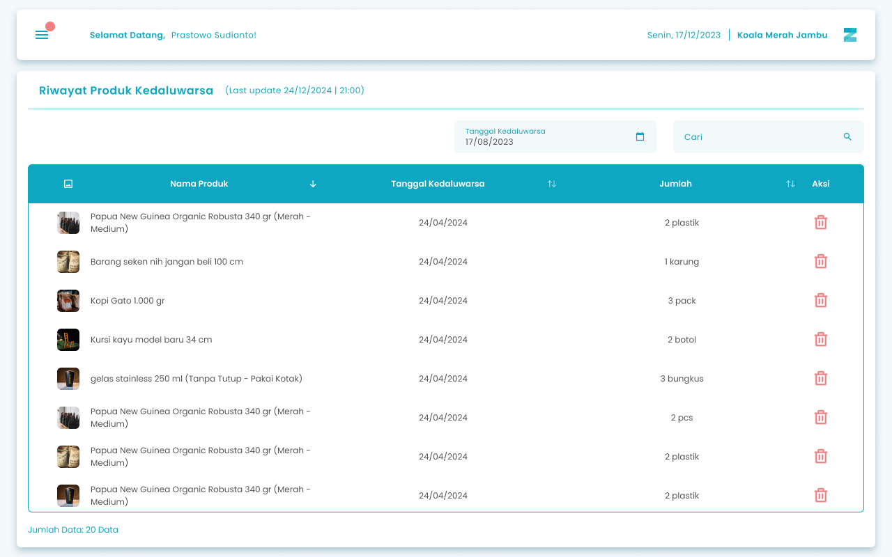
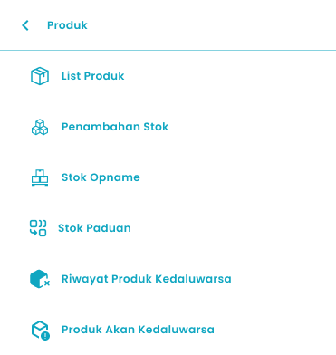

Fitur Riwayat Produk Kadaluarsa pada aplikasi Zycas ini menyediakan catatan lengkap tentang semua produk yang telah melewati tanggal kadaluarsanya. Halaman ini berfungsi sebagai arsip penting untuk membantu Anda menganalisis produk-produk yang tidak laku dan mengevaluasi manajemen stok.

<Frame>
  
</Frame>

<table>
  <colgroup>
    <col width="55" />
    <col width="277" />
    <col width="325" />
  </colgroup>
  <thead>
    <tr>
      <th>No.</th>
      <th>Simbol</th>
      <th>Keterangan</th>
    </tr>
  </thead>
  <tbody>
    <tr>
      <td>1</td>
      <td>Tanggal Kadaluarsa</td>
      <td>Tombol untuk filter range tanggal kadaluarsa produk</td>
    </tr>
    <tr>
      <td>2</td>
      <td>Cari</td>
      <td>Kolom untuk mencari produk kadaluarsa</td>
    </tr>
    <tr>
      <td>3</td>
      <td>Hapus Riwayat Produk Kadaluarsa</td>
      <td>Tombol untuk menghapus riwayat produk kadaluarsa</td>
    </tr>
  </tbody>
</table>

## 1.1. Cara Akses List Riwayat Kadaluarsa

**Berikut cara mengakses halaman list riwayat kadaluarsa :**

1. Tekan ikon tiga garis di pojok kiri atas

<Frame>
  
</Frame>

2. Setelah menekan ikon hamburger, maka akan menampilkan sidebar list menu

<Frame>
  
</Frame>

3. Tekan menu Produk pada list menu
4. Setelah tekan menu Produk, maka akan menampilkan list sub menu Produk

<Frame>
  
</Frame>

5. Lalu tekan menu Riwayat Produk Kadaluarsa pada list sub menu Produk
6. Setelah menekan menu Riwayat Produk Kadaluarsa maka akan menampilkan halaman list riwayat kadaluarsa. 

## 1.2. Cara Hapus Riwayat Kadaluarsa

**Berikut cara mengakses halaman hapus riwayat kadaluarsa :**

1. Tekan ikon keranjang sampah pada salah satu list produk kadaluarsa di halaman list riwayat kadaluarsa

<Frame>
  
</Frame>

2. Setelah menekan tombol, maka akan menampilkan halaman pop up konfirmasi hapus riwayat kadaluarsa

<Frame>
  .png "Frame 1205 (2dsdedede)")
</Frame>

3. Tekan tombol “Ya, Saya Yakin” di halaman konfirmasi untuk hapus riwayat kadaluarsa

<Frame>
  .png "Button 45e(11)")
</Frame>

4. Tekan tombol “Tidak” di halaman konfirmasi untuk membatalkan hapus riwayat kadaluarsa 

<Frame>
  
</Frame>

5. Jika Anda memilih tombol **Ya, Saya Yakin**, maka data riwayat kadaluarsa akan berhasil terhapus dan secara otomatis diperbarui pada sistem.

## **Glosarium**

<table>
  <colgroup>
    <col width="265" />
    <col width="404" />
  </colgroup>
  <thead>
    <tr>
      <th>**Istilah**</th>
      <th>**Deskripsi (Penjelasan dalam Bahasa Indonesia)**</th>
    </tr>
  </thead>
  <tbody>
    <tr>
      <td>Zycas Mobile</td>
      <td>Aplikasi mobile yang digunakan untuk mengelola transaksi, stok, dan operasional bisnis ritel.</td>
    </tr>
    <tr>
      <td>Pengguna</td>
      <td>Individu yang menggunakan aplikasi Zycas Mobile dengan hak akses tertentu.</td>
    </tr>
    <tr>
      <td>Owner</td>
      <td>Pengguna dengan hak akses penuh untuk mengelola seluruh menu dan fitur aplikasi.</td>
    </tr>
    <tr>
      <td>Karyawan</td>
      <td>Pengguna dengan hak akses terbatas sesuai izin yang diberikan oleh owner.</td>
    </tr>
    <tr>
      <td>Hak Akses</td>
      <td>Pengaturan izin yang menentukan menu dan fitur yang dapat diakses oleh pengguna.</td>
    </tr>
    <tr>
      <td>Riwayat Kedaluwarsa</td>
      <td>Modul yang menampilkan daftar dan catatan produk yang telah melewati tanggal kedaluwarsa.</td>
    </tr>
    <tr>
      <td>Modul Riwayat Kadaluarsa</td>
      <td>Fitur dalam aplikasi Zycas yang digunakan untuk memantau, menganalisis, dan mengelola produk yang sudah tidak layak jual.</td>
    </tr>
    <tr>
      <td>Produk Kadaluarsa</td>
      <td>Produk yang telah melewati tanggal kedaluwarsa dan tidak lagi layak untuk dijual.</td>
    </tr>
    <tr>
      <td>Manajemen Stok</td>
      <td>Proses pengelolaan persediaan barang agar jumlah dan kondisi stok tetap terkendali.</td>
    </tr>
    <tr>
      <td>Tanggal Kedaluwarsa</td>
      <td>Batas tanggal aman penggunaan atau penjualan suatu produk.</td>
    </tr>
    <tr>
      <td>Filter Tanggal Kadaluarsa</td>
      <td>Fitur untuk menampilkan produk kadaluarsa berdasarkan rentang tanggal tertentu.</td>
    </tr>
    <tr>
      <td>Cari Produk Kadaluarsa</td>
      <td>Kolom pencarian untuk menemukan produk kadaluarsa tertentu dengan cepat.</td>
    </tr>
    <tr>
      <td>List Riwayat Kadaluarsa</td>
      <td>Halaman yang menampilkan daftar seluruh produk yang telah kedaluwarsa.</td>
    </tr>
    <tr>
      <td>Hapus Riwayat Produk Kadaluarsa</td>
      <td>Fitur untuk menghapus data riwayat produk yang telah kedaluwarsa dari sistem.</td>
    </tr>
    <tr>
      <td>Ikon Keranjang Sampah</td>
      <td>Ikon yang digunakan untuk menghapus data riwayat produk kadaluarsa.</td>
    </tr>
    <tr>
      <td>Konfirmasi Hapus</td>
      <td>Pop up persetujuan yang muncul sebelum proses penghapusan data dilakukan.</td>
    </tr>
    <tr>
      <td>Notifikasi Berhasil</td>
      <td>Pesan sistem yang menandakan bahwa data riwayat kadaluarsa berhasil dihapus.</td>
    </tr>
    <tr>
      <td>Sidebar Menu</td>
      <td>Panel navigasi samping yang berisi daftar menu utama aplikasi.</td>
    </tr>
    <tr>
      <td>Ikon Hamburger</td>
      <td>Ikon tiga garis yang digunakan untuk membuka sidebar menu.</td>
    </tr>
    <tr>
      <td>Menu Produk</td>
      <td>Menu utama yang berisi fitur-fitur pengelolaan data produk.</td>
    </tr>
    <tr>
      <td>Sub Menu Produk</td>
      <td>Menu turunan dari Menu Produk yang menampilkan fitur spesifik seperti riwayat produk kadaluarsa.</td>
    </tr>
    <tr>
      <td>Evaluasi Produk</td>
      <td>Proses analisis produk yang tidak terjual atau sudah kadaluarsa untuk perbaikan manajemen stok.</td>
    </tr>
    <tr>
      <td>Inventaris</td>
      <td>Seluruh persediaan barang atau produk yang tercatat dalam sistem.</td>
    </tr>
  </tbody>
</table>
