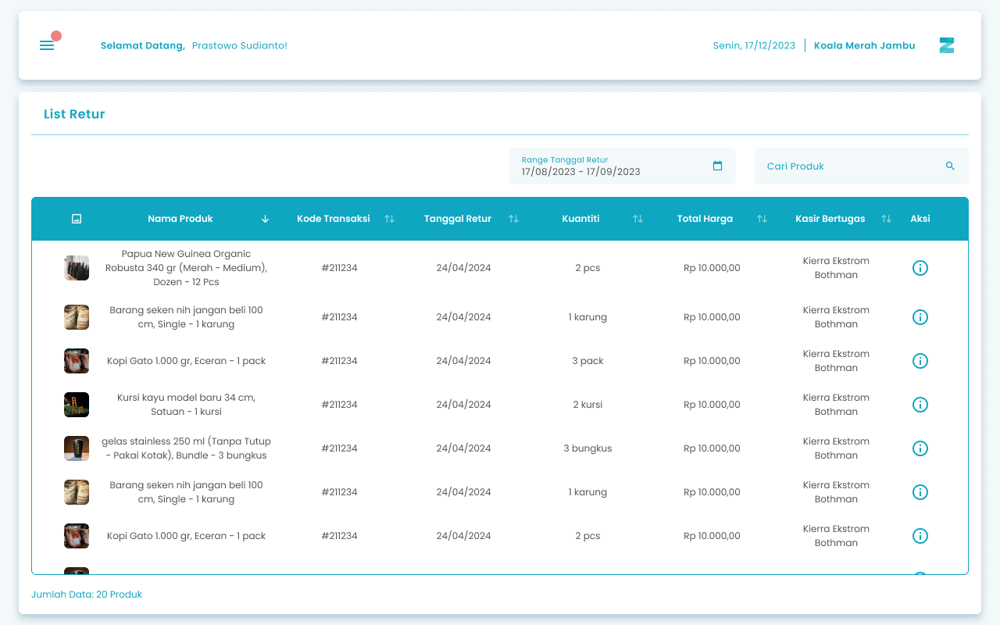
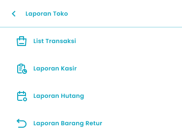

Fitur **List Retur** di aplikasi Zycas adalah alat penting untuk memantau semua produk yang dikembalikan ketika transaksi penjualan. Halaman ini memberikan gambaran lengkap tentang setiap produk yang diretur, membantu Anda mengelola inventaris dan menganalisis alasan pengembalian.

<Frame>
  
</Frame>

<table>
  <colgroup>
    <col width="57" />
    <col width="188" />
    <col width="462" />
  </colgroup>
  <thead>
    <tr>
      <th>No.</th>
      <th>Simbol</th>
      <th>Keterangan</th>
    </tr>
  </thead>
  <tbody>
    <tr>
      <td>1</td>
      <td>Range Tanggal Retur</td>
      <td>Tombol untuk filter range tanggal retur</td>
    </tr>
    <tr>
      <td>2</td>
      <td>Cari Produk</td>
      <td>Kolom untuk mencari produk yang di retur</td>
    </tr>
    <tr>
      <td>3</td>
      <td>Aksi Detail</td>
      <td>Icon untuk informasi detail pada setiap produk yang di retur</td>
    </tr>
  </tbody>
</table>

## 1.1. Cara Mengakses List Retur

**Berikut cara mengakses halaman list retur:**

1. Tekan ikon tiga garis di pojok kiri atas

<Frame>
  
</Frame>

2. Setelah menekan ikon hamburger, maka akan menampilkan sidebar list menu

<Frame>
  
</Frame>

3. Tekan menu Laporan Toko pada list menu

<Frame>
  
</Frame>

4. Setelah tekan menu Laporan Toko, maka akan menampilkan list sub menu Laporan Toko

<Frame>
  
</Frame>

5. Lalu tekan menu Laporan Barang Retur pada list sub menu Laporan Toko

<Frame>
  
</Frame>

6. Setelah menekan menu Laporan Barang Retur maka akan menampilkan halaman List Retur
7. Tekan icon Detail pada kolom aksi di salah satu list riwayat retur

<Frame>
  
</Frame>

8. Setelah icon detail di tekan maka akan muncul halaman detail retur dari transaksi

## **Glosarium**

<table>
  <colgroup>
    <col width="210" />
    <col width="500" />
  </colgroup>
  <thead>
    <tr>
      <th>**Istilah**</th>
      <th>**Deskripsi (Penjelasan dalam Bahasa Indonesia)**</th>
    </tr>
  </thead>
  <tbody>
    <tr>
      <td>Zycas Mobile</td>
      <td>Aplikasi mobile untuk mengelola transaksi, stok, dan operasional bisnis ritel.</td>
    </tr>
    <tr>
      <td>Pengguna</td>
      <td>Individu yang menggunakan aplikasi Zycas dengan hak akses tertentu.</td>
    </tr>
    <tr>
      <td>Owner</td>
      <td>Pengguna dengan hak akses penuh terhadap seluruh menu dan fitur aplikasi.</td>
    </tr>
    <tr>
      <td>Karyawan</td>
      <td>Pengguna dengan hak akses terbatas sesuai izin dari owner.</td>
    </tr>
    <tr>
      <td>Hak Akses</td>
      <td>Pengaturan izin yang menentukan menu dan fitur yang dapat diakses pengguna.</td>
    </tr>
    <tr>
      <td>Retur Pesanan</td>
      <td>Proses pengembalian produk oleh pelanggan setelah transaksi penjualan dilakukan.</td>
    </tr>
    <tr>
      <td>Modul Retur Pesanan</td>
      <td>Fitur dalam aplikasi Zycas untuk mengelola, memantau, dan mencatat seluruh produk yang diretur.</td>
    </tr>
    <tr>
      <td>List Retur</td>
      <td>Halaman yang menampilkan daftar semua produk yang telah dikembalikan oleh pelanggan.</td>
    </tr>
    <tr>
      <td>Produk Retur</td>
      <td>Produk yang dikembalikan oleh pelanggan ke toko.</td>
    </tr>
    <tr>
      <td>Range Tanggal Retur</td>
      <td>Fitur untuk memfilter data retur berdasarkan rentang tanggal tertentu.</td>
    </tr>
    <tr>
      <td>Cari Produk</td>
      <td>Kolom pencarian untuk menemukan produk retur tertentu dengan cepat.</td>
    </tr>
    <tr>
      <td>Aksi Detail</td>
      <td>Ikon atau tombol untuk melihat informasi detail dari produk atau transaksi retur.</td>
    </tr>
    <tr>
      <td>Detail Retur</td>
      <td>Halaman yang menampilkan informasi lengkap mengenai produk dan transaksi retur.</td>
    </tr>
    <tr>
      <td>Ikon Hamburger</td>
      <td>Ikon tiga garis yang digunakan untuk membuka sidebar menu.</td>
    </tr>
    <tr>
      <td>Sidebar Menu</td>
      <td>Panel navigasi samping yang berisi daftar menu utama aplikasi.</td>
    </tr>
    <tr>
      <td>Menu Stok</td>
      <td>Menu utama yang berisi fitur pengelolaan stok dan inventaris.</td>
    </tr>
    <tr>
      <td>Barang Retur</td>
      <td>Sub menu pada Menu Stok yang menampilkan daftar produk yang diretur.</td>
    </tr>
    <tr>
      <td>Shift Kasir</td>
      <td>Status operasional kasir yang menunjukkan apakah kasir sedang aktif (Open Shift) atau tidak aktif (Closed Shift).</td>
    </tr>
    <tr>
      <td>Open Shift</td>
      <td>Kondisi kasir aktif dan diperbolehkan melakukan transaksi atau retur.</td>
    </tr>
    <tr>
      <td>Closed Shift</td>
      <td>Kondisi kasir tidak aktif sehingga transaksi atau retur tidak dapat dilanjutkan.</td>
    </tr>
    <tr>
      <td>Tanggal Retur</td>
      <td>Tanggal saat proses pengembalian produk dilakukan.</td>
    </tr>
    <tr>
      <td>Metode Pengembalian</td>
      <td>Cara pengembalian dana atau nilai transaksi kepada pelanggan saat retur.</td>
    </tr>
    <tr>
      <td>Pengembalian Tunai</td>
      <td>Metode retur dengan pengembalian uang secara tunai.</td>
    </tr>
    <tr>
      <td>Pengembalian Non Tunai</td>
      <td>Metode retur dengan pengembalian melalui media non tunai seperti transfer atau referensi pembayaran.</td>
    </tr>
    <tr>
      <td>Pengembalian Voucher</td>
      <td>Metode retur dengan memberikan voucher sebagai pengganti pengembalian dana.</td>
    </tr>
    <tr>
      <td>Nomor Referensi</td>
      <td>Nomor acuan transaksi non tunai yang digunakan sebagai bukti pengembalian.</td>
    </tr>
    <tr>
      <td>Pilih Produk</td>
      <td>Tombol untuk memilih produk yang akan diretur dari transaksi.</td>
    </tr>
    <tr>
      <td>Kuantiti</td>
      <td>Jumlah produk yang diretur oleh pelanggan.</td>
    </tr>
    <tr>
      <td>Alasan Pengembalian</td>
      <td>Keterangan atau sebab mengapa produk dikembalikan.</td>
    </tr>
    <tr>
      <td>Tambah Produk</td>
      <td>Tombol untuk menambahkan produk lain dalam satu proses retur.</td>
    </tr>
    <tr>
      <td>Simpan dan Retur Produk</td>
      <td>Tombol untuk menyimpan data retur dan memproses pengembalian produk.</td>
    </tr>
    <tr>
      <td>Konfirmasi Retur</td>
      <td>Pop up persetujuan sebelum proses retur benar-benar dijalankan.</td>
    </tr>
    <tr>
      <td>Notifikasi Berhasil</td>
      <td>Pesan sistem yang menandakan bahwa proses retur berhasil dilakukan.</td>
    </tr>
    <tr>
      <td>Cetak Voucher</td>
      <td>Tombol untuk mencetak voucher retur melalui printer kasir.</td>
    </tr>
    <tr>
      <td>Inventaris</td>
      <td>Seluruh persediaan produk yang tercatat dan dikelola dalam sistem.</td>
    </tr>
    <tr>
      <td>Manajemen Retur</td>
      <td>Proses pengelolaan data retur untuk pengendalian stok dan analisis pengembalian produk.</td>
    </tr>
  </tbody>
</table>
