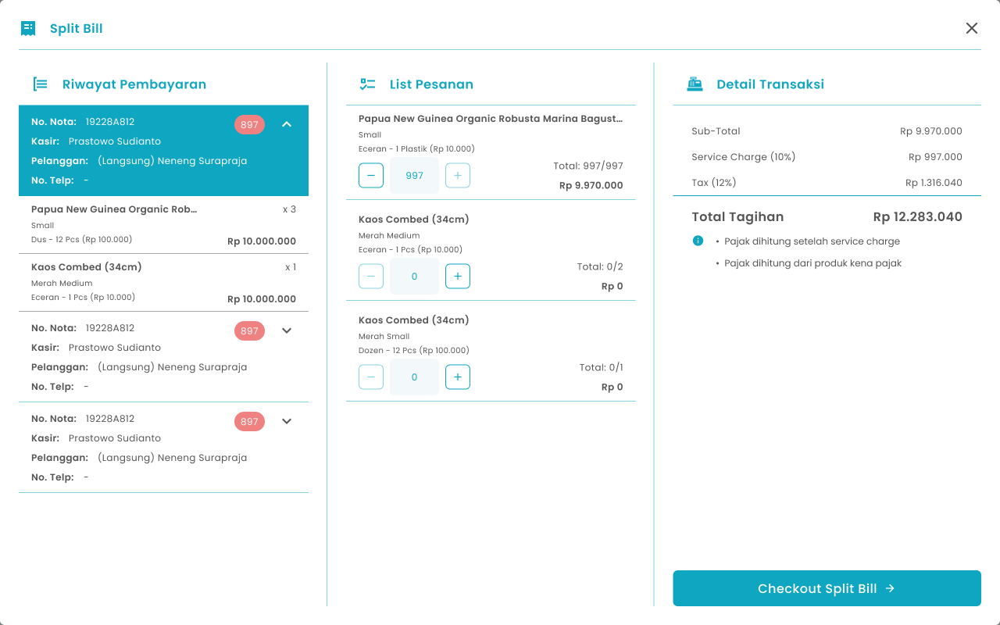
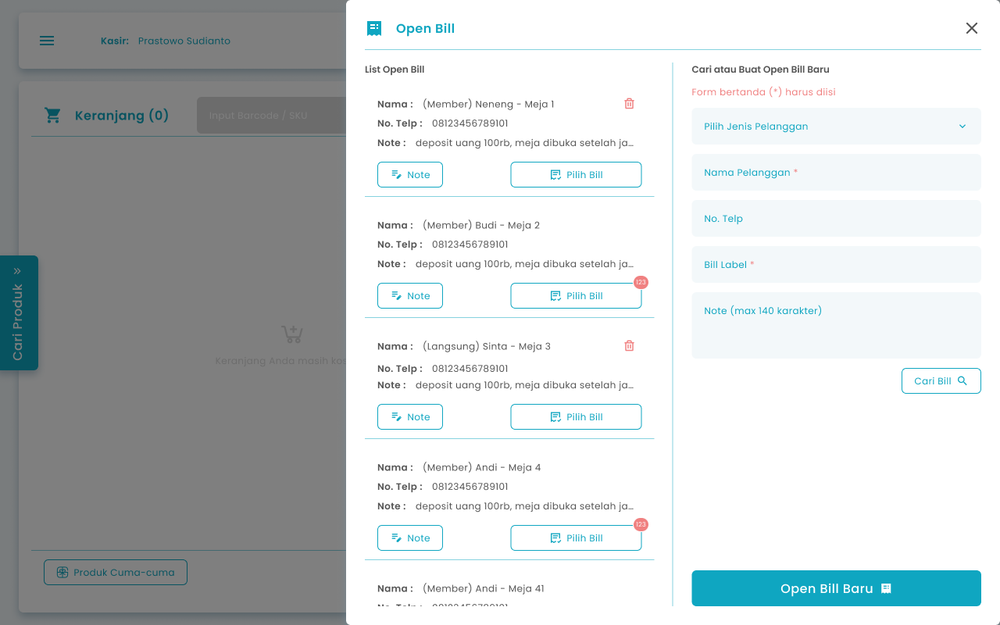
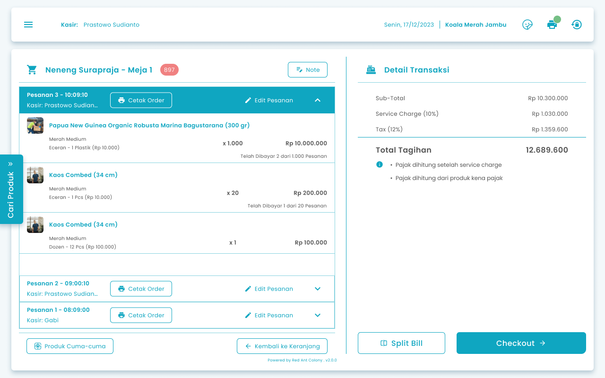

## **1.1. Cara Memisahkan Nota Pesanan (Split Bill)**

Kasir dapat melakukan split bill pada pesanan yang tersimpan di list open bill

<Frame>
  
</Frame>

<table>
  <colgroup>
    <col width="50" />
    <col width="178" />
    <col width="441" />
  </colgroup>
  <thead>
    <tr>
      <th>No</th>
      <th>Simbol</th>
      <th>Keterangan</th>
    </tr>
  </thead>
  <tbody>
    <tr>
      <td>1</td>
      <td>List Pesanan</td>
      <td>Tombol untuk memasukkan jumlah pesanan yang perlu dipisahkan notanya</td>
    </tr>
    <tr>
      <td>2</td>
      <td>Checkout Split Bill</td>
      <td>Tombol untuk memisahkan nota pesanan</td>
    </tr>
    <tr>
      <td>3</td>
      <td>Riwayat Pembayaran</td>
      <td>Menampilkan riwayat pembayaran yang pernah dilakukan pada order yang sama.</td>
    </tr>
  </tbody>
</table>

**Berikut cara mengakses menu split bill di open bill:**

1. Tekan tombol “Open Bill” di halaman keranjang pesanan
   <Frame>
     
   </Frame>
2. Setelah menekan tombol, maka akan menampilkan halaman list pesanan tersimpan per pelanggan
   <Frame>
     
   </Frame>
3. Tekan tombol “Pilih Bill” dari transaksi tersimpan salah satu pelanggan
   <Frame>
     .png "Frame 970 (3sdfsdfrgsd)")
   </Frame>
4. Setelah memilih transaksi tersimpan maka akan menampilkan list transaksi tersimpan dari pelanggan tersebut di halaman kasir
   <Frame>
     
   </Frame>
5. Tekan tombol “Split Bill”
   <Frame>
     .png "Frame 1367 (5detaswrf)")
   </Frame>
6. Setelah menekan tombol maka akan menampilkan halaman split bill
7. Masukkan jumlah pesanan yang akan ditambahkan ke keranjang pesanan dengan menginput jumlah secara manual atau menggunakan tombol tambah (+) dan kurang (−)
   <Frame>
     .png "Frame 970 (drrre2)")
   </Frame>
8. Setelah selesai mengisi pesanan yang perlu dipisahkan notanya, kemudian tekan tombol “Checkout Split Bill”
   <Frame>
     .png "Frame 1366 (sdfrt5)")
   </Frame>
9. Setelah selesai menekan tombol maka pesanan berhasil dipisahkan dan diarahkan ke halaman checkout untuk pembayaran pesanan
