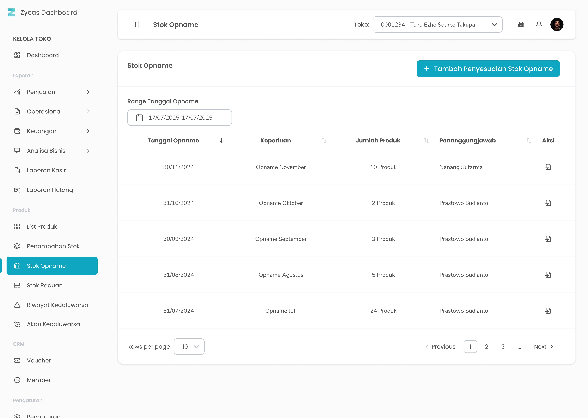

Fitur stok opname pada aplikasi Zycas berguna untuk menyesuaikan stok baik dan stok sistem 

<Frame>
  
</Frame>

<table>
  <colgroup>
    <col width="50" />
    <col width="279" />
    <col width="341" />
  </colgroup>
  <thead>
    <tr>
      <th>No</th>
      <th>Simbol</th>
      <th>Keterangan</th>
    </tr>
  </thead>
  <tbody>
    <tr>
      <td>1</td>
      <td>Tambah penyesuaian stok opname</td>
      <td>Tombol untuk tambah penyesuaian stok opname</td>
    </tr>
    <tr>
      <td>2</td>
      <td>Pilih Rentang Tanggal</td>
      <td>Tombol untuk filter rentang tanggal stok opname</td>
    </tr>
    <tr>
      <td>3</td>
      <td>Detail Stock Opname</td>
      <td>Tombol untuk melihat detail penyesuaian stok</td>
    </tr>
  </tbody>
</table>

## **1.1. Cara Akses Stok Opname**

**Berikut cara mengakses menu Stok Opname:**

1. Tekan Stok Opname pada list menu di sidebar kelola toko
   <Frame>
     .png "FULL (8vbnmnnh)")
   </Frame>
2. Setelah menekan menu List Stok Opname maka akan menampilkan halaman List Stok Opname
3. **Ganti konteks toko**
4. Tekan tombol "Toko" di pojok kanan atas halaman
   <Frame>
     
   </Frame>
5. Setelah menekan tombol, maka akan menampilkan list toko
   <Frame>
     
   </Frame>
6. Pilih salah satu toko
7. Setelah memilih salah satu toko maka akan menampilkan list produk di toko tersebut

## **1.2. Cara Penyesuaian Stok Opname**

Menu Penyesuaian Stok Opname adalah menu yang berisi form untuk mengisi stok baik dari produk yang perlu penyesuaian stok

<Frame>
  .jpg "Input Stok (1xxxccccvc)")
</Frame>

<table>
  <colgroup>
    <col width="55" />
    <col width="280" />
    <col width="337" />
  </colgroup>
  <thead>
    <tr>
      <th>No</th>
      <th>Simbol</th>
      <th>Keterangan</th>
    </tr>
  </thead>
  <tbody>
    <tr>
      <td>1</td>
      <td>Keperluan Opname</td>
      <td>Tombol untuk mengisi keperluan penyesuaian stok</td>
    </tr>
    <tr>
      <td>2</td>
      <td>Tanggal Opname</td>
      <td>Kolom untuk melihat tanggal penyesuaian stok</td>
    </tr>
    <tr>
      <td>3</td>
      <td>Pilih produk</td>
      <td>Tombol untuk memilih produk yang perlu penyesuaian stok</td>
    </tr>
    <tr>
      <td>4</td>
      <td>Stok Baik</td>
      <td>Tombol untuk mengisi jumlah stok baik atau stok fisik</td>
    </tr>
    <tr>
      <td>5</td>
      <td>Tambah Produk</td>
      <td>Tombol untuk menambahkan penyesuaian stok pada produk lain</td>
    </tr>
    <tr>
      <td>6</td>
      <td>Simpan Penyesuaian Stok Opname</td>
      <td>Tombol untuk simpan penyesuaian stok</td>
    </tr>
  </tbody>
</table>

**Berikut cara mengakses penyesuaian stok:**

1. Tekan tombol Tambah Penyesuaian Stok Opname di halaman list stok opname
   <Frame>
     .png "Button (35xxsdfg)")
   </Frame>
2. Setelah menekan tombol, maka akan menampilkan halaman form input penyesuaian stok opname
3. Masukkan keperluan opname di kolom keperluan opname
   <Frame>
     .png "Input (40bnbnbn)")
   </Frame>
4. Tekan tombol pilih produk di kolom produk
   <Frame>
     .png "Input (41rrrrr)")
   </Frame>
5. Masukkan jumlah stok baik produk
   <Frame>
     .png "Input (42vvvv)")
   </Frame>
6. Tekan tombol “Tambah Produk Lain” untuk menambahkan penyesuaian produk yang lain
   <Frame>
     .png "Button (36ccxsdf)")
   </Frame>
7. Setelah menekan tombol, maka akan menampilkan kolom input tambahan untuk penyesuaian stok produk lain
8. Setelah selesai mengisi penyesuaian stok, kemudian tekan tombol “Simpan Penyesuaian Stok Opname”
   <Frame>
     .png "Frame 237856 (2ssdc)")
   </Frame>
9. Setelah menekan tombol, maka akan terdapat 3 kondisi sebagai berikut:
10. **Semua produk memiliki stok baik sama dengan stok sistem**
11. Menampilkan halaman konfirmasi simpan stok opname
    <Frame>
      .png "Alter Dialog (24ssasww)")
    </Frame>
12. Tekan tombol “Ya, Saya Yakin” di halaman konfirmasi untuk melanjutkan penyesuaian stok
    <Frame>
      .png "Button2q (1)")
    </Frame>
13. Tekan tombol “Tidak” di halaman konfirmasi untuk membatalkan penyesuaian stok
    <Frame>
      .png "Button2sa (2)")
    </Frame>
14. Setelah menekan tombol “Ya, Saya Yakin”,  maka akan menampilkan halaman list stok opname serta notifikasi “Stok opname berhasil disimpan!”
15. **Terdapat produk dengan stok baik melebihi stok sistem**
16. Menampilkan halaman konfirmasi lanjutkan penyesuaian stok
    <Frame>
      .png "Alter Dialog (25hhhhg)")
    </Frame>
17. Tekan tombol “Ya, Saya Yakin” di halaman konfirmasi untuk melanjutkan penyesuaian stok
    <Frame>
      .png "Button 45e(11)")
    </Frame>
18. Tekan tombol “Tidak” di halaman konfirmasi untuk membatalkan penyesuaian stok
    <Frame>
      .png "Button2sa (2)")
    </Frame>
19. **Lanjutan dari poin 17 setelah menekan tombol “Ya, Saya Yakin”**,  **jika terdapat produk dengan stok baik melebihi stok sistem** maka akan menampilkan halaman konfirmasi simpan stok opname dengan mengabaikan produk yang stoknya diinput melebihi stok sistem
    <Frame>
      .png "Alter Dialog (24ssasww)")
    </Frame>
20. Tekan tombol “Ya, Saya Yakin” di halaman konfirmasi untuk melanjutkan penyesuaian stok
    <Frame>
      .png "Button2q (1)")
    </Frame>
21. Tekan tombol “Tidak” di halaman konfirmasi untuk membatalkan penyesuaian stok
    <Frame>
      .png "Button2sa (2)")
    </Frame>
22. Setelah menekan tombol "Ya, Saya Yakin" maka akan diarahkan ke halaman list stok opname serta notifikasi “Stok opname berhasil disimpan!”
23. **Lanjutan dari poin 17 setelah menekan tombol “Ya, Saya Yakin”**,  jika stok baik melebihi atau kurang dari stok sistem maka akan menampilkan halaman  input alasan selisih stok yang dijelaskan di **poin 25** dibawah ini
24. **Terdapat produk dengan stok baik kurang dari stok sistem**
25. Menampilkan halaman input alasan selisih stok
    <Frame>
      .jpg "Input Stok (2frttyuh)")
    </Frame>
26. Masukkan jumlah selisih stok pada kolom jumlah
    <Frame>
      .png "Input (43zgfr)")
    </Frame>
27. Tekan tombol pilih alasan untuk memilih alasan selisih stok
    <Frame>
      .png "Input (44mkjhj)")
    </Frame>
28. Masukkan catatan selisih stok opname di kolom catatan
    <Frame>
      .png "Input (45xcvfd)")
    </Frame>
29. Tekan tombol “Tambah Alasan” untuk menambah alasan selisih stok lain
    <Frame>
      .png "Button (37ededed)")
    </Frame>
30. Setelah menekan tombol, maka akan menampilkan kolom input alasan selisih stok lain
31. Setelah selesai mengisi alasan selisih stok lain, tekan tombol “Simpan Alasan Selisih”
    <Frame>
      .png "Frame 237856 (3sdscx)")
    </Frame>
32. Setelah menekan tombol, maka akan menampilkan halaman konfirmasi simpan stok opname
    <Frame>
      .png "Alter Dialog (24ssasww)")
    </Frame>
33. Tekan tombol “Ya, Saya Yakin” di halaman konfirmasi untuk melanjutkan penyesuaian stok
    <Frame>
      .png "Button2q (1)")
    </Frame>
34. Tekan tombol “Tidak” di halaman konfirmasi untuk membatalkan penyesuaian stok
    <Frame>
      .png "Button2sa (2)")
    </Frame>
35. Setelah menekan tombol “Ya, Saya Yakin”,  maka akan menampilkan halaman list stok opname serta notifikasi “Stok opname berhasil disimpan!”
