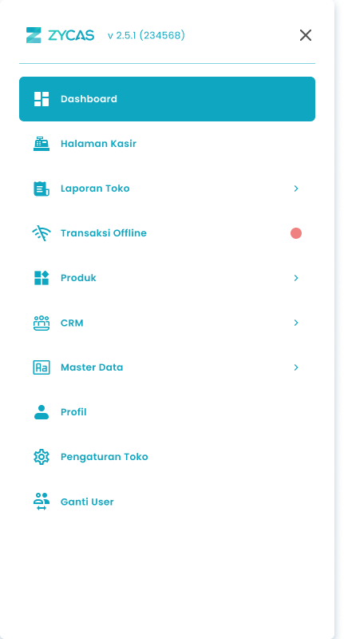
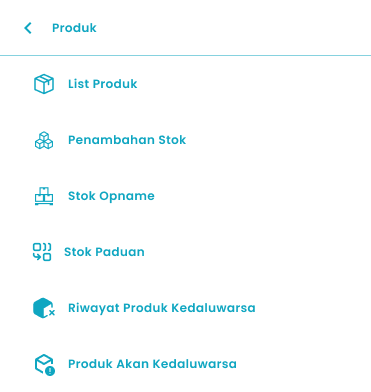
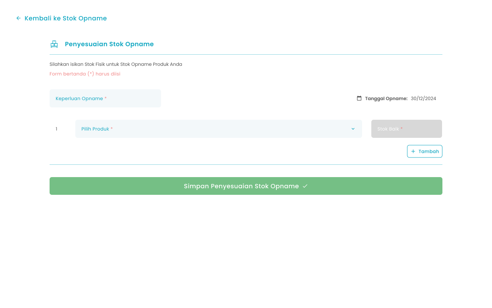
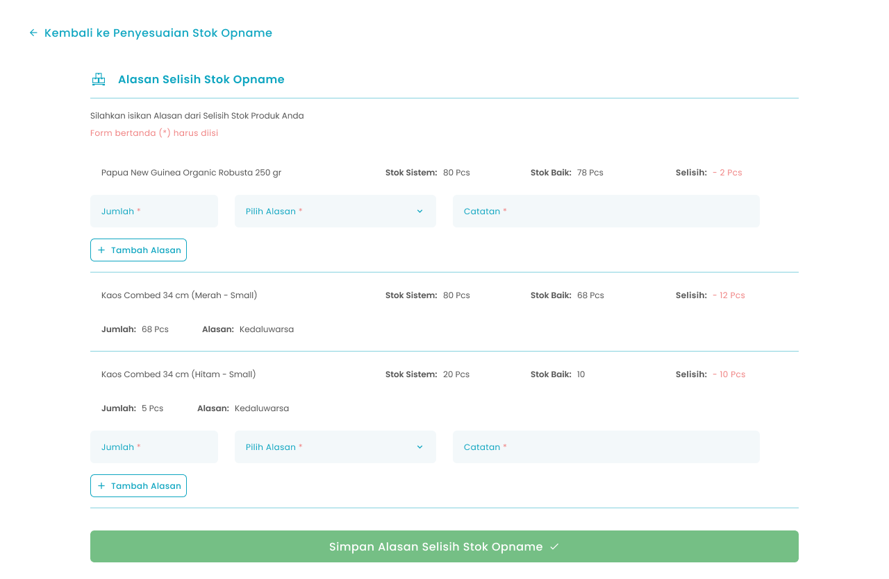

Fitur stok opname pada aplikasi Zycas berguna untuk menyesuaikan stok baik dan stok sistem

<Frame>
  .png "Android Expanded 252 (1sxsadd)")
</Frame>

<table>
  <colgroup>
    <col width="50" />
    <col width="279" />
    <col width="339" />
  </colgroup>
  <thead>
    <tr>
      <th>No</th>
      <th>Simbol</th>
      <th>Keterangan</th>
    </tr>
  </thead>
  <tbody>
    <tr>
      <td>1</td>
      <td>Tambah penyesuaian stok opname</td>
      <td>Tombol untuk tambah penyesuaian stok opname</td>
    </tr>
    <tr>
      <td>2</td>
      <td>Pilih Rentang Tanggal</td>
      <td>Tombol untuk filter rentang tanggal stok opname</td>
    </tr>
    <tr>
      <td>3</td>
      <td>Detail Stock Opname</td>
      <td>Tombol untuk melihat detail penyesuaian stok</td>
    </tr>
  </tbody>
</table>

## **1.1. Cara Akses Stok Opname**

**Berikut cara mengakses menu Stok Opname:**

1. Tekan ikon tiga garis di pojok kiri atas

<Frame>
  
</Frame>

2. Setelah menekan ikon, maka akan menampilkan sidebar list menu

<Frame>
  
</Frame>

3. Tekan menu produk pada list menu 
4. Setelah menekan menu, maka akan menampilkan list sub menu Produk

<Frame>
  
</Frame>

5. Tekan menu Stok Opname pada list sub menu Stok
6. Setelah menekan menu Stok Opname maka akan menampilkan halaman List Stok Opname

## **1.2. Cara Penyesuaian Stok Opname**

Menu **Penyesuaian Stok Opname** adalah menu yang berisi form untuk mengisi stok baik dari produk yang perlu penyesuaian stok

<Frame>
  
</Frame>

<table>
  <colgroup>
    <col width="53" />
    <col width="280" />
    <col width="338" />
  </colgroup>
  <thead>
    <tr>
      <th>No</th>
      <th>Simbol</th>
      <th>Keterangan</th>
    </tr>
  </thead>
  <tbody>
    <tr>
      <td>1</td>
      <td>Keperluan Opname</td>
      <td>Tombol untuk mengisi keperluan penyesuaian stok</td>
    </tr>
    <tr>
      <td>2</td>
      <td>Tanggal Opname</td>
      <td>Kolom untuk melihat tanggal penyesuaian stok</td>
    </tr>
    <tr>
      <td>3</td>
      <td>Pilih produk</td>
      <td>Tombol untuk memilih produk yang perlu penyesuaian stok</td>
    </tr>
    <tr>
      <td>4</td>
      <td>Stok Baik</td>
      <td>Tombol untuk mengisi jumlah stok baik atau stok fisik</td>
    </tr>
    <tr>
      <td>5</td>
      <td>Tambah Produk</td>
      <td>Tombol untuk menambahkan penyesuaian stok pada produk lain</td>
    </tr>
    <tr>
      <td>6</td>
      <td>Simpan Penyesuaian Stok Opname</td>
      <td>Tombol untuk simpan penyesuaian stok</td>
    </tr>
  </tbody>
</table>

**Berikut cara mengakses penyesuaian stok:**

1. Tekan tombol Tambah Penyesuaian Stok Opname di halaman list stok opname
   <Frame>
     .png "Frame 6 (3dsded)")
   </Frame>
2. Setelah menekan tombol, maka akan menampilkan halaman penyesuaian stok opname
3. Masukkan keperluan opname di kolom keperluan opname
   <Frame>
     .png "Input Right Icon (22ssacv)")
   </Frame>
4. Tekan tombol pilih produk di kolom pilih produk
   <Frame>
     .png "Input Right Icon (23xcvcb)")
   </Frame>
5. Pilih salah satu produk
6. Setelah memilih salah satu produk, produk akan menampilkan list penyesuaian stok opname
7. Masukkan jumlah stok baik produk
   <Frame>
     .png "Input Right Icon (24rtfrt)")
   </Frame>
8. Tekan tombol “Tambah” untuk menambahkan penyesuaian produk yang lain
   <Frame>
     
   </Frame>
9. Setelah menekan tombol, maka akan menampilkan kolom input penyesuaian stok produk lain
10. Setelah selesai mengisi penyesuaian stok, kemudian tekan tombol “Simpan Penyesuaian Stok Opname”
    <Frame>
      
    </Frame>
11. Setelah menekan tombol, maka akan terdapat 3 kondisi sebagai berikut:
12. **Semua Produk Stok baik sama dengan stok sistem**
13. Menampilkan halaman konfirmasi simpan stok opname
    <Frame>
      .png "Frame 1336 (6ssada)")
    </Frame>
14. Tekan tombol “Ya, Saya Yakin” di halaman konfirmasi untuk melanjutkan penyesuaian stok
    <Frame>
      
    </Frame>
15. Tekan tombol “Tidak” di halaman konfirmasi untuk membatalkan penyesuaian stok
    <Frame>
      
    </Frame>
16. Setelah menekan tombol “Ya, Saya Yakin”,  maka akan menampilkan halaman list stok opname serta notifikasi “Stok opname berhasil disimpan!”
17. **Terdapat Produk dengan Stok baik melebihi stok sistem**
18. Menampilkan halaman konfirmasi lanjutkan penyesuaian stok
    <Frame>
      .png "Frame 1205 (3sszxxcv)")
    </Frame>
19. Tekan tombol “Ya, Saya Yakin” di halaman konfirmasi untuk melanjutkan penyesuaian stok
    <Frame>
      .png "Button 45e(11)")
    </Frame>
20. Tekan tombol “Tidak” di halaman konfirmasi untuk membatalkan penyesuaian stok
    <Frame>
      
    </Frame>
21. **Lanjutan dari poin 19 setelah menekan tombol “Ya, Saya Yakin”**,  jika semua produk dengan stok baik melebihi stok sistem maka akan menampilkan halaman konfirmasi simpan stok opname
    <Frame>
      .png "Frame 1336 (6ssada)")
    </Frame>
22. Tekan tombol “Ya, Saya Yakin” di halaman konfirmasi untuk melanjutkan penyesuaian stok
    <Frame>
      
    </Frame>
23. Tekan tombol “Tidak” di halaman konfirmasi untuk membatalkan penyesuaian stok
    <Frame>
      
    </Frame>
24. Setelah menekan tombol “Ya, Saya Yakin”,  maka akan menampilkan halaman list stok opname serta notifikasi “Stok opname berhasil disimpan!” dan sistem tidak simpan produk dengan stok baik melebihi stok sistem
25. **Lanjutan dari poin 19 setelah menekan tombol “Ya, Saya Yakin”**,  jika terdapat produk dengan stok baik melebihi atau kurang dari stok sistem maka akan menampilkan halaman  input alasan selisih stok yang dijelaskan di **poin 26** dibawah ini
26. **Terdapat Produk dengan Stok baik kurang dari stok sistem**
27. Menampilkan halaman input alasan selisih stok
    <Frame>
      
    </Frame>
28. Masukkan jumlah selisih stok pada kolom jumlah
    <Frame>
      .png "Input Right Icon (25dsdvdsx)")
    </Frame>
29. Tekan tombol pilih alasan
    <Frame>
      .png "Input Right Icon (26sdsdcxs)")
    </Frame>
30. Pilih salah satu alasan
31. Setelah memilih salah satu alasan selisih maka alasan tersebut tampil di kolom pilih alasan
32. Masukkan catatan selisih stok opname di kolom catatan
    <Frame>
      .png "Input Right Icon (27dscbbg)")
    </Frame>
33. Tekan tombol “Tambah Alasan” untuk menambah alasan selisih stok lain
    <Frame>
      .png "Frame 960 (1frfrth)")
    </Frame>
34. Setelah menekan tombol, maka akan menampilkan kolom input alasan selisih stok lain
35. Setelah selesai mengisi alasan selisih stok lain, tekan tombol “Simpan Alasan Selisih Stok Opname”
    <Frame>
      .png "Frame 1569 (1ewewd)")
    </Frame>
36. Setelah menekan tombol, maka akan menampilkan halaman konfirmasi simpan stok opname
    <Frame>
      .png "Frame 1336 (6ssada)")
    </Frame>
37. Tekan tombol “Ya, Saya Yakin” di halaman konfirmasi untuk melanjutkan penyesuaian stok
    <Frame>
      
    </Frame>
38. Tekan tombol “Tidak” di halaman konfirmasi untuk membatalkan penyesuaian stok
    <Frame>
      
    </Frame>
39. Setelah menekan tombol “Ya, Saya Yakin”,  maka akan menampilkan halaman list stok opname serta notifikasi “Stok opname berhasil disimpan!”

## **Glosarium**

<table>
  <colgroup>
    <col width="284" />
    <col width="393" />
  </colgroup>
  <thead>
    <tr>
      <th>**Istilah**</th>
      <th>**Deskripsi (Penjelasan dalam Bahasa Indonesia)**</th>
    </tr>
  </thead>
  <tbody>
    <tr>
      <td>Zycas Mobile</td>
      <td>Aplikasi mobile yang digunakan untuk mengelola operasional bisnis seperti transaksi, stok, dan laporan.</td>
    </tr>
    <tr>
      <td>Pengguna (User)</td>
      <td>Orang yang menggunakan aplikasi Zycas Mobile dengan hak akses tertentu.</td>
    </tr>
    <tr>
      <td>Owner</td>
      <td>Pengguna dengan hak akses penuh yang dapat mengakses dan mengelola seluruh menu dan fitur aplikasi.</td>
    </tr>
    <tr>
      <td>Karyawan</td>
      <td>Pengguna dengan hak akses terbatas sesuai izin yang diberikan oleh owner.</td>
    </tr>
    <tr>
      <td>Hak Akses</td>
      <td>Pengaturan izin yang menentukan menu dan fitur yang dapat digunakan oleh pengguna.</td>
    </tr>
    <tr>
      <td>Stok Opname</td>
      <td>Proses verifikasi dan penyesuaian antara stok fisik (stok baik) dengan stok yang tercatat di sistem.</td>
    </tr>
    <tr>
      <td>Modul Stok Opname</td>
      <td>Modul dalam Zycas Mobile yang digunakan untuk mencocokkan dan menyesuaikan data persediaan barang.</td>
    </tr>
    <tr>
      <td>Stok Fisik</td>
      <td>Jumlah barang yang secara nyata tersedia di lokasi penyimpanan.</td>
    </tr>
    <tr>
      <td>Stok Baik</td>
      <td>Stok fisik barang yang masih layak jual dan dapat digunakan.</td>
    </tr>
    <tr>
      <td>Stok Sistem</td>
      <td>Jumlah stok barang yang tercatat di dalam sistem aplikasi Zycas.</td>
    </tr>
    <tr>
      <td>Selisih Stok</td>
      <td>Perbedaan jumlah antara stok baik (fisik) dengan stok sistem.</td>
    </tr>
    <tr>
      <td>List Stok Opname</td>
      <td>Halaman yang menampilkan daftar riwayat penyesuaian stok opname.</td>
    </tr>
    <tr>
      <td>Tambah Penyesuaian Stok Opname</td>
      <td>Tombol untuk membuat data penyesuaian stok opname baru.</td>
    </tr>
    <tr>
      <td>Rentang Tanggal</td>
      <td>Filter untuk menampilkan data stok opname berdasarkan periode tanggal tertentu.</td>
    </tr>
    <tr>
      <td>Detail Stok Opname</td>
      <td>Halaman yang menampilkan rincian penyesuaian stok opname.</td>
    </tr>
    <tr>
      <td>Penyesuaian Stok Opname</td>
      <td>Proses menginput dan menyimpan perubahan stok berdasarkan hasil stok fisik.</td>
    </tr>
    <tr>
      <td>Keperluan Opname</td>
      <td>Keterangan atau tujuan dilakukannya penyesuaian stok opname.</td>
    </tr>
    <tr>
      <td>Tanggal Opname</td>
      <td>Tanggal pelaksanaan atau pencatatan stok opname.</td>
    </tr>
    <tr>
      <td>Pilih Produk</td>
      <td>Fitur untuk memilih produk yang akan dilakukan penyesuaian stok.</td>
    </tr>
    <tr>
      <td>Tambah Produk</td>
      <td>Tombol untuk menambahkan produk lain ke dalam proses penyesuaian stok opname.</td>
    </tr>
    <tr>
      <td>Simpan Penyesuaian Stok Opname</td>
      <td>Tombol untuk menyimpan data penyesuaian stok opname.</td>
    </tr>
    <tr>
      <td>Konfirmasi Penyesuaian Stok</td>
      <td>Halaman konfirmasi sebelum data penyesuaian stok opname disimpan.</td>
    </tr>
    <tr>
      <td>Alasan Selisih Stok</td>
      <td>Keterangan penyebab terjadinya perbedaan antara stok baik dan stok sistem.</td>
    </tr>
    <tr>
      <td>Catatan Selisih Stok</td>
      <td>Kolom tambahan yang wajib diisi untuk alasan tertentu seperti terpakai atau mutasi.</td>
    </tr>
    <tr>
      <td>Tambah Alasan</td>
      <td>Tombol untuk menambahkan lebih dari satu alasan selisih stok.</td>
    </tr>
    <tr>
      <td>Notifikasi Berhasil</td>
      <td>Pesan sistem yang menandakan stok opname berhasil disimpan.</td>
    </tr>
    <tr>
      <td>Sidebar Menu</td>
      <td>Panel navigasi samping yang berisi daftar menu aplikasi.</td>
    </tr>
    <tr>
      <td>Ikon Hamburger</td>
      <td>Ikon tiga garis yang digunakan untuk membuka sidebar menu.</td>
    </tr>
  </tbody>
</table>
