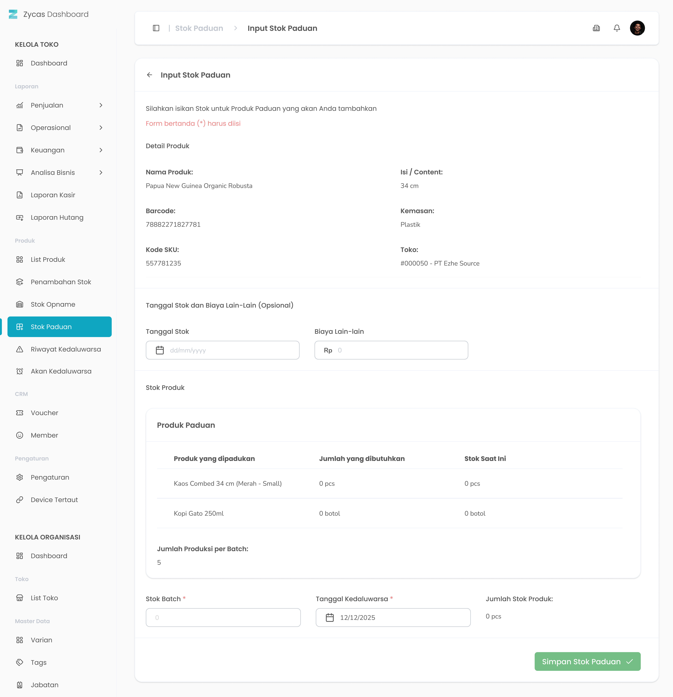

Fitur Stok Paduan pada aplikasi Zycas berguna untuk menambahkan stok pada produk paduan. Pembuatan stok paduan disini akan mempengaruhi stok dari komposisi produk atau komponen produk yang dipadukan

<Frame>
  .jpg "Stok Paduan (2sdsde)")
</Frame>

<table>
  <colgroup>
    <col width="53" />
    <col width="189" />
    <col width="429" />
  </colgroup>
  <thead>
    <tr>
      <th>No.</th>
      <th>Simbol</th>
      <th>Keterangan</th>
    </tr>
  </thead>
  <tbody>
    <tr>
      <td>1</td>
      <td>Pencarian stok produk</td>
      <td>Tombol untuk pencarian produk paduan</td>
    </tr>
    <tr>
      <td>2</td>
      <td>Tambah Stok</td>
      <td>Tombol untuk menambahkan stok produk paduan</td>
    </tr>
  </tbody>
</table>

## **1.1. Cara Akses Menu Stok Paduan**

**Berikut cara mengakses menu Stok Paduan:**

1. Tekan menu Stok Paduan pada list menu di sidebar kelola toko
   <Frame>
     .png "FULL (7xxsxcd)")
   </Frame>
2. Setelah menekan menu Stok Paduan maka akan menampilkan halaman List Stok Paduan
3. Cari produk tertentu dengan kata kunci tertentu di kolom cari
   <Frame>
     .png "Input (28qaqa)")
   </Frame>
4. **Ganti konteks toko**
5. Tekan tombol "Toko" di pojok kanan atas halaman
   <Frame>
     
   </Frame>
6. Setelah menekan tombol, maka akan menampilkan list toko
   <Frame>
     
   </Frame>
7. Pilih salah satu toko
8. Setelah memilih salah satu toko maka akan menampilkan list produk di toko tersebut

## **1.2. Cara Rakit Produk Paduan**

Rakit Produk Paduan merupakan fitur yang berfungsi untuk merakit produk paduan ke dalam sistem.

<Frame>
  
</Frame>

<table>
  <colgroup>
    <col width="51" />
    <col width="225" />
    <col width="401" />
  </colgroup>
  <thead>
    <tr>
      <th>No</th>
      <th>Simbol</th>
      <th>Keterangan</th>
    </tr>
  </thead>
  <tbody>
    <tr>
      <td>1</td>
      <td>Tanggal Stok</td>
      <td>Tombol untuk memilih tanggal input stok</td>
    </tr>
    <tr>
      <td>2</td>
      <td>Biaya Lain-Lain</td>
      <td>Tombol untuk mengisi biaya lain-lain</td>
    </tr>
    <tr>
      <td>3</td>
      <td>Jumlah Produksi per Batch</td>
      <td>Tombol untuk mengisi jumlah produksi per batch untuk setiap 1 produk paduan memerlukan berapa produk satuan</td>
    </tr>
    <tr>
      <td>4</td>
      <td>Tanggal kedaluwarsa</td>
      <td>Tombol untuk memilih tanggal kadaluarsa produk paduan</td>
    </tr>
    <tr>
      <td>5</td>
      <td>Simpan Stok Paduan</td>
      <td>Tombol untuk merakit produk paduan</td>
    </tr>
  </tbody>
</table>

**Berikut adalah langkah-langkah untuk menambah stok produk paduan:**

1. Tekan tombol rakit stok pada salah satu produk paduan halaman list stok paduan
   <Frame>
     .png "Button (34sasddf)")
   </Frame>
2. Setelah menekan tombol, maka akan menampilkan halaman form rakit stok paduan
3. Masukkan tanggal pengisian stok di kolom tanggal stok
   <Frame>
     .png "Input (37pvvbvv)")
   </Frame>
4. Masukkan biaya lain lain stok paduan di kolom biaya lain-lain
   <Frame>
     .png "Input (38xscdsk)")
   </Frame>
5. Masukkan jumlah produksi batch di kolom stok batch
   <Frame>
     .png "Input (39ccxxx)")
   </Frame>
6. Masukkan tanggal kadaluarsa produk di kolom tanggal kadaluarsa
   <Frame>
     .png "Input (36dcxzxs)")
   </Frame>
7. Setelah selesai mengisi data stok paduan,  kemudian tekan tombol “Simpan Stok Paduan”
   <Frame>
     .png "Frame 237856 (1ddscggg)")
   </Frame>
8. Setelah menekan tombol, maka akan menampilkan halaman konfirmasi rakit produk paduan
   <Frame>
     .png "Alter Dialog (23ddds)")
   </Frame>
9. Tekan tombol “Ya, Saya Yakin” di halaman konfirmasi untuk melanjutkan rakit produk paduan
   <Frame>
     .png "Button2q (1)")
   </Frame>
10. Tekan tombol “Tidak” di halaman konfirmasi untuk membatalkan rakit produk paduan 
    <Frame>
      .png "Button2sa (2)")
    </Frame>
11. Setelah menekan tombol “Ya, Saya Yakin”,  maka akan menampilkan halaman list stok paduan serta notifikasi “Stok Produk Paduan berhasil disimpan!”

<table>
  <colgroup>
    <col width="115" />
    <col width="562" />
  </colgroup>
  <thead>
    <tr>
      <th style={{ textAlign: "center" }}>**🛈** **Information**</th>
      <th>Jika jumlah produk biasa yang dipadukan tidak cukup maka sistem akan memberikan peringatan “Stok Produk yang dipadukan tidak cukup!”</th>
    </tr>
  </thead>
</table>
