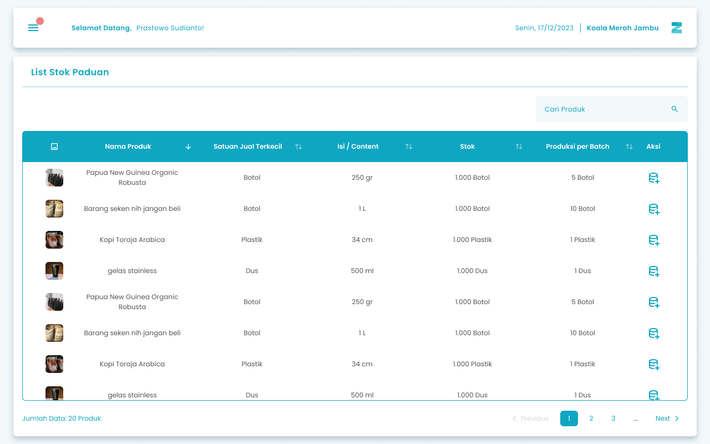
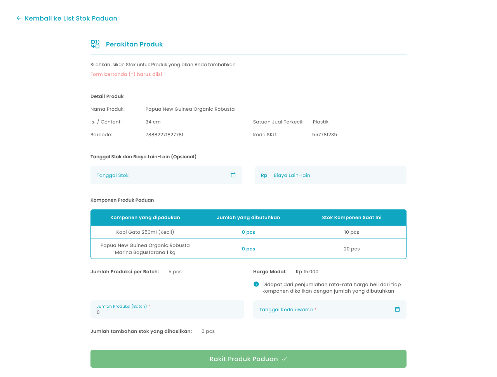

Fitur Stok Paduan pada aplikasi Zycas berguna untuk menambahkan stok pada produk paduan. Pembuatan stok paduan disini akan mempengaruhi stok dari komposisi produk atau komponen produk yang dipadukan

<Frame>
  
</Frame>

<table>
  <colgroup>
    <col width="52" />
    <col width="193" />
    <col width="432" />
  </colgroup>
  <thead>
    <tr>
      <th>No.</th>
      <th>Simbol</th>
      <th>Keterangan</th>
    </tr>
  </thead>
  <tbody>
    <tr>
      <td>1</td>
      <td>Pencarian stok produk</td>
      <td>Tombol untuk pencarian produk paduan</td>
    </tr>
    <tr>
      <td>2</td>
      <td>Tambah Stok</td>
      <td>Tombol untuk menambahkan stok produk paduan</td>
    </tr>
  </tbody>
</table>

## **1.1. Cara Akses Menu Stok Paduan**

**Berikut cara mengakses menu Stok Paduan:**

1. Tekan ikon tiga garis di pojok kiri atas

<Frame>
  
</Frame>

2. Setelah menekan ikon, maka akan menampilkan sidebar list menu

<Frame>
  
</Frame>

3. Tekan menu produk pada list menu 
4. Setelah menekan menu produk, maka akan menampilkan list sub menu produk

<Frame>
  .png "Frame 1391 (1dderddg)")
</Frame>

5. Tekan menu Stok Paduan pada list sub menu Stok 
6. Setelah menekan menu Stok Paduan maka akan menampilkan halaman List Stok Paduan

## **1.2. Cara Rakit Produk Paduan**

Rakit Produk Paduan merupakan fitur yang berfungsi untuk merakit produk paduan ke dalam sistem.

<Frame>
  
</Frame>

<table>
  <colgroup>
    <col width="61" />
    <col width="226" />
    <col width="386" />
  </colgroup>
  <thead>
    <tr>
      <th>No</th>
      <th>Simbol</th>
      <th>Keterangan</th>
    </tr>
  </thead>
  <tbody>
    <tr>
      <td>1</td>
      <td>Tanggal Stok</td>
      <td>Tombol untuk memilih tanggal input stok</td>
    </tr>
    <tr>
      <td>2</td>
      <td>Biaya Lain-Lain</td>
      <td>Tombol untuk mengisi biaya lain-lain</td>
    </tr>
    <tr>
      <td>3</td>
      <td>Jumlah Produksi per Batch</td>
      <td>Tombol untuk mengisi jumlah produksi per batch untuk setiap 1 produk paduan memerlukan berapa produk satuan</td>
    </tr>
    <tr>
      <td>4</td>
      <td>Tanggal kedaluwarsa</td>
      <td>Tombol untuk memilih tanggal kadaluarsa produk paduan</td>
    </tr>
    <tr>
      <td>5</td>
      <td>Rakit Produk Paduan</td>
      <td>Tombol untuk merakit produk paduan</td>
    </tr>
  </tbody>
</table>

**Berikut adalah langkah-langkah untuk menambah stok produk paduan:**

1. Tekan tombol rakit stok pada salah satu produk paduan halaman list stok paduan
   <Frame>
     .png "Frame 1016 (1zxczxc)")
   </Frame>
2. Setelah menekan tombol, maka akan menampilkan halaman rakit produk paduan
3. Masukkan tanggal pengisian stok di kolom tanggal stok

<Frame>
  .png "Input Right Icon (21fsfsf)")
</Frame>

3. Masukkan biaya lain lain stok paduan di kolom biaya lain-lain

<Frame>
  .png "Input Right Icon (20aqadasd)")
</Frame>

4. Masukkan jumlah produksi batch di kolom jumlah produksi

<Frame>
  .png "Input Right Icon (19sdaasda)")
</Frame>

5. Masukkan tanggal kadaluarsa produk di kolom tanggal kadaluarsa

<Frame>
  .png "Input Right Icon (18tftf)")
</Frame>

6. Setelah selesai mengisi data stok paduan,  kemudian tekan tombol “Rakit Produk Paduan”

<Frame>
  .png "Frame 1411 (5dsws)")
</Frame>

7. Setelah menekan tombol, maka akan menampilkan halaman konfirmasi rakit produk paduan

<Frame>
  .png "Frame 1336 (5sadas)")
</Frame>

8. Tekan tombol “Ya, Saya Yakin” di halaman konfirmasi untuk melanjutkan rakit produk paduan 

<Frame>
  
</Frame>

9. Tekan tombol “Tidak” di halaman konfirmasi untuk membatalkan rakit produk paduan 

<Frame>
  
</Frame>

10. Setelah menekan tombol “Ya, Saya Yakin”,  maka akan menampilkan halaman list stok paduan serta notifikasi “Stok Produk Paduan berhasil disimpan!”

<table>
  <colgroup>
    <col width="117" />
    <col width="560" />
  </colgroup>
  <thead>
    <tr>
      <th style={{ textAlign: "center" }}>**🛈** **Information**</th>
      <th>Jika jumlah produk biasa yang dipadukan tidak cukup maka sistem akan memberikan peringatan “Stok Produk yang dipadukan tidak cukup!”</th>
    </tr>
  </thead>
</table>

## **Glosarium**

<table>
  <colgroup>
    <col width="258" />
    <col width="421" />
  </colgroup>
  <thead>
    <tr>
      <th>**Istilah**</th>
      <th>**Deskripsi (Penjelasan dalam Bahasa Indonesia)**</th>
    </tr>
  </thead>
  <tbody>
    <tr>
      <td>Zycas Mobile</td>
      <td>Aplikasi mobile untuk mengelola operasional bisnis seperti transaksi, stok, dan laporan.</td>
    </tr>
    <tr>
      <td>Pengguna (User)</td>
      <td>Orang yang menggunakan aplikasi Zycas Mobile dengan hak akses tertentu.</td>
    </tr>
    <tr>
      <td>Owner</td>
      <td>Pengguna dengan hak akses penuh yang dapat mengelola seluruh menu dan fitur dalam aplikasi.</td>
    </tr>
    <tr>
      <td>Karyawan</td>
      <td>Pengguna dengan hak akses terbatas sesuai izin yang diberikan oleh owner.</td>
    </tr>
    <tr>
      <td>Hak Akses</td>
      <td>Izin yang menentukan menu dan fitur yang dapat diakses oleh pengguna.</td>
    </tr>
    <tr>
      <td>Stok Paduan</td>
      <td>Stok produk hasil penggabungan beberapa produk satuan menjadi satu produk jadi.</td>
    </tr>
    <tr>
      <td>Modul Stok Paduan</td>
      <td>Modul khusus untuk mengelola persediaan produk rakitan atau bundle product.</td>
    </tr>
    <tr>
      <td>Produk Paduan</td>
      <td>Produk jadi yang terbentuk dari kombinasi beberapa produk satuan.</td>
    </tr>
    <tr>
      <td>Produk Satuan</td>
      <td>Produk tunggal yang menjadi komponen penyusun produk paduan.</td>
    </tr>
    <tr>
      <td>List Stok Paduan</td>
      <td>Halaman yang menampilkan daftar stok produk paduan dalam sistem.</td>
    </tr>
    <tr>
      <td>Pencarian Stok Produk</td>
      <td>Fitur untuk mencari produk paduan dalam daftar stok paduan.</td>
    </tr>
    <tr>
      <td>Tambah Stok Paduan</td>
      <td>Fitur atau tombol untuk menambahkan stok produk paduan.</td>
    </tr>
    <tr>
      <td>Rakit Produk Paduan</td>
      <td>Proses menggabungkan beberapa produk satuan untuk menghasilkan produk paduan.</td>
    </tr>
    <tr>
      <td>Tanggal Stok</td>
      <td>Tanggal pencatatan atau pengisian stok produk paduan.</td>
    </tr>
    <tr>
      <td>Biaya Lain-Lain</td>
      <td>Biaya tambahan yang timbul dalam proses perakitan produk paduan.</td>
    </tr>
    <tr>
      <td>Jumlah Produksi per Batch</td>
      <td>Jumlah produk paduan yang dihasilkan dalam satu kali proses perakitan.</td>
    </tr>
    <tr>
      <td>Tanggal Kedaluwarsa</td>
      <td>Tanggal batas akhir produk paduan dapat digunakan atau dijual.</td>
    </tr>
    <tr>
      <td>Konfirmasi Rakit Produk Paduan</td>
      <td>Halaman konfirmasi sebelum proses perakitan produk paduan disimpan.</td>
    </tr>
    <tr>
      <td>Notifikasi Berhasil</td>
      <td>Pesan sistem yang menandakan stok produk paduan berhasil disimpan.</td>
    </tr>
    <tr>
      <td>Peringatan Stok Tidak Cukup</td>
      <td>Pesan sistem yang muncul ketika stok produk satuan tidak mencukupi untuk dirakit.</td>
    </tr>
    <tr>
      <td>Sidebar Menu</td>
      <td>Panel navigasi yang muncul setelah menekan ikon hamburger.</td>
    </tr>
    <tr>
      <td>Ikon Hamburger</td>
      <td>Ikon tiga garis yang digunakan untuk membuka sidebar menu aplikasi.</td>
    </tr>
  </tbody>
</table>
