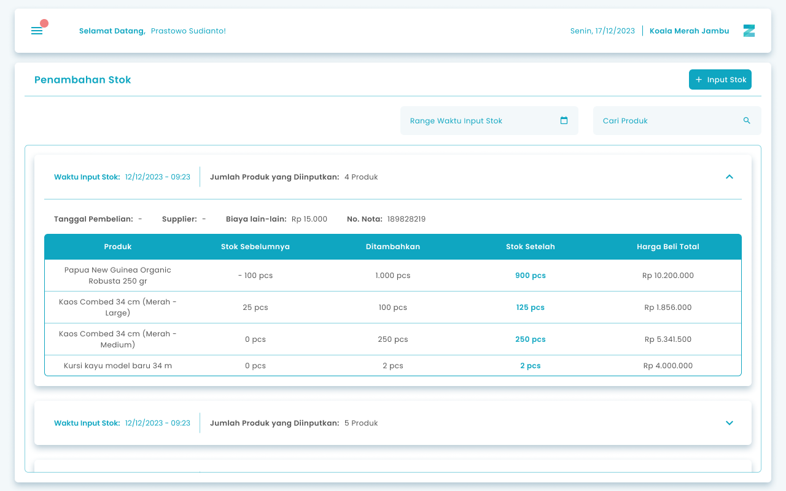
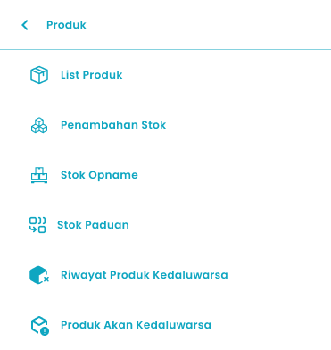
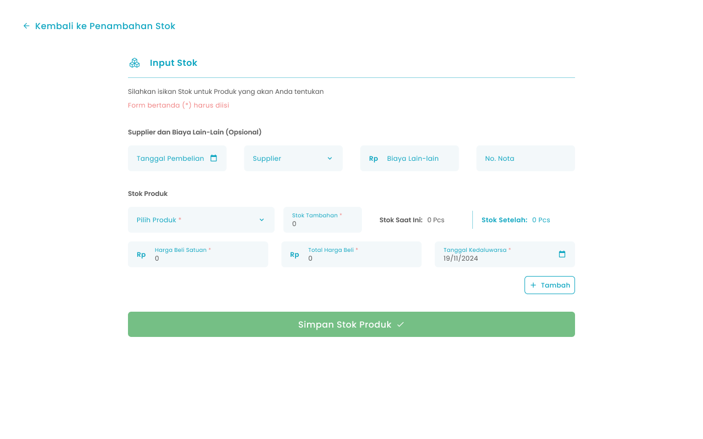

Fitur **Stok Produk** digunakan untuk mengelola data stok barang dalam sistem. Melalui halaman ini, Anda dapat menambahkan stok untuk produk biasa, produk paduan dan produk varian

<Frame>
  
</Frame>

<table>
  <colgroup>
    <col width="50" />
    <col width="153" />
    <col width="471" />
  </colgroup>
  <thead>
    <tr>
      <th>No</th>
      <th>Simbol</th>
      <th>Keterangan</th>
    </tr>
  </thead>
  <tbody>
    <tr>
      <td>1</td>
      <td>Input Stok</td>
      <td>Tombol digunakan untuk menambahkan data stok baru ke dalam sistem</td>
    </tr>
    <tr>
      <td>2</td>
      <td>Rentang Tanggal</td>
      <td>Tombol digunakan untuk memfilter dan menampilkan data stok berdasarkan periode tanggal tertentu.</td>
    </tr>
    <tr>
      <td>3</td>
      <td>Cari Produk</td>
      <td>Tombol digunakan untuk mencari produk tertentu dalam daftar stok dengan cepat, sehingga mempermudah pengelolaan data yang jumlahnya banyak</td>
    </tr>
  </tbody>
</table>

## **1.1. Cara Mengakses Stok Produk**

**Berikut cara mengakses menu stok produk:**

1. Tekan ikon tiga garis di pojok kiri atas

<Frame>
  
</Frame>

2. Setelah menekan ikon hamburger, maka akan menampilkan sidebar list menu

<Frame>
  
</Frame>

3. Tekan menu Produk pada list menu
4. Setelah tekan menu Produk, maka akan menampilkan list sub menu Produk

<Frame>
  
</Frame>

5. Lalu tekan menu Penambahan Stok pada list sub menu Stok
6. Setelah menekan menu Penambahan Stok maka akan menampilkan halaman List Penambahan Stok

## **1.2. Cara Tambah Stok**

Tambah Stok merupakan fitur yang berfungsi untuk menambah stok produk ke dalam sistem.

<Frame>
  
</Frame>

<table>
  <colgroup>
    <col width="54" />
    <col width="173" />
    <col width="446" />
  </colgroup>
  <thead>
    <tr>
      <th>No.</th>
      <th>Simbol</th>
      <th>Keterangan</th>
    </tr>
  </thead>
  <tbody>
    <tr>
      <td>1</td>
      <td>Tanggal Pembelian</td>
      <td>Tombol untuk mengisi tanggal pembelian stok produk</td>
    </tr>
    <tr>
      <td>2</td>
      <td>Supplier</td>
      <td>Tombol untuk mengisi supplier</td>
    </tr>
    <tr>
      <td>3</td>
      <td>Biaya Lain-lain</td>
      <td>Tombol untuk mengisi biaya lain-lain</td>
    </tr>
    <tr>
      <td>4</td>
      <td>No. Nota</td>
      <td>Tombol untuk mengisi no nota</td>
    </tr>
    <tr>
      <td>5</td>
      <td>Pilih Produk</td>
      <td>Tombol untuk memilih produk yang ditambahkan stok</td>
    </tr>
    <tr>
      <td>6</td>
      <td>Stok Tambahan</td>
      <td>Tombol untuk mengisi jumlah stok tambahan</td>
    </tr>
    <tr>
      <td>7</td>
      <td>Stok Saat Ini</td>
      <td>Kolom untuk melihat jumlah stok saat ini</td>
    </tr>
    <tr>
      <td>8</td>
      <td>Stok Setelah</td>
      <td>Kolom untuk melihat jumlah stok setelah ditambah</td>
    </tr>
    <tr>
      <td>9</td>
      <td>Harga Beli Satuan</td>
      <td>Tombol untuk mengisi harga beli produk satuan</td>
    </tr>
    <tr>
      <td>10</td>
      <td>Total Harga Beli</td>
      <td>Tombol untuk mengisi total harga beli</td>
    </tr>
    <tr>
      <td>11</td>
      <td>Tanggal Kadaluarsa</td>
      <td>Tombol untuk mengisi tanggal kadaluarsa produk</td>
    </tr>
    <tr>
      <td>12</td>
      <td>Tambah</td>
      <td>Tombol untuk menambah stok produk lain</td>
    </tr>
    <tr>
      <td>13</td>
      <td>Simpan Stok Produk</td>
      <td>Tombol untuk simpan stok</td>
    </tr>
  </tbody>
</table>

**Berikut adalah langkah-langkah untuk menambah stok produk:**

1. Tekan pada tombol Input Stok di sebelah kanan atas

<Frame>
  .png "Frame 6 (2sasesaf)")
</Frame>

2. Masukkan tanggal Pembelian produk di kolom tanggal pembelian

<Frame>
  .png "Input Right Icon (8dasas)")
</Frame>

3. Tekan tombol  **Supplier** untuk memilih supplier terkait produk yang akan ditambahkan.
   <Frame>
     .png "Input Right Icon (9dddds)")
   </Frame>
4. Lalu pilih supplier yang tersedia, jika belum ada suplier maka anda dapat menambahkan supplier di halaman list supplier
5. Setelah supplier dipilih, sistem akan otomatis menampilkan **Halaman Input Stok Produk** sesuai dengan supplier tersebut.
6. **Biaya Lain-Lain (Opsional)**: Masukkan biaya tambahan yang berkaitan dengan pembelian.
   <Frame>
     .png "Input Right Icon (10cvcvcvc)")
   </Frame>
7. **Nota**: Masukkan nomor atau keterangan nota pembelian.
   <Frame>
     .png "Input Right Icon (11asdasd)")
   </Frame>
8. Pilih Produk yang perlu ditambahkan stok di kolom pilih produk
   <Frame>
     .png "Input Right Icon (12)")
   </Frame>
9. Lalu pilih produk yang tersedia
10. Setelah produk dipilih, sistem akan otomatis menampilkan **Halaman Input Stok Produk** sesuai dengan produk tersebut
11. **Jumlah Stok Tambahan**: Masukkan jumlah unit stok yang ingin ditambahkan.
    <Frame>
      .png "Input Right Icon (13asasds)")
    </Frame>
12. **Harga Beli Satuan**: Isi harga beli per unit produk.
    <Frame>
      .png "Input Right Icon (14sqwes)")
    </Frame>
13. **Total Harga Beli**: Isi total harga beli per unit produk (bisa diabaikan jika sudah mengisi harga beli satuan)
    <Frame>
      .png "Input Right Icon (15xzcvxz)")
    </Frame>
14. **Tanggal Kadaluarsa**: Masukkan tanggal kadaluarsa produk (jika ada).
    <Frame>
      .png "Input Right Icon (16dsese)")
    </Frame>
15. Tekan tombol “Tambah” untuk menambahkan stok produk lain
    <Frame>
      
    </Frame>
16. Setelah menekan tombol, maka akan menampilkan kolom input stok produk lain
17. Masukkan data stok sesuai kebutuhan, lalu klik tombol **Simpan Stok Produk** untuk menyimpan informasi ke dalam sistem.
    <Frame>
      .png "Frame 1411 (4ssadfs)")
    </Frame>
18. Setelah tombol simpan ditekan, sistem akan menampilkan pop up konfirmasi untuk memastikan bahwa proses penambahan stok dilakukan dengan benar.
    <Frame>
      .png "Frame 1336 (4sszxz)")
    </Frame>
19. Tekan tombol “Ya, Saya Yakin” di halaman konfirmasi untuk menyimpan data stok produk
    <Frame>
      
    </Frame>
20. Tekan tombol “Tidak” di halaman konfirmasi untuk membatalkan  
    <Frame>
      
    </Frame>
21. Jika Anda memilih tombol **Ya, Saya Yakin**, maka data stok terbaru akan berhasil tersimpan dan secara otomatis diperbarui pada sistem.

<table>
  <colgroup>
    <col width="118" />
    <col width="562" />
  </colgroup>
  <thead>
    <tr>
      <th style={{ textAlign: "center" }}>**🛈** **Information**</th>
      <th>Anda dapat menambahkan stok untuk produk biasa, paduan, dan varian  Kolom input harga beli satuan dan kolom input total harga beli saling berkaitan jika anda mengubah salah satu kolom  Kolom produk kadaluarsa muncul jika anda menyalakan fitur lacak produk kadaluarsa</th>
    </tr>
  </thead>
</table>

## **Glosarium**

<table>
  <colgroup>
    <col width="247" />
    <col width="424" />
  </colgroup>
  <thead>
    <tr>
      <th>**Istilah**</th>
      <th>**Deskripsi (Penjelasan dalam Bahasa Indonesia)**</th>
    </tr>
  </thead>
  <tbody>
    <tr>
      <td>Zycas Mobile</td>
      <td>Aplikasi mobile untuk mengelola operasional bisnis seperti transaksi, stok produk, dan laporan.</td>
    </tr>
    <tr>
      <td>Pengguna (User)</td>
      <td>Orang yang menggunakan aplikasi Zycas Mobile dengan hak akses tertentu.</td>
    </tr>
    <tr>
      <td>Owner</td>
      <td>Pengguna dengan hak akses penuh yang dapat mengelola seluruh menu dan fitur dalam aplikasi.</td>
    </tr>
    <tr>
      <td>Karyawan</td>
      <td>Pengguna dengan hak akses terbatas sesuai izin yang diberikan oleh owner.</td>
    </tr>
    <tr>
      <td>Hak Akses</td>
      <td>Izin yang menentukan menu dan fitur yang dapat diakses oleh pengguna.</td>
    </tr>
    <tr>
      <td>Stok Produk</td>
      <td>Jumlah persediaan barang yang tersedia dan tercatat dalam sistem.</td>
    </tr>
    <tr>
      <td>Modul Stok Produk</td>
      <td>Modul pengelolaan persediaan untuk memantau, menambah, dan mengontrol stok barang secara real-time.</td>
    </tr>
    <tr>
      <td>List Penambahan Stok</td>
      <td>Halaman yang menampilkan daftar riwayat penambahan stok produk.</td>
    </tr>
    <tr>
      <td>Input Stok</td>
      <td>Tombol atau fitur untuk menambahkan data stok baru ke dalam sistem.</td>
    </tr>
    <tr>
      <td>Tambah Stok</td>
      <td>Fitur untuk menambahkan jumlah stok produk yang sudah terdaftar.</td>
    </tr>
    <tr>
      <td>Rentang Tanggal</td>
      <td>Fitur filter untuk menampilkan data stok berdasarkan periode tanggal tertentu.</td>
    </tr>
    <tr>
      <td>Cari Produk</td>
      <td>Fitur pencarian untuk menemukan produk tertentu dalam daftar stok.</td>
    </tr>
    <tr>
      <td>Tanggal Pembelian</td>
      <td>Tanggal saat stok produk dibeli dari supplier.</td>
    </tr>
    <tr>
      <td>Supplier</td>
      <td>Pihak atau perusahaan yang memasok produk ke toko.</td>
    </tr>
    <tr>
      <td>Biaya Lain-lain</td>
      <td>Biaya tambahan selain harga beli produk, seperti ongkos kirim atau biaya administrasi.</td>
    </tr>
    <tr>
      <td>No. Nota</td>
      <td>Nomor atau identitas nota pembelian produk.</td>
    </tr>
    <tr>
      <td>Pilih Produk</td>
      <td>Fitur untuk memilih produk yang akan ditambahkan stoknya.</td>
    </tr>
    <tr>
      <td>Stok Tambahan</td>
      <td>Jumlah unit stok baru yang ditambahkan ke stok yang sudah ada.</td>
    </tr>
    <tr>
      <td>Stok Saat Ini</td>
      <td>Jumlah stok produk sebelum dilakukan penambahan stok.</td>
    </tr>
    <tr>
      <td>Stok Setelah</td>
      <td>Jumlah stok produk setelah penambahan stok dilakukan.</td>
    </tr>
    <tr>
      <td>Harga Beli Satuan</td>
      <td>Harga pembelian per unit produk.</td>
    </tr>
    <tr>
      <td>Total Harga Beli</td>
      <td>Total biaya pembelian produk berdasarkan jumlah dan harga satuan.</td>
    </tr>
    <tr>
      <td>Tanggal Kadaluarsa</td>
      <td>Tanggal batas akhir produk dapat digunakan atau dijual.</td>
    </tr>
    <tr>
      <td>Produk Biasa</td>
      <td>Produk tunggal tanpa varian atau kombinasi.</td>
    </tr>
    <tr>
      <td>Produk Paduan</td>
      <td>Produk yang terdiri dari gabungan beberapa produk lain.</td>
    </tr>
    <tr>
      <td>Produk Varian</td>
      <td>Produk dengan variasi tertentu, seperti ukuran atau warna.</td>
    </tr>
    <tr>
      <td>Simpan Stok Produk</td>
      <td>Tombol untuk menyimpan data penambahan stok ke dalam sistem.</td>
    </tr>
    <tr>
      <td>Pop-up Konfirmasi</td>
      <td>Tampilan konfirmasi sistem sebelum data stok disimpan.</td>
    </tr>
    <tr>
      <td>Notifikasi Berhasil</td>
      <td>Pesan sistem yang menandakan data stok berhasil disimpan atau diperbarui.</td>
    </tr>
    <tr>
      <td>Fitur Lacak Produk Kadaluarsa</td>
      <td>Fitur opsional untuk menampilkan dan memantau tanggal kadaluarsa produk.</td>
    </tr>
    <tr>
      <td>Sidebar Menu</td>
      <td>Panel navigasi yang muncul setelah menekan ikon hamburger.</td>
    </tr>
    <tr>
      <td>Ikon Hamburger</td>
      <td>Ikon tiga garis yang digunakan untuk membuka sidebar menu.</td>
    </tr>
  </tbody>
</table>
