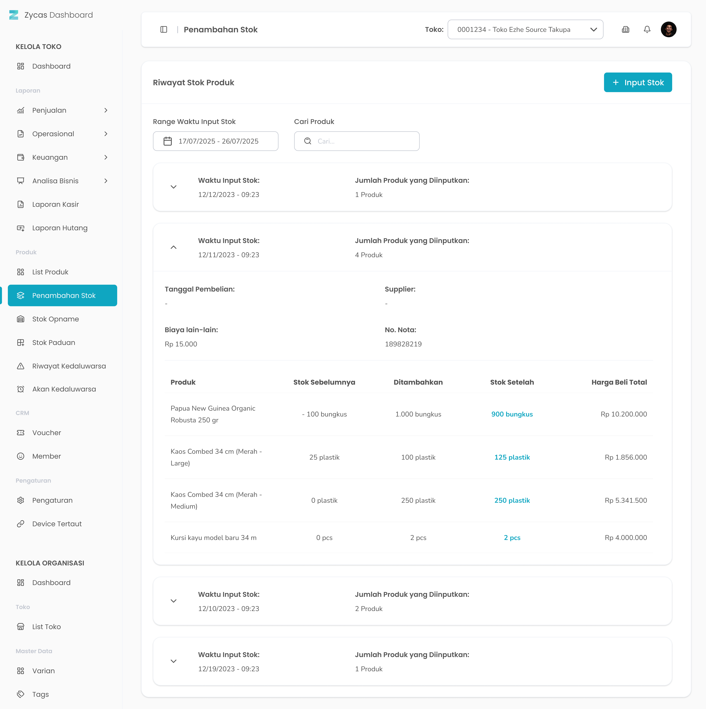

Fitur **Stok Produk** digunakan untuk mengelola data stok barang dalam sistem. Melalui halaman ini, Anda dapat menambahkan stok untuk produk biasa, produk paduan dan produk varian

<Frame>
  
</Frame>

<table>
  <colgroup>
    <col width="50" />
    <col width="161" />
    <col width="465" />
  </colgroup>
  <thead>
    <tr>
      <th>No</th>
      <th>Simbol</th>
      <th>Keterangan</th>
    </tr>
  </thead>
  <tbody>
    <tr>
      <td>1</td>
      <td>Input Stok</td>
      <td>Tombol digunakan untuk menambahkan data stok baru ke dalam sistem</td>
    </tr>
    <tr>
      <td>2</td>
      <td>Rentang Tanggal</td>
      <td>Tombol digunakan untuk memfilter dan menampilkan data stok berdasarkan periode tanggal tertentu.</td>
    </tr>
    <tr>
      <td>3</td>
      <td>Cari Produk</td>
      <td>Tombol digunakan untuk mencari produk tertentu dalam daftar stok dengan cepat, sehingga mempermudah pengelolaan data yang jumlahnya banyak</td>
    </tr>
  </tbody>
</table>

## **1.1. Cara Mengakses Stok Produk**

**Berikut cara mengakses menu stok produk:**

1. Tekan menu Penambahan Stok pada list menu di sidebar kelola toko
   <Frame>
     .png "FULL (9ghghg)")
   </Frame>
2. Setelah menekan menu Penambahan Stok maka akan menampilkan halaman List Riwayat Penambahan Stok
3. **Ganti konteks toko**
4. Tekan tombol "Toko" di pojok kanan atas halaman
   <Frame>
     
   </Frame>
5. Setelah menekan tombol, maka akan menampilkan list toko
   <Frame>
     
   </Frame>
6. Pilih salah satu toko
7. Setelah memilih salah satu toko maka akan menampilkan list produk di toko tersebut

## **1.2. Cara Tambah Stok**

Tambah Stok merupakan fitur yang berfungsi untuk menambah stok produk ke dalam sistem.

<Frame>
  .jpg "Input Stok (3uygt)")
</Frame>

<table>
  <colgroup>
    <col width="51" />
    <col width="173" />
    <col width="448" />
  </colgroup>
  <thead>
    <tr>
      <th>No.</th>
      <th>Simbol</th>
      <th>Keterangan</th>
    </tr>
  </thead>
  <tbody>
    <tr>
      <td>1</td>
      <td>Tanggal Pembelian</td>
      <td>Tombol untuk mengisi tanggal pembelian stok produk</td>
    </tr>
    <tr>
      <td>2</td>
      <td>Supplier</td>
      <td>Tombol untuk mengisi supplier</td>
    </tr>
    <tr>
      <td>3</td>
      <td>Biaya Lain-lain</td>
      <td>Tombol untuk mengisi biaya lain-lain</td>
    </tr>
    <tr>
      <td>4</td>
      <td>No. Nota</td>
      <td>Tombol untuk mengisi no nota</td>
    </tr>
    <tr>
      <td>5</td>
      <td>Pilih Produk</td>
      <td>Tombol untuk memilih produk yang ditambahkan stok</td>
    </tr>
    <tr>
      <td>6</td>
      <td>Stok Tambahan</td>
      <td>Tombol untuk mengisi jumlah stok tambahan</td>
    </tr>
    <tr>
      <td>7</td>
      <td>Stok Saat Ini</td>
      <td>Kolom untuk melihat jumlah stok saat ini</td>
    </tr>
    <tr>
      <td>8</td>
      <td>Stok Setelah</td>
      <td>Kolom untuk melihat jumlah stok setelah ditambah</td>
    </tr>
    <tr>
      <td>9</td>
      <td>Harga Beli Satuan</td>
      <td>Tombol untuk mengisi harga beli produk satuan</td>
    </tr>
    <tr>
      <td>10</td>
      <td>Total Harga Beli</td>
      <td>Tombol untuk mengisi total harga beli</td>
    </tr>
    <tr>
      <td>11</td>
      <td>Tanggal Kadaluarsa</td>
      <td>Tombol untuk mengisi tanggal kadaluarsa produk</td>
    </tr>
    <tr>
      <td>12</td>
      <td>Tambah</td>
      <td>Tombol untuk menambah stok produk lain</td>
    </tr>
    <tr>
      <td>13</td>
      <td>Simpan Stok Produk</td>
      <td>Tombol untuk simpan stok</td>
    </tr>
  </tbody>
</table>

**Berikut adalah langkah-langkah untuk menambah stok produk:**

1. Tekan pada tombol Input Stok di sebelah kanan atas

<Frame>
  .png "Button (38aqaqc)")
</Frame>

2. Setelah menekan tombol, maka akan menampilkan halaman input stok
3. Masukkan tanggal pembelian di kolom tanggal pembelian

<Frame>
  .png "Input (46bideds)")
</Frame>

3. Tekan tombol  **Supplier** untuk memilih supplier terkait produk yang akan ditambahkan.
   <Frame>
     qwqww.png "Input (51)qwqww")
   </Frame>
   <table>
     <colgroup>
       <col width="120" />
       <col width="496" />
     </colgroup>
     <thead>
       <tr>
         <th style={{ textAlign: "center" }}>**🛈** **Information**</th>
         <th>Anda dapat menambahkan supplier yang belum terdapat di list supplier di menu master data supplier</th>
       </tr>
     </thead>
   </table>
4. **Biaya Lain-Lain (Opsional)**: Masukkan biaya tambahan yang berkaitan dengan pembelian.
   <Frame>
     .png "Input (50swswqa)")
   </Frame>
5. **Nota**: Masukkan nomor atau keterangan nota pembelian.
   <Frame>
     .png "Input (49fgfdd)")
   </Frame>
6. Pilih Produk yang perlu ditambahkan stok di kolom Produk
   <Frame>
     .png "Input (41rrrrr)")
   </Frame>
7. **Jumlah Stok Tambahan**: Masukkan jumlah unit stok yang ingin ditambahkan.
   <Frame>
     .png "Input (48qqqqq)")
   </Frame>
8. **Harga Beli Satuan**: Isi harga beli per unit produk.
   <Frame>
     .png "Input (47wwwew)")
   </Frame>
9. **Total Harga Beli**: menampilkan hasil perhitungan total harga beli per unit produk
10. **Tanggal Kadaluarsa**: Masukkan tanggal kadaluarsa produk (jika ada).
    <Frame>
      .png "Input (36dcxzxs)")
    </Frame>
11. Tekan tombol “Tambah Produk Lain” untuk menambahkan stok produk lain
    <Frame>
      .png "Button (36ccxsdf)")
    </Frame>
12. Setelah menekan tombol, maka akan menampilkan kolom input stok produk lain
13. Masukkan data stok sesuai kebutuhan, lalu klik tombol **Simpan Stok Produk** untuk menyimpan informasi ke dalam sistem.
    <Frame>
      .png "Button (39zmfnc)")
    </Frame>
14. Setelah tombol simpan ditekan, sistem akan menampilkan pop up konfirmasi untuk memastikan bahwa proses penambahan stok dilakukan dengan benar.
    <Frame>
      .png "Alter Dialog (26dxswsa)")
    </Frame>
15. Tekan tombol “Ya, Saya Yakin” di halaman konfirmasi untuk menyimpan data stok produk
    <Frame>
      .png "Button2q (1)")
    </Frame>
16. Tekan tombol “Tidak” di halaman konfirmasi untuk membatalkan
    <Frame>
      .png "Button2sa (2)")
    </Frame>
17. Jika Anda memilih tombol **Ya, Saya Yakin**, maka data stok terbaru akan berhasil tersimpan dan secara otomatis diperbarui pada sistem.

<table>
  <colgroup>
    <col width="119" />
    <col width="554" />
  </colgroup>
  <thead>
    <tr>
      <th style={{ textAlign: "center" }}>**🛈** **Information**</th>
      <th>Anda dapat menambahkan stok untuk produk biasa, paduan, dan varian  Kolom input harga beli satuan dan kolom input total harga beli saling berkaitan jika anda mengubah salah satu kolom  Kolom produk kadaluarsa muncul jika anda menyalakan fitur lacak produk kadaluarsa</th>
    </tr>
  </thead>
</table>
