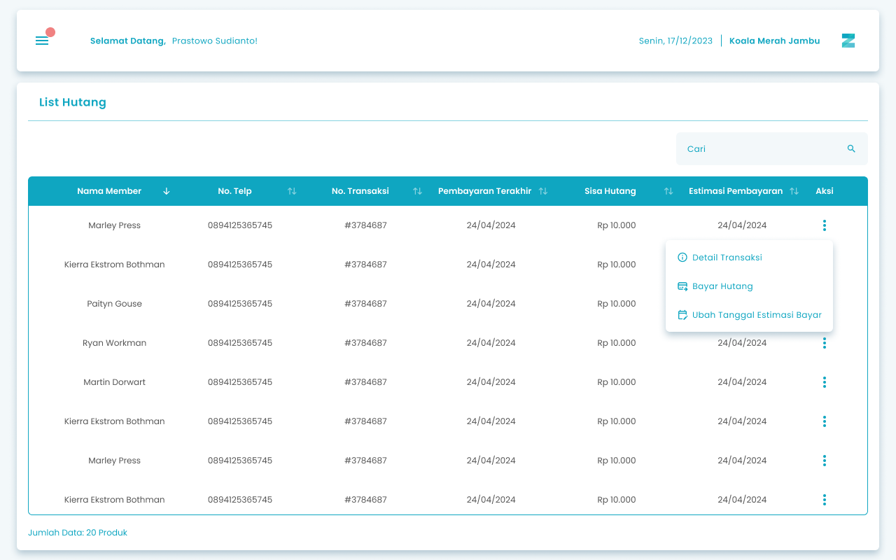
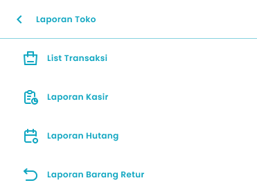
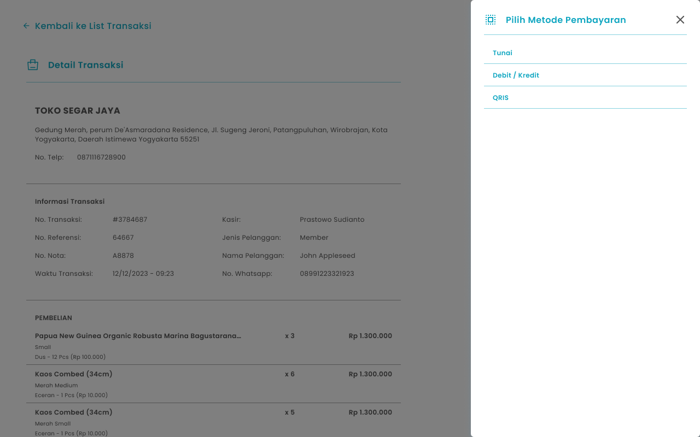
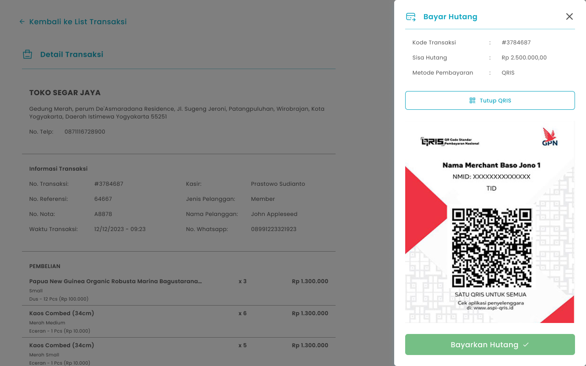
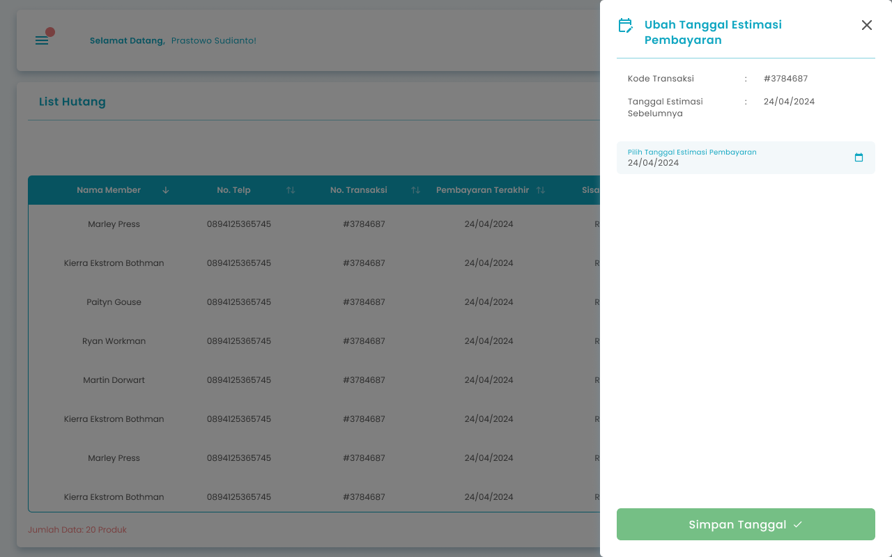

Fitur List Hutang digunakan untuk melihat, mencari, dan mengelola data hutang pada sistem. Melalui halaman ini, Anda dapat mencari transaksi hutang, melihat detail transaksi, melakukan pembayaran hutang, serta mengubah estimasi tanggal pembayaran.

<Frame>
  
</Frame>

<table>
  <colgroup>
    <col width="51" />
    <col width="237" />
    <col width="421" />
  </colgroup>
  <thead>
    <tr>
      <th>No</th>
      <th>Simbol</th>
      <th>Keterangan</th>
    </tr>
  </thead>
  <tbody>
    <tr>
      <td>1</td>
      <td>Cari</td>
      <td>Tombol untuk melakukan pencarian data transaksi hutang</td>
    </tr>
    <tr>
      <td>2</td>
      <td>Detail Transaksi</td>
      <td>Tombol untuk melihat informasi detail transaksi hutang</td>
    </tr>
    <tr>
      <td>3</td>
      <td>Bayar Hutang</td>
      <td>Tombol untuk melakukan pembayaran transaksi hutang</td>
    </tr>
    <tr>
      <td>4</td>
      <td>Ubah Tanggal Estimasi Bayar</td>
      <td>Tombol untuk  memperbarui estimasi tanggal pembayaran transaksi hutang</td>
    </tr>
  </tbody>
</table>

## **1.1. Cara Mengakses List Hutang**

**Berikut cara mengakses halaman list hutang:**

1. Tekan ikon tiga garis di pojok kiri atas

<Frame>
  
</Frame>

2. Setelah menekan ikon hamburger, maka akan menampilkan sidebar list menu

<Frame>
  
</Frame>

3. Tekan menu Laporan Toko pada list menu

<Frame>
  
</Frame>

4. Setelah tekan menu Laporan Toko, maka akan menampilkan list sub menu Laporan Toko

<Frame>
  
</Frame>

5. Lalu tekan menu Laporan Hutang pada list sub menu Laporan Toko

<Frame>
  
</Frame>

6. Setelah menekan menu Laporan Hutang maka akan menampilkan halaman List Hutang

## **1.2. Cara Membayar Hutang**

**Berikut cara mengakses halaman pembayaran hutang: **

1. Tekan tombol “Bayar Hutang” di halaman detail transaksi

<Frame>
  dwsax.png "Frame 1610 (1)dwsax")
</Frame>

<table>
  <colgroup>
    <col width="125" />
    <col width="589" />
  </colgroup>
  <thead>
    <tr>
      <th style={{ textAlign: "center" }}>**🛈** **Information**</th>
      <th>Anda dapat melakukan pembayaran hutang jika masih terdapat sisa hutang yang belum terbayarkan</th>
    </tr>
  </thead>
</table>

2. Sistem akan melakukan pengecekan status shift kasir:

- **_Jika shift sudah ditutup (Closed Shift)_** → sistem akan mengarahkan Anda ke halaman **Open Cashier** untuk membuka shift baru terlebih dahulu.

3. Menampilkan halaman Pilih metode Pembayaran
   <Frame>
     
   </Frame>
4. **Cara Pembayaran Hutang dengan Tunai**
5. Pilih Tunai di halaman halaman Pilih metode Pembayaran
6. Setelah memilih tunai, maka menampilkan halaman input nominal pembayaran
   <Frame>
     .png "Input Right Icon (4swaq)")
   </Frame>
7. Masukkan nominal pembayaran di kolom nominal pembayaran
8. **Cara Pembayaran Hutang dengan Debit/Kredit**
9. Pilih **Debit/Kredit** di halaman Pilih metode Pembayaran
10. Setelah memilih debit/kredit, maka menampilkan halaman input nominal pembayaran
    <Frame>
      .png "Input Right Icon (4swaq)")
    </Frame>
11. Masukkan nominal pembayaran di kolom nominal pembayaran
12. Masukkan no kartu di kolom no kartu
    <Frame>
      .png "Input Right Icon (5123e)")
    </Frame>
13. Masukkan approver number di kolom approver number
    <Frame>
      .png "Input Right Icon (6sqwed)")
    </Frame>
14. **Cara Pembayaran Hutang dengan QRIS**
15. Pilih QRIS di halaman Pilih metode Pembayaran
16. Setelah memilih qris, maka menampilkan halaman input nominal pembayaran
    <Frame>
      .png "Input Right Icon (4swaq)")
    </Frame>
17. Masukkan nominal pembayaran di kolom nominal pembayaran
18. Tekan tombol “Lihat QRIS” untuk menampilkan kode QRIS
    <Frame>
      .png "Frame 1609 (1qftyg)")
    </Frame>
19. Setelah menekan tombol, maka akan menampilkan halaman kode QRIS
    <Frame>
      
    </Frame>
20. Tekan tombol “Tutup QRIS” untuk menutup halaman kode QRIS
    <Frame>
      .png "Frame 1609 (2wdedv)")
    </Frame>
21. Setelah selesai mengisi data, kemudian tekan tombol “Bayarkan Hutang”
    <Frame>
      .png "Frame 1411 (2sdxgb)")
    </Frame>
22. **Jika lunas maka akan menampilkan halaman konfirmasi bayar hutang**
    <Frame>
      .png "Frame 1336 (2qrtg)")
    </Frame>
23. Tekan tombol “Ya, Saya Yakin” di halaman konfirmasi untuk melanjutkan pembayaran hutang
    <Frame>
      
    </Frame>
24. Tekan tombol “Tidak” di halaman konfirmasi untuk membatalkan pembayaran hutang
    <Frame>
      
    </Frame>
25. Setelah menekan tombol “Ya, Saya Yakin”,  maka akan menampilkan halaman list hutang serta notifikasi “Hutang berhasil dibayar”
26. **Jika belum lunas maka akan menampilkan halaman konfirmasi bayar hutang belum lunas**
27. Masukkan tanggal estimasi pembayaran hutang
    <Frame>
      srtyg.png "Frame 1205 (1)srtyg")
    </Frame>
28. Tekan tombol “Ya, Saya Yakin” di halaman konfirmasi untuk melanjutkan proses transaksi
    <Frame>
      .png "Button 45e(11)")
    </Frame>
29. Tekan tombol “Tidak” di halaman konfirmasi untuk membatalkan transaksi
    <Frame>
      
    </Frame>
30. Setelah menekan tombol “Ya, Saya Yakin”,  maka akan menampilkan halaman pembayaran sukses

## **1.3. Cara Mengubah Tanggal Pembayaran Hutang**

**Berikut cara mengakses halaman perubahan tanggal hutang: **

1. Tekan tombol “Ubah Tanggal Estimasi Bayar” di halaman list hutang

<Frame>
  
</Frame>

2. Setelah menekan tombol, maka akan menampilkan halaman perubahan tanggal pembayaran hutang

<Frame>
  
</Frame>

3. Ubah tanggal estimasi pembayaran hutang di kolom pilih tanggal estimasi pembayaran

<Frame>
  .png "Input Right Icon (7sgjk)")
</Frame>

4. Setelah mengisi tanggal, kemudian tekan tombol “Simpan Tanggal”

<Frame>
  .png "Frame 1411 (3asxgh)")
</Frame>

5. Setelah menekan tombol, maka akan menampilkan halaman konfirmasi perubahan tanggal

<Frame>
  .png "Frame 1336 (3awdc)")
</Frame>

6. Tekan tombol “Ya, Saya Yakin” di halaman konfirmasi untuk melanjutkan perubahan tanggal pembayaran hutang 

<Frame>
  
</Frame>

7. Tekan tombol “Tidak” di halaman konfirmasi untuk membatalkan perubahan tanggal pembayaran hutang

<Frame>
  
</Frame>

8. Setelah menekan tombol “Ya, Saya Yakin”,  maka akan menampilkan halaman list hutang serta notifikasi “Perubahan Tanggal Berhasil Disimpan”

<table>
  <colgroup>
    <col width="124" />
    <col width="591" />
  </colgroup>
  <thead>
    <tr>
      <th style={{ textAlign: "center" }}>**🛈** **Information**</th>
      <th>Anda dapat mengubah tanggal estimasi pembayaran hutang jika masih terdapat sisa hutang yang belum terbayarkan</th>
    </tr>
  </thead>
</table>

## **Glosarium**

<table>
  <colgroup>
    <col width="260" />
    <col width="432" />
  </colgroup>
  <thead>
    <tr>
      <th>**Istilah**</th>
      <th>**Deskripsi (Penjelasan dalam Bahasa Indonesia)**</th>
    </tr>
  </thead>
  <tbody>
    <tr>
      <td>Zycas Mobile</td>
      <td>Aplikasi mobile untuk pengelolaan operasional bisnis ritel, termasuk transaksi penjualan, kasir, laporan, dan hutang pelanggan.</td>
    </tr>
    <tr>
      <td>Pengguna (User)</td>
      <td>Individu yang menggunakan aplikasi Zycas sesuai dengan hak akses yang diberikan.</td>
    </tr>
    <tr>
      <td>Owner</td>
      <td>Pengguna dengan hak akses penuh untuk mengelola seluruh menu dan fitur dalam aplikasi Zycas.</td>
    </tr>
    <tr>
      <td>Karyawan</td>
      <td>Pengguna dengan hak akses terbatas sesuai izin yang diberikan oleh owner.</td>
    </tr>
    <tr>
      <td>Hak Akses</td>
      <td>Izin yang menentukan menu dan fitur yang dapat diakses oleh pengguna dalam aplikasi.</td>
    </tr>
    <tr>
      <td>Modul Hutang</td>
      <td>Fitur pada aplikasi Zycas yang digunakan untuk mengelola dan memantau transaksi hutang pelanggan.</td>
    </tr>
    <tr>
      <td>Hutang</td>
      <td>Kewajiban pembayaran pelanggan kepada bisnis yang belum dilunasi sepenuhnya.</td>
    </tr>
    <tr>
      <td>List Hutang</td>
      <td>Halaman yang menampilkan daftar seluruh transaksi hutang pelanggan.</td>
    </tr>
    <tr>
      <td>Transaksi Hutang</td>
      <td>Catatan transaksi yang mencerminkan jumlah hutang pelanggan beserta status pembayarannya.</td>
    </tr>
    <tr>
      <td>Cari</td>
      <td>Fitur pencarian untuk menemukan data transaksi hutang tertentu.</td>
    </tr>
    <tr>
      <td>Detail Transaksi</td>
      <td>Halaman yang menampilkan informasi lengkap mengenai transaksi hutang pelanggan.</td>
    </tr>
    <tr>
      <td>Bayar Hutang</td>
      <td>Aksi untuk melakukan pembayaran sebagian atau seluruh hutang pelanggan.</td>
    </tr>
    <tr>
      <td>Ubah Tanggal Estimasi Bayar</td>
      <td>Fitur untuk memperbarui perkiraan tanggal pelunasan hutang pelanggan.</td>
    </tr>
    <tr>
      <td>Estimasi Tanggal Pembayaran</td>
      <td>Perkiraan tanggal pelunasan hutang yang ditentukan oleh pengguna.</td>
    </tr>
    <tr>
      <td>Shift Kasir</td>
      <td>Periode kerja kasir yang aktif dalam sistem Zycas.</td>
    </tr>
    <tr>
      <td>Closed Shift</td>
      <td>Kondisi ketika shift kasir telah ditutup dan tidak dapat melakukan transaksi.</td>
    </tr>
    <tr>
      <td>Open Cashier</td>
      <td>Halaman untuk membuka shift kasir baru sebelum melakukan transaksi.</td>
    </tr>
    <tr>
      <td>Metode Pembayaran</td>
      <td>Cara yang digunakan untuk membayar hutang, seperti tunai, debit/kredit, atau QRIS.</td>
    </tr>
    <tr>
      <td>Tunai</td>
      <td>Metode pembayaran hutang menggunakan uang fisik.</td>
    </tr>
    <tr>
      <td>Debit/Kredit</td>
      <td>Metode pembayaran hutang menggunakan kartu debit atau kartu kredit.</td>
    </tr>
    <tr>
      <td>Nomor Kartu</td>
      <td>Nomor kartu debit atau kredit yang digunakan dalam transaksi pembayaran hutang.</td>
    </tr>
    <tr>
      <td>Approver Number</td>
      <td>Nomor persetujuan transaksi dari mesin EDC pada pembayaran kartu debit/kredit.</td>
    </tr>
    <tr>
      <td>QRIS</td>
      <td>Metode pembayaran digital menggunakan kode QR sesuai standar QRIS Indonesia.</td>
    </tr>
    <tr>
      <td>Kode QRIS</td>
      <td>Kode QR yang digunakan pelanggan untuk melakukan pembayaran hutang secara digital.</td>
    </tr>
    <tr>
      <td>Nominal Pembayaran</td>
      <td>Jumlah uang yang dibayarkan untuk melunasi atau mengurangi hutang.</td>
    </tr>
    <tr>
      <td>Lunas</td>
      <td>Status hutang yang telah dibayarkan sepenuhnya.</td>
    </tr>
    <tr>
      <td>Belum Lunas</td>
      <td>Status hutang yang masih memiliki sisa pembayaran.</td>
    </tr>
    <tr>
      <td>Konfirmasi Pembayaran</td>
      <td>Halaman untuk memastikan pengguna melanjutkan atau membatalkan proses pembayaran hutang.</td>
    </tr>
    <tr>
      <td>Notifikasi</td>
      <td>Pesan sistem yang memberikan informasi hasil dari suatu tindakan, seperti pembayaran atau perubahan data.</td>
    </tr>
    <tr>
      <td>Pembayaran Sukses</td>
      <td>Status yang menandakan proses pembayaran hutang berhasil dilakukan.</td>
    </tr>
    <tr>
      <td>Simpan Tanggal</td>
      <td>Tombol untuk menyimpan perubahan estimasi tanggal pembayaran hutang.</td>
    </tr>
    <tr>
      <td>Perubahan Tanggal Berhasil Disimpan</td>
      <td>Notifikasi yang menandakan perubahan estimasi tanggal pembayaran hutang telah berhasil.</td>
    </tr>
  </tbody>
</table>
