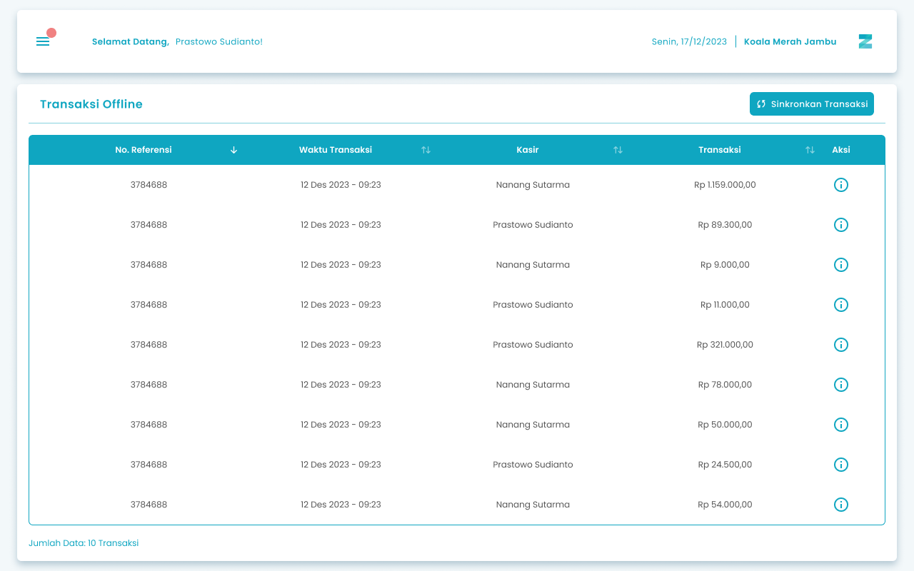
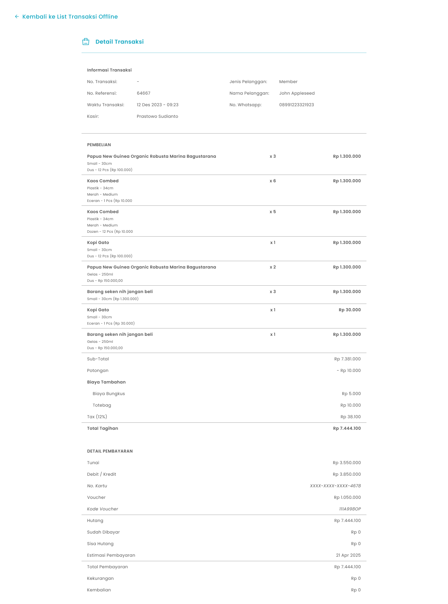

 Fitur **Transaksi Offline** adalah solusi andal untuk memastikan bisnis Anda tetap berjalan meskipun tanpa koneksi internet. Semua transaksi yang terjadi saat _offline_ akan tersimpan sementara di perangkat Anda dan bisa disinkronkan saat koneksi internet kembali stabil.

<Frame>
  
</Frame>

<table>
  <colgroup>
    <col width="53" />
    <col width="216" />
    <col width="442" />
  </colgroup>
  <thead>
    <tr>
      <th>No.</th>
      <th>Simbol</th>
      <th>Keterangan</th>
    </tr>
  </thead>
  <tbody>
    <tr>
      <td>1</td>
      <td>Sinkronkan Transaksi</td>
      <td>Kolom untuk menyinkronkan transaksi yang sudah tersimpan saat transaksi offline</td>
    </tr>
    <tr>
      <td>2</td>
      <td>Aksi Detail</td>
      <td>Icon untuk informasi detail pada setiap transaksi</td>
    </tr>
  </tbody>
</table>

## **1.1. Cara Akses Menu Transaksi Offline**

**Berikut cara mengakses menu transaksi offline :**

1. Tekan ikon tiga garis di pojok kiri atas

<Frame>
  
</Frame>

2. Setelah menekan ikon hamburger, maka akan menampilkan sidebar list menu

<Frame>
  
</Frame>

3. Tekan menu Transaksi Offline

<Frame>
  
</Frame>

4. Setelah menekan menu Transaksi Offline  maka akan menampilkan halaman Transaksi Offline

## **1.2. Cara Melihat Detail Transaksi Offline**

**Berikut cara melihat detail setiap transaksi yang ada :**

1. Tekan icon detail pada kolom aksi di salah satu list transaksi offline
   <Frame>
     
   </Frame>
2. Setelah icon detail di tekan maka akan muncul halaman detail dari setiap transaksi

<Frame>
  
</Frame>

<table>
  <colgroup>
    <col width="55" />
    <col width="261" />
    <col width="398" />
  </colgroup>
  <thead>
    <tr>
      <th>No.</th>
      <th>Simbol</th>
      <th>Keterangan</th>
    </tr>
  </thead>
  <tbody>
    <tr>
      <td>1</td>
      <td>Kembali ke List Transaksi Offline</td>
      <td>Tombol untuk kembali ke halaman Transaksi Offline dan keluar dari detail transaksi</td>
    </tr>
  </tbody>
</table>

<table>
  <colgroup>
    <col width="119" />
    <col width="604" />
  </colgroup>
  <thead>
    <tr>
      <th style={{ textAlign: "center" }}>**🛈** **Information**</th>
      <th>Dalam kondisi offline anda hanya dapat melihat detail transaksi saja tanpa bisa melakukan cetak nota, retur barang, pembayaran hutang, atau batalkan transaksi</th>
    </tr>
  </thead>
</table>

## **1.3. Cara Sinkronisasi Transaksi Offline**

Fitur ini memungkinkan Anda mengirim data transaksi yang dilakukan saat offline ke sistem 

pusat secara online terhubung ke internet.

**Berikut cara sinkronisasi transaksi offline:**

1. Tekan Sinkronkan Transaksi

<Frame>
  
</Frame>

2. Setelah tekan tombol maka akan muncul pop-up saat proses sinkronisasi transaksi 

<Frame>
  
</Frame>

3. Setelah proses sinkronisasi selesai, maka akan menampilkan pesan sukses sinkronisasi data dan transaksi  offline tersebut tercatat di sistem secara online

## **Glosarium**

<table>
  <colgroup>
    <col width="219" />
    <col width="496" />
  </colgroup>
  <thead>
    <tr>
      <th>**Istilah**</th>
      <th>**Deskripsi (Penjelasan dalam Bahasa Indonesia)**</th>
    </tr>
  </thead>
  <tbody>
    <tr>
      <td>Zycas Mobile</td>
      <td>Aplikasi mobile yang digunakan untuk mengelola operasional bisnis seperti transaksi penjualan, pengelolaan data, dan fitur pendukung lainnya.</td>
    </tr>
    <tr>
      <td>Pengguna (User)</td>
      <td>Orang yang menggunakan aplikasi Zycas Mobile sesuai dengan hak akses yang diberikan.</td>
    </tr>
    <tr>
      <td>Owner</td>
      <td>Pengguna dengan hak akses penuh yang dapat mengakses dan mengelola seluruh menu dan fitur aplikasi Zycas.</td>
    </tr>
    <tr>
      <td>Karyawan</td>
      <td>Pengguna dengan hak akses terbatas sesuai izin yang diberikan oleh owner.</td>
    </tr>
    <tr>
      <td>Hak Akses</td>
      <td>Izin yang menentukan menu dan fitur apa saja yang dapat diakses oleh pengguna dalam aplikasi.</td>
    </tr>
    <tr>
      <td>Transaksi Offline</td>
      <td>Fitur yang memungkinkan proses transaksi tetap berjalan meskipun perangkat tidak terhubung ke internet.</td>
    </tr>
    <tr>
      <td>Modul Transaksi Offline</td>
      <td>Modul business continuity yang menyimpan transaksi secara lokal saat offline dan menyinkronkannya ke server saat koneksi internet kembali tersedia.</td>
    </tr>
    <tr>
      <td>Mode Offline</td>
      <td>Kondisi aplikasi saat tidak terhubung ke jaringan internet namun tetap dapat melakukan pencatatan transaksi.</td>
    </tr>
    <tr>
      <td>Penyimpanan Lokal</td>
      <td>Mekanisme penyimpanan data transaksi sementara di perangkat pengguna saat offline.</td>
    </tr>
    <tr>
      <td>Sinkronisasi Transaksi</td>
      <td>Proses pengiriman data transaksi yang tersimpan secara lokal ke server pusat ketika koneksi internet tersedia.</td>
    </tr>
    <tr>
      <td>Cloud Server</td>
      <td>Server pusat berbasis cloud tempat data transaksi disimpan dan dikelola secara terpusat.</td>
    </tr>
    <tr>
      <td>Menu Transaksi Offline</td>
      <td>Menu pada aplikasi Zycas Mobile yang menampilkan daftar transaksi yang dilakukan saat offline.</td>
    </tr>
    <tr>
      <td>List Transaksi Offline</td>
      <td>Daftar transaksi yang tersimpan di perangkat selama kondisi offline.</td>
    </tr>
    <tr>
      <td>Detail Transaksi Offline</td>
      <td>Informasi rinci dari setiap transaksi offline yang dapat dilihat oleh pengguna.</td>
    </tr>
    <tr>
      <td>Aksi Detail</td>
      <td>Ikon atau tombol untuk membuka halaman detail transaksi offline.</td>
    </tr>
    <tr>
      <td>Sinkronkan Transaksi</td>
      <td>Tombol untuk memulai proses sinkronisasi transaksi offline ke sistem online.</td>
    </tr>
    <tr>
      <td>Sidebar Menu</td>
      <td>Panel navigasi yang muncul setelah menekan ikon hamburger.</td>
    </tr>
    <tr>
      <td>Ikon Hamburger</td>
      <td>Ikon tiga garis yang digunakan untuk membuka sidebar menu aplikasi.</td>
    </tr>
    <tr>
      <td>Pop-up Sinkronisasi</td>
      <td>Tampilan notifikasi yang muncul selama proses sinkronisasi transaksi berlangsung.</td>
    </tr>
    <tr>
      <td>Pesan Sukses Sinkronisasi</td>
      <td>Notifikasi sistem yang menandakan proses sinkronisasi transaksi berhasil dilakukan.</td>
    </tr>
  </tbody>
</table>
