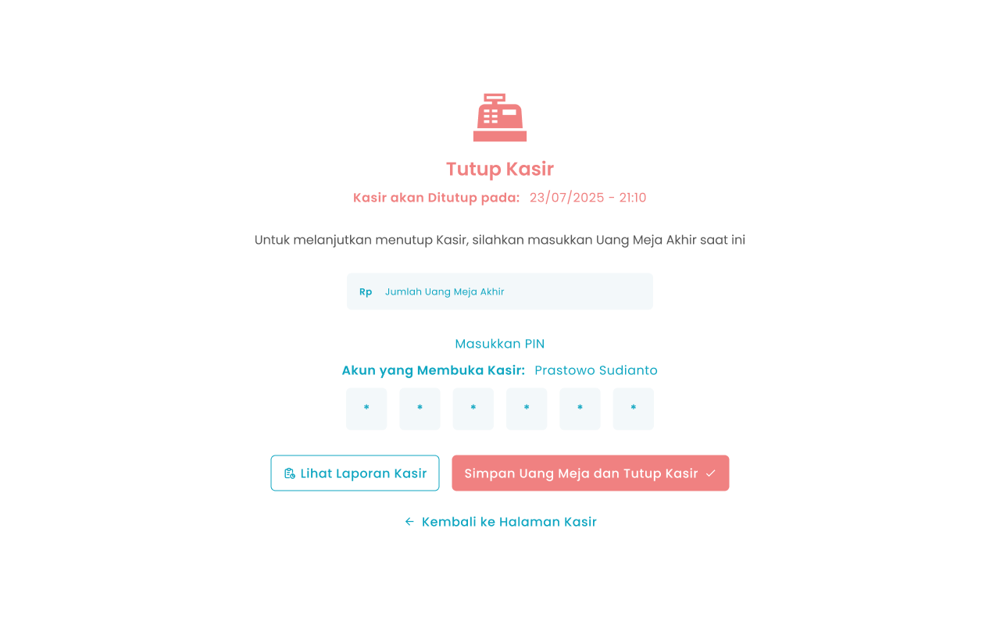
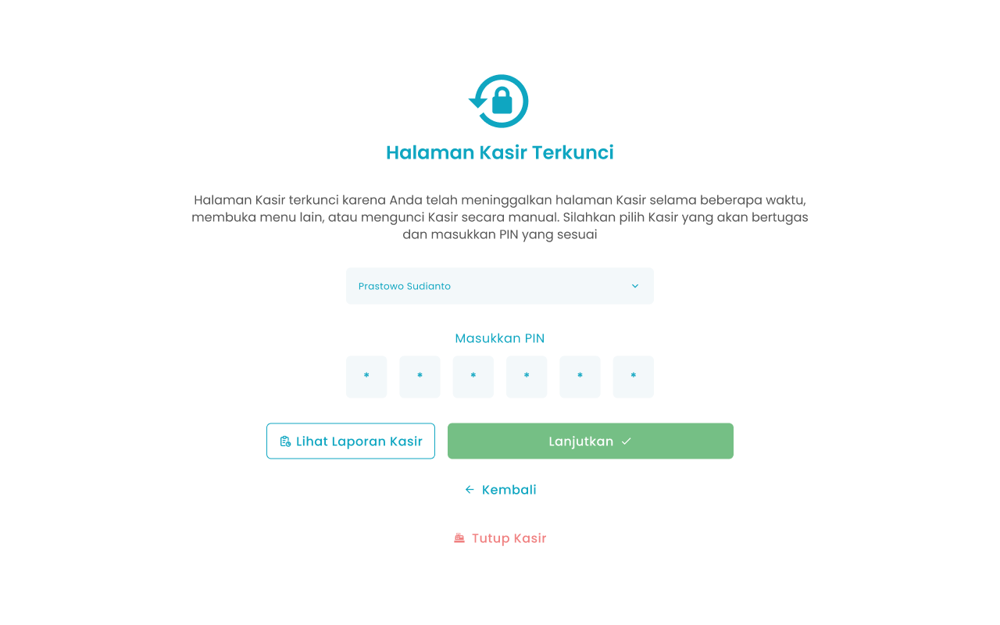

Tutup kasir berfungsi untuk mengakhiri sesi transaksi dan merekap seluruh penjualan selama satu shift, termasuk total pembayaran tunai maupun non-tunai. Proses ini juga digunakan untuk mencocokkan saldo sistem dengan uang fisik guna mengetahui adanya selisih kas (lebih atau kurang).

<Frame>
  
</Frame>

<table>
  <colgroup>
    <col width="54" />
    <col width="245" />
    <col width="371" />
  </colgroup>
  <thead>
    <tr>
      <th>No</th>
      <th>Simbol</th>
      <th>Keterangan</th>
    </tr>
  </thead>
  <tbody>
    <tr>
      <td>1</td>
      <td>Jumlah Uang Meja Akhir</td>
      <td>Kolom untuk mengisi nominal uang meja akhir</td>
    </tr>
    <tr>
      <td>2</td>
      <td>PIN</td>
      <td>Kolom untuk input PIN Kasir</td>
    </tr>
    <tr>
      <td>3</td>
      <td>Simpan Uang Meja dan Tutup Kasir</td>
      <td>Tombol untuk konfirmasi tutup kasir</td>
    </tr>
    <tr>
      <td>4</td>
      <td>Lihat Laporan Kasir</td>
      <td>Tombol untuk mengakses laporan kasir aktif</td>
    </tr>
    <tr>
      <td>5</td>
      <td>Kembali ke Halaman Kasir</td>
      <td>Tombol untuk kembali ke halaman kasir</td>
    </tr>
  </tbody>
</table>

## **1.1. Cara Tutup Kasir ketika Halaman Kasir Terkunci**

Pada halaman awal setelah login dan mengakses menu Halaman Kasir, jika sudah membuka kasir atau kondisi kasir meninggalkan halaman selama beberapa menit maka akan menampilkan halaman kasir terkunci untuk melakukan tutup kasir.

**Berikut cara mengakses menu tutup kasir:**

1. Tekan ikon tiga garis di pojok kiri atas
   <Frame>
     
   </Frame>
2. Setelah menekan ikon, maka akan menampilkan sidebar list menu
   <Frame>
     
   </Frame>
3. Tekan menu Halaman Kasir pada list menu
4. Setelah menekan menu Halaman Kasir maka akan menampilkan halaman kasir terkunci
   <Frame>
     
   </Frame>
5. Tekan tombol “Tutup Kasir”
   <Frame>
     
   </Frame>
6. Setelah menekan tombol, maka akan menampilkan halaman tutup kasir
7. Ketuk kolom jumlah uang meja akhir
   <Frame>
     
   </Frame>
8. Masukkan nominal uang meja akhir di kolom numpad
9. Setelah selesai mengisi uang meja akhir, kemudian tekan tombol “Submit”
10. Ketuk kolom PIN
    <Frame>
      
    </Frame>
11. Masukkan PIN menggunakan keyboard default.
12. Setelah mengisi uang meja akhir dan PIN, kemudian tekan tombol “Simpan Uang Meja dan Tutup Kasir”
    <Frame>
      
    </Frame>
13. Setelah selesai menekan tombol, maka akan menampilkan pesan sukses tutup kasir dan diarahkan ke halaman dashboard

## **1.2. Cara Tutup Kasir di Halaman Kasir**

Pada halaman awal setelah login jika kondisi kasir berada di halaman kasir untuk melakukan tutup kasir.

**Berikut cara mengakses menu tutup kasir:**

1. Tekan ikon gembok di pojok kanan atas halaman kasir
   <Frame>
     .png "Frame 1367 (3dseer)")
   </Frame>
2. Setelah menekan menu Halaman Kasir maka akan menampilkan halaman kasir terkunci
   <Frame>
     
   </Frame>
3. Tekan tombol “Tutup Kasir”
   <Frame>
     
   </Frame>
4. Setelah menekan tombol, maka akan menampilkan halaman tutup kasir
5. Ketuk kolom jumlah uang meja akhir
   <Frame>
     
   </Frame>
6. Masukkan nominal uang meja akhir di kolom numpad
7. Setelah selesai mengisi uang meja akhir, kemudian tekan tombol “Submit”
8. Ketuk kolom PIN
   <Frame>
     
   </Frame>
9. Masukkan PIN menggunakan keyboard default.
10. Setelah mengisi uang meja akhir dan PIN, kemudian tekan tombol “Simpan Uang Meja dan Tutup Kasir”
    <Frame>
      
    </Frame>
11. Setelah selesai menekan tombol, maka akan menampilkan pesan sukses tutup kasir dan diarahkan ke halaman dashboard
