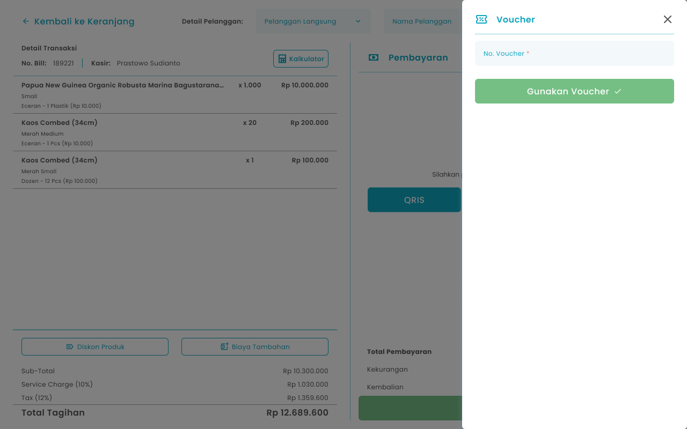

## **1.1. Cara Menambahkan Voucher di Transaksi Pemesanan**

Kasir dapat memproses pesanan pelanggan yang memiliki voucher sebagai potongan harga total pesanan

<Frame>
  
</Frame>

<table>
  <colgroup>
    <col width="50" />
    <col width="176" />
    <col width="453" />
  </colgroup>
  <thead>
    <tr>
      <th>No</th>
      <th>Simbol</th>
      <th>Keterangan</th>
    </tr>
  </thead>
  <tbody>
    <tr>
      <td>1</td>
      <td>No Voucher</td>
      <td>Kolom input kode voucher pelanggan</td>
    </tr>
    <tr>
      <td>2</td>
      <td>Gunakan Voucher</td>
      <td>Tombol untuk memproses kode voucher</td>
    </tr>
  </tbody>
</table>

**Berikut cara mengakses menu Voucher:**

1. Input item pesanan ke keranjang
   <Frame>
     .png "Android Expanded 171 (1fgyt)")
   </Frame>
2. Setelah input pesanan, kemudian tekan tombol “Checkout”
   <Frame>
     .png "Frame 1366 (2frgh)")
   </Frame>
3. Setelah menekan tombol, maka akan menampilkan halaman checkout
4. Tekan tombol “Voucher”
   <Frame>
     
   </Frame>
5. Setelah menekan tombol, maka akan menampilkan halaman input voucher
6. Masukkan kode voucher di kolom no. voucher
   <Frame>
     .png "Input Right Icon (39ert4tgg)")
   </Frame>
7. Setelah selesai mengisi kode voucher, kemudian tekan tombol “Gunakan Voucher”
   <Frame>
     .png "Frame 1369 (ttret2)")
   </Frame>
8. Setelah menekan tombol jika voucher valid, maka akan menampilkan pesan sukses menambahkan voucher dan diarahkan ke halaman checkout dengan menampilkan detail potongan voucher

<table>
  <colgroup>
    <col width="119" />
    <col width="557" />
  </colgroup>
  <thead>
    <tr>
      <th style={{ textAlign: "center" }}>**🛈** **Information**</th>
      <th>Nominal voucher yang melebihi total pembayaran maka total nominal kembalian bernilai nol</th>
    </tr>
  </thead>
</table>
